# 交互处理

<cite>
**本文引用的文件**   
- [PianoRollControl.cs](file://src/Weftone.App/Controls/PianoRollControl.cs)
- [MainWindowViewModel.cs](file://src/Weftone.App/ViewModels/MainWindowViewModel.cs)
- [PianoRollGeometry.cs](file://src/Weftone.App/Controls/PianoRollGeometry.cs)
- [PianoRollGeometryTests.cs](file://tests/Weftone.App.Tests/PianoRollGeometryTests.cs)
</cite>

## 目录
1. [简介](#简介)
2. [项目结构定位](#项目结构定位)
3. [核心组件](#核心组件)
4. [架构总览](#架构总览)
5. [详细组件分析](#详细组件分析)
6. [依赖关系分析](#依赖关系分析)
7. [性能与交互特性](#性能与交互特性)
8. [故障排查指南](#故障排查指南)
9. [结论](#结论)

## 简介
本文聚焦钢琴卷帘的用户交互处理，系统说明鼠标事件在控件层与视图模型层的协作方式，包括：
- 鼠标按下、移动、释放的完整流程。
- 手势状态机（Gesture）的工作机制与三种操作模式：添加并调整长度、移动音符、调整已有音符长度。
- 右键删除、左键拖拽画音符、拖拽移动、拖拽调整长度的具体行为。
- 与 MainWindowViewModel 的命令调用机制，以及 BeginAddNote、BeginMoveNote、BeginResizeNote 等方法的触发时机。
- 通过流程图和代码路径帮助读者快速理解实现细节。

## 项目结构定位
钢琴卷帘交互相关代码主要分布在以下位置：
- 控件层：PianoRollControl.cs，负责 Avalonia 指针事件、命中测试、绘制与手势状态。
- 几何工具：PianoRollGeometry.cs，提供 tick/pixel/key 映射、吸附步长、命中区域判断。
- 视图模型层：MainWindowViewModel.cs，封装编辑事务、命令执行、撤销重做与播放联动。
- 单元测试：PianoRollGeometryTests.cs，覆盖几何映射、吸附与命中逻辑。

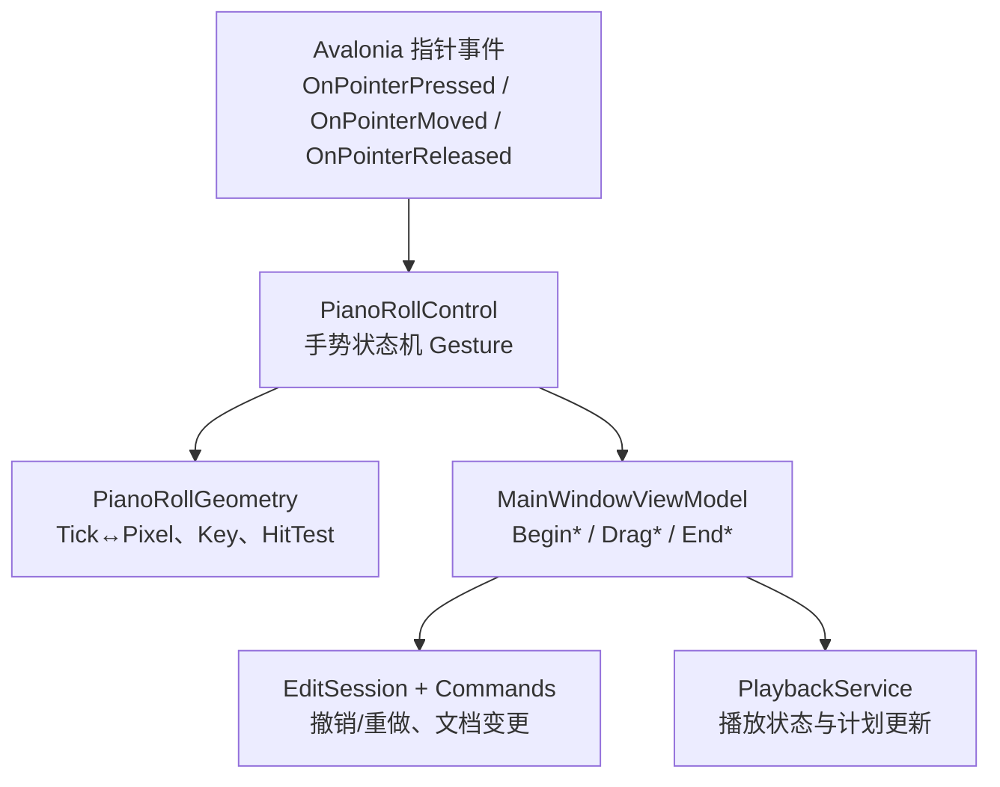

**图表来源**
- [PianoRollControl.cs:185-293](file://src/Weftone.App/Controls/PianoRollControl.cs#L185-L293)
- [PianoRollGeometry.cs:18-64](file://src/Weftone.App/Controls/PianoRollGeometry.cs#L18-L64)
- [MainWindowViewModel.cs:229-323](file://src/Weftone.App/ViewModels/MainWindowViewModel.cs#L229-L323)

**章节来源**
- [PianoRollControl.cs:10-15](file://src/Weftone.App/Controls/PianoRollControl.cs#L10-L15)
- [PianoRollGeometry.cs:14-25](file://src/Weftone.App/Controls/PianoRollGeometry.cs#L14-L25)
- [MainWindowViewModel.cs:229-230](file://src/Weftone.App/ViewModels/MainWindowViewModel.cs#L229-L230)

## 核心组件
- PianoRollControl：自绘控件，处理指针事件、渲染网格与音符矩形、维护本地手势状态。
- PianoRollGeometry：纯函数几何库，定义 NoteZone、HitTest、Tick/Key 映射与可见范围计算。
- MainWindowViewModel：视图模型，维护编辑事务、命令执行、播放状态同步与文档变更通知。

关键职责划分：
- 控件只负责“意图表达”：将鼠标坐标转换为 tick/key，识别命中区域，切换手势，调用 ViewModel 方法。
- 视图模型负责“业务执行”：开启事务、创建或修改 Note、执行命令、结束事务并刷新 UI。

**章节来源**
- [PianoRollControl.cs:15-58](file://src/Weftone.App/Controls/PianoRollControl.cs#L15-L58)
- [PianoRollGeometry.cs:5-12](file://src/Weftone.App/Controls/PianoRollGeometry.cs#L5-L12)
- [MainWindowViewModel.cs:12-35](file://src/Weftone.App/ViewModels/MainWindowViewModel.cs#L12-L35)

## 架构总览
钢琴卷帘交互采用“控件意图 + 视图模型执行”的分层设计：
- 控件层不直接修改文档，而是通过 ViewModel 暴露的方法发起编辑意图。
- 视图模型使用 EditSession 与命令模式，保证所有编辑可撤销、可重做。
- 几何工具独立于 UI 框架，便于 headless 测试与复用。

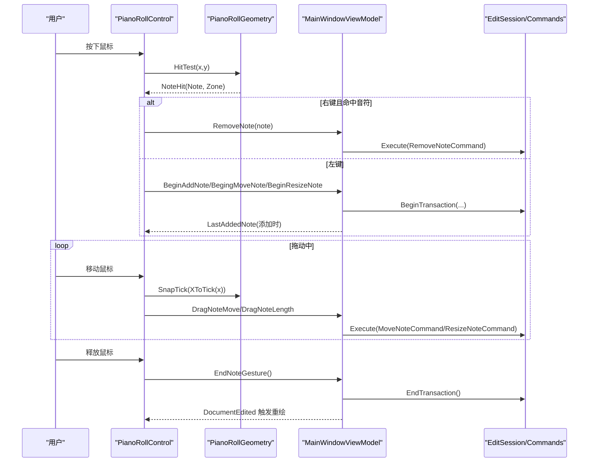

**图表来源**
- [PianoRollControl.cs:185-293](file://src/Weftone.App/Controls/PianoRollControl.cs#L185-L293)
- [MainWindowViewModel.cs:229-323](file://src/Weftone.App/ViewModels/MainWindowViewModel.cs#L229-L323)
- [PianoRollGeometry.cs:45-64](file://src/Weftone.App/Controls/PianoRollGeometry.cs#L45-L64)

## 详细组件分析

### 手势状态机（Gesture 枚举）工作机制
PianoRollControl 内部使用私有枚举 Gesture 表示当前手势：
- None：无活动手势。
- AddResize：在空白处按下后开始画音符，并在拖动中同时调整其长度。
- Move：在音符主体上按下，拖动时移动音符。
- Resize：在音符右边缘按下，拖动时调整已有音符长度。

状态转换要点：
- OnPointerPressed 根据命中区域设置 _gesture 与 _gestureNote，并记录按下时的 tick 与 originTick。
- OnPointerMoved 根据 _gesture 调用不同的拖动逻辑。
- OnPointerReleased 统一结束手势，清理状态并通知 ViewModel 结束事务。

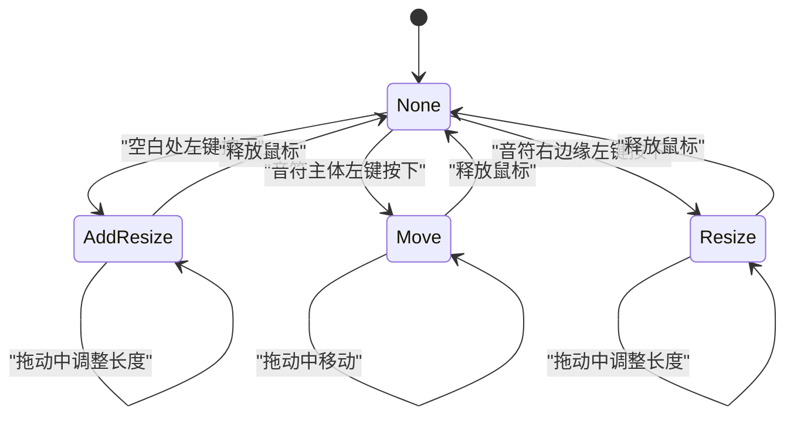

**图表来源**
- [PianoRollControl.cs:31-44](file://src/Weftone.App/Controls/PianoRollControl.cs#L31-L44)
- [PianoRollControl.cs:185-293](file://src/Weftone.App/Controls/PianoRollControl.cs#L185-L293)

**章节来源**
- [PianoRollControl.cs:31-44](file://src/Weftone.App/Controls/PianoRollControl.cs#L31-L44)
- [PianoRollControl.cs:185-293](file://src/Weftone.App/Controls/PianoRollControl.cs#L185-L293)

### 鼠标事件处理流程

#### OnPointerPressed：按下判定与手势启动
- 若为右键且命中音符：立即调用 ViewModel.RemoveNote 删除音符，并标记事件已处理。
- 若非左键：忽略。
- 若是左键：
  - 计算吸附后的 tick 与 key。
  - 根据命中区域选择操作：
    - 右边缘：BeginResizeNote，进入 Resize 手势。
    - 主体：BeginMoveNote，进入 Move 手势。
    - 空白：BeginAddNote，进入 AddResize 手势，并使用 LastAddedNote 引用新音符。
  - 捕获指针、标记事件已处理、触发重绘。

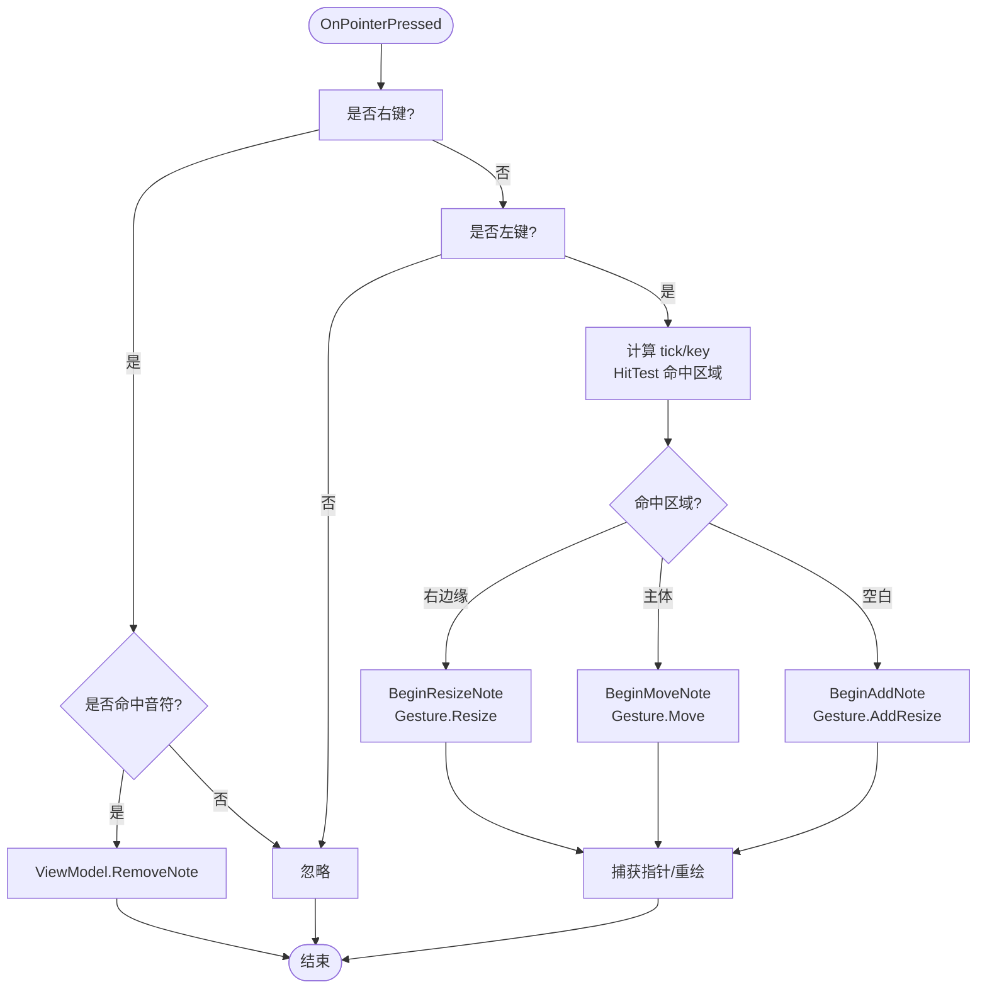

**图表来源**
- [PianoRollControl.cs:185-242](file://src/Weftone.App/Controls/PianoRollControl.cs#L185-L242)
- [PianoRollGeometry.cs:45-64](file://src/Weftone.App/Controls/PianoRollGeometry.cs#L45-L64)

**章节来源**
- [PianoRollControl.cs:185-242](file://src/Weftone.App/Controls/PianoRollControl.cs#L185-L242)

#### OnPointerMoved：拖动中的实时编辑
- 若无活动手势或无手势音符：直接返回。
- 获取当前鼠标位置，计算吸附后的 tick。
- 根据手势类型：
  - Move：计算 delta 与目标 tick，调用 DragNoteMove。
  - Resize/AddResize：计算 endTick（至少比起点多一个 1/4 拍），调用 DragNoteLength。
- 每次移动后触发重绘以反映预览效果。

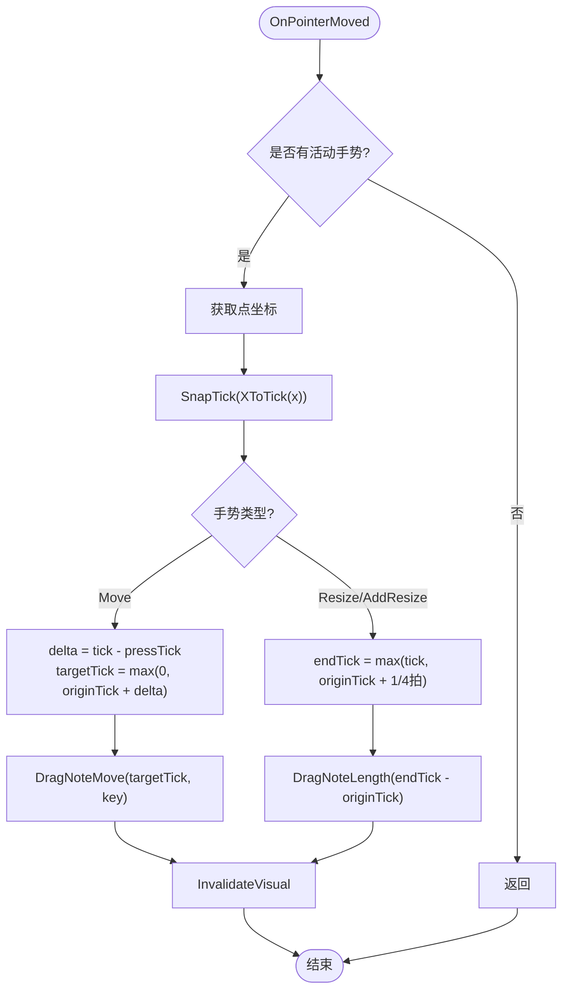

**图表来源**
- [PianoRollControl.cs:244-272](file://src/Weftone.App/Controls/PianoRollControl.cs#L244-L272)
- [PianoRollGeometry.cs:39-40](file://src/Weftone.App/Controls/PianoRollGeometry.cs#L39-L40)

**章节来源**
- [PianoRollControl.cs:244-272](file://src/Weftone.App/Controls/PianoRollControl.cs#L244-L272)

#### OnPointerReleased：释放与事务提交
- 调用 EndGesture 清理本地手势状态。
- 释放指针捕获。
- 标记事件已处理。

EndGesture 内部：
- 若手势为 None：直接返回。
- 否则重置 _gesture 与 _gestureNote。
- 调用 ViewModel.EndNoteGesture 提交事务并触发文档变更。
- 触发重绘。

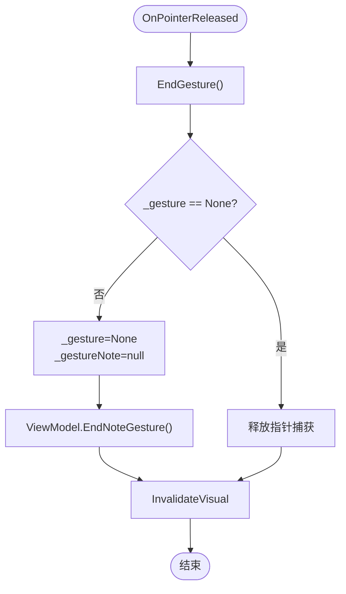

**图表来源**
- [PianoRollControl.cs:274-293](file://src/Weftone.App/Controls/PianoRollControl.cs#L274-L293)

**章节来源**
- [PianoRollControl.cs:274-293](file://src/Weftone.App/Controls/PianoRollControl.cs#L274-L293)

### 与 MainWindowViewModel 的命令调用机制
视图模型负责将控件的意图转化为可撤销的业务操作：
- BeginAddNote：
  - 校验 SelectedPattern 与通道存在。
  - 开启事务“添加音符”。
  - 创建 Note 并执行 AddNoteCommand。
  - 设置手势为 AddResize，记录起始 tick/key/length，并暴露 LastAddedNote。
- BeginMoveNote：
  - 校验 SelectedPattern。
  - 开启事务“移动音符”。
  - 设置手势为 Move，记录起始 tick/key/length。
- BeginResizeNote：
  - 校验 SelectedPattern。
  - 开启事务“调整音符长度”。
  - 设置手势为 Resize，记录起始 tick/key/length。
- DragNoteMove：
  - 仅当手势为 Move 时执行。
  - 执行 MoveNoteCommand，传入起始与目标 tick/key。
- DragNoteLength：
  - 仅当手势为 Resize 或 AddResize 时执行。
  - 执行 ResizeNoteCommand，传入起始长度与目标长度（至少为 1）。
- RemoveNote：
  - 执行 RemoveNoteCommand，随后 AfterEdit 刷新 UI。
- EndNoteGesture：
  - 结束事务，AfterEdit 刷新标题、历史按钮状态、属性变更通知与播放计划。

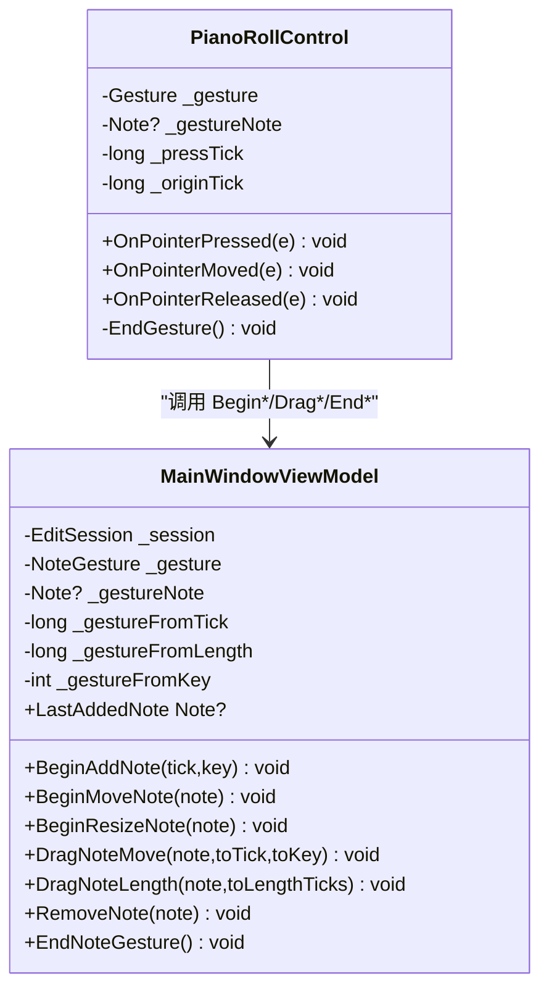

**图表来源**
- [MainWindowViewModel.cs:229-323](file://src/Weftone.App/ViewModels/MainWindowViewModel.cs#L229-L323)
- [PianoRollControl.cs:185-293](file://src/Weftone.App/Controls/PianoRollControl.cs#L185-L293)

**章节来源**
- [MainWindowViewModel.cs:229-323](file://src/Weftone.App/ViewModels/MainWindowViewModel.cs#L229-L323)

### 用户操作完整流程

#### 右键删除音符
- 用户在音符上按下右键。
- PianoRollControl.OnPointerPressed 检测到右键且命中音符。
- 调用 MainWindowViewModel.RemoveNote。
- ViewModel 执行 RemoveNoteCommand，AfterEdit 刷新 UI。

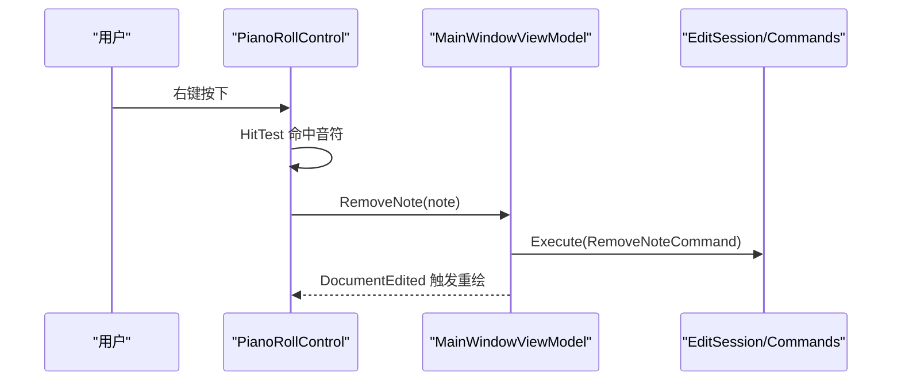

**图表来源**
- [PianoRollControl.cs:198-207](file://src/Weftone.App/Controls/PianoRollControl.cs#L198-L207)
- [MainWindowViewModel.cs:302-310](file://src/Weftone.App/ViewModels/MainWindowViewModel.cs#L302-L310)

**章节来源**
- [PianoRollControl.cs:198-207](file://src/Weftone.App/Controls/PianoRollControl.cs#L198-L207)
- [MainWindowViewModel.cs:302-310](file://src/Weftone.App/ViewModels/MainWindowViewModel.cs#L302-L310)

#### 左键拖拽画音符
- 用户在空白区域按下左键。
- PianoRollControl.OnPointerPressed 计算 tick/key，调用 BeginAddNote。
- ViewModel 开启事务、创建 Note、执行 AddNoteCommand，设置手势为 AddResize。
- 拖动中 OnPointerMoved 调用 DragNoteLength 调整长度。
- 释放鼠标 EndNoteGesture 提交事务。

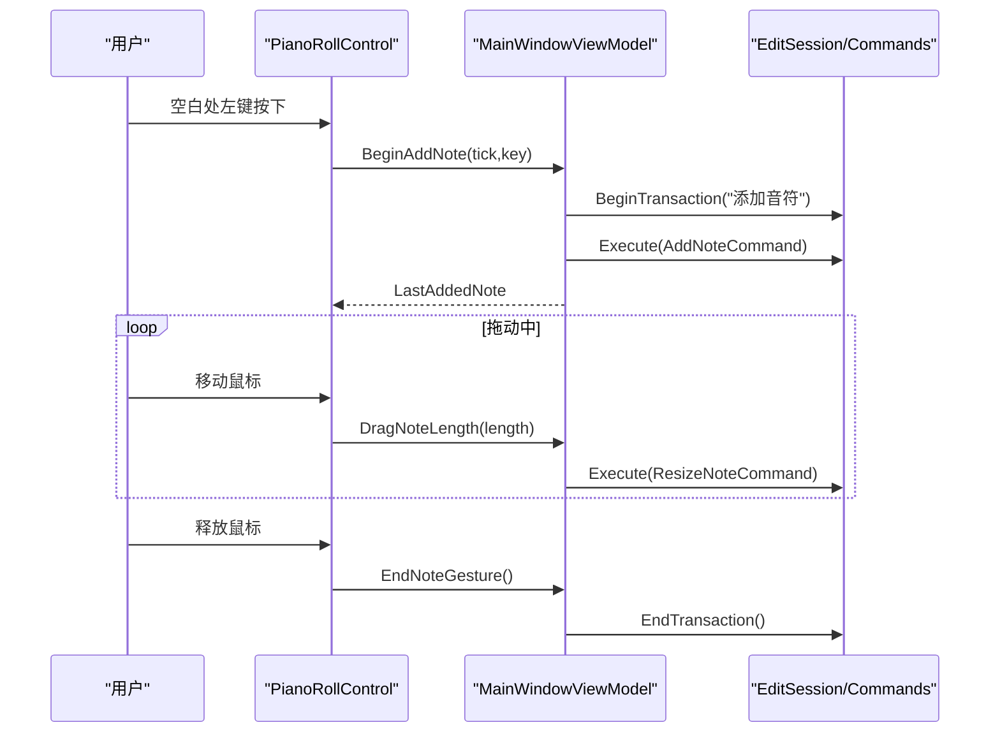

**图表来源**
- [PianoRollControl.cs:231-242](file://src/Weftone.App/Controls/PianoRollControl.cs#L231-L242)
- [MainWindowViewModel.cs:230-252](file://src/Weftone.App/ViewModels/MainWindowViewModel.cs#L230-L252)
- [MainWindowViewModel.cs:292-300](file://src/Weftone.App/ViewModels/MainWindowViewModel.cs#L292-L300)
- [MainWindowViewModel.cs:312-323](file://src/Weftone.App/ViewModels/MainWindowViewModel.cs#L312-L323)

**章节来源**
- [PianoRollControl.cs:231-242](file://src/Weftone.App/Controls/PianoRollControl.cs#L231-L242)
- [MainWindowViewModel.cs:230-252](file://src/Weftone.App/ViewModels/MainWindowViewModel.cs#L230-L252)
- [MainWindowViewModel.cs:292-300](file://src/Weftone.App/ViewModels/MainWindowViewModel.cs#L292-L300)
- [MainWindowViewModel.cs:312-323](file://src/Weftone.App/ViewModels/MainWindowViewModel.cs#L312-L323)

#### 拖拽移动音符
- 用户在音符主体上按下左键。
- PianoRollControl.OnPointerPressed 调用 BeginMoveNote，手势为 Move。
- 拖动中 OnPointerMoved 计算目标 tick/key，调用 DragNoteMove。
- ViewModel 执行 MoveNoteCommand。
- 释放鼠标 EndNoteGesture 提交事务。

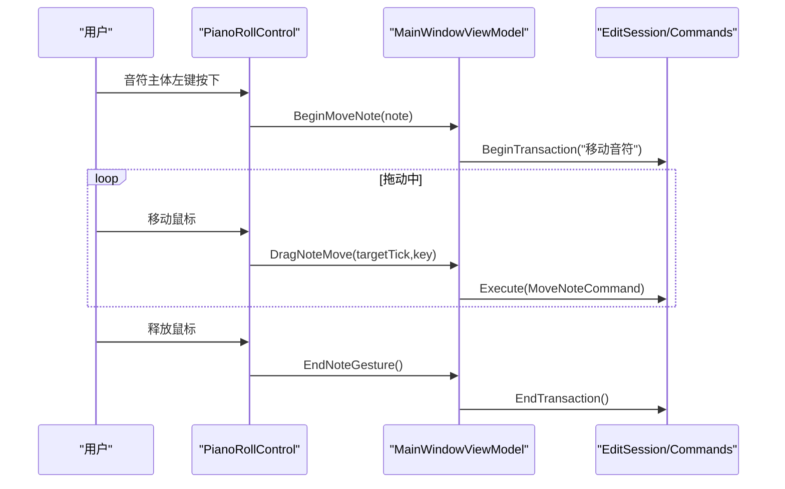

**图表来源**
- [PianoRollControl.cs:224-230](file://src/Weftone.App/Controls/PianoRollControl.cs#L224-L230)
- [MainWindowViewModel.cs:254-266](file://src/Weftone.App/ViewModels/MainWindowViewModel.cs#L254-L266)
- [MainWindowViewModel.cs:282-290](file://src/Weftone.App/ViewModels/MainWindowViewModel.cs#L282-L290)
- [MainWindowViewModel.cs:312-323](file://src/Weftone.App/ViewModels/MainWindowViewModel.cs#L312-L323)

**章节来源**
- [PianoRollControl.cs:224-230](file://src/Weftone.App/Controls/PianoRollControl.cs#L224-L230)
- [MainWindowViewModel.cs:254-266](file://src/Weftone.App/ViewModels/MainWindowViewModel.cs#L254-L266)
- [MainWindowViewModel.cs:282-290](file://src/Weftone.App/ViewModels/MainWindowViewModel.cs#L282-L290)
- [MainWindowViewModel.cs:312-323](file://src/Weftone.App/ViewModels/MainWindowViewModel.cs#L312-L323)

#### 拖拽调整长度
- 用户在音符右边缘按下左键。
- PianoRollControl.OnPointerPressed 调用 BeginResizeNote，手势为 Resize。
- 拖动中 OnPointerMoved 计算 endTick，调用 DragNoteLength。
- ViewModel 执行 ResizeNoteCommand。
- 释放鼠标 EndNoteGesture 提交事务。

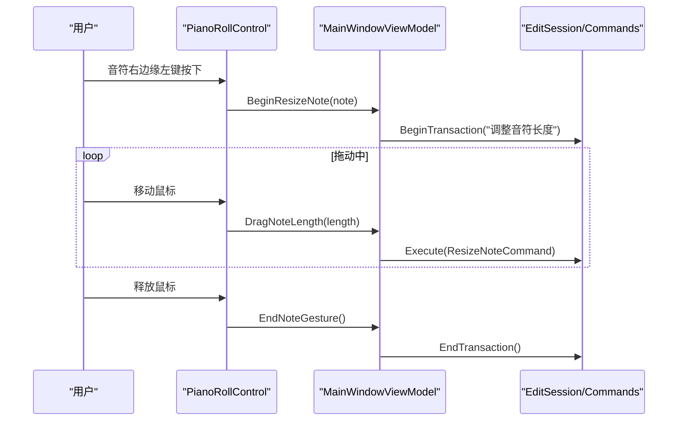

**图表来源**
- [PianoRollControl.cs:217-223](file://src/Weftone.App/Controls/PianoRollControl.cs#L217-L223)
- [MainWindowViewModel.cs:268-280](file://src/Weftone.App/ViewModels/MainWindowViewModel.cs#L268-L280)
- [MainWindowViewModel.cs:292-300](file://src/Weftone.App/ViewModels/MainWindowViewModel.cs#L292-L300)
- [MainWindowViewModel.cs:312-323](file://src/Weftone.App/ViewModels/MainWindowViewModel.cs#L312-L323)

**章节来源**
- [PianoRollControl.cs:217-223](file://src/Weftone.App/Controls/PianoRollControl.cs#L217-L223)
- [MainWindowViewModel.cs:268-280](file://src/Weftone.App/ViewModels/MainWindowViewModel.cs#L268-L280)
- [MainWindowViewModel.cs:292-300](file://src/Weftone.App/ViewModels/MainWindowViewModel.cs#L292-L300)
- [MainWindowViewModel.cs:312-323](file://src/Weftone.App/ViewModels/MainWindowViewModel.cs#L312-L323)

## 依赖关系分析
- PianoRollControl 依赖：
  - Avalonia 输入与绘图接口。
  - PianoRollGeometry 提供几何与命中测试。
  - MainWindowViewModel 提供编辑入口与数据绑定。
- MainWindowViewModel 依赖：
  - EditSession 与命令集合，用于事务与撤销重做。
  - PlaybackService 用于播放状态与计划更新。
  - IFileDialogService 用于打开/保存文件。
- PianoRollGeometry 依赖：
  - Domain.Note 与 TimeBase，提供 MIDI Key 与 PPQ 常量。

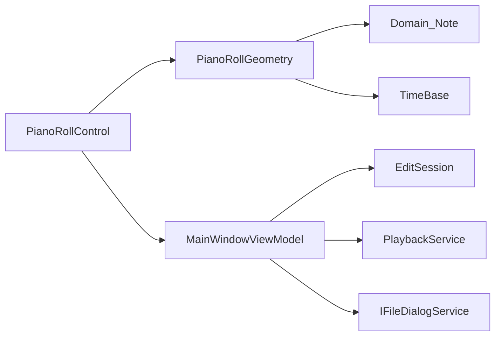

**图表来源**
- [PianoRollControl.cs:1-6](file://src/Weftone.App/Controls/PianoRollControl.cs#L1-L6)
- [MainWindowViewModel.cs:1-9](file://src/Weftone.App/ViewModels/MainWindowViewModel.cs#L1-L9)
- [PianoRollGeometry.cs:1-2](file://src/Weftone.App/Controls/PianoRollGeometry.cs#L1-L2)

**章节来源**
- [PianoRollControl.cs:1-6](file://src/Weftone.App/Controls/PianoRollControl.cs#L1-L6)
- [MainWindowViewModel.cs:1-9](file://src/Weftone.App/ViewModels/MainWindowViewModel.cs#L1-L9)
- [PianoRollGeometry.cs:1-2](file://src/Weftone.App/Controls/PianoRollGeometry.cs#L1-L2)

## 性能与交互特性
- 渲染裁剪：控件仅绘制可见区域的行与音符，避免全量绘制导致卡顿。
- 吸附步长：默认 1/4 拍（PPQ/4），提升编辑精度与一致性。
- 命中测试：从后向前遍历音符列表，优先命中上层音符；右边缘 6px 内判定为 Resize 区域。
- 最小长度：调整长度时至少保持 1 tick，防止无效音符。
- 事务合并：一次手势期间的所有编辑合并为一条撤销项，提升用户体验。

**章节来源**
- [PianoRollControl.cs:114-157](file://src/Weftone.App/Controls/PianoRollControl.cs#L114-L157)
- [PianoRollGeometry.cs:20-25](file://src/Weftone.App/Controls/PianoRollGeometry.cs#L20-L25)
- [PianoRollGeometry.cs:45-64](file://src/Weftone.App/Controls/PianoRollGeometry.cs#L45-L64)
- [MainWindowViewModel.cs:292-300](file://src/Weftone.App/ViewModels/MainWindowViewModel.cs#L292-L300)
- [MainWindowViewModel.cs:229-230](file://src/Weftone.App/ViewModels/MainWindowViewModel.cs#L229-L230)

## 故障排查指南
- 无法画音符：
  - 检查 SelectedPattern 是否为空，或通道列表是否为空。
  - 确认 BeginAddNote 被调用且 LastAddedNote 非空。
- 拖动无效：
  - 检查 _gesture 是否正确设置，_gestureNote 是否非空。
  - 确认 DragNoteMove/DragNoteLength 的条件分支匹配当前手势。
- 删除无效：
  - 确认右键命中音符且 RemoveNote 被调用。
  - 检查 RemoveNoteCommand 是否成功执行。
- 重绘不生效：
  - 检查 EndNoteGesture 是否调用 ViewModel.EndNoteGesture。
  - 确认 DocumentEdited 事件触发后控件重绘。

**章节来源**
- [MainWindowViewModel.cs:230-252](file://src/Weftone.App/ViewModels/MainWindowViewModel.cs#L230-L252)
- [MainWindowViewModel.cs:282-300](file://src/Weftone.App/ViewModels/MainWindowViewModel.cs#L282-L300)
- [MainWindowViewModel.cs:302-310](file://src/Weftone.App/ViewModels/MainWindowViewModel.cs#L302-L310)
- [PianoRollControl.cs:282-293](file://src/Weftone.App/Controls/PianoRollControl.cs#L282-L293)

## 结论
钢琴卷帘的交互处理通过控件层与视图模型的清晰分工实现了高内聚、低耦合的设计：
- 控件专注事件与手势状态，几何工具提供稳定可靠的命中与映射能力。
- 视图模型集中管理编辑事务与命令，确保所有用户操作可撤销、可重做。
- 三种手势模式（添加并调整长度、移动、调整长度）覆盖了常见编辑场景，配合吸附与裁剪优化了性能与体验。
- 通过流程图与代码路径，开发者可以快速定位问题并进行扩展与维护。