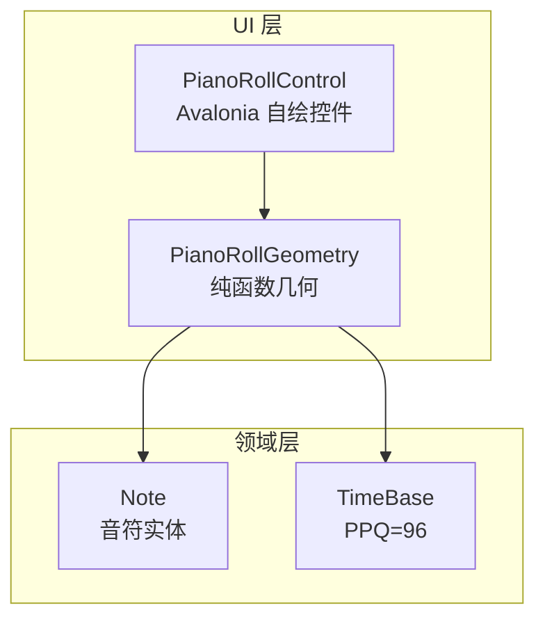
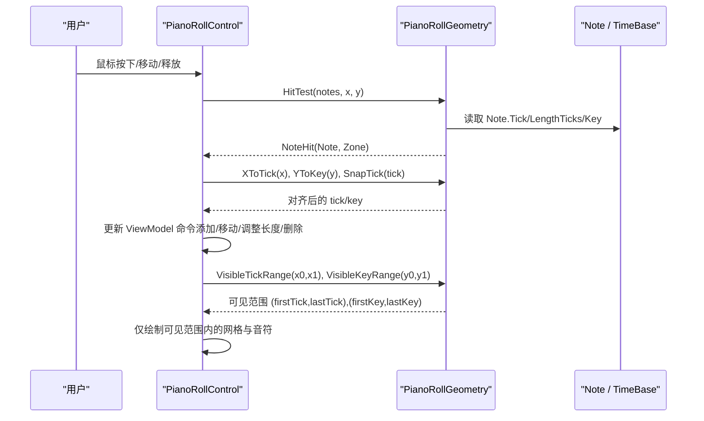
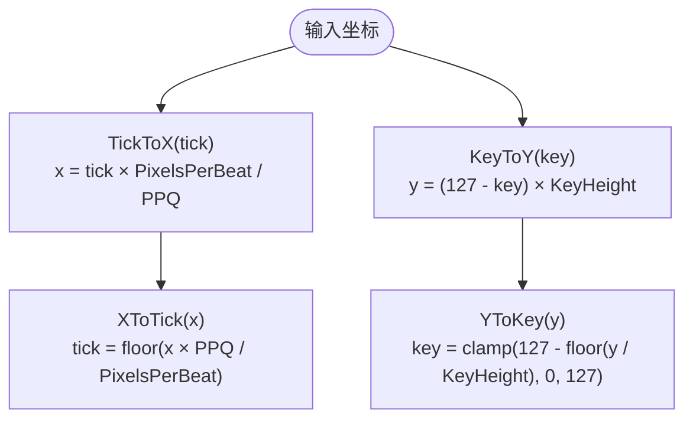
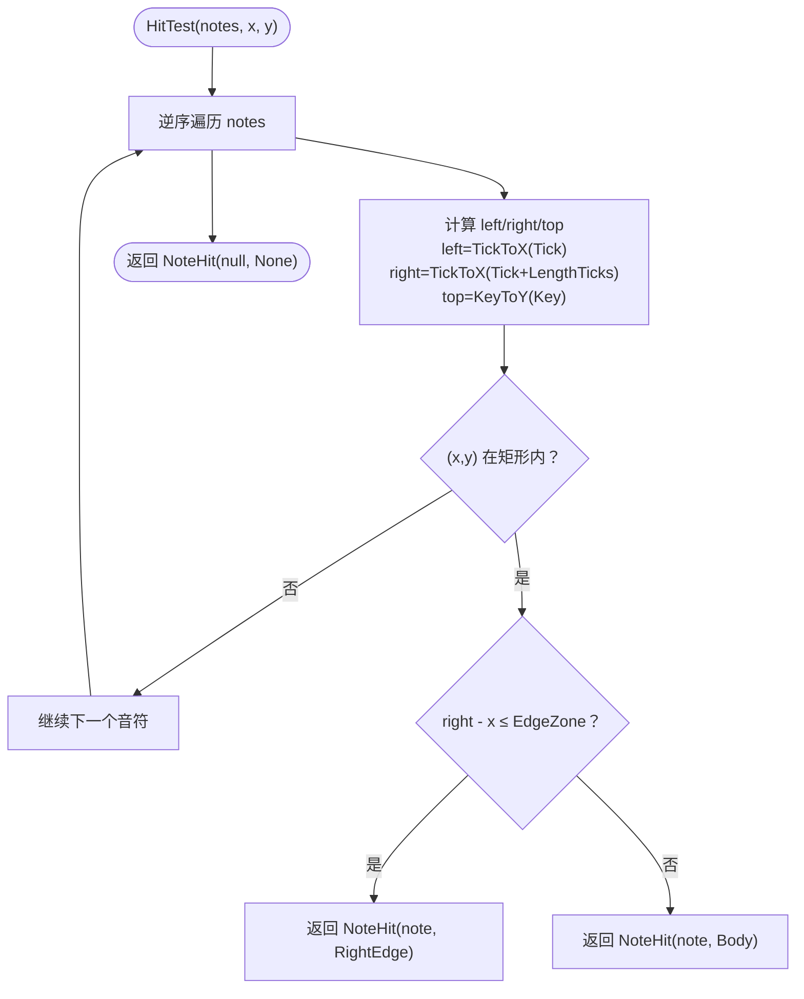
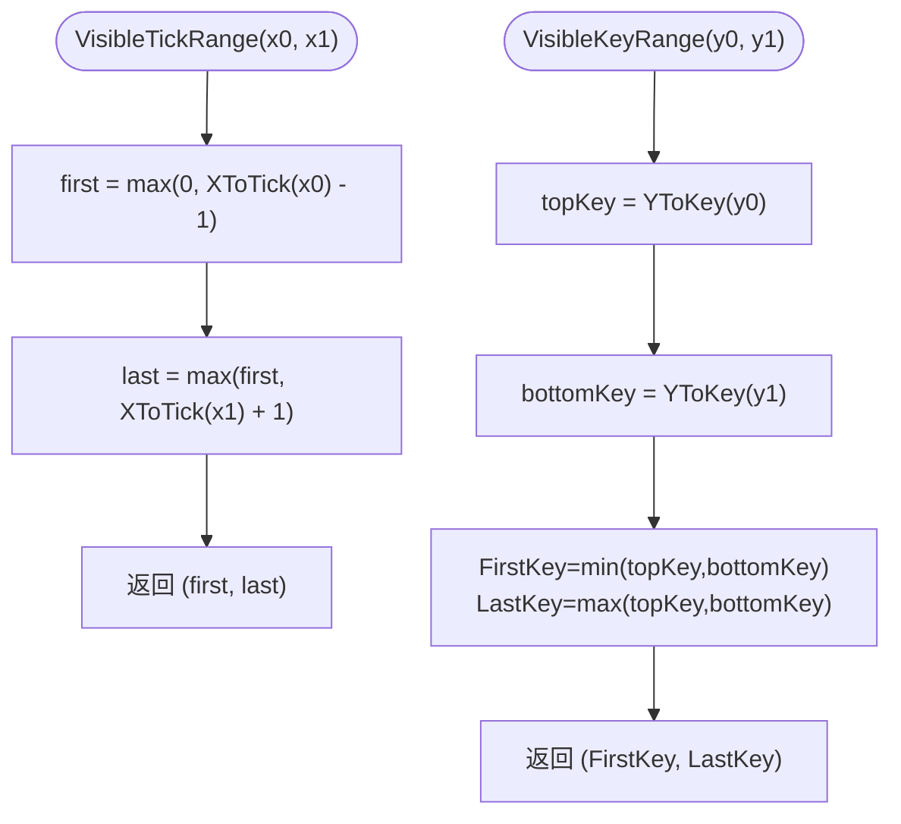
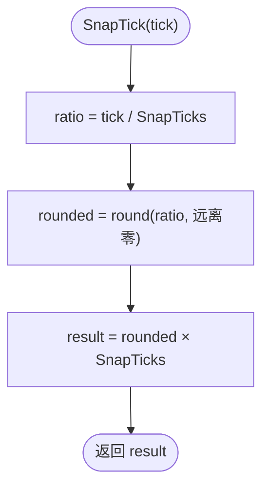
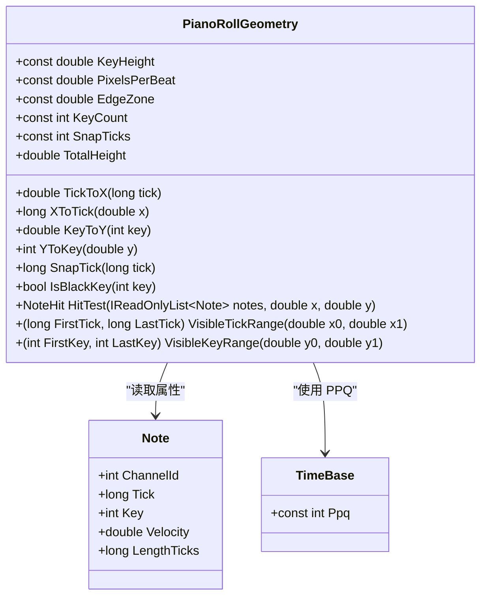
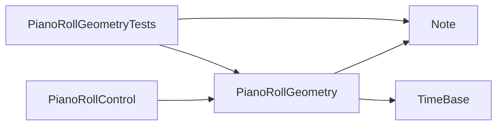

# 几何计算

<cite>
**本文引用的文件**   
- [PianoRollGeometry.cs](file://src/Weftone.App/Controls/PianoRollGeometry.cs)
- [PianoRollControl.cs](file://src/Weftone.App/Controls/PianoRollControl.cs)
- [Note.cs](file://src/Weftone.Domain/Note.cs)
- [TimeBase.cs](file://src/Weftone.Domain/TimeBase.cs)
- [PianoRollGeometryTests.cs](file://tests/Weftone.App.Tests/PianoRollGeometryTests.cs)
</cite>

## 目录
1. [引言](#引言)
2. [项目结构](#项目结构)
3. [核心组件](#核心组件)
4. [架构总览](#架构总览)
5. [详细组件分析](#详细组件分析)
6. [依赖关系分析](#依赖关系分析)
7. [性能考虑](#性能考虑)
8. [故障排查指南](#故障排查指南)
9. [结论](#结论)
10. [附录：公式与示例](#附录公式与示例)

## 引言
本文件为钢琴卷帘的几何计算系统提供深入文档，重点覆盖以下方面：
- tick↔pixel 坐标映射算法（TickToX、XToTick）
- MIDI key↔pixel 坐标映射算法（KeyToY、YToKey）
- 命中测试 HitTest 与 NoteZone 枚举（Body、RightEdge、None）判断规则
- 可见范围裁剪 VisibleTickRange 与 VisibleKeyRange
- 对齐算法 SnapTick 的工作原理与最小音符长度限制
- 数学公式、坐标转换示例与性能优化技巧
- 纯函数设计模式与可测试性考量

该几何子系统位于 UI 控件层与领域模型之间，作为无状态、纯函数的几何与命中计算核心，既服务于 Avalonia 渲染，也支持 headless 单元测试。

## 项目结构
几何计算相关代码集中在应用层的钢琴卷帘控制与几何工具类中，并与领域模型中的音符和时间基线类型协作。

**图表来源**
- [PianoRollGeometry.cs:1-81](file://src/Weftone.App/Controls/PianoRollGeometry.cs#L1-L81)
- [PianoRollControl.cs:104-157](file://src/Weftone.App/Controls/PianoRollControl.cs#L104-L157)
- [Note.cs:1-12](file://src/Weftone.Domain/Note.cs#L1-L12)
- [TimeBase.cs:1-8](file://src/Weftone.Domain/TimeBase.cs#L1-L8)

**章节来源**
- [PianoRollGeometry.cs:1-81](file://src/Weftone.App/Controls/PianoRollGeometry.cs#L1-L81)
- [PianoRollControl.cs:104-157](file://src/Weftone.App/Controls/PianoRollControl.cs#L104-L157)
- [Note.cs:1-12](file://src/Weftone.Domain/Note.cs#L1-L12)
- [TimeBase.cs:1-8](file://src/Weftone.Domain/TimeBase.cs#L1-L8)

## 核心组件
- PianoRollGeometry：提供纯函数形式的几何计算，包括坐标映射、命中测试、可见范围裁剪和对齐。
- Note：领域模型中的音符对象，包含 Tick、LengthTicks、Key、Velocity 等属性。
- TimeBase：定义每拍 tick 数（PPQ=96），是时间到像素映射的基础常量。
- PianoRollControl：Avalonia 自绘控件，负责视口同步、渲染和手势处理，调用 PianoRollGeometry 完成几何计算。

关键职责划分：
- PianoRollGeometry 不依赖 UI 框架类型，保证可测试性与 headless 运行能力。
- PianoRollControl 负责 UI 事件、绘制与视图状态，委托几何计算给 PianoRollGeometry。

**章节来源**
- [PianoRollGeometry.cs:14-42](file://src/Weftone.App/Controls/PianoRollGeometry.cs#L14-L42)
- [Note.cs:1-12](file://src/Weftone.Domain/Note.cs#L1-L12)
- [TimeBase.cs:1-8](file://src/Weftone.Domain/TimeBase.cs#L1-L8)
- [PianoRollControl.cs:10-14](file://src/Weftone.App/Controls/PianoRollControl.cs#L10-L14)

## 架构总览
钢琴卷帘的几何计算在 UI 渲染与交互流程中扮演“纯函数几何引擎”的角色。

**图表来源**
- [PianoRollControl.cs:185-272](file://src/Weftone.App/Controls/PianoRollControl.cs#L185-L272)
- [PianoRollGeometry.cs:44-80](file://src/Weftone.App/Controls/PianoRollGeometry.cs#L44-L80)
- [Note.cs:1-12](file://src/Weftone.Domain/Note.cs#L1-L12)
- [TimeBase.cs:1-8](file://src/Weftone.Domain/TimeBase.cs#L1-L8)

## 详细组件分析

### 坐标映射：tick↔pixel 与 key↔pixel
- TickToX：将音乐时间 tick 线性映射到水平像素位置。
- XToTick：将水平像素位置反映射回 tick，使用向下取整实现像素到 tick 的截断。
- KeyToY：将 MIDI key（0..127）映射到垂直像素位置，127 在顶部，0 在底部。
- YToKey：将垂直像素位置反映射回 MIDI key，越界时钳制到有效范围。

这些函数均为纯函数，输入输出明确，无副作用，便于单测与复用。

**图表来源**
- [PianoRollGeometry.cs:29-37](file://src/Weftone.App/Controls/PianoRollGeometry.cs#L29-L37)
- [TimeBase.cs:3-7](file://src/Weftone.Domain/TimeBase.cs#L3-L7)

**章节来源**
- [PianoRollGeometry.cs:29-37](file://src/Weftone.App/Controls/PianoRollGeometry.cs#L29-L37)
- [PianoRollGeometryTests.cs:9-27](file://tests/Weftone.App.Tests/PianoRollGeometryTests.cs#L9-L27)

### 命中测试：HitTest 与 NoteZone
HitTest 用于确定鼠标点击落在哪个音符区域，返回 NoteHit(Note?, NoteZone)。

- NoteZone 枚举：
  - None：未命中任何音符
  - Body：命中音符主体区域
  - RightEdge：命中音符右侧边缘区域（用于拖拽调整长度）

判断规则：
- 逆序遍历音符列表，后画的在上层优先。
- 对每个音符计算 left/right/top 像素边界。
- 若点击坐标超出矩形范围则跳过。
- 若点击位置距离 right 边界的水平距离小于等于 EdgeZone（默认 6 像素），判定为 RightEdge。
- 否则判定为 Body。
- 若无命中，返回 None。

**图表来源**
- [PianoRollGeometry.cs:44-64](file://src/Weftone.App/Controls/PianoRollGeometry.cs#L44-L64)

**章节来源**
- [PianoRollGeometry.cs:5-12](file://src/Weftone.App/Controls/PianoRollGeometry.cs#L5-L12)
- [PianoRollGeometry.cs:44-64](file://src/Weftone.App/Controls/PianoRollGeometry.cs#L44-L64)
- [PianoRollGeometryTests.cs:39-63](file://tests/Weftone.App.Tests/PianoRollGeometryTests.cs#L39-L63)

### 可见范围裁剪：VisibleTickRange 与 VisibleKeyRange
这两个函数根据视口像素范围计算需要渲染的 tick 与 key 区间，以实现高效裁剪。

- VisibleTickRange(x0, x1)：
  - first = max(0, XToTick(x0) - 1)
  - last = max(first, XToTick(x1) + 1)
  - 两侧各留 1 tick 余量，确保边缘音符不被裁剪掉。

- VisibleKeyRange(y0, y1)：
  - topKey = YToKey(y0)
  - bottomKey = YToKey(y1)
  - FirstKey = min(topKey, bottomKey)
  - LastKey = max(topKey, bottomKey)

**图表来源**
- [PianoRollGeometry.cs:67-80](file://src/Weftone.App/Controls/PianoRollGeometry.cs#L67-L80)

**章节来源**
- [PianoRollGeometry.cs:67-80](file://src/Weftone.App/Controls/PianoRollGeometry.cs#L67-L80)
- [PianoRollControl.cs:114-117](file://src/Weftone.App/Controls/PianoRollControl.cs#L114-L117)
- [PianoRollGeometryTests.cs:65-81](file://tests/Weftone.App.Tests/PianoRollGeometryTests.cs#L65-L81)

### 对齐算法：SnapTick 与最小音符长度
- SnapTick(tick)：
  - 以默认步长 SnapTicks（1/4 拍，即 PPQ/4）进行四舍五入对齐。
  - 使用远离零的中点取整策略，避免半拍歧义。
  - 结果始终为 SnapTicks 的整数倍。

- 最小音符长度限制：
  - 在拖动调整长度或新增音符时，结束 tick 至少比起点多一个 1/4 拍（TimeBase.Ppq / 4）。
  - 这保证了音符不会过短，提升编辑体验与一致性。

**图表来源**
- [PianoRollGeometry.cs:39-40](file://src/Weftone.App/Controls/PianoRollGeometry.cs#L39-L40)
- [PianoRollControl.cs:265-269](file://src/Weftone.App/Controls/PianoRollControl.cs#L265-L269)

**章节来源**
- [PianoRollGeometry.cs:24-25](file://src/Weftone.App/Controls/PianoRollGeometry.cs#L24-L25)
- [PianoRollGeometry.cs:39-40](file://src/Weftone.App/Controls/PianoRollGeometry.cs#L39-L40)
- [PianoRollControl.cs:265-269](file://src/Weftone.App/Controls/PianoRollControl.cs#L265-L269)
- [PianoRollGeometryTests.cs:29-37](file://tests/Weftone.App.Tests/PianoRollGeometryTests.cs#L29-L37)

### 纯函数设计与可测试性
- 纯函数特性：
  - 所有几何方法都是静态纯函数，无内部状态，不依赖 UI 框架类型。
  - 输入输出明确，易于单元测试与跨平台复用。

- 可测试性体现：
  - 通过 NUnit 测试覆盖 tick↔pixel 往返、key↔pixel 边界、对齐行为、命中区域与可见范围。
  - 测试用例验证了截断、钳制、边缘命中、上层优先等关键行为。

**图表来源**
- [PianoRollGeometry.cs:18-80](file://src/Weftone.App/Controls/PianoRollGeometry.cs#L18-L80)
- [Note.cs:1-12](file://src/Weftone.Domain/Note.cs#L1-L12)
- [TimeBase.cs:1-8](file://src/Weftone.Domain/TimeBase.cs#L1-L8)

**章节来源**
- [PianoRollGeometry.cs:14-17](file://src/Weftone.App/Controls/PianoRollGeometry.cs#L14-L17)
- [PianoRollGeometryTests.cs:1-83](file://tests/Weftone.App.Tests/PianoRollGeometryTests.cs#L1-L83)

## 依赖关系分析
- PianoRollGeometry 依赖领域模型 Note 与 TimeBase，但不依赖 UI 框架。
- PianoRollControl 依赖 PianoRollGeometry 完成几何计算，并驱动 ViewModel 执行命令。
- 测试文件直接引用 PianoRollGeometry 与 Note，验证几何行为的正确性。

**图表来源**
- [PianoRollControl.cs:104-157](file://src/Weftone.App/Controls/PianoRollControl.cs#L104-L157)
- [PianoRollGeometry.cs:1-81](file://src/Weftone.App/Controls/PianoRollGeometry.cs#L1-L81)
- [Note.cs:1-12](file://src/Weftone.Domain/Note.cs#L1-L12)
- [TimeBase.cs:1-8](file://src/Weftone.Domain/TimeBase.cs#L1-L8)
- [PianoRollGeometryTests.cs:1-83](file://tests/Weftone.App.Tests/PianoRollGeometryTests.cs#L1-L83)

**章节来源**
- [PianoRollControl.cs:104-157](file://src/Weftone.App/Controls/PianoRollControl.cs#L104-L157)
- [PianoRollGeometry.cs:1-81](file://src/Weftone.App/Controls/PianoRollGeometry.cs#L1-L81)
- [PianoRollGeometryTests.cs:1-83](file://tests/Weftone.App.Tests/PianoRollGeometryTests.cs#L1-L83)

## 性能考虑
- 可见范围裁剪：
  - 渲染前通过 VisibleTickRange 与 VisibleKeyRange 计算首尾 tick/key，仅绘制可见区域内的网格与音符，避免全量绘制。
  - 黑键行与节拍线按可见范围循环绘制，减少无效绘制。

- 命中测试复杂度：
  - HitTest 为 O(n)，n 为音符数量；由于通常音符数量可控且 UI 层已做视口裁剪，整体性能可接受。
  - 可通过空间索引（如网格或四叉树）进一步优化大规模音符场景下的命中检测。

- 坐标映射与对齐：
  - TickToX/XToTick、KeyToY/YToKey 为常数时间操作，开销极小。
  - SnapTick 使用浮点除法与四舍五入，注意在高频调用路径中缓存常量以减少重复计算。

- 渲染优化建议：
  - 预计算常用像素值（如拍线位置、黑键行高度）并在滚动时增量更新。
  - 使用双缓冲与脏矩形重绘减少闪烁与重绘面积。

[本节为通用性能指导，不直接分析具体文件]

## 故障排查指南
- 坐标映射异常：
  - 检查 TimeBase.Ppq 是否为 96，确认 PixelsPerBeat 与 KeyHeight 常量设置。
  - 验证 XToTick 的向下取整与 YToKey 的钳制逻辑是否符合预期。

- 命中测试误判：
  - 确认 EdgeZone 值是否合适（默认 6 像素），过小可能导致难以选中右边缘。
  - 检查音符列表顺序，后画音符应位于列表末尾以保证上层优先。

- 可见范围裁剪问题：
  - 检查 VisibleTickRange 的 ±1 tick 余量是否导致边缘音符被裁剪。
  - 确认 VisibleKeyRange 的 top/bottom key 计算是否正确处理倒置坐标系。

- 对齐与最小长度：
  - 验证 SnapTicks 是否为 PPQ/4，确保对齐步长符合编辑需求。
  - 检查拖动调整长度时的最小长度限制（至少增加一个 1/4 拍）。

**章节来源**
- [PianoRollGeometry.cs:20-25](file://src/Weftone.App/Controls/PianoRollGeometry.cs#L20-L25)
- [PianoRollGeometry.cs:44-64](file://src/Weftone.App/Controls/PianoRollGeometry.cs#L44-L64)
- [PianoRollGeometry.cs:67-80](file://src/Weftone.App/Controls/PianoRollGeometry.cs#L67-L80)
- [PianoRollControl.cs:265-269](file://src/Weftone.App/Controls/PianoRollControl.cs#L265-L269)

## 结论
钢琴卷帘几何计算系统通过纯函数设计实现了清晰、可测试且高效的坐标映射、命中测试与可见范围裁剪。其 tick↔pixel 与 key↔pixel 线性映射简单直观，HitTest 规则明确，VisibleTickRange/VisibleKeyRange 提供稳定的视口裁剪，SnapTick 与最小音符长度限制提升了编辑体验。结合单元测试覆盖，该系统具备良好的可维护性与扩展性，适合在复杂 UI 场景中稳定运行。

[本节为总结性内容，不直接分析具体文件]

## 附录：公式与示例
- 横轴映射：
  - x = tick × PixelsPerBeat / PPQ
  - tick = floor(x × PPQ / PixelsPerBeat)

- 纵轴映射：
  - y = (127 - key) × KeyHeight
  - key = clamp(127 - floor(y / KeyHeight), 0, 127)

- 对齐：
  - snap = round(tick / SnapTicks, 远离零) × SnapTicks

- 可见范围：
  - firstTick = max(0, XToTick(x0) - 1)
  - lastTick = max(firstTick, XToTick(x1) + 1)
  - firstKey = min(YToKey(y0), YToKey(y1))
  - lastKey = max(YToKey(y0), YToKey(y1))

- 命中区域：
  - RightEdge：right - x ≤ EdgeZone
  - Body：其余命中区域
  - None：未命中

**章节来源**
- [PianoRollGeometry.cs:29-40](file://src/Weftone.App/Controls/PianoRollGeometry.cs#L29-L40)
- [PianoRollGeometry.cs:67-80](file://src/Weftone.App/Controls/PianoRollGeometry.cs#L67-L80)
- [PianoRollGeometryTests.cs:9-81](file://tests/Weftone.App.Tests/PianoRollGeometryTests.cs#L9-L81)