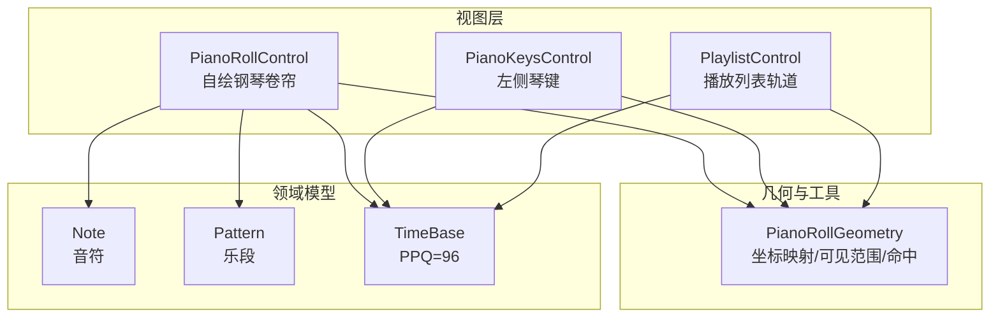
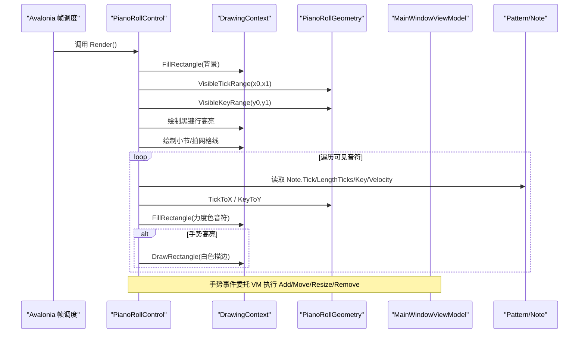
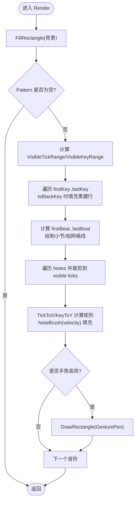
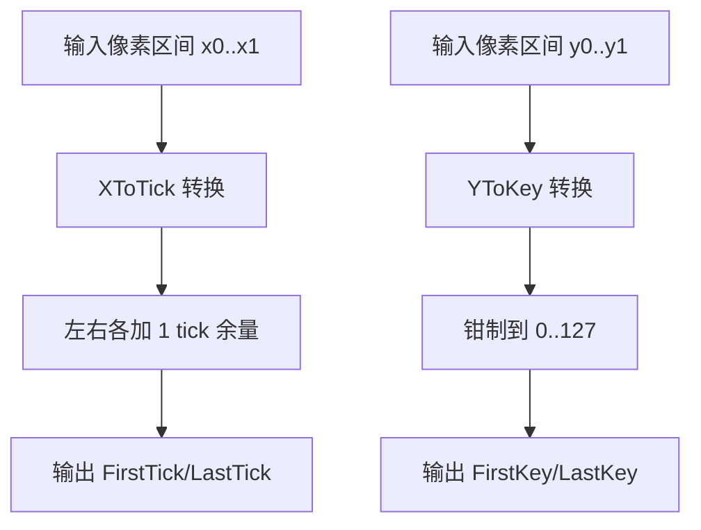
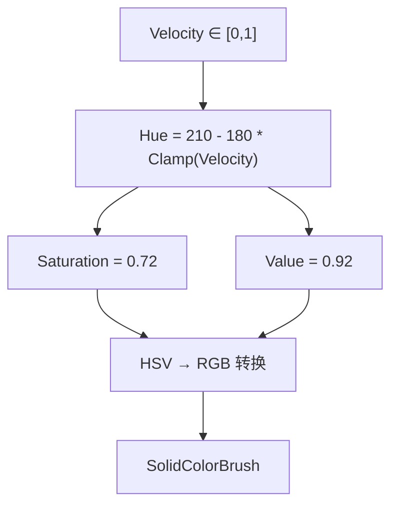
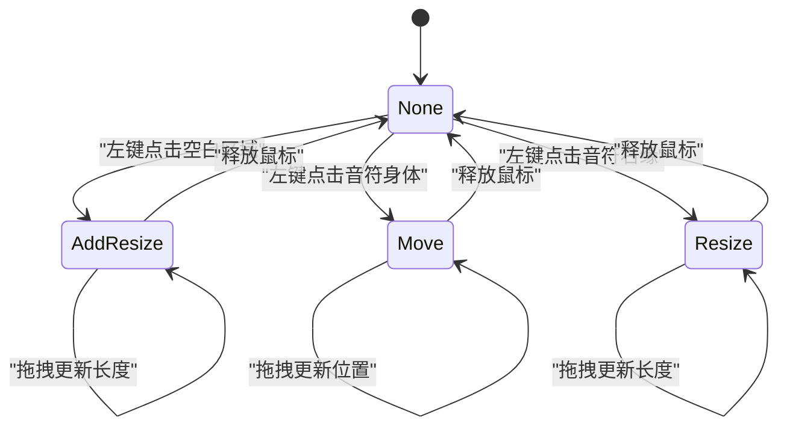
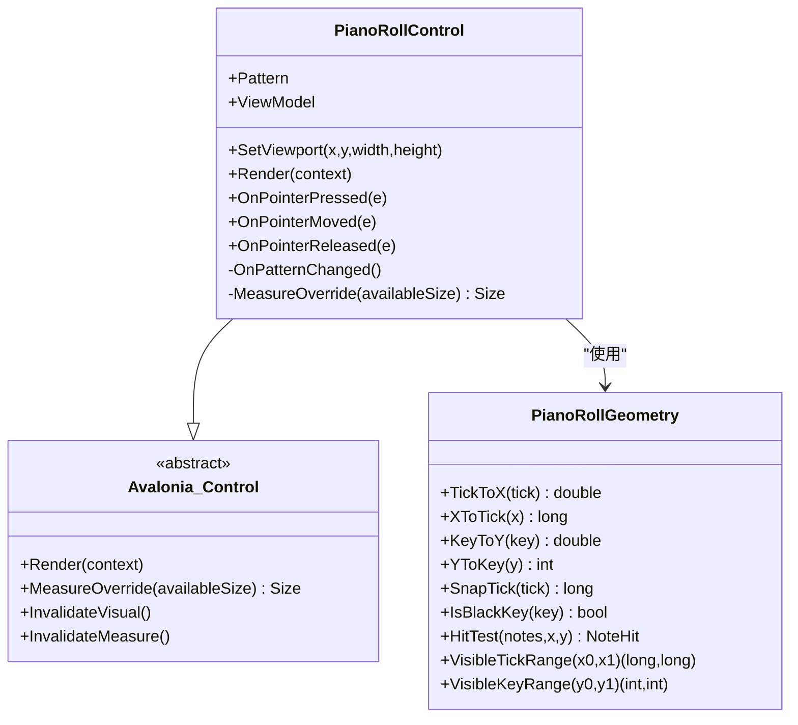
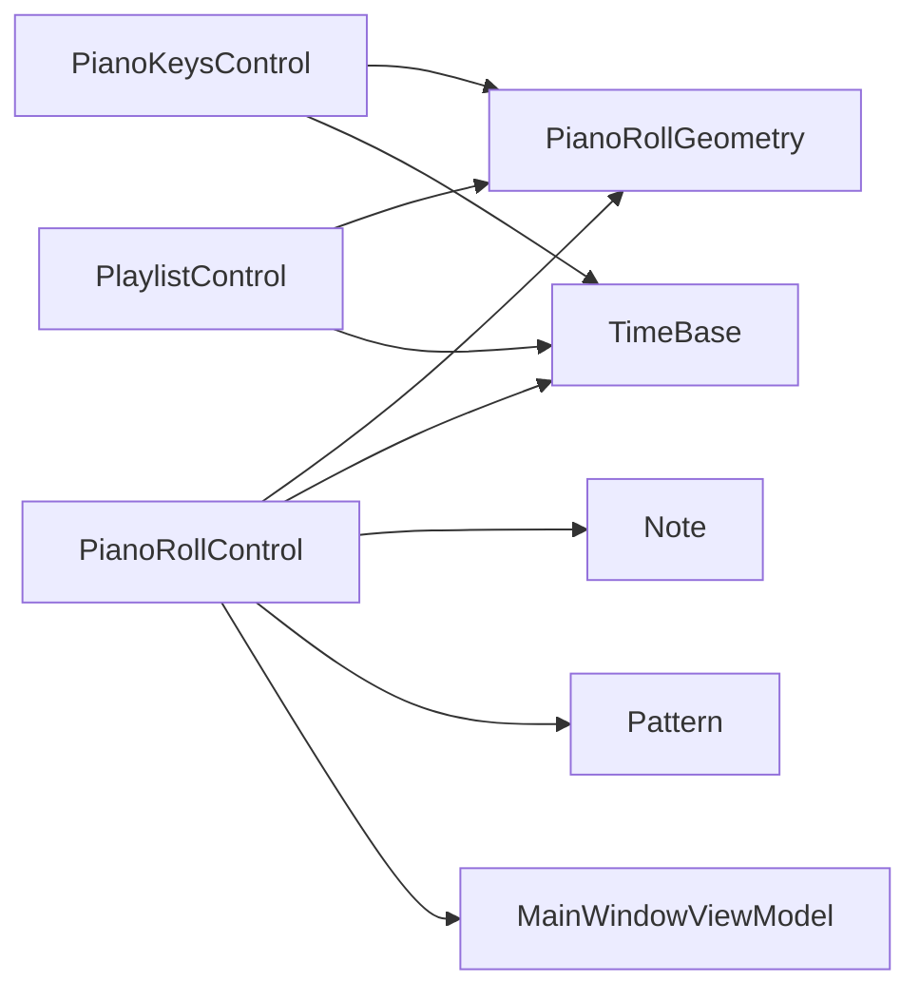

# 绘制系统

<cite>
**本文引用的文件**   
- [PianoRollControl.cs](file://src/Weftone.App/Controls/PianoRollControl.cs)
- [PianoRollGeometry.cs](file://src/Weftone.App/Controls/PianoRollGeometry.cs)
- [Note.cs](file://src/Weftone.Domain/Note.cs)
- [Pattern.cs](file://src/Weftone.Domain/Pattern.cs)
- [TimeBase.cs](file://src/Weftone.Domain/TimeBase.cs)
- [PlaylistControl.cs](file://src/Weftone.App/Controls/PlaylistControl.cs)
- [PianoKeysControl.cs](file://src/Weftone.App/Controls/PianoKeysControl.cs)
- [MainWindowSmokeTests.cs](file://tests/Weftone.App.Tests/MainWindowSmokeTests.cs)
- [PianoRollGeometryTests.cs](file://tests/Weftone.App.Tests/PianoRollGeometryTests.cs)
</cite>

## 目录
1. [引言](#引言)
2. [项目结构](#项目结构)
3. [核心组件](#核心组件)
4. [架构总览](#架构总览)
5. [详细组件分析](#详细组件分析)
6. [依赖关系分析](#依赖关系分析)
7. [性能考虑](#性能考虑)
8. [故障排查指南](#故障排查指南)
9. [结论](#结论)

## 引言
本文件聚焦钢琴卷帘的绘制子系统，目标是解释自绘控件如何通过 Avalonia 的 DrawingContext 完成背景填充、黑键行高亮、小节与拍网格线绘制、音符矩形渲染，并说明视口裁剪机制 VisibleTickRange 与 VisibleKeyRange 如何优化大量音符的渲染。文档还涵盖力度色算法（HSV 颜色空间转换）、手势高亮效果、DrawingContext API 使用示例、颜色定义、性能优化策略，以及与 Avalonia 框架的集成方式和自定义控件生命周期。

## 项目结构
钢琴卷帘绘制相关代码主要分布在以下位置：
- 视图层自绘控件：PianoRollControl、PianoKeysControl、PlaylistControl
- 几何与命中计算：PianoRollGeometry
- 领域模型：Note、Pattern、TimeBase
- 测试用例：PianoRollGeometryTests、MainWindowSmokeTests

**图表来源**
- [PianoRollControl.cs:104-157](file://src/Weftone.App/Controls/PianoRollControl.cs#L104-L157)
- [PianoRollGeometry.cs:18-80](file://src/Weftone.App/Controls/PianoRollGeometry.cs#L18-L80)
- [Note.cs:1-12](file://src/Weftone.Domain/Note.cs#L1-L12)
- [Pattern.cs:1-9](file://src/Weftone.Domain/Pattern.cs#L1-L9)
- [TimeBase.cs:1-8](file://src/Weftone.Domain/TimeBase.cs#L1-L8)

**章节来源**
- [PianoRollControl.cs:10-15](file://src/Weftone.App/Controls/PianoRollControl.cs#L10-L15)
- [PianoRollGeometry.cs:14-18](file://src/Weftone.App/Controls/PianoRollGeometry.cs#L14-L18)

## 核心组件
- PianoRollControl：Avalonia 自绘 Control，负责 Render 主循环、视口同步、手势交互、命令委托给 ViewModel。
- PianoRollGeometry：纯函数几何模块，提供 tick↔像素、key↔像素、可见范围、命中检测等能力，不依赖 UI 类型，便于 headless 测试。
- Note/Pattern/TimeBase：领域数据，Note 以 PPQ=96 整数 tick 表示时间，Key 为 0..127 MIDI 音高，Velocity 为 0..1 的力度值；Pattern 持有 Notes 列表；TimeBase 固定 PPQ=96。

**章节来源**
- [PianoRollControl.cs:15-58](file://src/Weftone.App/Controls/PianoRollControl.cs#L15-L58)
- [PianoRollGeometry.cs:18-42](file://src/Weftone.App/Controls/PianoRollGeometry.cs#L18-L42)
- [Note.cs:1-12](file://src/Weftone.Domain/Note.cs#L1-L12)
- [Pattern.cs:1-9](file://src/Weftone.Domain/Pattern.cs#L1-L9)
- [TimeBase.cs:1-8](file://src/Weftone.Domain/TimeBase.cs#L1-L8)

## 架构总览
钢琴卷帘绘制流程从 Avalonia 框架触发 Control.Render，内部通过 DrawingContext 进行图形绘制。PianoRollControl 将业务逻辑（如命令）委托给 MainWindowViewModel，而几何计算交给 PianoRollGeometry。这样 UI 与业务解耦，几何可被单元测试覆盖。

**图表来源**
- [PianoRollControl.cs:104-157](file://src/Weftone.App/Controls/PianoRollControl.cs#L104-L157)
- [PianoRollGeometry.cs:67-80](file://src/Weftone.App/Controls/PianoRollGeometry.cs#L67-L80)

## 详细组件分析

### PianoRollControl 的 Render 方法
Render 是绘制系统的核心入口，按顺序执行以下逻辑：
- 背景填充：使用预定义的深色背景刷 FillRectangle 铺满 Bounds。
- 模式检查：若 Pattern 为空则直接返回，避免空引用。
- 视口裁剪：
  - 使用 VisibleTickRange(_viewportX, _viewportX + _viewportWidth) 得到 firstTick/lastTick。
  - 使用 VisibleKeyRange(_viewportY, _viewportY + _viewportHeight) 得到 firstKey/lastKey。
- 黑键行高亮：
  - 在 firstKey..lastKey 范围内，仅对 IsBlackKey(key) 为 true 的行用 BlackRowBrush 填充整行矩形。
- 小节/拍网格线：
  - 基于 ppq = TimeBase.Ppq，计算 firstBeat/lastBeat，逐拍绘制竖线。
  - beat % 4 == 0 时使用 BarPen（小节线），否则使用 BeatPen（拍线）。
- 音符矩形渲染：
  - 遍历 pattern.Notes，跳过不在 [firstTick, lastTick] 范围的音符。
  - 计算 left、width、top，构造圆角矩形 Rect，并使用 NoteBrush(velocity) 填充。
  - 若当前音符处于手势状态（_gestureNote），使用 GesturePen 绘制白色描边高亮。

**图表来源**
- [PianoRollControl.cs:104-157](file://src/Weftone.App/Controls/PianoRollControl.cs#L104-L157)
- [PianoRollGeometry.cs:67-80](file://src/Weftone.App/Controls/PianoRollGeometry.cs#L67-L80)

**章节来源**
- [PianoRollControl.cs:104-157](file://src/Weftone.App/Controls/PianoRollControl.cs#L104-L157)

### 视口裁剪机制：VisibleTickRange 与 VisibleKeyRange
- VisibleTickRange(x0, x1)：
  - 将像素横坐标转换为 tick，并在两侧各留 1 tick 余量，确保滚动边缘平滑。
  - 返回 (FirstTick, LastTick)，保证 FirstTick <= LastTick。
- VisibleKeyRange(y0, y1)：
  - 将像素纵坐标转换为 key，并处理上下边界钳制。
  - 返回 (FirstKey, LastKey)，保证 FirstKey <= LastKey。

这些方法使 Render 只处理可见范围内的行和音符，从而在大量音符场景下保持流畅。

**图表来源**
- [PianoRollGeometry.cs:67-80](file://src/Weftone.App/Controls/PianoRollGeometry.cs#L67-L80)

**章节来源**
- [PianoRollGeometry.cs:67-80](file://src/Weftone.App/Controls/PianoRollGeometry.cs#L67-L80)

### 力度色算法（HSV 颜色空间转换）
- NoteBrush(velocity)：
  - 将 velocity ∈ [0,1] 映射到 HSV 色相 210→30（蓝→橙），饱和度与明度固定。
  - 返回 SolidColorBrush，供 FillRectangle 使用。
- ColorFromHsv(hue, saturation, value)：
  - 实现标准 HSV→RGB 转换，包含分段计算与偏移 m。
  - 最终生成 ARGB 颜色。

该算法让音符根据力度呈现不同颜色，增强视觉反馈。

**图表来源**
- [PianoRollControl.cs:159-183](file://src/Weftone.App/Controls/PianoRollControl.cs#L159-L183)

**章节来源**
- [PianoRollControl.cs:159-183](file://src/Weftone.App/Controls/PianoRollControl.cs#L159-L183)

### 手势高亮效果
- 手势状态由 _gesture 与 _gestureNote 维护。
- 当某个 Note 是当前手势目标时，Render 会额外绘制白色描边矩形（GesturePen），用于指示正在编辑的音符。
- 手势包括添加+调整长度、移动、调整长度三种模式，分别对应不同的交互路径。

**图表来源**
- [PianoRollControl.cs:31-46](file://src/Weftone.App/Controls/PianoRollControl.cs#L31-L46)
- [PianoRollControl.cs:185-292](file://src/Weftone.App/Controls/PianoRollControl.cs#L185-L292)

**章节来源**
- [PianoRollControl.cs:185-292](file://src/Weftone.App/Controls/PianoRollControl.cs#L185-L292)

### DrawingContext API 使用示例
- 背景填充：
  - context.FillRectangle(BackgroundBrush, new Rect(0, 0, Bounds.Width, Bounds.Height))
- 黑键行高亮：
  - context.FillRectangle(BlackRowBrush, new Rect(0, y, Bounds.Width, PianoRollGeometry.KeyHeight))
- 小节/拍网格线：
  - context.DrawLine(bar ? BarPen : BeatPen, new Point(x, 0), new Point(x, Bounds.Height))
- 音符矩形：
  - context.FillRectangle(NoteBrush(note.Velocity), rect, cornerRadius)
- 手势高亮：
  - context.DrawRectangle(GesturePen, rect, cornerRadius)

上述调用均在 PianoRollControl.Render 中实现，并通过 PianoRollGeometry 提供的坐标转换方法计算几何参数。

**章节来源**
- [PianoRollControl.cs:104-157](file://src/Weftone.App/Controls/PianoRollControl.cs#L104-L157)

### 颜色定义与画笔复用
- 背景刷：深灰底色
- 黑键行刷：略深的行背景
- 拍线刷/小节线刷：区分拍与小节
- 手势笔：白色细线，用于高亮选中音符
- 所有 Brush/Pen 对象静态创建并复用，减少分配开销

**章节来源**
- [PianoRollControl.cs:23-29](file://src/Weftone.App/Controls/PianoRollControl.cs#L23-L29)

### 与 Avalonia 框架的集成与控件生命周期
- 继承 Avalonia.Controls.Control，重写 MeasureOverride 与 Render。
- 属性：
  - Pattern：绑定的 Pattern 数据源
  - ViewModel：绑定的 MainWindowViewModel，用于执行命令
- 生命周期钩子：
  - OnPointerPressed/OnPointerMoved/OnPointerReleased：处理鼠标交互
  - SetViewport：由宿主 ScrollViewer 联动设置可见视口，触发 InvalidateMeasure/InvalidateVisual
  - OnPatternChanged：Pattern 变化时重测并重绘
- 测试集成：
  - MainWindowSmokeTests 验证 PianoRollControl 能正确接收 Pattern 并渲染音符而不崩溃

**图表来源**
- [PianoRollControl.cs:15-86](file://src/Weftone.App/Controls/PianoRollControl.cs#L15-L86)
- [PianoRollGeometry.cs:18-80](file://src/Weftone.App/Controls/PianoRollGeometry.cs#L18-L80)

**章节来源**
- [PianoRollControl.cs:15-86](file://src/Weftone.App/Controls/PianoRollControl.cs#L15-L86)
- [MainWindowSmokeTests.cs:39-57](file://tests/Weftone.App.Tests/MainWindowSmokeTests.cs#L39-L57)

## 依赖关系分析
- PianoRollControl 依赖：
  - Avalonia 框架类型（Control、DrawingContext、Brush、Pen）
  - PianoRollGeometry（坐标/可见范围/命中）
  - Domain 模型（Pattern、Note、TimeBase）
  - MainWindowViewModel（命令执行）
- PlaylistControl 与 PianoKeysControl 也使用 PianoRollGeometry 与 TimeBase，保持一致的坐标与网格绘制风格。

**图表来源**
- [PianoRollControl.cs:1-6](file://src/Weftone.App/Controls/PianoRollControl.cs#L1-L6)
- [PianoRollGeometry.cs:1-3](file://src/Weftone.App/Controls/PianoRollGeometry.cs#L1-L3)
- [PlaylistControl.cs:108-133](file://src/Weftone.App/Controls/PlaylistControl.cs#L108-L133)
- [PianoKeysControl.cs:33-79](file://src/Weftone.App/Controls/PianoKeysControl.cs#L33-L79)

**章节来源**
- [PianoRollControl.cs:1-6](file://src/Weftone.App/Controls/PianoRollControl.cs#L1-L6)
- [PlaylistControl.cs:108-133](file://src/Weftone.App/Controls/PlaylistControl.cs#L108-L133)
- [PianoKeysControl.cs:33-79](file://src/Weftone.App/Controls/PianoKeysControl.cs#L33-L79)

## 性能考虑
- 视口裁剪：
  - 通过 VisibleTickRange 与 VisibleKeyRange 限制绘制范围，避免全量渲染。
  - 音符遍历前进行 tick 范围过滤，减少无效绘制。
- 几何计算复用：
  - PianoRollGeometry 提供纯函数接口，避免重复计算。
- 画笔与画刷静态复用：
  - BackgroundBrush、BlackRowBrush、BeatPen、BarPen、GesturePen 静态创建，降低 GC 压力。
- 圆角矩形半径：
  - 音符矩形使用小圆角（例如 2），提升视觉质感同时控制绘制成本。
- 基准与测试：
  - 测试覆盖可见范围与坐标映射，确保裁剪与转换正确性。

[本节为通用性能建议，不直接分析具体文件]

## 故障排查指南
- 现象：钢琴卷帘未显示或空白
  - 检查 Pattern 是否为空；若为空，Render 会提前返回。
  - 确认 SetViewport 是否正确传入可视区域坐标。
- 现象：网格线错位
  - 检查 VisibleTickRange 与 TickToX 的计算；确认 TimeBase.Ppq 配置一致。
- 现象：音符颜色异常
  - 检查 Velocity 是否在 [0,1]；超出范围会被 Clamp 截断。
- 现象：手势无响应
  - 检查 OnPointerPressed/OnPointerMoved/OnPointerReleased 是否捕获指针并调用 ViewModel 命令。
  - 确认 HitTest 返回的 Zone 是否符合预期（Body/RightEdge）。

**章节来源**
- [PianoRollControl.cs:104-157](file://src/Weftone.App/Controls/PianoRollControl.cs#L104-L157)
- [PianoRollGeometry.cs:44-64](file://src/Weftone.App/Controls/PianoRollGeometry.cs#L44-L64)
- [PianoRollGeometryTests.cs:65-81](file://tests/Weftone.App.Tests/PianoRollGeometryTests.cs#L65-L81)

## 结论
钢琴卷帘绘制系统通过 Avalonia 的 DrawingContext 实现了高效的自绘流程。PianoRollControl 负责渲染与交互，PianoRollGeometry 提供纯函数几何能力，Domain 模型承载数据。VisibleTickRange 与 VisibleKeyRange 的视口裁剪机制显著提升了大量音符场景下的渲染性能。HSV 力度色算法与手势高亮增强了用户体验。整体架构清晰、职责分离，便于扩展与维护。