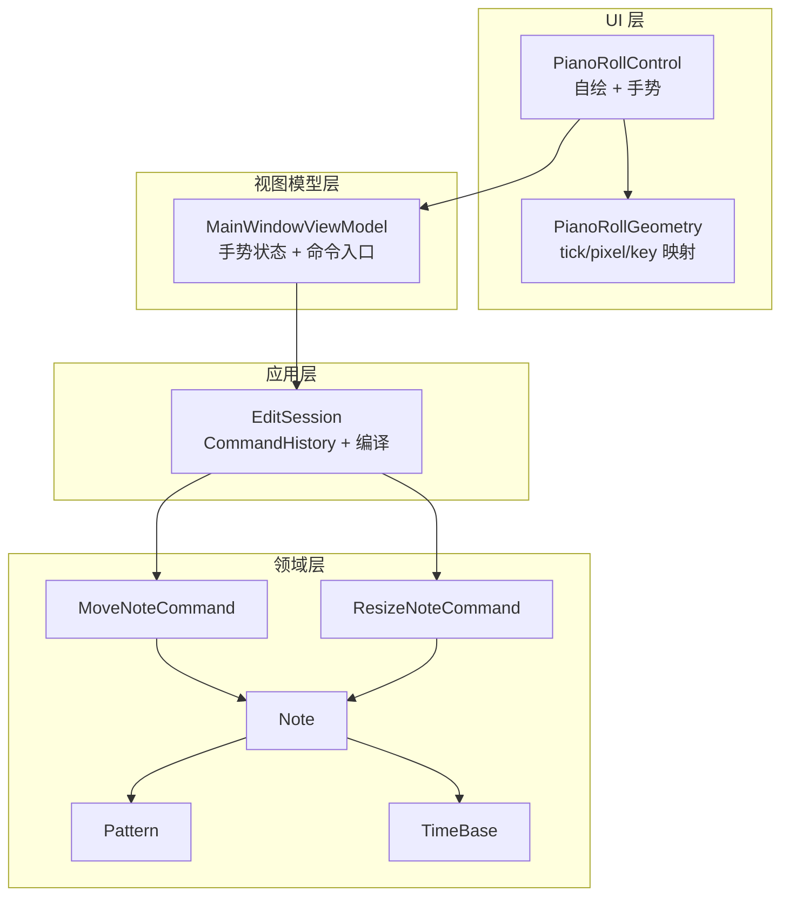
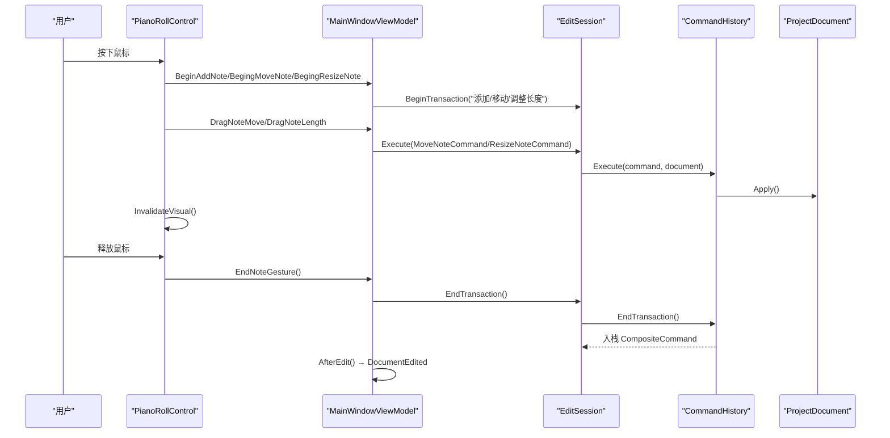
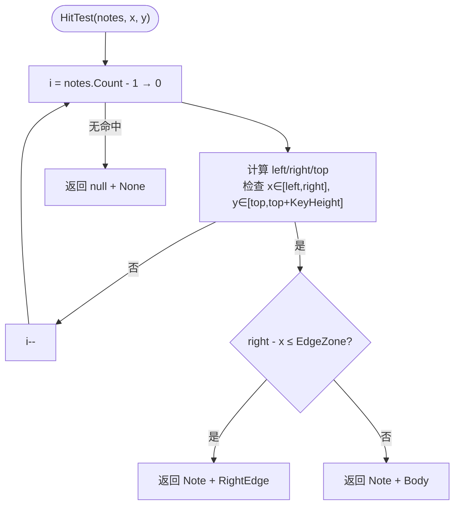
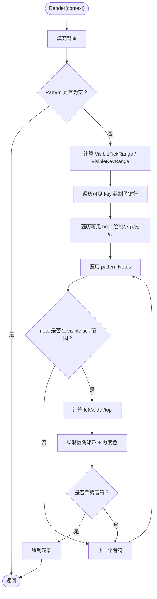
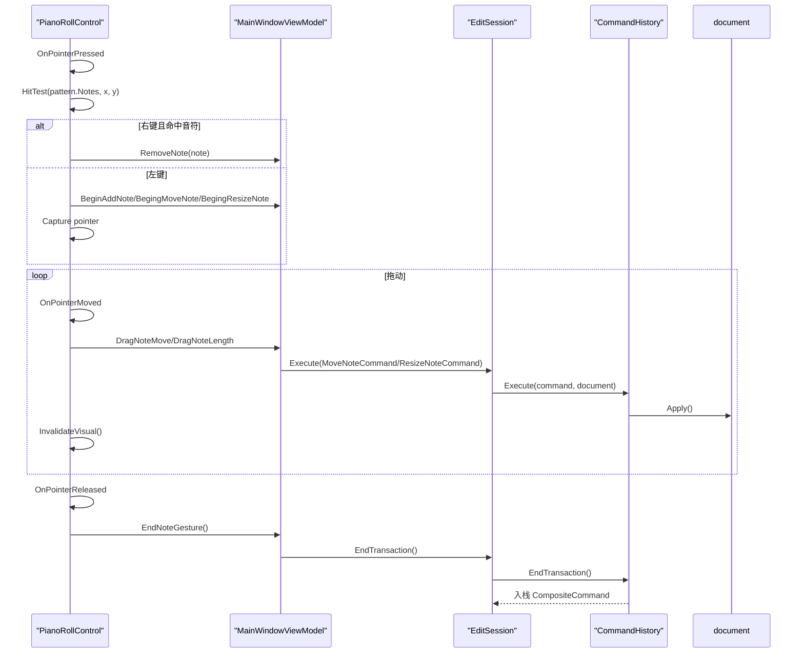
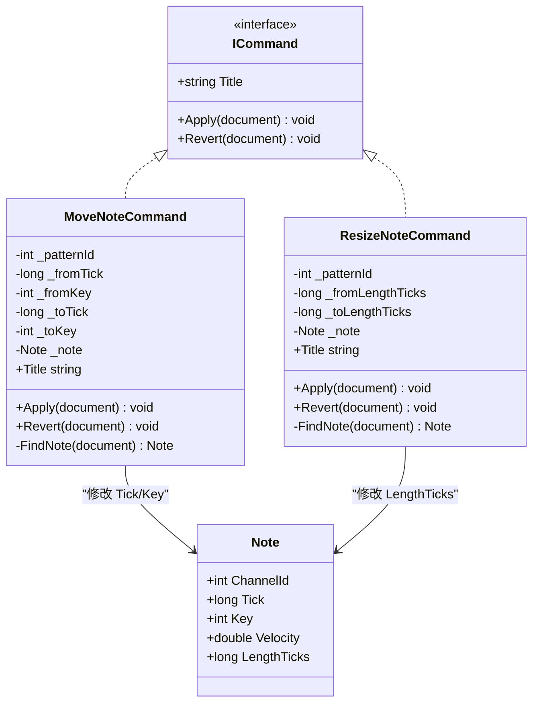
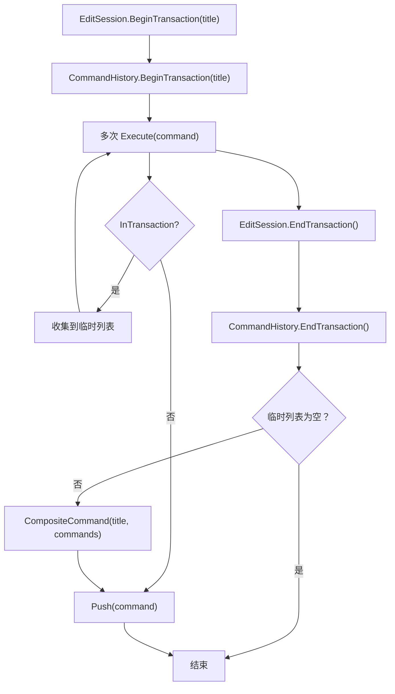
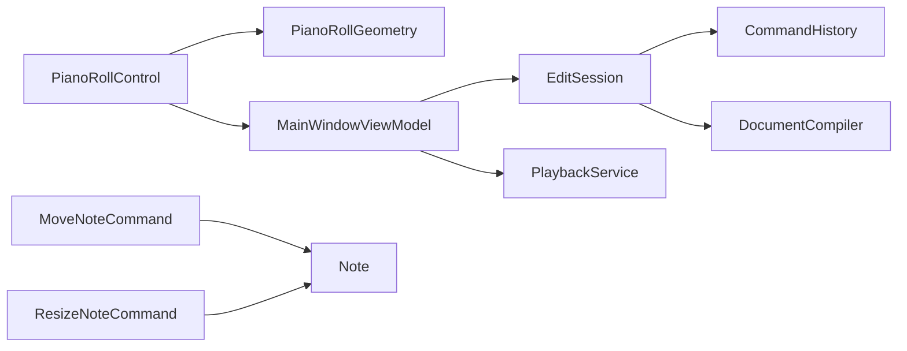

# 钢琴卷帘编辑器

<cite>
**本文引用的文件**   
- [PianoRollControl.cs](file://src/Weftone.App/Controls/PianoRollControl.cs)
- [PianoRollGeometry.cs](file://src/Weftone.App/Controls/PianoRollGeometry.cs)
- [MainWindowViewModel.cs](file://src/Weftone.App/ViewModels/MainWindowViewModel.cs)
- [MoveNoteCommand.cs](file://src/Weftone.Domain/Commands/MoveNoteCommand.cs)
- [ResizeNoteCommand.cs](file://src/Weftone.Domain/Commands/ResizeNoteCommand.cs)
- [CommandHistory.cs](file://src/Weftone.Domain/Commands/CommandHistory.cs)
- [ICommand.cs](file://src/Weftone.Domain/Commands/ICommand.cs)
- [EditSession.cs](file://src/Weftone.Application/EditSession.cs)
- [Note.cs](file://src/Weftone.Domain/Note.cs)
- [Pattern.cs](file://src/Weftone.Domain/Pattern.cs)
- [TimeBase.cs](file://src/Weftone.Domain/TimeBase.cs)
</cite>

## 目录
1. [引言](#引言)
2. [项目结构](#项目结构)
3. [核心组件](#核心组件)
4. [架构总览](#架构总览)
5. [详细组件分析](#详细组件分析)
6. [依赖关系分析](#依赖关系分析)
7. [性能考虑](#性能考虑)
8. [故障排查指南](#故障排查指南)
9. [结论](#结论)

## 引言
本文件面向钢琴卷帘编辑器的自绘实现，重点解释以下方面：
- 横轴 tick（小节/拍网格）与纵轴 MIDI key（钢琴键侧栏）的坐标系统。
- 音符矩形绘制、力度色显示、视口裁剪优化。
- MoveNote / ResizeNote 命令的实现与撤销系统集成。
- 拖拽操作的开始、移动、结束流程。
- 几何与命中测试纯函数的设计，tick↔pixel 映射算法和 note hit test 逻辑。
- 具体绘制代码路径、用户交互流程和性能优化策略。

该实现采用 Avalonia 自绘 Control，UI 层只负责手势与渲染，业务变更通过 ViewModel 调用 EditSession 执行领域命令，并由 CommandHistory 提供撤销/重做与事务合并能力。

## 项目结构
钢琴卷帘相关代码分布在三层：
- UI 层：PianoRollControl 负责自绘与指针事件；PianoRollGeometry 提供纯函数几何与命中测试。
- 视图模型层：MainWindowViewModel 封装手势状态、命令发起与播放联动。
- 领域与应用层：MoveNoteCommand / ResizeNoteCommand 修改 Pattern.Notes；EditSession 管理 CommandHistory 与文档编译；Note / Pattern / TimeBase 为领域模型。

**图表来源**
- [PianoRollControl.cs:10-15](file://src/Weftone.App/Controls/PianoRollControl.cs#L10-L15)
- [PianoRollGeometry.cs:14-18](file://src/Weftone.App/Controls/PianoRollGeometry.cs#L14-L18)
- [MainWindowViewModel.cs:229-323](file://src/Weftone.App/ViewModels/MainWindowViewModel.cs#L229-L323)
- [EditSession.cs:100-118](file://src/Weftone.Application/EditSession.cs#L100-L118)
- [MoveNoteCommand.cs:1-41](file://src/Weftone.Domain/Commands/MoveNoteCommand.cs#L1-L41)
- [ResizeNoteCommand.cs:1-41](file://src/Weftone.Domain/Commands/ResizeNoteCommand.cs#L1-L41)
- [Note.cs:1-12](file://src/Weftone.Domain/Note.cs#L1-L12)
- [Pattern.cs:1-9](file://src/Weftone.Domain/Pattern.cs#L1-L9)
- [TimeBase.cs:1-8](file://src/Weftone.Domain/TimeBase.cs#L1-L8)

**章节来源**
- [PianoRollControl.cs:10-15](file://src/Weftone.App/Controls/PianoRollControl.cs#L10-L15)
- [PianoRollGeometry.cs:14-18](file://src/Weftone.App/Controls/PianoRollGeometry.cs#L14-L18)
- [MainWindowViewModel.cs:229-323](file://src/Weftone.App/ViewModels/MainWindowViewModel.cs#L229-L323)
- [EditSession.cs:100-118](file://src/Weftone.Application/EditSession.cs#L100-L118)
- [MoveNoteCommand.cs:1-41](file://src/Weftone.Domain/Commands/MoveNoteCommand.cs#L1-L41)
- [ResizeNoteCommand.cs:1-41](file://src/Weftone.Domain/Commands/ResizeNoteCommand.cs#L1-L41)
- [Note.cs:1-12](file://src/Weftone.Domain/Note.cs#L1-L12)
- [Pattern.cs:1-9](file://src/Weftone.Domain/Pattern.cs#L1-L9)
- [TimeBase.cs:1-8](file://src/Weftone.Domain/TimeBase.cs#L1-L8)

## 核心组件
- PianoRollControl：Avalonia 自绘控件，处理 Render、Measure、PointerPressed/Moved/Released，驱动手势状态并调用 ViewModel。
- PianoRollGeometry：纯函数集合，定义 KeyHeight、PixelsPerBeat、EdgeZone、SnapTicks，并提供 TickToX/XToTick、KeyToY/YToKey、HitTest、VisibleTickRange、VisibleKeyRange。
- MainWindowViewModel：维护 NoteGesture 状态、最近添加音符引用、Begin/Drag/End 系列方法，统一经 EditSession 执行命令。
- MoveNoteCommand / ResizeNoteCommand：可撤销命令，Apply/Revert 精确互逆，基于 patternId + Note 引用定位并修改字段。
- CommandHistory：命令日志，支持 Execute、Undo、Redo、BeginTransaction、EndTransaction，将一次手势的多条命令合并为 CompositeCommand。
- EditSession：持有 ProjectDocument 与 CommandHistory，暴露 BeginTransaction/EndTransaction/Execute/Undo/Redo，并在 AfterEdit 时触发文档替换与播放更新。
- Note / Pattern / TimeBase：领域模型，Tick 以 PPQ=96 整数 tick 表示，Key 为 0..127，Velocity 为 0..1，LengthTicks 为长度单位。

**章节来源**
- [PianoRollControl.cs:15-74](file://src/Weftone.App/Controls/PianoRollControl.cs#L15-L74)
- [PianoRollGeometry.cs:18-81](file://src/Weftone.App/Controls/PianoRollGeometry.cs#L18-L81)
- [MainWindowViewModel.cs:16-35](file://src/Weftone.App/ViewModels/MainWindowViewModel.cs#L16-L35)
- [MoveNoteCommand.cs:7-40](file://src/Weftone.Domain/Commands/MoveNoteCommand.cs#L7-L40)
- [ResizeNoteCommand.cs:7-40](file://src/Weftone.Domain/Commands/ResizeNoteCommand.cs#L7-L40)
- [CommandHistory.cs:7-59](file://src/Weftone.Domain/Commands/CommandHistory.cs#L7-L59)
- [EditSession.cs:14-45](file://src/Weftone.Application/EditSession.cs#L14-L45)
- [Note.cs:1-12](file://src/Weftone.Domain/Note.cs#L1-L12)
- [Pattern.cs:1-9](file://src/Weftone.Domain/Pattern.cs#L1-L9)
- [TimeBase.cs:1-8](file://src/Weftone.Domain/TimeBase.cs#L1-L8)

## 架构总览
钢琴卷帘编辑器的数据流遵循“UI 意图 → VM 命令 → 领域命令 → 文档变更 → 全量编译 → 播放/渲染”的单向流。

**图表来源**
- [PianoRollControl.cs:185-292](file://src/Weftone.App/Controls/PianoRollControl.cs#L185-L292)
- [MainWindowViewModel.cs:229-323](file://src/Weftone.App/ViewModels/MainWindowViewModel.cs#L229-L323)
- [EditSession.cs:100-118](file://src/Weftone.Application/EditSession.cs#L100-L118)
- [CommandHistory.cs:20-59](file://src/Weftone.Domain/Commands/CommandHistory.cs#L20-L59)

## 详细组件分析

### 坐标系统与几何纯函数
- 横轴 tick 到像素：TickToX(tick) = tick × PixelsPerBeat / TimeBase.Ppq，其中 PixelsPerBeat=64，TimeBase.Ppq=96。
- 像素到横轴 tick：XToTick(x) = floor(x × TimeBase.Ppq / PixelsPerBeat)。
- 纵轴 key 到像素：KeyToY(key) = (KeyCount - 1 - key) × KeyHeight，KeyCount=128，KeyHeight=14，因此 127 在顶部，0 在底部。
- 像素到纵轴 key：YToKey(y) = clamp(KeyCount - 1 - floor(y / KeyHeight), 0, 127)。
- 吸附步长：SnapTicks = TimeBase.Ppq / 4 = 24 tick（1/4 拍），SnapTick(tick) 按四舍五入对齐到 SnapTicks。
- 可见范围：VisibleTickRange(x0,x1) 返回 firstTick,lastTick，两侧各留 1 tick 余量；VisibleKeyRange(y0,y1) 返回 topKey,bottomKey 的最小/最大区间。
- 黑键判断：IsBlackKey(key) 根据 MIDI key 模 12 的结果判定。

这些函数不依赖 Avalonia 类型，便于 headless 单测覆盖。

```mermaid
flowchart TD
Start(["输入 x/y"]) --> XToTick["XToTick(x)<br/>floor(x * 96 / 64)"]
YToKey["YToKey(y)<br/>clamp(127 - floor(y / 14), 0, 127)"]
XToTick --> SnapTick["SnapTick(tick)<br/>round(tick / 24) * 24"]
YToKey --> Range["VisibleKeyRange(y0,y1)"]
XToTick --> Range2["VisibleTickRange(x0,x1)"]
SnapTick --> End(["输出 snap tick"])
Range --> End2(["输出 key 范围"])
Range2 --> End3(["输出 tick 范围"])
```

**图表来源**
- [PianoRollGeometry.cs:29-40](file://src/Weftone.App/Controls/PianoRollGeometry.cs#L29-L40)
- [PianoRollGeometry.cs:66-80](file://src/Weftone.App/Controls/PianoRollGeometry.cs#L66-L80)
- [TimeBase.cs:3-7](file://src/Weftone.Domain/TimeBase.cs#L3-L7)

**章节来源**
- [PianoRollGeometry.cs:18-40](file://src/Weftone.App/Controls/PianoRollGeometry.cs#L18-L40)
- [PianoRollGeometry.cs:66-80](file://src/Weftone.App/Controls/PianoRollGeometry.cs#L66-L80)
- [TimeBase.cs:3-7](file://src/Weftone.Domain/TimeBase.cs#L3-L7)

### 命中测试与音符区域
HitTest(notes, x, y) 从后向前遍历音符列表，找到包含点 (x,y) 的第一个音符，若右边缘距离 EdgeZone=6 像素内则返回 RightEdge，否则返回 Body；未命中返回 None。

**图表来源**
- [PianoRollGeometry.cs:44-64](file://src/Weftone.App/Controls/PianoRollGeometry.cs#L44-L64)

**章节来源**
- [PianoRollGeometry.cs:44-64](file://src/Weftone.App/Controls/PianoRollGeometry.cs#L44-L64)

### 绘制流程与视口裁剪
Render(context) 主要步骤：
1. 填充背景。
2. 若 Pattern 为空直接返回。
3. 计算 VisibleTickRange 与 VisibleKeyRange。
4. 遍历可见 key，仅对黑键行绘制深色背景。
5. 遍历可见 beat，绘制小节线或拍线。
6. 遍历 pattern.Notes，跳过不在 visible tick 范围的音符，计算 left/width/top，使用圆角矩形绘制音符，并根据 velocity 选择颜色。
7. 若当前音符处于手势中，额外绘制轮廓。

**图表来源**
- [PianoRollControl.cs:104-157](file://src/Weftone.App/Controls/PianoRollControl.cs#L104-L157)

**章节来源**
- [PianoRollControl.cs:104-157](file://src/Weftone.App/Controls/PianoRollControl.cs#L104-L157)

### 力度色显示
NoteBrush(velocity) 将 velocity 映射到 HSV 色相：低力度对应蓝色（约 210°），高力度对应橙色（约 30°），饱和度与明度固定，再通过 HSV→RGB 转换生成 SolidColorBrush。

**章节来源**
- [PianoRollControl.cs:159-183](file://src/Weftone.App/Controls/PianoRollControl.cs#L159-L183)

### 用户交互流程：拖拽音符
- 按下：OnPointerPressed 调用 HitTest 判断区域；右键删除；左键根据区域进入 AddResize/Move/Resize 三种手势，记录 pressTick、originTick、gestureNote，并捕获指针。
- 移动：OnPointerMoved 根据 gesture 类型计算目标 tick/key，调用 VM.DragNoteMove 或 VM.DragNoteLength，刷新视觉。
- 释放：OnPointerReleased 调用 EndGesture，VM.EndNoteGesture 结束事务并触发 AfterEdit。

**图表来源**
- [PianoRollControl.cs:185-292](file://src/Weftone.App/Controls/PianoRollControl.cs#L185-L292)
- [MainWindowViewModel.cs:229-323](file://src/Weftone.App/ViewModels/MainWindowViewModel.cs#L229-L323)
- [EditSession.cs:100-118](file://src/Weftone.Application/EditSession.cs#L100-L118)
- [CommandHistory.cs:20-59](file://src/Weftone.Domain/Commands/CommandHistory.cs#L20-L59)

**章节来源**
- [PianoRollControl.cs:185-292](file://src/Weftone.App/Controls/PianoRollControl.cs#L185-L292)
- [MainWindowViewModel.cs:229-323](file://src/Weftone.App/ViewModels/MainWindowViewModel.cs#L229-L323)

### MoveNote / ResizeNote 命令实现
- MoveNoteCommand：保存 fromTick/fromKey/toTick/toKey，Apply 设置 note.Tick/Key，Revert 恢复原值；FindNote 通过 patternId 与对象引用定位音符。
- ResizeNoteCommand：保存 fromLengthTicks/toLengthTicks，Apply 校验 toLengthTicks≥1 并设置 LengthTicks，Revert 恢复原长度；FindNote 同样通过 patternId 与对象引用定位。

两者均要求 Apply/Revert 精确互逆，确保撤销/重做正确性。

**图表来源**
- [ICommand.cs:1-12](file://src/Weftone.Domain/Commands/ICommand.cs#L1-L12)
- [MoveNoteCommand.cs:7-40](file://src/Weftone.Domain/Commands/MoveNoteCommand.cs#L7-L40)
- [ResizeNoteCommand.cs:7-40](file://src/Weftone.Domain/Commands/ResizeNoteCommand.cs#L7-L40)
- [Note.cs:1-12](file://src/Weftone.Domain/Note.cs#L1-L12)

**章节来源**
- [MoveNoteCommand.cs:7-40](file://src/Weftone.Domain/Commands/MoveNoteCommand.cs#L7-L40)
- [ResizeNoteCommand.cs:7-40](file://src/Weftone.Domain/Commands/ResizeNoteCommand.cs#L7-L40)
- [ICommand.cs:1-12](file://src/Weftone.Domain/Commands/ICommand.cs#L1-L12)
- [Note.cs:1-12](file://src/Weftone.Domain/Note.cs#L1-L12)

### 撤销系统与命令合并机制
- CommandHistory.Execute：立即 Apply 到文档；若非事务中则直接入撤销栈；若在事务中则加入临时列表；清空重做栈。
- BeginTransaction：开启事务，记录标题，初始化临时列表。
- EndTransaction：关闭事务，若临时列表非空则包装为 CompositeCommand 并入撤销栈；空事务不入栈。
- Undo/Redo：在非事务状态下弹出命令并 Revert/Apply，同时交换撤销/重做栈。
- EditSession.BeginTransaction/EndTransaction：委托给 History，并标记 IsDirty。

**图表来源**
- [EditSession.cs:106-118](file://src/Weftone.Application/EditSession.cs#L106-L118)
- [CommandHistory.cs:20-59](file://src/Weftone.Domain/Commands/CommandHistory.cs#L20-L59)

**章节来源**
- [CommandHistory.cs:20-59](file://src/Weftone.Domain/Commands/CommandHistory.cs#L20-L59)
- [EditSession.cs:106-118](file://src/Weftone.Application/EditSession.cs#L106-L118)

## 依赖关系分析
- PianoRollControl 依赖 PianoRollGeometry 进行几何计算与命中测试，依赖 MainWindowViewModel 执行业务意图。
- MainWindowViewModel 依赖 EditSession 执行命令与事务，依赖 PlaybackService 更新播放计划。
- EditSession 依赖 CommandHistory 管理撤销/重做，依赖 DocumentCompiler 编译 RenderPlan。
- MoveNoteCommand / ResizeNoteCommand 依赖 Note 与 Pattern（通过 ProjectDocument.Patterns）。
- 所有几何与命中测试逻辑集中在 PianoRollGeometry，避免 UI 框架耦合，提升可测试性。

**图表来源**
- [PianoRollControl.cs:10-15](file://src/Weftone.App/Controls/PianoRollControl.cs#L10-L15)
- [PianoRollGeometry.cs:14-18](file://src/Weftone.App/Controls/PianoRollGeometry.cs#L14-L18)
- [MainWindowViewModel.cs:24-35](file://src/Weftone.App/ViewModels/MainWindowViewModel.cs#L24-L35)
- [EditSession.cs:14-45](file://src/Weftone.Application/EditSession.cs#L14-L45)
- [MoveNoteCommand.cs:7-40](file://src/Weftone.Domain/Commands/MoveNoteCommand.cs#L7-L40)
- [ResizeNoteCommand.cs:7-40](file://src/Weftone.Domain/Commands/ResizeNoteCommand.cs#L7-L40)

**章节来源**
- [PianoRollControl.cs:10-15](file://src/Weftone.App/Controls/PianoRollControl.cs#L10-L15)
- [PianoRollGeometry.cs:14-18](file://src/Weftone.App/Controls/PianoRollGeometry.cs#L14-L18)
- [MainWindowViewModel.cs:24-35](file://src/Weftone.App/ViewModels/MainWindowViewModel.cs#L24-L35)
- [EditSession.cs:14-45](file://src/Weftone.Application/EditSession.cs#L14-L45)
- [MoveNoteCommand.cs:7-40](file://src/Weftone.Domain/Commands/MoveNoteCommand.cs#L7-L40)
- [ResizeNoteCommand.cs:7-40](file://src/Weftone.Domain/Commands/ResizeNoteCommand.cs#L7-L40)

## 性能考虑
- 视口裁剪：Render 中先计算 VisibleTickRange 与 VisibleKeyRange，再绘制网格与音符，避免绘制不可见区域。
- 音符过滤：遍历 Notes 时跳过不在 visible tick 范围的音符，减少绘制开销。
- 黑键行优化：仅对黑键行绘制深色背景，降低无关行的绘制成本。
- 最小音符宽度：width 至少为 3 像素，保证小长度音符仍可点击与识别。
- 手势轮廓：仅在 _gestureNote 上绘制轮廓，避免每帧重复绘制所有音符边框。
- 纯函数几何：PianoRollGeometry 不依赖 UI 框架，可在 headless 环境快速运行单测，提高开发效率与稳定性。

**章节来源**
- [PianoRollControl.cs:114-157](file://src/Weftone.App/Controls/PianoRollControl.cs#L114-L157)
- [PianoRollGeometry.cs:66-80](file://src/Weftone.App/Controls/PianoRollGeometry.cs#L66-L80)

## 故障排查指南
- 命中测试无效：检查 HitTest 的 right-edge 阈值 EdgeZone 与 KeyHeight 配置，确认点坐标与像素映射是否正确。
- 音符无法选中：确认 Pattern.Notes 顺序与绘制顺序一致，HitTest 从后向前取上层音符。
- 撤销失败：确保 MoveNoteCommand/ResizeNoteCommand 的 Apply/Revert 精确互逆，FindNote 能定位到同一对象引用。
- 事务未合并：检查 BeginTransaction/EndTransaction 成对调用，且中间 Execute 次数大于 0 才会入栈 CompositeCommand。
- 播放不同步：AfterEdit 会触发 DocumentEdited 与 UpdatePlan，确保 VM 的 IsPlaying 状态与 PlaybackService 同步。

**章节来源**
- [PianoRollGeometry.cs:44-64](file://src/Weftone.App/Controls/PianoRollGeometry.cs#L44-L64)
- [MoveNoteCommand.cs:18-39](file://src/Weftone.Domain/Commands/MoveNoteCommand.cs#L18-L39)
- [ResizeNoteCommand.cs:16-39](file://src/Weftone.Domain/Commands/ResizeNoteCommand.cs#L16-L39)
- [CommandHistory.cs:35-59](file://src/Weftone.Domain/Commands/CommandHistory.cs#L35-L59)
- [MainWindowViewModel.cs:496-507](file://src/Weftone.App/ViewModels/MainWindowViewModel.cs#L496-L507)

## 结论
钢琴卷帘编辑器通过自绘控件与纯函数几何实现了高效的音符编辑界面。坐标系统以 tick 与 MIDI key 为核心，配合视口裁剪与黑键行优化，确保在大数量音符场景下的流畅体验。MoveNote / ResizeNote 命令与 CommandHistory 的事务机制保证了拖拽操作的可撤销性与一致性。UI 层职责清晰，业务逻辑集中于 ViewModel 与领域命令，便于测试与维护。