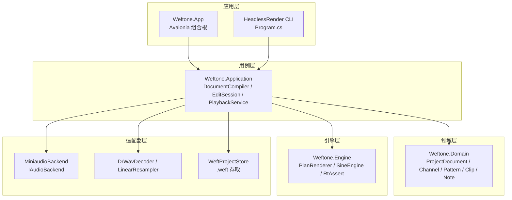
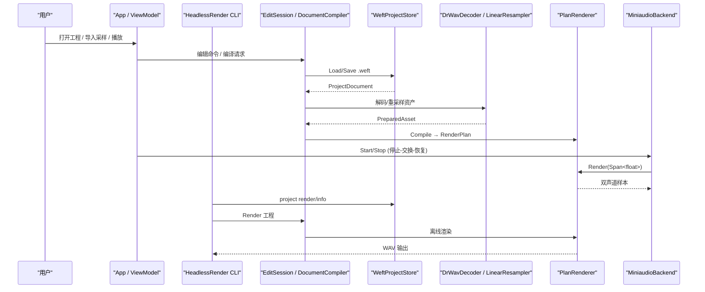
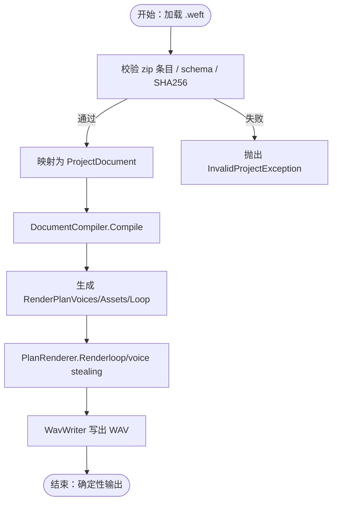
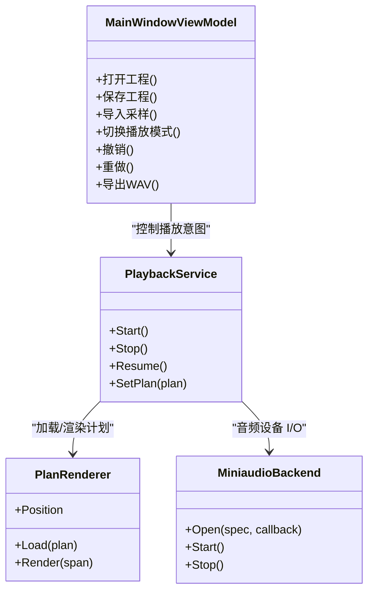
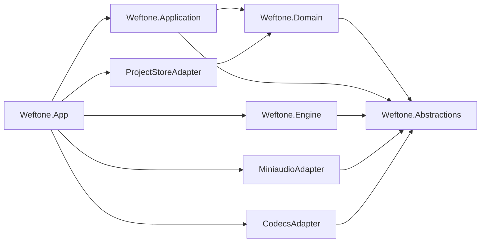
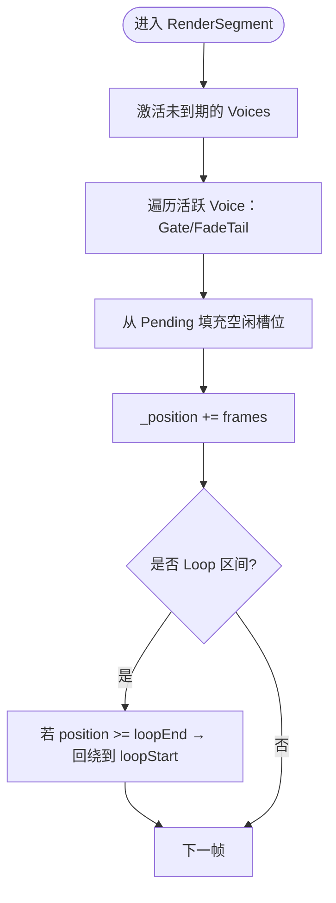

# 规格文档

<cite>
**本文引用的文件**   
- [README.md](file://README.md)
- [M0_FOUNDATION.md](file://specs/M0_FOUNDATION.md)
- [M1a_HEADLESS.md](file://specs/M1a_HEADLESS.md)
- [M1b_UI.md](file://specs/M1b_UI.md)
- [ci.yml](file://.github/workflows/ci.yml)
- [Weftone.slnx](file://Weftone.slnx)
- [ProjectDocument.cs](file://src/Weftone.Domain/ProjectDocument.cs)
- [DocumentCompiler.cs](file://src/Weftone.Application/DocumentCompiler.cs)
- [PlanRenderer.cs](file://src/Weftone.Engine/PlanRenderer.cs)
- [WeftProjectStore.cs](file://src/Weftone.Adapters.ProjectStore/WeftProjectStore.cs)
- [Program.cs](file://tools/HeadlessRender/Program.cs)
- [App.axaml.cs](file://src/Weftone.App/App.axaml.cs)
</cite>

## 目录
1. [引言](#引言)
2. [项目结构](#项目结构)
3. [核心组件](#核心组件)
4. [架构总览](#架构总览)
5. [详细组件分析](#详细组件分析)
6. [依赖关系分析](#依赖关系分析)
7. [性能与实时纪律](#性能与实时纪律)
8. [规格验收、优先级与里程碑](#规格验收优先级与里程碑)
9. [规格驱动开发与变更管理](#规格驱动开发与变更管理)
10. [故障排查指南](#故障排查指南)
11. [结论](#结论)

## 引言
本参考文档面向 Weftone 的功能规格与实现现状，覆盖 M0 地基、M1a Headless 与 M1b UI 三个里程碑。文档以仓库现有源码和规格文件为依据，说明：
- M0 地基的完成范围：仓库治理、native shim、最小可出声与离线渲染、三平台 CI。
- M1a Headless 的能力边界：`.weft` 工程模型、命令撤销、编译器、transport、Sampler、Mixer、导出与黄金音频回归。
- M1b UI 的最小界面需求：Piano Roll、Playlist、Mixer、传输条与工程存取。
- 规格验收标准、优先级排序与里程碑规划。
- 规格驱动开发流程与变更管理策略。

## 项目结构
Weftone 采用六边形架构（端口与适配器）+ 编译器模式 + 数据导向实时层。源码按领域分层组织：Domain 富对象、Application 用例、Engine 零分配渲染、Adapters 第三方能力、App 组合根与 UI。解决方案由 `Weftone.slnx` 统一编排 src、tests、tools 下的项目。

**图表来源**
- [Weftone.slnx:1-23](file://Weftone.slnx#L1-L23)
- [App.axaml.cs:23-37](file://src/Weftone.App/App.axaml.cs#L23-L37)
- [Program.cs:119-120](file://tools/HeadlessRender/Program.cs#L119-L120)

**章节来源**
- [README.md:38-79](file://README.md#L38-L79)
- [Weftone.slnx:1-23](file://Weftone.slnx#L1-L23)

## 核心组件
本节聚焦 M1a 与 M1b 共同的核心组件：工程文档模型、`.weft` 存取、编译器、渲染器、CLI 与 App 组合根。

- 工程文档模型：`ProjectDocument` 提供 BPM、采样率、主控音量、声部、Pattern、Playlist 与资产引用；M1b 引入 MasterVolume 作为 Mixer master 推子。
- `.weft` 存取：`WeftProjectStore` 实现 zip 容器校验、schema 版本检查、SHA256 资产校验与白名单条目保护。
- 编译器：`DocumentCompiler` 将富对象 Document 编译为扁平 RenderPlan，支持 Song 线性展开与 Pattern 循环区间。
- 渲染器：`PlanRenderer` 在实时/离线路径上执行零分配渲染，支持 loop、voice stealing、fade tail、sine 与 sampler。
- CLI：`Program.cs` 提供 render/play/project/demo 等子命令，串联 ProjectStore、Codecs、Resampler 与 PlanRenderer。
- App 组合根：`App.axaml.cs` 装配 EditSession、PlaybackService、MiniaudioBackend 与 PlanRenderer，并加载演示工程。

**章节来源**
- [ProjectDocument.cs:1-20](file://src/Weftone.Domain/ProjectDocument.cs#L1-L20)
- [WeftProjectStore.cs:9-70](file://src/Weftone.Adapters.ProjectStore/WeftProjectStore.cs#L9-L70)
- [DocumentCompiler.cs:6-157](file://src/Weftone.Application/DocumentCompiler.cs#L6-L157)
- [PlanRenderer.cs:5-105](file://src/Weftone.Engine/PlanRenderer.cs#L5-L105)
- [Program.cs:119-135](file://tools/HeadlessRender/Program.cs#L119-L135)
- [App.axaml.cs:23-37](file://src/Weftone.App/App.axaml.cs#L23-L37)

## 架构总览
Weftone 的运行时关键路径是“编辑模型 → 编译器 → RenderPlan → 原子交换 → 实时引擎”。UI 与 CLI 仅负责组装与交互，Engine 不感知 UI 类型。

**图表来源**
- [App.axaml.cs:23-37](file://src/Weftone.App/App.axaml.cs#L23-L37)
- [Program.cs:119-135](file://tools/HeadlessRender/Program.cs#L119-L135)
- [DocumentCompiler.cs:18-49](file://src/Weftone.Application/DocumentCompiler.cs#L18-L49)
- [PlanRenderer.cs:48-105](file://src/Weftone.Engine/PlanRenderer.cs#L48-L105)

## 详细组件分析

### M0 地基规格完成情况
M0 目标为“可出声、可离线渲染、可被三平台 CI 守护的最小地基”，已完成：
- 仓库治理：GPLv3 许可、第三方声明、贡献指南、构建属性与包管理。
- native shim：miniaudio C ABI 封装、CMake 构建、库探测与 P/Invoke。
- C# 核心：Abstractions（IAudioBackend）、Engine（SineEngine、RtAssert）、MiniaudioAdapter（反向 P/Invoke）。
- CLI：render/play 冒烟，WAV 尺寸校验。
- 测试：正弦正确性、确定性、分配断言、WAV 往返、架构依赖规则与占位符扫描。
- CI：三平台矩阵（windows/macOS/linux），native 编译、Release/Debug 测试、CLI 冒烟与 WAV 尺寸校验。

验收要点包括 Release/Debug 全绿、RT 托管分配为零、5 秒 48kHz/2ch float32 WAV 尺寸与数值偏差、两次渲染逐位一致、play 有库出声无库降级提示、CI 三平台绿。

**章节来源**
- [M0_FOUNDATION.md:5-32](file://specs/M0_FOUNDATION.md#L5-L32)
- [ci.yml:9-59](file://.github/workflows/ci.yml#L9-L59)
- [README.md:81-112](file://README.md#L81-L112)

### M1a Headless 规格功能范围
M1a 定义了一个 headless 竖切：`.weft` 工程可确定性渲染出 WAV，编辑操作具备命令撤销，输出受黄金音频基线守护。

- 数据模型：`ProjectDocument` 含 tempo、sampleRate、channels、patterns、playlist、assets；时间单位使用整数 tick（PPQ=96）。
- 命令撤销：ICommand 接口 + CommandHistory 事务日志；拖拽合并机制在 M1b 落地，M1a 逐条撤销。
- `.weft` 格式 v1：zip 容器包含 project.json、metadata.json 与 assets/*.wav，加载时校验 SHA256 与 schemaVersion。
- 编译器：`DocumentCompiler.Compile` 生成 RenderPlan，事件按 StartSample 稳定排序，幂等且确定。
- Engine 扩展：transport（起止 tick、BPM→采样位置换算）、voice 调度（预分配池、淡出防 click）、Mixer（channel gain/pan + master gain）。
- 采样链：dr_wav 解码、线性插值重采样到工程采样率、Sampler voice 整采样触发与 key→播放速率。
- CLI：project render/info、demo 工程生成与 WAV 导出。

**图表来源**
- [WeftProjectStore.cs:23-70](file://src/Weftone.Adapters.ProjectStore/WeftProjectStore.cs#L23-L70)
- [DocumentCompiler.cs:18-49](file://src/Weftone.Application/DocumentCompiler.cs#L18-L49)
- [PlanRenderer.cs:48-105](file://src/Weftone.Engine/PlanRenderer.cs#L48-L105)

**章节来源**
- [M1a_HEADLESS.md:6-98](file://specs/M1a_HEADLESS.md#L6-L98)
- [ProjectDocument.cs:1-20](file://src/Weftone.Domain/ProjectDocument.cs#L1-L20)
- [WeftProjectStore.cs:9-70](file://src/Weftone.Adapters.ProjectStore/WeftProjectStore.cs#L9-L70)
- [DocumentCompiler.cs:6-157](file://src/Weftone.Application/DocumentCompiler.cs#L6-L157)
- [PlanRenderer.cs:5-105](file://src/Weftone.Engine/PlanRenderer.cs#L5-L105)
- [Program.cs:122-135](file://tools/HeadlessRender/Program.cs#L122-L135)

### M1b UI 规格最小界面需求
M1b 最小 UI 目标是 Avalonia 单窗口 DAW：加载采样 → Piano Roll 画 4 小节 → Pattern 循环播放 → Playlist 排 2 段 → Mixer 调音量/pan → 导出 WAV；撤销/重做、存盘/读盘正常。

- 架构边界：App 是唯一允许引用 Avalonia 的项目；Engine/Application/Domain 不出现 UI 类型。
- 线程模型：UI 线程独占 Document；命令同步执行；编译在 UI 线程全量编译；RenderPlan 不可变交付音频线程。
- 播放与 transport：Pattern 模式（循环当前 Pattern）与 Song 模式（Playlist 线性时间轴）；PlanRenderer 新增 loop 支持。
- RenderPlan 交换：M1b 采用“停止-交换-恢复”避免并发风险；RCU 双缓冲留 M2。
- 自绘：Piano Roll、Playlist、Mixer 使用 Avalonia DrawingContext 自绘，几何/命中测试抽成纯函数。
- 编辑命令与撤销：新增 MoveNote/ResizeNote/AddClip/RemoveClip/MoveClip/AddChannel/ImportAsset；拖拽合并为单步撤销。
- 工程存取与采样导入：复用 WeftProjectStore；未存盘资产内存注册表；标题栏脏标记。
- 导出 WAV：复用 ProjectRenderService，离线路径与实时播放互不干扰。

**图表来源**
- [App.axaml.cs:23-37](file://src/Weftone.App/App.axaml.cs#L23-L37)
- [M1b_UI.md:49-64](file://specs/M1b_UI.md#L49-L64)
- [PlanRenderer.cs:48-105](file://src/Weftone.Engine/PlanRenderer.cs#L48-L105)

**章节来源**
- [M1b_UI.md:7-155](file://specs/M1b_UI.md#L7-L155)
- [App.axaml.cs:18-47](file://src/Weftone.App/App.axaml.cs#L18-L47)

## 依赖关系分析
- 项目解耦：Domain 不依赖 Application/Engine；Application 依赖 Domain 与 Abstractions；Engine 仅依赖 Abstractions；App 组合根装配 Adapters。
- 外部依赖隔离：Audio I/O（miniaudio）、解码（dr_wav）、UI（Avalonia）均通过 Adapter 或 App 层接入，Engine 保持零第三方类型。
- 测试与架构约束：ArchTests 确保 App 之外不得出现 Avalonia 类型；CI 运行架构测试与占位符扫描。

**图表来源**
- [Weftone.slnx:1-23](file://Weftone.slnx#L1-L23)
- [App.axaml.cs:23-37](file://src/Weftone.App/App.axaml.cs#L23-L37)

**章节来源**
- [Weftone.slnx:1-23](file://Weftone.slnx#L1-L23)
- [README.md:38-68](file://README.md#L38-L68)

## 性能与实时纪律
- 零分配实时路径：PlanRenderer 使用固定大小 Voice 池与 pending ring，避免 GC 压力；RtAssert 在 Debug 构建中强制托管分配为零。
- 确定性渲染：Compile 对 Voices 按 StartSample 排序，Loop 区间随 RenderPlan 下发，保证同配置输出一致。
- 复音上限与偷声：最大 64 voices，池满时选择最早结束的 voice 进行 fade tail 偷声，pending 队列等待释放槽位。
- Loop 回绕：position 到达 loopEnd 时重置到 loopStart 并重设事件游标，保持零分配。
- 主增益：MasterGain 在 Render 末尾统一缩放，避免每帧分支。

**图表来源**
- [PlanRenderer.cs:107-137](file://src/Weftone.Engine/PlanRenderer.cs#L107-L137)
- [PlanRenderer.cs:78-93](file://src/Weftone.Engine/PlanRenderer.cs#L78-L93)

**章节来源**
- [PlanRenderer.cs:5-105](file://src/Weftone.Engine/PlanRenderer.cs#L5-L105)
- [PlanRenderer.cs:139-231](file://src/Weftone.Engine/PlanRenderer.cs#L139-L231)

## 规格验收、优先级与里程碑

### 验收标准汇总
- M0：
  - Release/Debug 全绿；RT 托管分配为零。
  - 5 秒 48kHz/2ch float32 WAV 尺寸与数值偏差达标。
  - 两次渲染逐位一致；play 有库出声、无库明确降级。
  - 三平台 CI 绿，含 native shim 编译与占位符检查。
- M1a：
  - CLI 对示例工程确定性渲染；CI 三平台绿，黄金音频对比峰值差 ≤ 1e-4。
  - 撤销/重做到边界；.weft 往返 schema 等价。
  - zip slip/畸形 zip/错误 SHA256/非法 schemaVersion 拒绝且错误可读。
  - 渲染路径分配断言 0；模块 README 与许可台账更新。
- M1b：
  - DoD 全链可在 UI 完成：加载采样 → 画 4 小节 → Pattern 循环 → Playlist 排 2 段 → 调音量/pan → 导出 WAV；导出结果与 headless CLI 一致。
  - 撤销/重做覆盖所有编辑（含拖拽合并）；空栈拒绝；存读盘往返 schema 等价。
  - 实时播放零分配；交换无竞争/无崩溃；loop 回绕正确。
  - Piano Roll 1 万音符视口裁剪后交互流畅（本地基准软门禁）。
  - 三平台 CI 绿：App 构建 + headless 冒烟 + 全部单测 + 架构测试 + 黄金基线。

**章节来源**
- [M0_FOUNDATION.md:20-32](file://specs/M0_FOUNDATION.md#L20-L32)
- [M1a_HEADLESS.md:71-98](file://specs/M1a_HEADLESS.md#L71-L98)
- [M1b_UI.md:125-155](file://specs/M1b_UI.md#L125-L155)

### 优先级排序
- 高优先：
  - 稳定性：零分配 RT 路径、确定性渲染、.weft 安全加载。
  - 基础工作流：.weft 存取、编译器、PlanRenderer loop、CLI 导出。
  - UI 最小闭环：传输条、工程存取、Piano Roll/Playlist/Mixer 自绘、撤销合并。
- 中优先：
  - RCU 双缓冲与块边界 pickup（M2）。
  - 自动化曲线、插件宿主（M2/M3）。
- 低优先：
  - IME/高 DPI/无障碍打磨（L2）。
  - 拉伸/切片（M4）。

**章节来源**
- [M1a_HEADLESS.md:84-98](file://specs/M1a_HEADLESS.md#L84-L98)
- [M1b_UI.md:135-155](file://specs/M1b_UI.md#L135-L155)

### 里程碑规划
- M0（已完成）：仓库/CI/miniaudio shim/正弦出声/RT 断言/render CLI。
- M1a（已完成）：headless 竖切：文档模型、.weft 存取、命令撤销、编译器、transport、Sampler、Mixer、导出。
- M1b（进行中）：最小 UI：Piano Roll/Playlist/Mixer/传输条/工程存取。
- M2+：自动化曲线、CLAP 宿主、拉伸/切片、进程隔离、性能打磨。

**章节来源**
- [README.md:81-88](file://README.md#L81-L88)

## 规格驱动开发与变更管理
- 规格先行：每个里程碑以 specs 文件定义目标、范围、验收与非目标；实现围绕规格推进。
- ADR 决策记录：架构决策（ADR-0001~0008）沉淀设计取舍，如线程模型、编译器模式、端口适配器、工程格式、插件策略、命名商标等。
- 竖切节奏：每步可运行可验收，例如 M1a 的四步竖切（Domain/.weft → Compiler/Transport/Sine → Sampler/Mixer → 全链/Golden Audio）；M1b 的四步竖切（App骨架/传输条/工程存取 → Piano Roll → Playlist → Mixer/导入/导出）。
- 变更管理：
  - 新增功能需评估对 RT 路径的影响（零分配、零锁、零异常）。
  - 涉及跨线程共享可变对象需升级线程模型并按 ADR-0002 处理。
  - 影响渲染路径的变更需守护黄金音频基线。
  - 第三方依赖需经 adapter 隔离，并在 THIRD_PARTY_NOTICES 登记。

**章节来源**
- [M1a_HEADLESS.md:64-98](file://specs/M1a_HEADLESS.md#L64-L98)
- [M1b_UI.md:117-155](file://specs/M1b_UI.md#L117-L155)
- [README.md:32-36](file://README.md#L32-L36)

## 故障排查指南
- 工程包非法：
  - 现象：CLI 返回工程包非法错误码。
  - 原因：缺少 project.json/metadata.json、schema 版本不支持、asset SHA256 不匹配、zip 条目非白名单。
  - 处理：检查 WeftProjectStore 抛出的 InvalidProjectException 消息，确认 zip 结构与 asset 完整性。
- 音频设备问题：
  - 现象：play 报未找到 native 库或设备打开失败。
  - 原因：未构建 native shim、runtimes 缺失、系统音频设备不可用。
  - 处理：先构建 native（cmake），设置 WEFTONE_NATIVE_DIR；本地验证出声，CI 不要求出声但需构建成功。
- 实时分配违规：
  - 现象：Debug 构建下 RtAssert.Violations > 0。
  - 原因：回调内存在托管分配、GC 压力或异常。
  - 处理：定位 PlanRenderer 或 Adapter 中的分配点，改为预分配数组/结构体，避免 new/装箱。
- 渲染不一致：
  - 现象：两次渲染输出不同或黄金音频对比失败。
  - 原因：Compile 未稳定排序、Loop 区间未下发、随机源未种子化。
  - 处理：确认 DocumentCompiler 的 Voices 排序与 LoopStartSample/LoopEndSample 设置；检查 SampleRate/Tempo 一致性。

**章节来源**
- [WeftProjectStore.cs:23-70](file://src/Weftone.Adapters.ProjectStore/WeftProjectStore.cs#L23-L70)
- [Program.cs:217-247](file://tools/HeadlessRender/Program.cs#L217-L247)
- [PlanRenderer.cs:48-105](file://src/Weftone.Engine/PlanRenderer.cs#L48-L105)

## 结论
Weftone 已达成 M0 地基与 M1a Headless 的关键目标：稳定的工程模型、安全的 `.weft` 存取、确定性编译器与零分配渲染器，并通过三平台 CI 守护。M1b 正推进最小 UI，补齐 Piano Roll、Playlist、Mixer、传输条与工程存取，同时保持 headless 优先与实时纪律。后续里程碑将围绕自动化、插件宿主与性能优化逐步扩展，始终以规格驱动与 ADR 决策为依据，确保架构演进可控、可审计。