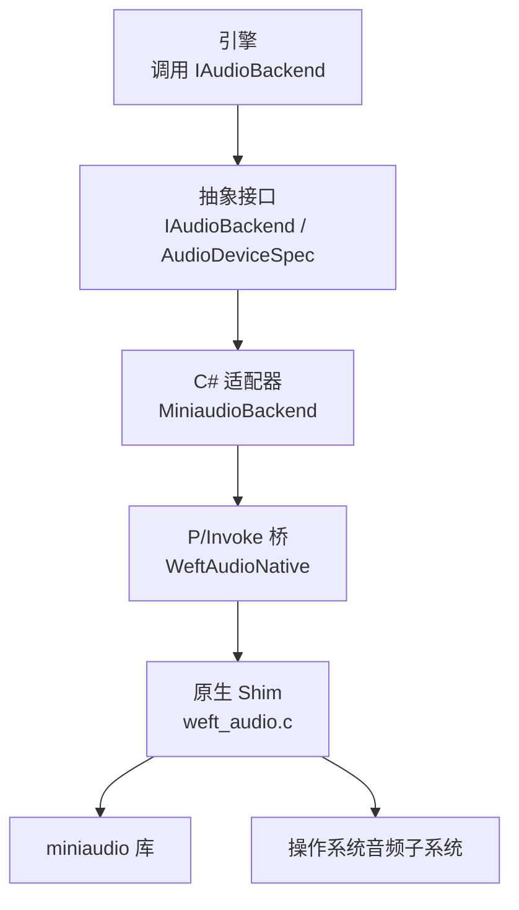
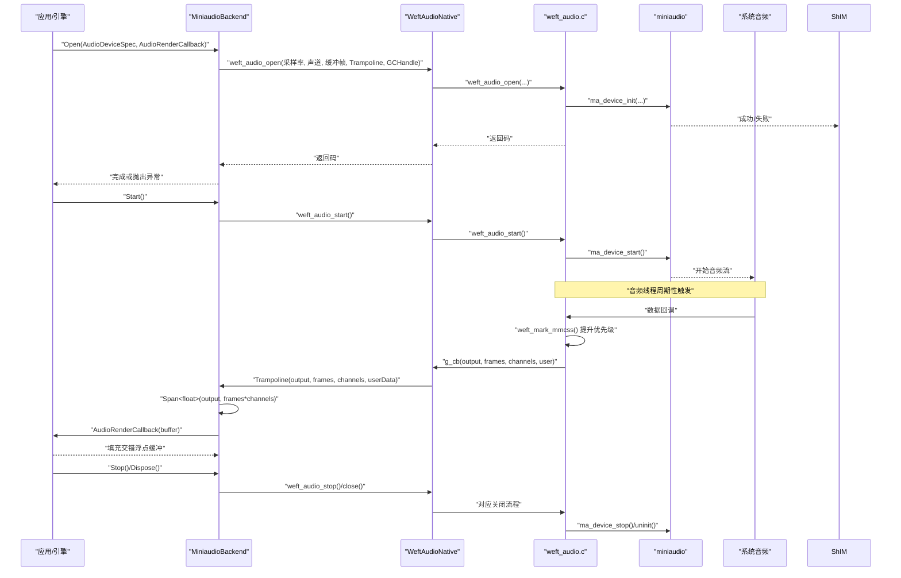
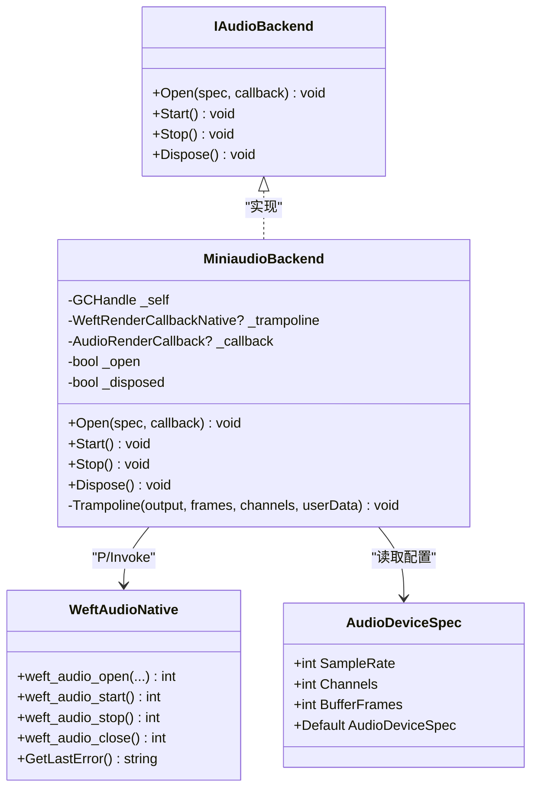
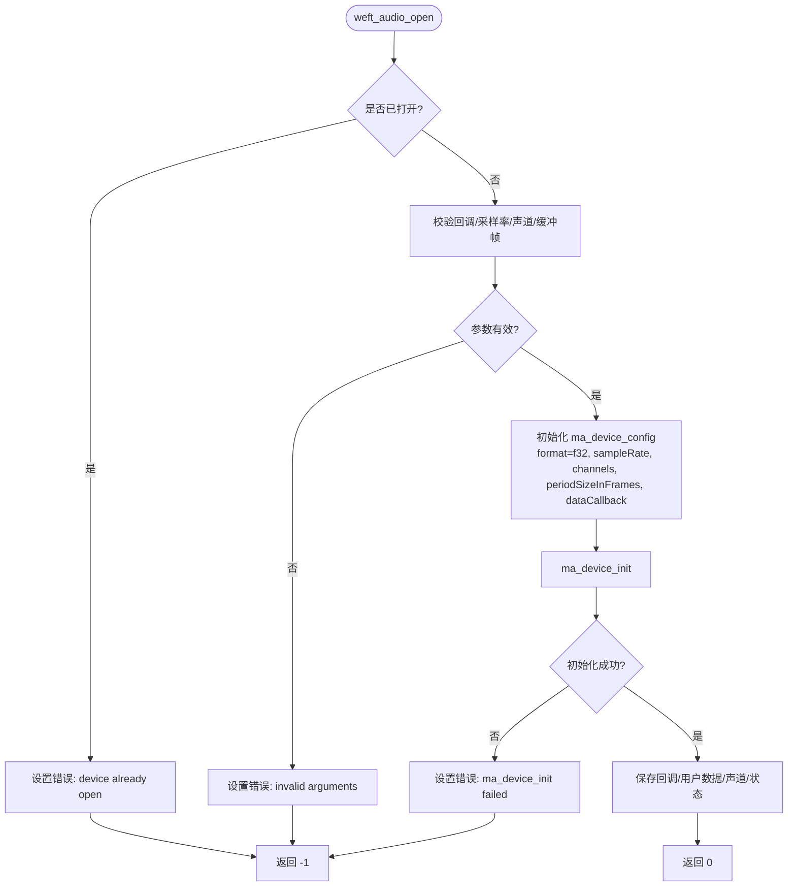
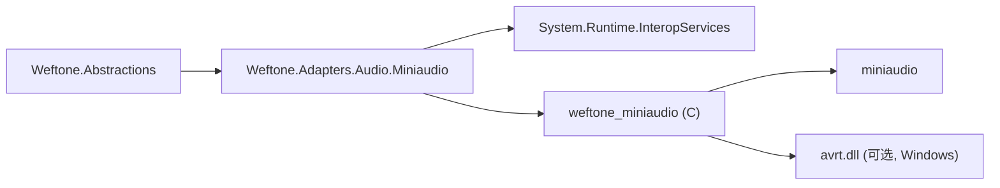
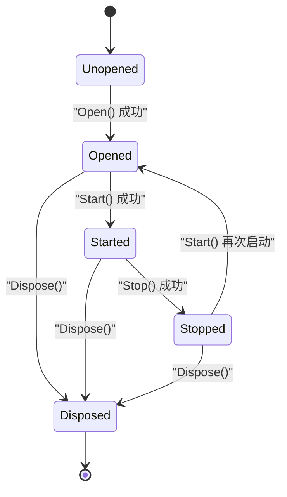
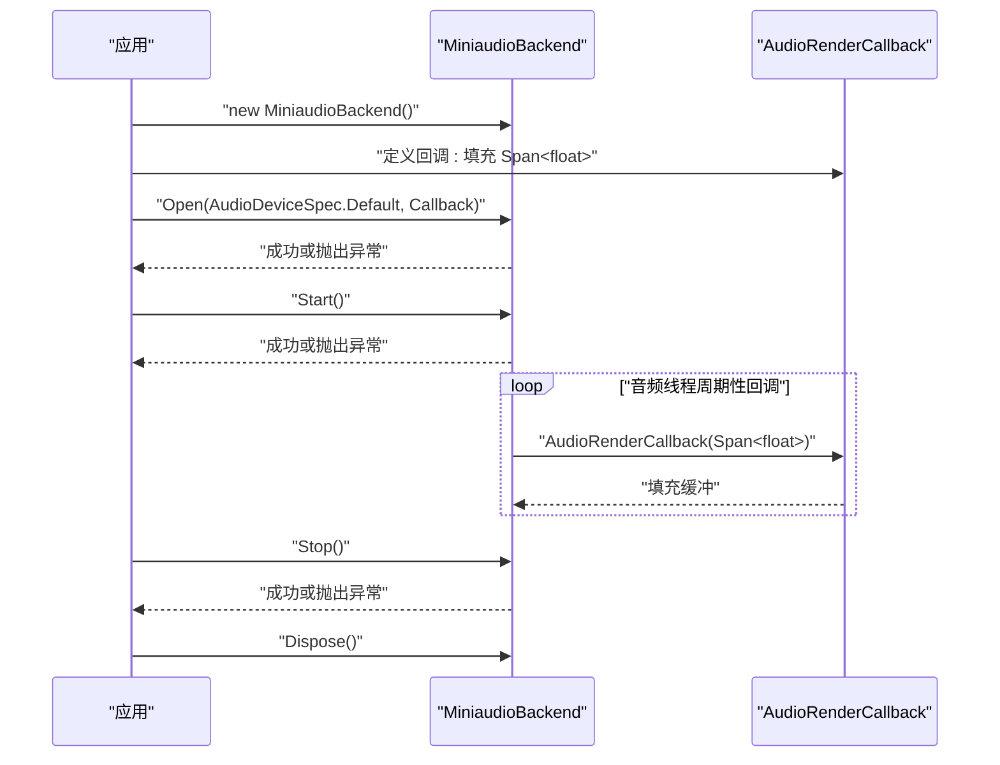

# Miniaudio 音频后端

<cite>
**本文引用的文件**   
- [IAudioBackend.cs](file://src/Weftone.Abstractions/IAudioBackend.cs)
- [AudioDeviceSpec.cs](file://src/Weftone.Abstractions/AudioDeviceSpec.cs)
- [MiniaudioBackend.cs](file://src/Weftone.Adapters.Audio.Miniaudio/MiniaudioBackend.cs)
- [WeftAudioNative.cs](file://src/Weftone.Adapters.Audio.Miniaudio/WeftAudioNative.cs)
- [NativeProbe.cs](file://src/Weftone.Adapters.Audio.Miniaudio/NativeProbe.cs)
- [weft_audio.c](file://native/weftone_miniaudio/weft_audio.c)
- [CMakeLists.txt](file://native/weftone_miniaudio/CMakeLists.txt)
</cite>

## 目录
1. [简介](#简介)
2. [项目结构](#项目结构)
3. [核心组件](#核心组件)
4. [架构总览](#架构总览)
5. [详细组件分析](#详细组件分析)
6. [依赖关系分析](#依赖关系分析)
7. [性能与实时性](#性能与实时性)
8. [错误处理与故障排查](#错误处理与故障排查)
9. [生命周期与资源管理](#生命周期与资源管理)
10. [设备发现、打开、启动、停止示例](#设备发现打开启动停止示例)
11. [结论](#结论)

## 简介
本技术文档聚焦于 Weftone 的 Miniaudio 音频后端适配器，说明 `MiniaaudioBackend` 如何实现 `IAudioBackend` 接口，如何桥接 C# 与原生 miniaudio 库，以及如何在音频实时线程中安全地调用托管回调。文档涵盖：
- 音频设备初始化、流配置与实时回调路径
- P/Invoke 与 GCHandle 的零分配保证
- `AudioDeviceSpec` 参数对延迟、吞吐和稳定性的影响
- 错误处理策略、资源管理与生命周期
- 完整的设备发现、打开、启动、停止使用流程

## 项目结构
Miniaudio 后端由三层组成：
- 抽象层：定义引擎使用的音频后端接口和设备规格
- 适配层（C#）：实现 `IAudioBackend`，封装 P/Invoke 与原生库探测
- 原生层（C）：基于 miniaudio 暴露稳定的 C ABI，负责底层设备 I/O 与回调调度

**图表来源**
- [IAudioBackend.cs:3-14](file://src/Weftone.Abstractions/IAudioBackend.cs#L3-L14)
- [AudioDeviceSpec.cs:1-7](file://src/Weftone.Abstractions/AudioDeviceSpec.cs#L1-L7)
- [MiniaudioBackend.cs:6-11](file://src/Weftone.Adapters.Audio.Miniaudio/MiniaudioBackend.cs#L6-L11)
- [WeftAudioNative.cs:8-29](file://src/Weftone.Adapters.Audio.Miniaudio/WeftAudioNative.cs#L8-L29)
- [weft_audio.c:1-2](file://native/weftone_miniaudio/weft_audio.c#L1-L2)

**章节来源**
- [IAudioBackend.cs:1-15](file://src/Weftone.Abstractions/IAudioBackend.cs#L1-L15)
- [AudioDeviceSpec.cs:1-7](file://src/Weftone.Abstractions/AudioDeviceSpec.cs#L1-L7)
- [MiniaudioBackend.cs:1-11](file://src/Weftone.Adapters.Audio.Miniaudio/MiniaudioBackend.cs#L1-L11)
- [weft_audio.c:1-2](file://native/weftone_miniaudio/weft_audio.c#L1-L2)

## 核心组件
- `IAudioBackend`：引擎侧统一音频后端接口，要求实现 Open/Start/Stop/Dispose，并在实时回调中禁止分配、锁与异常。
- `AudioDeviceSpec`：描述采样率、声道数与缓冲区帧数的不可变记录类型，提供默认值。
- `MiniaudioBackend`：实现 `IAudioBackend`，负责建立委托、GCHandle、调用原生 weft_audio_* API，并维护状态。
- `WeftAudioNative`：声明 Cdecl 调用的 P/Invoke 方法，包括 open/start/stop/close 与最后错误字符串访问。
- `NativeProbe`：通过 DllImportResolver 解析 weftone_miniaudio 动态库位置，支持环境变量与应用目录扫描。
- `weft_audio.c`：原生 shim，封装 miniaudio 设备初始化、数据回调、启停与错误信息。

**章节来源**
- [IAudioBackend.cs:3-14](file://src/Weftone.Abstractions/IAudioBackend.cs#L3-L14)
- [AudioDeviceSpec.cs:1-7](file://src/Weftone.Abstractions/AudioDeviceSpec.cs#L1-L7)
- [MiniaudioBackend.cs:6-11](file://src/Weftone.Adapters.Audio.Miniaudio/MiniaudioBackend.cs#L6-L11)
- [WeftAudioNative.cs:5-29](file://src/Weftone.Adapters.Audio.Miniaudio/WeftAudioNative.cs#L5-L29)
- [NativeProbe.cs:6-10](file://src/Weftone.Adapters.Audio.Miniaudio/NativeProbe.cs#L6-L10)
- [weft_audio.c:1-2](file://native/weftone_miniaudio/weft_audio.c#L1-L2)

## 架构总览
下图展示从引擎到原生音频设备的完整调用链，包括托管回调在音频线程中的执行路径。

**图表来源**
- [MiniaudioBackend.cs:21-36](file://src/Weftone.Adapters.Audio.Miniaudio/MiniaudioBackend.cs#L21-L36)
- [MiniaudioBackend.cs:38-56](file://src/Weftone.Adapters.Audio.Miniaudio/MiniaudioBackend.cs#L38-L56)
- [MiniaudioBackend.cs:78-83](file://src/Weftone.Adapters.Audio.Miniaudio/MiniaudioBackend.cs#L78-L83)
- [WeftAudioNative.cs:12-28](file://src/Weftone.Adapters.Audio.Miniaudio/WeftAudioNative.cs#L12-L28)
- [weft_audio.c:52-65](file://native/weftone_miniaudio/weft_audio.c#L52-L65)
- [weft_audio.c:72-107](file://native/weftone_miniaudio/weft_audio.c#L72-L107)
- [weft_audio.c:109-157](file://native/weftone_miniaudio/weft_audio.c#L109-L157)

## 详细组件分析

### IAudioBackend 与 AudioDeviceSpec
- `IAudioBackend` 定义了统一的音频后端契约：
  - `Open(spec, callback)`：在实时线程外设置设备与回调
  - `Start()`：启动音频流
  - `Stop()`：停止音频流
  - `Dispose()`：释放资源
  - 注释明确：回调在实时线程上执行，禁止分配、锁与异常
- `AudioDeviceSpec` 是不可变记录，包含：
  - `SampleRate`：采样率（Hz），默认 48000
  - `Channels`：声道数，默认立体声 2
  - `BufferFrames`：每周期帧数，默认 256

这些设计确保引擎不感知具体后端实现，同时为实时路径提供严格约束。

**章节来源**
- [IAudioBackend.cs:3-14](file://src/Weftone.Abstractions/IAudioBackend.cs#L3-L14)
- [AudioDeviceSpec.cs:1-7](file://src/Weftone.Abstractions/AudioDeviceSpec.cs#L1-L7)

### MiniaudioBackend：IAudioBackend 的实现
`MiniaudioBackend` 是适配器核心，职责包括：
- 构造时创建 `GCHandle` 以固定托管对象地址
- `Open`：
  - 校验已释放状态与回调非空
  - 确保原生库已安装（`NativeProbe.EnsureInstalled()`）
  - 保存托管回调与 trampoline 委托
  - 调用 `weft_audio_open`，传入采样率、声道、缓冲帧、trampoline 与 GCHandle 指针
  - 若返回码非 0，抛出包含最后错误信息的异常
  - 标记 `_open = true`
- `Start`/`Stop`：
  - 检查已释放状态
  - 调用原生启/停 API，失败则抛异常
- `Dispose`：
  - 若已打开则调用 `weft_audio_close`
  - 清空委托引用，释放 GCHandle，标记已释放
- `Trampoline`：
  - 从 `userData` 还原 `MiniaudioBackend` 实例
  - 将原生输出指针包装为 `Span<float>`，长度 = frames × channels
  - 调用托管 `AudioRenderCallback`

该实现遵循“一次性建立委托与句柄”的策略，避免在音频线程中分配。

**图表来源**
- [MiniaudioBackend.cs:11-83](file://src/Weftone.Adapters.Audio.Miniaudio/MiniaudioBackend.cs#L11-L83)
- [WeftAudioNative.cs:8-29](file://src/Weftone.Adapters.Audio.Miniaudio/WeftAudioNative.cs#L8-L29)
- [AudioDeviceSpec.cs:1-7](file://src/Weftone.Abstractions/AudioDeviceSpec.cs#L1-L7)

**章节来源**
- [MiniaudioBackend.cs:11-83](file://src/Weftone.Adapters.Audio.Miniaudio/MiniaudioBackend.cs#L11-L83)

### WeftAudioNative：P/Invoke 桥
- 声明 `WeftRenderCallbackNative` 委托，使用 Cdecl 调用约定，匹配原生回调签名
- 封装 `weft_audio_open/start/stop/close` 与 `weft_audio_last_error`
- `GetLastError` 将 C 字符串指针转换为托管字符串

该层保持与原生 ABI 的稳定映射，屏蔽平台差异。

**章节来源**
- [WeftAudioNative.cs:5-29](file://src/Weftone.Adapters.Audio.Miniaudio/WeftAudioNative.cs#L5-L29)

### NativeProbe：原生库探测
- 通过 `NativeLibrary.SetDllImportResolver` 注册自定义解析器
- 优先顺序：
  1. 环境变量 `WEFTONE_NATIVE_DIR`
  2. 应用目录 `AppContext.BaseDirectory`
  3. 仓库布局 `native/build` 或 `native/weftone_miniaudio/build` 递归查找
- 根据平台生成文件名：Windows `.dll`，macOS `.dylib`，Linux `.so`
- 仅当首次调用 `EnsureInstalled` 时注册解析器，避免重复开销

这保证了在不同构建与部署场景下都能定位到 weftone_miniaudio 动态库。

**章节来源**
- [NativeProbe.cs:6-71](file://src/Weftone.Adapters.Audio.Miniaudio/NativeProbe.cs#L6-L71)

### weft_audio.c：原生 shim 与 miniaudio 集成
- 全局变量维护设备、回调、用户数据、声道数、打开/启动状态与错误缓冲区
- `weft_data_callback`：
  - 在 Windows 上动态加载 avrt.dll 并设置 MMCSS “Pro Audio” 以提升线程优先级
  - 若托管回调为空，则清零输出缓冲
  - 否则调用托管回调函数指针
- `weft_audio_open`：
  - 校验参数与单设备限制
  - 配置 miniaudio 播放设备：格式 f32、采样率、声道、periodSizeInFrames、dataCallback
  - 初始化设备并保存回调与用户数据
- `weft_audio_start/stop/close`：
  - 状态机保护，防止未打开或重复启停
  - 调用 ma_device_* 控制设备
- `weft_audio_last_error`：返回最近错误消息

**图表来源**
- [weft_audio.c:72-107](file://native/weftone_miniaudio/weft_audio.c#L72-L107)

**章节来源**
- [weft_audio.c:17-25](file://native/weftone_miniaudio/weft_audio.c#L17-L25)
- [weft_audio.c:31-50](file://native/weftone_miniaudio/weft_audio.c#L31-L50)
- [weft_audio.c:52-65](file://native/weftone_miniaudio/weft_audio.c#L52-L65)
- [weft_audio.c:72-107](file://native/weftone_miniaudio/weft_audio.c#L72-L107)
- [weft_audio.c:109-157](file://native/weftone_miniaudio/weft_audio.c#L109-L157)
- [weft_audio.c:159-162](file://native/weftone_miniaudio/weft_audio.c#L159-L162)

## 依赖关系分析
- 抽象层与适配层解耦：引擎只依赖 `IAudioBackend` 与 `AudioDeviceSpec`
- 适配层依赖：
  - `System.Runtime.InteropServices` 进行 P/Invoke
  - `NativeProbe` 解析原生库
  - `WeftAudioNative` 绑定 C ABI
- 原生层依赖：
  - miniaudio 头文件与实现
  - Windows 可选 avrt.dll 用于 MMCSS 优先级提升
- CMake 配置将 weftone_miniaudio 编译为共享库，输出到统一目录便于运行时加载

**图表来源**
- [CMakeLists.txt:1-29](file://native/weftone_miniaudio/CMakeLists.txt#L1-L29)
- [weft_audio.c:31-50](file://native/weftone_miniaudio/weft_audio.c#L31-L50)

**章节来源**
- [CMakeLists.txt:1-29](file://native/weftone_miniaudio/CMakeLists.txt#L1-L29)
- [weft_audio.c:31-50](file://native/weftone_miniaudio/weft_audio.c#L31-L50)

## 性能与实时性
- 零分配保证：
  - `MiniaudioBackend` 在 `Open` 时建立委托与 GCHandle，回调路径仅使用 `Span<float>` 包装原生指针，无托管对象分配
  - `Trampoline` 直接调用托管回调，避免额外装箱/拆箱
- 低延迟与稳定性：
  - `BufferFrames` 越小，延迟越低，但 CPU 负载越高；过大则缓冲更平滑但延迟增加
  - 默认 `BufferFrames=256` 在多数桌面环境平衡了延迟与稳定性
- 实时线程优化：
  - Windows 上通过 MMCSS “Pro Audio” 提升音频线程优先级，减少抖动
  - 回调内禁止分配、锁与异常，确保实时路径确定性

参数建议：
- 采样率：通常 48000 Hz，与系统默认一致可减少重采样
- 声道数：立体声 2 声道；多声道需确认系统与驱动支持
- 缓冲帧：交互类应用可尝试 128~256；批处理渲染可增大至 512+

**章节来源**
- [MiniaudioBackend.cs:78-83](file://src/Weftone.Adapters.Audio.Miniaudio/MiniaudioBackend.cs#L78-L83)
- [weft_audio.c:31-50](file://native/weftone_miniaudio/weft_audio.c#L31-L50)
- [AudioDeviceSpec.cs:1-7](file://src/Weftone.Abstractions/AudioDeviceSpec.cs#L1-L7)

## 错误处理与故障排查
- C# 层：
  - `Open/Start/Stop` 在原生返回非 0 时抛出 `InvalidOperationException`，附带 `GetLastError()` 文本
  - `ObjectDisposedException.ThrowIf` 防止对已释放实例操作
- 原生层：
  - 使用固定大小错误缓冲区存储最近错误消息
  - 关键路径（如参数无效、设备未打开、ma_device_* 失败）均设置错误并返回负码
- 常见问题：
  - 找不到动态库：检查 `WEFTONE_NATIVE_DIR`、应用目录或仓库 build 目录
  - 设备打开失败：确认采样率、声道、缓冲帧合法且系统支持
  - 音频无声：检查回调是否正确填充交错浮点缓冲，声道数与格式匹配

**章节来源**
- [MiniaudioBackend.cs:21-36](file://src/Weftone.Adapters.Audio.Miniaudio/MiniaudioBackend.cs#L21-L36)
- [MiniaudioBackend.cs:38-56](file://src/Weftone.Adapters.Audio.Miniaudio/MiniaudioBackend.cs#L38-L56)
- [WeftAudioNative.cs:25-28](file://src/Weftone.Adapters.Audio.Miniaudio/WeftAudioNative.cs#L25-L28)
- [weft_audio.c:67-70](file://native/weftone_miniaudio/weft_audio.c#L67-L70)
- [weft_audio.c:72-107](file://native/weftone_miniaudio/weft_audio.c#L72-L107)
- [weft_audio.c:109-157](file://native/weftone_miniaudio/weft_audio.c#L109-L157)

## 生命周期与资源管理
- 构造：
  - 分配 `GCHandle` 固定托管对象，供原生回调反向寻址
- Open：
  - 校验状态与参数
  - 确保原生库已安装
  - 调用原生初始化，成功后标记 `_open = true`
- Start/Stop：
  - 状态保护，避免未打开或重复操作
- Dispose：
  - 若已打开则关闭原生设备
  - 清空委托引用，释放 GCHandle，标记 `_disposed = true`
- 线程安全：
  - 原生层维护打开/启动状态位，避免并发问题
  - 托管层通过布尔标志与异常提示防止误用

**图表来源**
- [MiniaudioBackend.cs:13-17](file://src/Weftone.Adapters.Audio.Miniaudio/MiniaudioBackend.cs#L13-L17)
- [MiniaudioBackend.cs:21-36](file://src/Weftone.Adapters.Audio.Miniaudio/MiniaudioBackend.cs#L21-L36)
- [MiniaudioBackend.cs:58-76](file://src/Weftone.Adapters.Audio.Miniaudio/MiniaudioBackend.cs#L58-L76)
- [weft_audio.c:72-107](file://native/weftone_miniaudio/weft_audio.c#L72-L107)
- [weft_audio.c:109-157](file://native/weftone_miniaudio/weft_audio.c#L109-L157)

**章节来源**
- [MiniaudioBackend.cs:13-17](file://src/Weftone.Adapters.Audio.Miniaudio/MiniaudioBackend.cs#L13-L17)
- [MiniaudioBackend.cs:21-36](file://src/Weftone.Adapters.Audio.Miniaudio/MiniaudioBackend.cs#L21-L36)
- [MiniaudioBackend.cs:58-76](file://src/Weftone.Adapters.Audio.Miniaudio/MiniaudioBackend.cs#L58-L76)
- [weft_audio.c:72-107](file://native/weftone_miniaudio/weft_audio.c#L72-L107)
- [weft_audio.c:109-157](file://native/weftone_miniaudio/weft_audio.c#L109-L157)

## 设备发现、打开、启动、停止示例
以下示例演示如何使用 `MiniaudioBackend` 完成设备打开、启动、停止与释放。注意：当前代码库未提供设备枚举 API，因此示例直接使用 `AudioDeviceSpec.Default` 打开默认设备。

步骤概览：
1. 创建 `MiniaudioBackend`
2. 定义 `AudioRenderCallback`，在回调中填充交错浮点缓冲
3. 调用 `Open(AudioDeviceSpec.Default, callback)`
4. 调用 `Start()` 启动音频流
5. 业务逻辑运行期间持续接收回调
6. 调用 `Stop()` 停止音频流
7. 调用 `Dispose()` 释放资源

注意事项：
- 回调内不得分配内存、加锁或抛出异常
- 若 `Open/Start/Stop` 返回非 0，会抛出包含错误信息的异常
- 使用 `using` 或显式 `Dispose` 确保资源释放

**章节来源**
- [MiniaudioBackend.cs:21-36](file://src/Weftone.Adapters.Audio.Miniaudio/MiniaudioBackend.cs#L21-L36)
- [MiniaudioBackend.cs:38-56](file://src/Weftone.Adapters.Audio.Miniaudio/MiniaudioBackend.cs#L38-L56)
- [MiniaudioBackend.cs:58-76](file://src/Weftone.Adapters.Audio.Miniaudio/MiniaudioBackend.cs#L58-L76)
- [AudioDeviceSpec.cs:1-7](file://src/Weftone.Abstractions/AudioDeviceSpec.cs#L1-L7)

## 结论
Miniaudio 音频后端通过清晰的抽象与适配器分层，将引擎与原生 miniaudio 解耦。`MiniaudioBackend` 在 `Open` 时建立委托与 GCHandle，确保音频回调路径零分配；原生 shim 封装设备初始化、数据回调与启停，并提供错误信息。`AudioDeviceSpec` 的参数直接影响延迟与稳定性，需根据应用场景调优。整体设计满足实时音频的低延迟与高可靠性要求，同时保持跨平台可移植性与可测试性。