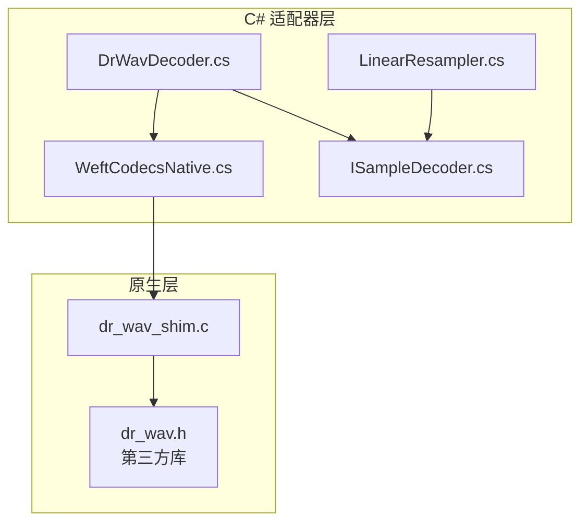
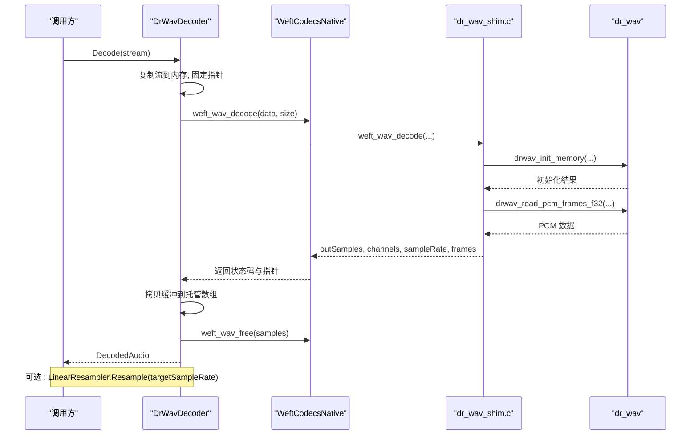
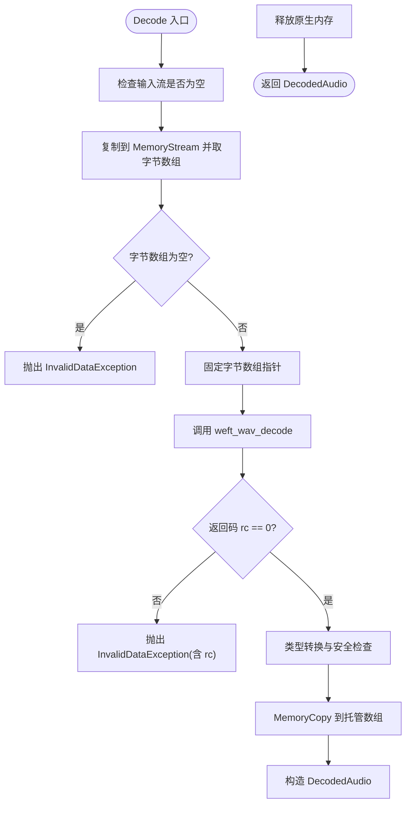
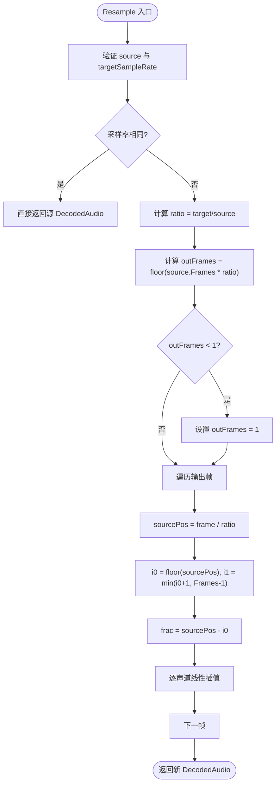
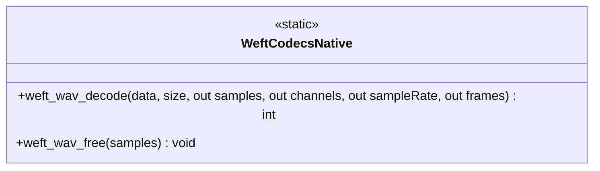
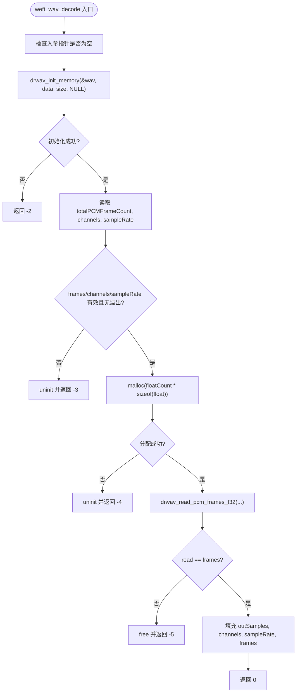
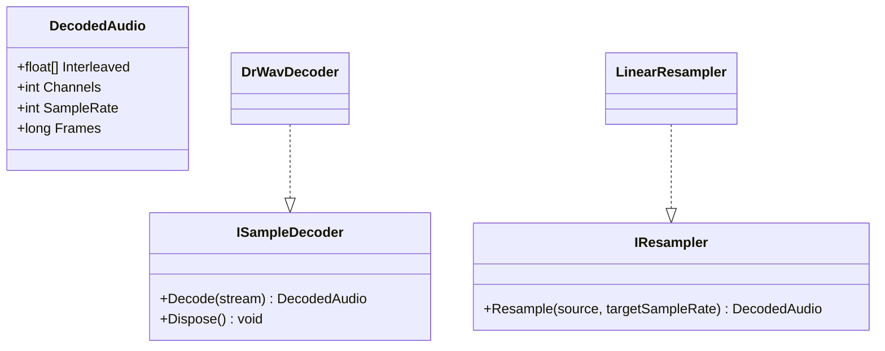
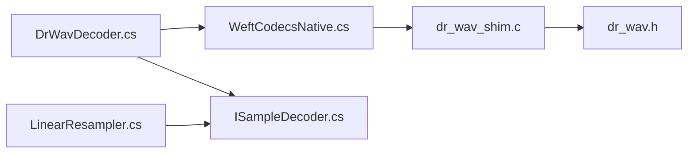

# WAV 编解码器

<cite>
**本文引用的文件**   
- [DrWavDecoder.cs](file://src/Weftone.Adapters.Codecs/DrWavDecoder.cs)
- [LinearResampler.cs](file://src/Weftone.Adapters.Codecs/LinearResampler.cs)
- [WeftCodecsNative.cs](file://src/Weftone.Adapters.Codecs/WeftCodecsNative.cs)
- [dr_wav_shim.c](file://native/weftone_codecs/dr_wav_shim.c)
- [ISampleDecoder.cs](file://src/Weftone.Abstractions/ISampleDecoder.cs)
</cite>

## 目录
1. [简介](#简介)
2. [项目结构](#项目结构)
3. [核心组件](#核心组件)
4. [架构总览](#架构总览)
5. [详细组件分析](#详细组件分析)
6. [依赖关系分析](#依赖关系分析)
7. [性能与音质权衡](#性能与音质权衡)
8. [故障排查指南](#故障排查指南)
9. [结论](#结论)
10. [附录：使用示例与最佳实践](#附录使用示例与最佳实践)

## 简介
本技术文档聚焦于 Weftone 项目中的 WAV 编解码适配器，重点说明以下能力：
- DrWavDecoder 如何基于 dr_wav 库实现 WAV 文件解码，包括格式支持、PCM 数据提取与元数据处理。
- LinearResampler 的线性插值重采样算法原理、音质保证与性能优化策略。
- WeftCodecsNative 的原生绑定设计，涵盖内存管理与错误处理。
- 提供从 WAV 到可播放音频样本的完整解码流程示例。
- 讨论不同采样率转换的质量与性能权衡及最佳实践。

该适配层遵循 ADR-0004（端口与适配器优先）的设计原则，将底层编解码细节封装在适配器中，通过抽象接口暴露给上层应用。

## 项目结构
WAV 编解码相关代码分布在 C# 适配器层与原生 shim 层：
- C# 适配器层
  - src/Weftone.Adapters.Codecs：包含 DrWavDecoder、LinearResampler、WeftCodecsNative 等。
  - src/Weftone.Abstractions：定义 ISampleDecoder、IResampler 与 DecodedAudio 数据结构。
- 原生层
  - native/weftone_codecs：包含 dr_wav_shim.c，封装 dr_wav 并导出 weft_wav_decode/weft_wav_free。

**图表来源**
- [DrWavDecoder.cs:1-51](file://src/Weftone.Adapters.Codecs/DrWavDecoder.cs#L1-L51)
- [LinearResampler.cs:1-45](file://src/Weftone.Adapters.Codecs/LinearResampler.cs#L1-L45)
- [WeftCodecsNative.cs:1-16](file://src/Weftone.Adapters.Codecs/WeftCodecsNative.cs#L1-L16)
- [dr_wav_shim.c:1-68](file://native/weftone_codecs/dr_wav_shim.c#L1-L68)
- [ISampleDecoder.cs:1-17](file://src/Weftone.Abstractions/ISampleDecoder.cs#L1-L17)

**章节来源**
- [DrWavDecoder.cs:1-51](file://src/Weftone.Adapters.Codecs/DrWavDecoder.cs#L1-L51)
- [LinearResampler.cs:1-45](file://src/Weftone.Adapters.Codecs/LinearResampler.cs#L1-L45)
- [WeftCodecsNative.cs:1-16](file://src/Weftone.Adapters.Codecs/WeftCodecsNative.cs#L1-L16)
- [dr_wav_shim.c:1-68](file://native/weftone_codecs/dr_wav_shim.c#L1-L68)
- [ISampleDecoder.cs:1-17](file://src/Weftone.Abstractions/ISampleDecoder.cs#L1-L17)

## 核心组件
- DrWavDecoder：实现 ISampleDecoder，负责整文件 WAV 解码为 f32 交错 PCM，并通过 P/Invoke 调用原生层。
- LinearResampler：实现 IResampler，提供离线线性插值重采样，输出目标采样率的音频帧。
- WeftCodecsNative：P/Invoke 声明，桥接 C# 与原生 weftone_codecs 动态库。
- dr_wav_shim.c：原生 shim，封装 dr_wav 初始化、读取与内存管理，返回 f32 交错 PCM。
- ISampleDecoder/IResampler/DecodedAudio：抽象接口与数据结构，统一解码与重采样契约。

**章节来源**
- [DrWavDecoder.cs:5-45](file://src/Weftone.Adapters.Codecs/DrWavDecoder.cs#L5-L45)
- [LinearResampler.cs:5-43](file://src/Weftone.Adapters.Codecs/LinearResampler.cs#L5-L43)
- [WeftCodecsNative.cs:5-15](file://src/Weftone.Adapters.Codecs/WeftCodecsNative.cs#L5-L15)
- [dr_wav_shim.c:16-61](file://native/weftone_codecs/dr_wav_shim.c#L16-L61)
- [ISampleDecoder.cs:3-16](file://src/Weftone.Abstractions/ISampleDecoder.cs#L3-L16)

## 架构总览
WAV 解码与重采样的端到端流程如下：
- 上层调用 DrWavDecoder.Decode，传入 Stream。
- DrWavDecoder 将流复制到内存，固定字节数组指针后调用 WeftCodecsNative.weft_wav_decode。
- WeftCodecsNative 通过 P/Invoke 调用原生 weft_wav_decode。
- dr_wav_shim.c 使用 dr_wav_init_memory 解析 WAV，校验参数与尺寸，分配 float 缓冲区，用 drwav_read_pcm_frames_f32 读取 PCM 数据。
- 成功时返回 f32 交错 PCM 指针与元数据（声道数、采样率、帧数）。
- DrWavDecoder 拷贝缓冲到托管数组，构造 DecodedAudio 并释放原生内存。
- 可选：LinearResampler.Resample 对 DecodedAudio 进行线性插值重采样，得到目标采样率的音频帧。

**图表来源**
- [DrWavDecoder.cs:8-45](file://src/Weftone.Adapters.Codecs/DrWavDecoder.cs#L8-L45)
- [WeftCodecsNative.cs:9-14](file://src/Weftone.Adapters.Codecs/WeftCodecsNative.cs#L9-L14)
- [dr_wav_shim.c:16-61](file://native/weftone_codecs/dr_wav_shim.c#L16-L61)

**章节来源**
- [DrWavDecoder.cs:8-45](file://src/Weftone.Adapters.Codecs/DrWavDecoder.cs#L8-L45)
- [WeftCodecsNative.cs:9-14](file://src/Weftone.Adapters.Codecs/WeftCodecsNative.cs#L9-L14)
- [dr_wav_shim.c:16-61](file://native/weftone_codecs/dr_wav_shim.c#L16-L61)

## 详细组件分析

### DrWavDecoder：WAV 解码适配器
- 职责
  - 接收任意 Stream，转换为字节数组并固定指针。
  - 调用原生 weft_wav_decode 获取 f32 交错 PCM 与元数据。
  - 将原生缓冲拷贝到托管数组，构造 DecodedAudio。
  - 确保原生内存释放。
- 关键行为
  - 空流检查与异常抛出。
  - 原生返回码检查，映射为 InvalidDataException。
  - 安全类型转换（checked），防止溢出。
  - finally 块中释放原生内存，避免泄漏。
- 复杂度
  - 时间复杂度 O(N)，N 为 PCM 样本总数（frames × channels）。
  - 空间复杂度 O(N)，用于托管数组与临时缓冲。

**图表来源**
- [DrWavDecoder.cs:8-45](file://src/Weftone.Adapters.Codecs/DrWavDecoder.cs#L8-L45)

**章节来源**
- [DrWavDecoder.cs:8-45](file://src/Weftone.Adapters.Codecs/DrWavDecoder.cs#L8-L45)

### LinearResampler：线性插值重采样
- 算法原理
  - 计算 ratio = targetSampleRate / sourceSampleRate。
  - 对于每个输出帧，计算对应源位置 sourcePos = frame / ratio。
  - 取相邻两个源样本索引 i0、i1，计算权重 frac = sourcePos - i0。
  - 对每个声道执行线性插值：out = s0 + (s1 - s0) * frac。
- 边界处理
  - 若 outFrames < 1，强制至少 1 帧，避免空输出。
  - i1 取 min(i0 + 1, source.Frames - 1)，防止越界。
- 复杂度
  - 时间复杂度 O(M × C)，M 为输出帧数，C 为声道数。
  - 空间复杂度 O(M × C)，用于输出缓冲。
- 音质与性能
  - 线性插值简单高效，适合离线路径；高频混叠风险高于高质量重采样器（如 r8brain）。
  - 可通过后续替换 IResampler 实现提升音质。

**图表来源**
- [LinearResampler.cs:11-43](file://src/Weftone.Adapters.Codecs/LinearResampler.cs#L11-L43)

**章节来源**
- [LinearResampler.cs:11-43](file://src/Weftone.Adapters.Codecs/LinearResampler.cs#L11-L43)

### WeftCodecsNative：原生绑定
- 职责
  - 声明 weft_wav_decode 与 weft_wav_free 的 P/Invoke 接口。
  - 指定调用约定为 Cdecl，与原生侧保持一致。
- 设计要点
  - 使用 unsafe 上下文以传递指针。
  - 将原生返回的 float* 交由调用方负责释放（weft_wav_free）。
  - 库名 weftone_codecs 需由构建系统生成并加载。

**图表来源**
- [WeftCodecsNative.cs:5-15](file://src/Weftone.Adapters.Codecs/WeftCodecsNative.cs#L5-L15)

**章节来源**
- [WeftCodecsNative.cs:5-15](file://src/Weftone.Adapters.Codecs/WeftCodecsNative.cs#L5-L15)

### dr_wav_shim.c：原生解码实现
- 职责
  - 封装 dr_wav 初始化、参数校验、内存分配与 PCM 读取。
  - 返回 f32 交错 PCM 与元数据（channels、sampleRate、frames）。
  - 提供 weft_wav_free 释放分配的缓冲。
- 错误码约定
  - 0：成功。
  - -1：入参为空。
  - -2：drwav_init_memory 失败（非法 WAV）。
  - -3：frames/channels/sampleRate 无效或溢出。
  - -4：内存分配失败。
  - -5：读取 PCM 帧数不匹配（截断）。
- 安全性
  - 检查 frames > SIZE_MAX / (sizeof(float) * channels)，防止整数溢出。
  - 所有路径均调用 drwav_uninit 与 free，避免资源泄漏。

**图表来源**
- [dr_wav_shim.c:16-61](file://native/weftone_codecs/dr_wav_shim.c#L16-L61)

**章节来源**
- [dr_wav_shim.c:16-61](file://native/weftone_codecs/dr_wav_shim.c#L16-L61)

### 接口与数据结构
- DecodedAudio：记录交错 PCM 数组、声道数、采样率与帧数。
- ISampleDecoder：定义 Decode(Stream) 方法，返回 DecodedAudio。
- IResampler：定义 Resample(DecodedAudio, int) 方法，返回目标采样率的 DecodedAudio。

**图表来源**
- [ISampleDecoder.cs:3-16](file://src/Weftone.Abstractions/ISampleDecoder.cs#L3-L16)
- [DrWavDecoder.cs:5-45](file://src/Weftone.Adapters.Codecs/DrWavDecoder.cs#L5-L45)
- [LinearResampler.cs:9-43](file://src/Weftone.Adapters.Codecs/LinearResampler.cs#L9-L43)

**章节来源**
- [ISampleDecoder.cs:3-16](file://src/Weftone.Abstractions/ISampleDecoder.cs#L3-L16)

## 依赖关系分析
- C# 层依赖
  - DrWavDecoder 依赖 WeftCodecsNative（P/Invoke）与 ISampleDecoder（接口）。
  - LinearResampler 依赖 IResampler（接口）与 DecodedAudio（数据结构）。
- 原生层依赖
  - dr_wav_shim.c 依赖 dr_wav.h（第三方库）。
- 外部依赖
  - dr_wav：WAV 文件解析与 PCM 读取。
  - 运行时：.NET P/Invoke 机制与内存管理。

**图表来源**
- [DrWavDecoder.cs:1-51](file://src/Weftone.Adapters.Codecs/DrWavDecoder.cs#L1-L51)
- [LinearResampler.cs:1-45](file://src/Weftone.Adapters.Codecs/LinearResampler.cs#L1-L45)
- [WeftCodecsNative.cs:1-16](file://src/Weftone.Adapters.Codecs/WeftCodecsNative.cs#L1-L16)
- [dr_wav_shim.c:1-68](file://native/weftone_codecs/dr_wav_shim.c#L1-L68)
- [ISampleDecoder.cs:1-17](file://src/Weftone.Abstractions/ISampleDecoder.cs#L1-L17)

**章节来源**
- [DrWavDecoder.cs:1-51](file://src/Weftone.Adapters.Codecs/DrWavDecoder.cs#L1-L51)
- [LinearResampler.cs:1-45](file://src/Weftone.Adapters.Codecs/LinearResampler.cs#L1-L45)
- [WeftCodecsNative.cs:1-16](file://src/Weftone.Adapters.Codecs/WeftCodecsNative.cs#L1-L16)
- [dr_wav_shim.c:1-68](file://native/weftone_codecs/dr_wav_shim.c#L1-L68)
- [ISampleDecoder.cs:1-17](file://src/Weftone.Abstractions/ISampleDecoder.cs#L1-L17)

## 性能与音质权衡
- 解码阶段
  - 整文件解码适合离线路径；实时场景应考虑流式解码与分块处理。
  - MemoryCopy 与托管数组分配带来一次性开销，但简化了后续处理。
- 重采样阶段
  - 线性插值计算量低，适合批量离线处理；高频成分可能产生轻微混叠。
  - 若追求更高音质，可在 M4 阶段替换为高质量重采样器（如 r8brain）。
- 采样率转换建议
  - 当目标采样率等于源采样率时，直接返回源数据，避免不必要计算。
  - 合理预估输出帧数，避免过小导致单帧输出。
  - 多声道处理保持每声道独立插值，确保相位一致性。

[本节为通用指导，不直接分析具体文件]

## 故障排查指南
- 常见错误与定位
  - 空音频流：DrWavDecoder 抛出 InvalidDataException，提示“空音频流”。
  - 原生解码失败：根据 rc 值判断原因（-2 非法 WAV、-3 空或超限、-5 截断）。
  - 内存分配失败：原生侧返回 -4，需检查系统可用内存与文件大小。
- 排查步骤
  - 确认输入流非空且包含合法 WAV 数据。
  - 检查 dr_wav_shim.c 的返回值与日志（如有）。
  - 验证目标采样率大于等于 1。
  - 确保 weftone_codecs 动态库已正确安装并可被 P/Invoke 加载。

**章节来源**
- [DrWavDecoder.cs:16-28](file://src/Weftone.Adapters.Codecs/DrWavDecoder.cs#L16-L28)
- [dr_wav_shim.c:20-55](file://native/weftone_codecs/dr_wav_shim.c#L20-L55)

## 结论
WAV 编解码适配器通过清晰的层次划分与稳定的接口契约，实现了从 WAV 文件到可播放 PCM 样本的可靠转换。DrWavDecoder 借助 dr_wav 完成格式解析与 PCM 提取，LinearResampler 提供高效的线性插值重采样，WeftCodecsNative 则承担原生绑定的职责。整体设计兼顾性能与可扩展性，便于后续引入更高质量的解码与重采样实现。

[本节为总结性内容，不直接分析具体文件]

## 附录：使用示例与最佳实践
- 解码示例（概念流程）
  - 打开 WAV 文件流。
  - 创建 DrWavDecoder 实例。
  - 调用 Decode(stream) 获取 DecodedAudio。
  - 如需统一采样率，调用 LinearResampler.Resample(targetSampleRate)。
  - 将 DecodedAudio.Interleaved 传递给播放器或渲染管线。
- 最佳实践
  - 始终检查 DecodedAudio.Channels 与 DecodedAudio.SampleRate，确保下游兼容。
  - 对大文件考虑分块处理或流式解码以降低峰值内存。
  - 在离线批处理中使用 LinearResampler；在实时路径评估高质量重采样器的延迟与 CPU 占用。
  - 正确处理异常与资源释放，避免内存泄漏。

[本节为概念性指导，不直接分析具体文件]