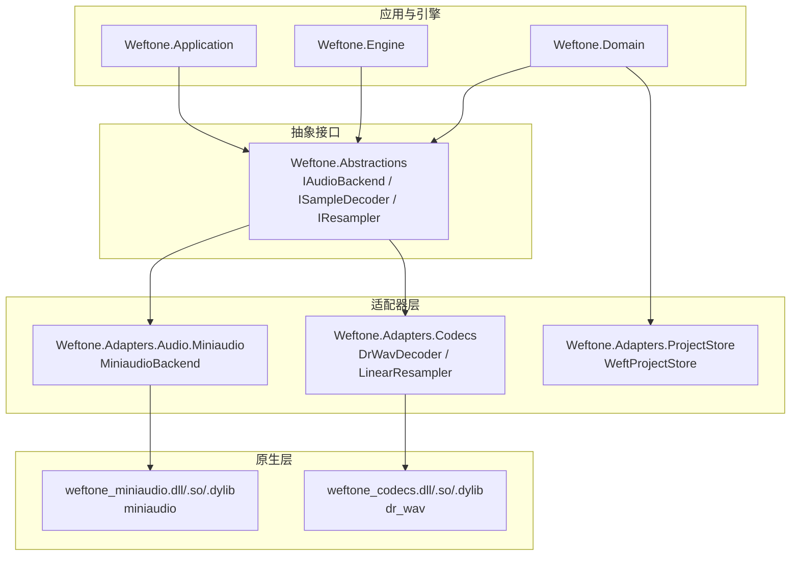
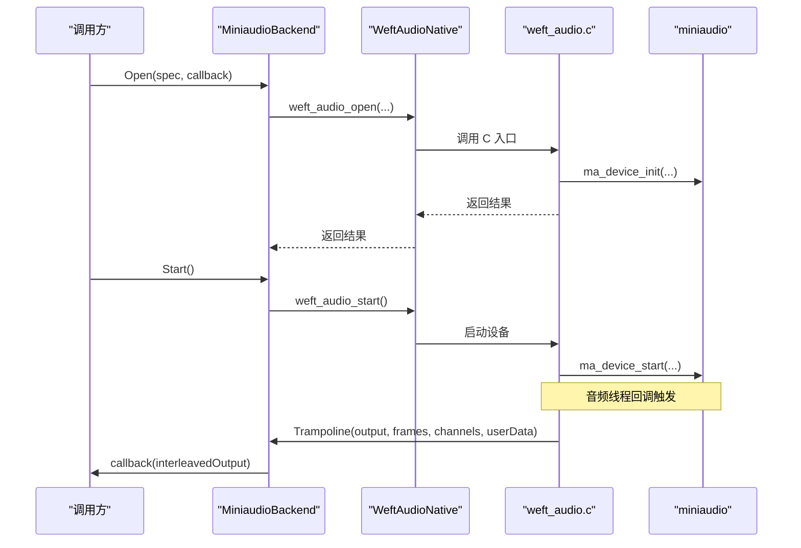
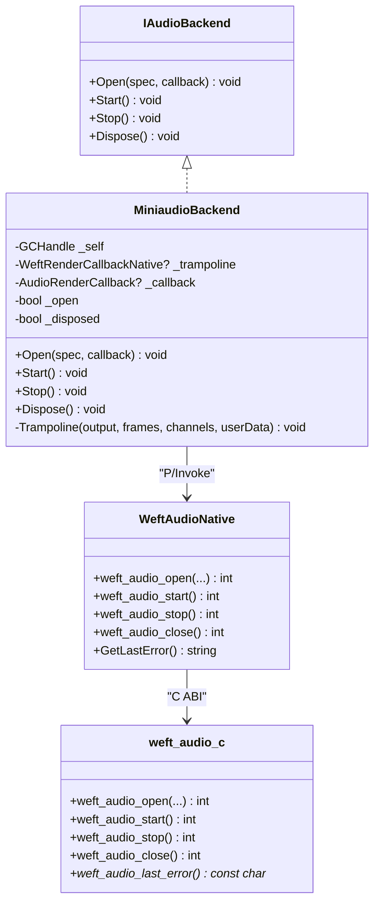
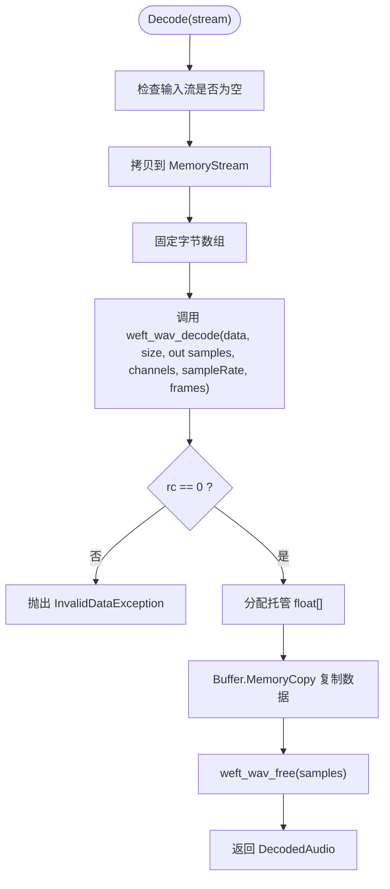
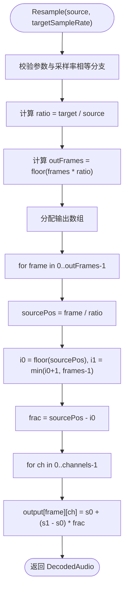
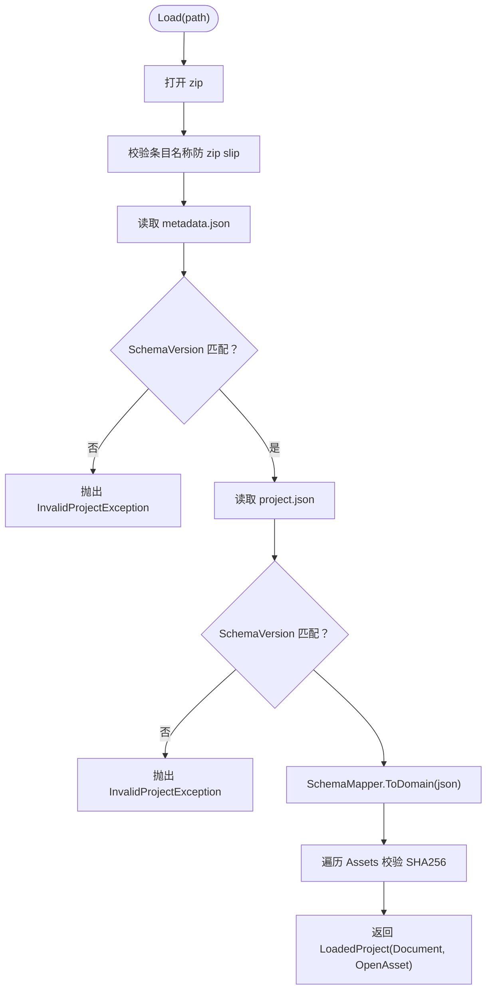
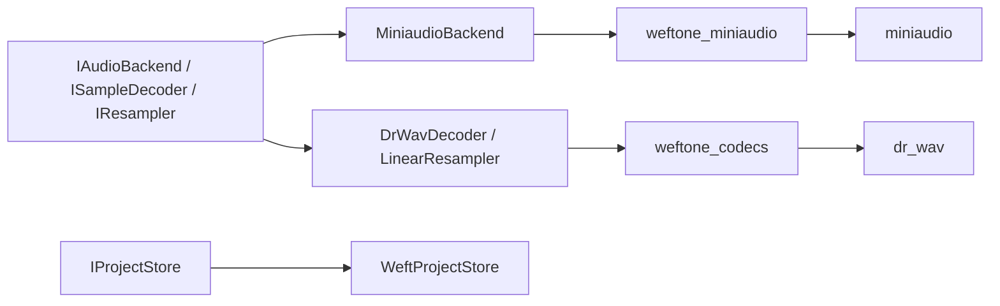

# 适配器实现

<cite>
**本文引用的文件**   
- [MiniaudioBackend.cs](file://src/Weftone.Adapters.Audio.Miniaudio/MiniaudioBackend.cs)
- [NativeProbe.cs（音频）](file://src/Weftone.Adapters.Audio.Miniaudio/NativeProbe.cs)
- [WeftAudioNative.cs](file://src/Weftone.Adapters.Audio.Miniaudio/WeftAudioNative.cs)
- [weft_audio.c](file://native/weftone_miniaudio/weft_audio.c)
- [IAudioBackend.cs](file://src/Weftone.Abstractions/IAudioBackend.cs)
- [DrWavDecoder.cs](file://src/Weftone.Adapters.Codecs/DrWavDecoder.cs)
- [LinearResampler.cs](file://src/Weftone.Adapters.Codecs/LinearResampler.cs)
- [NativeProbe.cs（编解码）](file://src/Weftone.Adapters.Codecs/NativeProbe.cs)
- [WeftCodecsNative.cs](file://src/Weftone.Adapters.Codecs/WeftCodecsNative.cs)
- [dr_wav_shim.c](file://native/weftone_codecs/dr_wav_shim.c)
- [WeftProjectStore.cs](file://src/Weftone.Adapters.ProjectStore/WeftProjectStore.cs)
- [IProjectStore.cs](file://src/Weftone.Domain/IProjectStore.cs)
</cite>

## 目录
1. [引言](#引言)
2. [项目结构](#项目结构)
3. [核心组件](#核心组件)
4. [架构总览](#架构总览)
5. [详细组件分析](#详细组件分析)
6. [依赖关系分析](#依赖关系分析)
7. [性能与实时性](#性能与实时性)
8. [故障排查指南](#故障排查指南)
9. [结论](#结论)

## 引言
本文面向 Weftone 的适配器实现层，聚焦以下目标：
- 说明 MiniaudioBackend 如何通过 P/Invoke 集成 miniaudio 库完成音频设备 I/O。
- 解释 DrWavDecoder 对 WAV 文件的解码流程、格式支持与内存管理。
- 描述 LinearResampler 的重采样算法、复杂度与音质取舍。
- 解析 WeftProjectStore 的 .weft 文件格式读写、序列化/反序列化与版本管理。
- 展示适配器如何遵循六边形架构原则，隔离第三方依赖，保持领域与引擎纯净。

## 项目结构
适配器层按职责拆分为三个独立适配包：
- 音频后端适配器：Weftone.Adapters.Audio.Miniaudio
- 编解码适配器：Weftone.Adapters.Codecs
- 项目存储适配器：Weftone.Adapters.ProjectStore

图表来源
- [IAudioBackend.cs:1-15](file://src/Weftone.Abstractions/IAudioBackend.cs#L1-L15)
- [IProjectStore.cs:1-15](file://src/Weftone.Domain/IProjectStore.cs#L1-L15)
- [MiniaudioBackend.cs:1-85](file://src/Weftone.Adapters.Audio.Miniaudio/MiniaudioBackend.cs#L1-L85)
- [DrWavDecoder.cs:1-51](file://src/Weftone.Adapters.Codecs/DrWavDecoder.cs#L1-L51)
- [LinearResampler.cs:1-45](file://src/Weftone.Adapters.Codecs/LinearResampler.cs#L1-L45)
- [WeftProjectStore.cs:1-208](file://src/Weftone.Adapters.ProjectStore/WeftProjectStore.cs#L1-L208)

章节来源
- [IAudioBackend.cs:1-15](file://src/Weftone.Abstractions/IAudioBackend.cs#L1-L15)
- [IProjectStore.cs:1-15](file://src/Weftone.Domain/IProjectStore.cs#L1-L15)

## 核心组件
- MiniaudioBackend：实现 IAudioBackend，封装 miniaudio 播放设备生命周期，提供零分配回调路径。
- DrWavDecoder：实现 ISampleDecoder，基于 dr_wav 将 WAV 解码为 f32 交错 PCM。
- LinearResampler：实现 IResampler，提供线性插值重采样。
- WeftProjectStore：实现 IProjectStore，负责 .weft 项目的加载与保存，包含 schema 版本校验与资产完整性校验。

章节来源
- [MiniaudioBackend.cs:6-85](file://src/Weftone.Adapters.Audio.Miniaudio/MiniaudioBackend.cs#L6-L85)
- [DrWavDecoder.cs:5-51](file://src/Weftone.Adapters.Codecs/DrWavDecoder.cs#L5-L51)
- [LinearResampler.cs:5-45](file://src/Weftone.Adapters.Codecs/LinearResampler.cs#L5-L45)
- [WeftProjectStore.cs:9-208](file://src/Weftone.Adapters.ProjectStore/WeftProjectStore.cs#L9-L208)

## 架构总览
适配器层通过抽象接口与领域/引擎解耦，并通过原生 shim 暴露稳定 C ABI，避免上层直接依赖第三方库。

图表来源
- [MiniaudioBackend.cs:21-46](file://src/Weftone.Adapters.Audio.Miniaudio/MiniaudioBackend.cs#L21-L46)
- [WeftAudioNative.cs:12-28](file://src/Weftone.Adapters.Audio.Miniaudio/WeftAudioNative.cs#L12-L28)
- [weft_audio.c:72-126](file://native/weftone_miniaudio/weft_audio.c#L72-L126)

## 详细组件分析

### MiniaudioBackend：音频设备 I/O 适配器
- 职责
  - 实现 IAudioBackend，封装音频设备打开、启动、停止与释放。
  - 在 Open 时建立托管回调委托与 GCHandle，确保音频线程回调零分配。
  - 通过 WeftAudioNative 调用原生 weftone_miniaudio 库。
- 关键流程
  - Open：参数校验、确保原生库已安装、绑定回调、调用 weft_audio_open。
  - Start/Stop：调用原生 API 控制设备状态。
  - Dispose：关闭设备、释放回调与 GCHandle。
- 错误处理
  - 所有原生调用失败均抛出 InvalidOperationException，并附带 GetLastError 文本。
  - 使用 ObjectDisposedException 防止重复操作。
- 实时性保障
  - 回调路径仅创建 Span<float>，无托管对象分配。
  - 原生侧在 Windows 上动态加载 avrt.dll 设置 MMCSS “Pro Audio”，提升音频线程优先级。

图表来源
- [IAudioBackend.cs:1-15](file://src/Weftone.Abstractions/IAudioBackend.cs#L1-L15)
- [MiniaudioBackend.cs:11-85](file://src/Weftone.Adapters.Audio.Miniaudio/MiniaudioBackend.cs#L11-L85)
- [WeftAudioNative.cs:5-29](file://src/Weftone.Adapters.Audio.Miniaudio/WeftAudioNative.cs#L5-L29)
- [weft_audio.c:17-163](file://native/weftone_miniaudio/weft_audio.c#L17-L163)

配置与选项
- 设备规格 AudioDeviceSpec：包含采样率、声道数、缓冲帧数；由调用方传入 Open。
- 原生库定位：通过 NativeProbe.EnsureInstalled 自动查找 weftone_miniaudio 动态库。

章节来源
- [MiniaudioBackend.cs:21-85](file://src/Weftone.Adapters.Audio.Miniaudio/MiniaudioBackend.cs#L21-L85)
- [NativeProbe.cs（音频）:10-71](file://src/Weftone.Adapters.Audio.Miniaudio/NativeProbe.cs#L10-L71)
- [weft_audio.c:31-50](file://native/weftone_miniaudio/weft_audio.c#L31-L50)

### DrWavDecoder：WAV 解码适配器
- 职责
  - 实现 ISampleDecoder，将输入流中的 WAV 解码为 f32 交错 PCM。
  - 整文件解码，非实时路径，适合离线导入与预加载。
- 支持格式
  - 基于 dr_wav，支持常见 PCM WAV 格式（如 16/24/32f/32i），统一输出为 float 交错。
- 内存与性能
  - 先将 Stream 拷贝到 MemoryStream，再固定字节数组传给原生解码器。
  - 使用 Buffer.MemoryCopy 将原生分配的 float 缓冲区复制到托管数组。
  - 解码完成后显式调用 weft_wav_free 释放原生内存。
- 错误处理
  - 空流抛 InvalidDataException。
  - 原生解码失败返回不同 rc，映射为 InvalidDataException，提示非法 WAV、空或超限、截断等。

图表来源
- [DrWavDecoder.cs:8-45](file://src/Weftone.Adapters.Codecs/DrWavDecoder.cs#L8-L45)
- [dr_wav_shim.c:16-61](file://native/weftone_codecs/dr_wav_shim.c#L16-L61)

章节来源
- [DrWavDecoder.cs:8-45](file://src/Weftone.Adapters.Codecs/DrWavDecoder.cs#L8-L45)
- [WeftCodecsNative.cs:5-15](file://src/Weftone.Adapters.Codecs/WeftCodecsNative.cs#L5-L15)
- [dr_wav_shim.c:16-67](file://native/weftone_codecs/dr_wav_shim.c#L16-L67)

### LinearResampler：线性插值重采样
- 算法
  - 计算 ratio = targetSampleRate / sourceSampleRate。
  - 对每个输出帧，计算源位置 sourcePos = frame / ratio。
  - 取相邻样本 s0、s1，按分数 frac 进行线性插值。
  - 逐声道处理，输出交错 PCM。
- 复杂度
  - 时间复杂度 O(outFrames × channels)，空间复杂度 O(outFrames × channels)。
- 音质保证
  - 线性插值为简单低通近似，适用于快速离线重采样；高质量实现（如 r8brain）预留扩展点。
- 边界处理
  - 若目标帧数小于 1，至少保留 1 帧。
  - 当 source.SampleRate == targetSampleRate 时直接返回原数据，避免冗余计算。

图表来源
- [LinearResampler.cs:11-43](file://src/Weftone.Adapters.Codecs/LinearResampler.cs#L11-L43)

章节来源
- [LinearResampler.cs:5-45](file://src/Weftone.Adapters.Codecs/LinearResampler.cs#L5-L45)

### WeftProjectStore：.weft 项目存储适配器
- 文件格式
  - .weft 为 zip 容器，包含 metadata.json、project.json 与 assets/*。
  - metadata.json 记录 SchemaVersion 与 Generator。
  - project.json 记录工程文档的 JSON 表示。
  - assets/* 存放资源文件，并在 project.json 中引用。
- 加载流程
  - 校验 zip 条目名称，防 zip slip。
  - 读取 metadata.json 与 project.json，校验 SchemaVersion。
  - 将 JSON 映射为领域模型 ProjectDocument。
  - 遍历 Assets，逐项校验 SHA256。
  - 返回 LoadedProject，包含按需打开资产流的委托。
- 保存流程
  - 校验 assetSourceFiles 键名合法且属于 assets/*。
  - 计算每个资产的 SHA256，写入 project.json。
  - 生成 metadata.json 与 project.json，并打包 assets。
- 版本管理
  - 常量 SchemaVersion 用于校验 metadata.json 与 project.json 的版本一致性。
  - 不支持的版本会抛出 InvalidProjectException。
- 安全与健壮性
  - 白名单限制 zip 条目，拒绝根路径、相对穿越“..”、非法分隔符。
  - 资产缺失或哈希不匹配抛出 InvalidProjectException。
  - EntryStream 包装 ZipArchiveEntry，确保跨 using 作用域正确释放 ZipArchive。

图表来源
- [WeftProjectStore.cs:23-71](file://src/Weftone.Adapters.ProjectStore/WeftProjectStore.cs#L23-L71)

章节来源
- [WeftProjectStore.cs:23-208](file://src/Weftone.Adapters.ProjectStore/WeftProjectStore.cs#L23-L208)
- [IProjectStore.cs:1-15](file://src/Weftone.Domain/IProjectStore.cs#L1-L15)

## 依赖关系分析
适配器层通过抽象接口与第三方库解耦，原生 shim 提供稳定 C ABI。

图表来源
- [IAudioBackend.cs:1-15](file://src/Weftone.Abstractions/IAudioBackend.cs#L1-L15)
- [IProjectStore.cs:1-15](file://src/Weftone.Domain/IProjectStore.cs#L1-L15)
- [MiniaudioBackend.cs:1-85](file://src/Weftone.Adapters.Audio.Miniaudio/MiniaudioBackend.cs#L1-L85)
- [DrWavDecoder.cs:1-51](file://src/Weftone.Adapters.Codecs/DrWavDecoder.cs#L1-L51)
- [LinearResampler.cs:1-45](file://src/Weftone.Adapters.Codecs/LinearResampler.cs#L1-L45)
- [WeftProjectStore.cs:1-208](file://src/Weftone.Adapters.ProjectStore/WeftProjectStore.cs#L1-L208)

章节来源
- [MiniaudioBackend.cs:1-85](file://src/Weftone.Adapters.Audio.Miniaudio/MiniaudioBackend.cs#L1-L85)
- [DrWavDecoder.cs:1-51](file://src/Weftone.Adapters.Codecs/DrWavDecoder.cs#L1-L51)
- [LinearResampler.cs:1-45](file://src/Weftone.Adapters.Codecs/LinearResampler.cs#L1-L45)
- [WeftProjectStore.cs:1-208](file://src/Weftone.Adapters.ProjectStore/WeftProjectStore.cs#L1-L208)

## 性能与实时性
- 音频回调路径
  - MiniaudioBackend.Trampoline 仅创建 Span<float>，无托管对象分配，满足实时约束。
  - 原生侧在 Windows 上启用 MMCSS “Pro Audio”，降低音频线程抖动风险。
- 解码路径
  - DrWavDecoder 整文件解码，适合离线导入；注意大文件内存占用。
  - 使用 Buffer.MemoryCopy 减少拷贝开销。
- 重采样路径
  - LinearResampler 为 O(N×C) 线性插值，速度快但音质有限；如需更高保真可替换为高质量实现。
- 项目存储
  - WeftProjectStore 在加载时逐项校验 SHA256，确保资产完整性；保存时计算哈希并写入元数据。

[本节为通用性能讨论，不直接分析具体文件]

## 故障排查指南
- 音频设备无法打开
  - 检查 Open 返回值与 GetLastError 文本。
  - 确认 NativeProbe.EnsureInstalled 成功加载 weftone_miniaudio。
  - 验证 AudioDeviceSpec 参数有效（采样率、声道数、缓冲帧数）。
- 音频无声或卡顿
  - 检查 Start/Stop 调用顺序与状态。
  - 确认回调内无分配、锁或异常。
  - Windows 平台确认 MMCSS 已启用。
- WAV 解码失败
  - 检查输入流是否为空。
  - 查看 InvalidDataException 消息中的 rc 码含义（非法 WAV、空或超限、截断）。
  - 确认 weftone_codecs 动态库可用。
- 重采样异常
  - 检查目标采样率是否大于等于 1。
  - 确认源数据不为空且通道数合理。
- 项目加载失败
  - 检查 zip 条目名称合法性（防 zip slip）。
  - 确认 metadata.json 与 project.json 存在且 SchemaVersion 匹配。
  - 检查资产是否存在且 SHA256 一致。

章节来源
- [MiniaudioBackend.cs:21-56](file://src/Weftone.Adapters.Audio.Miniaudio/MiniaudioBackend.cs#L21-L56)
- [weft_audio.c:72-163](file://native/weftone_miniaudio/weft_audio.c#L72-L163)
- [DrWavDecoder.cs:8-45](file://src/Weftone.Adapters.Codecs/DrWavDecoder.cs#L8-L45)
- [LinearResampler.cs:11-43](file://src/Weftone.Adapters.Codecs/LinearResampler.cs#L11-L43)
- [WeftProjectStore.cs:23-143](file://src/Weftone.Adapters.ProjectStore/WeftProjectStore.cs#L23-L143)

## 结论
Weftone 的适配器实现层通过清晰的抽象与原生 shim，将第三方依赖完全隔离在适配器内部：
- MiniaudioBackend 以零分配回调路径驱动音频设备，满足实时要求。
- DrWavDecoder 提供稳定的 WAV 解码能力，统一输出 f32 交错 PCM。
- LinearResampler 提供轻量高效的线性插值重采样，便于快速离线处理。
- WeftProjectStore 实现安全的 .weft 项目存取，具备 schema 版本管理与资产完整性校验。
整体设计遵循六边形架构原则，使领域与引擎保持纯净，同时具备良好的可测试性与可扩展性。