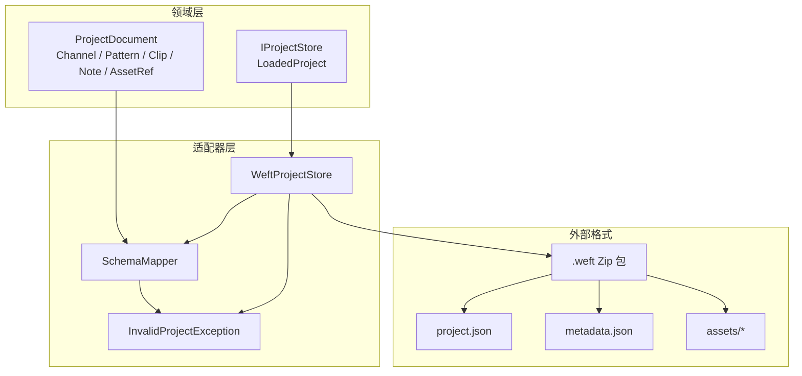
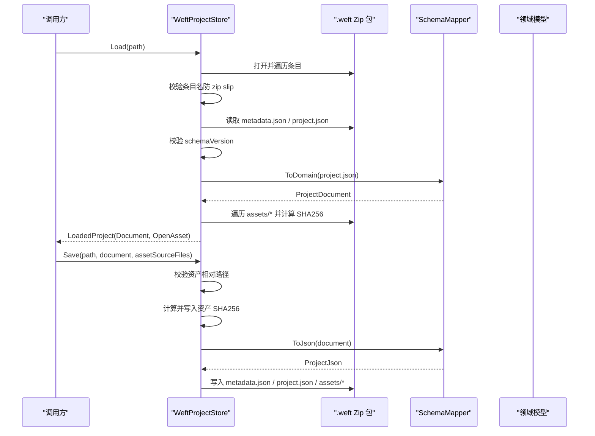
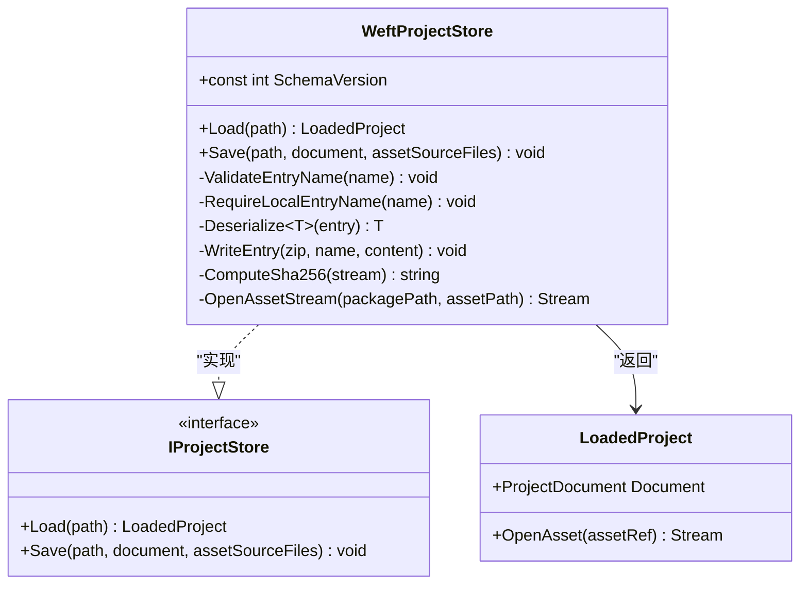
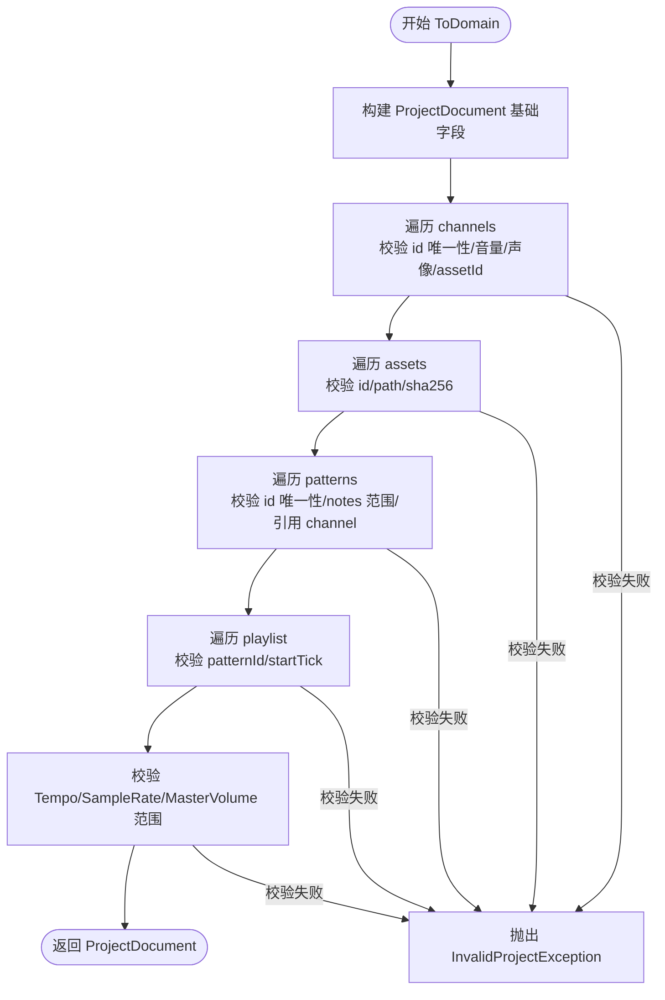
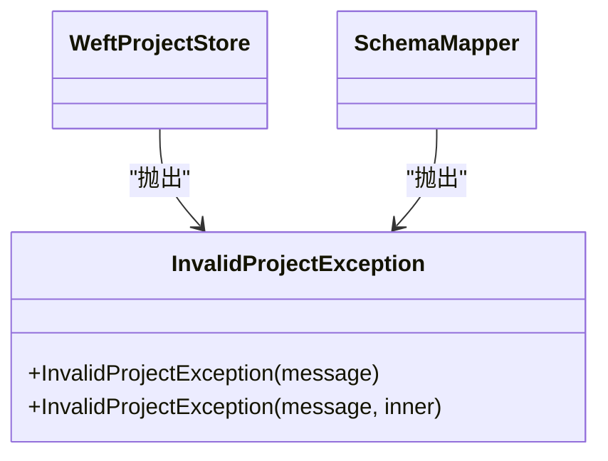
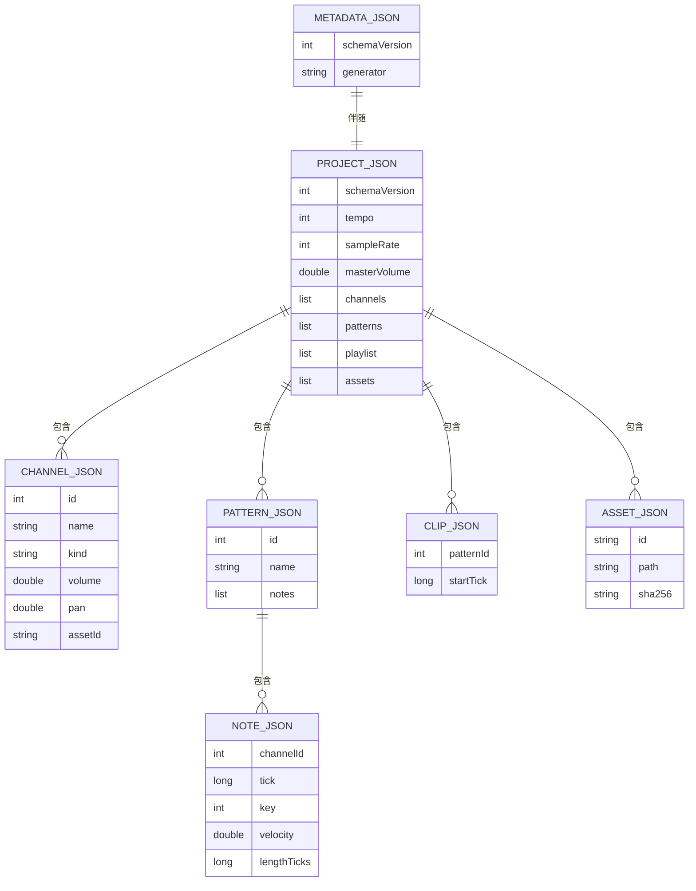
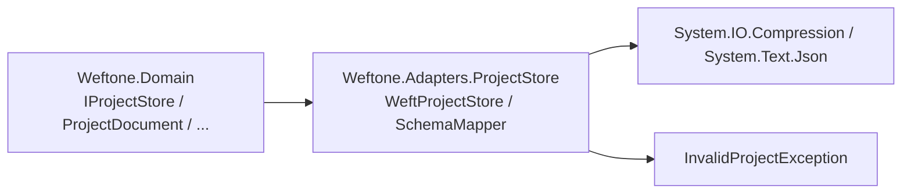

# 项目存储适配器

<cite>
**本文引用的文件**   
- [WeftProjectStore.cs](file://src/Weftone.Adapters.ProjectStore/WeftProjectStore.cs)
- [SchemaMapper.cs](file://src/Weftone.Adapters.ProjectStore/SchemaMapper.cs)
- [InvalidProjectException.cs](file://src/Weftone.Adapters.ProjectStore/InvalidProjectException.cs)
- [IProjectStore.cs](file://src/Weftone.Domain/IProjectStore.cs)
- [ADR-0006-project-format.md](file://docs/adr/ADR-0006-project-format.md)
</cite>

## 目录
1. [简介](#简介)
2. [项目结构](#项目结构)
3. [核心组件](#核心组件)
4. [架构总览](#架构总览)
5. [详细组件分析](#详细组件分析)
6. [依赖关系分析](#依赖关系分析)
7. [性能与扩展性](#性能与扩展性)
8. [故障排查指南](#故障排查指南)
9. [结论](#结论)

## 简介
本技术文档聚焦 Weftone 的“项目存储适配器”，说明 WeftProjectStore 如何实现 IProjectStore 接口，完成 .weft 工程文件的保存与加载；解释 SchemaMapper 如何将领域模型 ProjectDocument 序列化为 .weft 格式，以及如何从 .weft 反序列化为领域对象；阐述 InvalidProjectException 的错误处理机制，包括 zip 安全、schema 版本校验、资产 SHA256 校验与数据范围检查；并给出工程保存、加载与版本兼容性的完整流程说明。最后总结 .weft 文件格式的设计决策：zip 容器、JSON 元数据与资产分离、SHA256 命名与完整性校验、向后兼容策略与可扩展空间。

## 项目结构
本项目采用分层与端口-适配器模式：
- Domain 层定义 IProjectStore 端口与领域模型（如 ProjectDocument、Channel、Pattern、Clip、Note、AssetRef）。
- Adapters.ProjectStore 提供具体实现 WeftProjectStore 与 SchemaMapper，负责 .weft 格式的序列化、校验与持久化。
- ADR-0006 定义了 .weft 格式的总体设计原则与约束。

**图表来源**
- [IProjectStore.cs:1-15](file://src/Weftone.Domain/IProjectStore.cs#L1-L15)
- [WeftProjectStore.cs:9-12](file://src/Weftone.Adapters.ProjectStore/WeftProjectStore.cs#L9-L12)
- [SchemaMapper.cs:67-100](file://src/Weftone.Adapters.ProjectStore/SchemaMapper.cs#L67-L100)
- [ADR-0006-project-format.md:7-11](file://docs/adr/ADR-0006-project-format.md#L7-L11)

**章节来源**
- [IProjectStore.cs:1-15](file://src/Weftone.Domain/IProjectStore.cs#L1-L15)
- [ADR-0006-project-format.md:1-23](file://docs/adr/ADR-0006-project-format.md#L1-L23)

## 核心组件
- WeftProjectStore：实现 IProjectStore.Load 与 Save，负责 .weft 包的打开、条目白名单校验、schema 版本检查、资产 SHA256 校验、按需流式读取资产。
- SchemaMapper：在领域模型与 JSON DTO 之间进行双向映射，并在反序列化时执行严格的域规则校验。
- InvalidProjectException：统一表示“工程包非法”的错误类型，涵盖 zip slip、schema 不匹配、SHA256 不一致、字段越界等场景。
- IProjectStore：定义 Load 与 Save 两个端口方法，将持久化细节隔离在适配器中。

**章节来源**
- [WeftProjectStore.cs:13-208](file://src/Weftone.Adapters.ProjectStore/WeftProjectStore.cs#L13-L208)
- [SchemaMapper.cs:8-206](file://src/Weftone.Adapters.ProjectStore/SchemaMapper.cs#L8-L206)
- [InvalidProjectException.cs:1-10](file://src/Weftone.Adapters.ProjectStore/InvalidProjectException.cs#L1-L10)
- [IProjectStore.cs:1-15](file://src/Weftone.Domain/IProjectStore.cs#L1-L15)

## 架构总览
WeftProjectStore 作为 IProjectStore 的具体实现，承担以下职责：
- 打开 .weft 包，逐条校验 zip 条目名称，防止 zip slip 与非白名单路径。
- 解析 metadata.json 与 project.json，校验 schemaVersion 与当前支持版本一致。
- 通过 SchemaMapper.ToDomain 将 JSON 转换为领域对象，并进行字段范围与引用一致性校验。
- 对每个声明的资产计算 SHA256 并与记录值比对，确保资产未被篡改或损坏。
- 返回 LoadedProject，其中包含 ProjectDocument 与一个 OpenAsset 委托，用于按需流式读取 assets/* 中的资源。

保存流程则相反：
- 根据 assetSourceFiles 将相对路径资产写入 zip，同时计算并更新资产的 SHA256。
- 使用 SchemaMapper.ToJson 将领域对象转为 JSON DTO，再写入 project.json。
- 写入 metadata.json，包含 schemaVersion 与 generator 信息。

**图表来源**
- [WeftProjectStore.cs:23-110](file://src/Weftone.Adapters.ProjectStore/WeftProjectStore.cs#L23-L110)
- [SchemaMapper.cs:69-100](file://src/Weftone.Adapters.ProjectStore/SchemaMapper.cs#L69-L100)
- [SchemaMapper.cs:102-180](file://src/Weftone.Adapters.ProjectStore/SchemaMapper.cs#L102-L180)

## 详细组件分析

### WeftProjectStore：IProjectStore 的实现
- Load(path)
  - 打开 zip 并逐项校验条目名，拒绝包含反斜杠、根路径、父目录片段或非白名单路径。
  - 要求存在 project.json 与 metadata.json，否则抛出 InvalidProjectException。
  - 解析 metadata.json 与 project.json，校验 schemaVersion 与内部常量一致。
  - 调用 SchemaMapper.ToDomain 生成领域对象，并对资产逐一计算 SHA256 与预期值比较。
  - 返回 LoadedProject，OpenAsset 委托以流方式打开对应 assets/* 条目，避免一次性解压整个包。
- Save(path, document, assetSourceFiles)
  - 创建目标目录，遍历 assetSourceFiles，校验相对路径必须以 assets/ 开头且不含危险字符。
  - 为每个资产计算 SHA256 并写回 AssetRef.Sha256，随后将源文件复制到 zip 对应位置。
  - 使用 SchemaMapper.ToJson 将领域对象转为 JSON，写入 project.json；写入 metadata.json 包含 schemaVersion 与 generator。
- 辅助方法
  - ValidateEntryName：zip 条目白名单校验。
  - RequireLocalEntryName：资产相对路径校验。
  - Deserialize<T>：JSON 反序列化封装，捕获 JsonException 并包装为 InvalidProjectException。
  - WriteEntry：UTF-8 无 BOM 写入 JSON。
  - ComputeSha256：计算十六进制小写哈希。
  - EntryStream：包装 ZipArchiveEntry 流，确保在 Dispose 时释放外层 ZipArchive。

**图表来源**
- [WeftProjectStore.cs:13-208](file://src/Weftone.Adapters.ProjectStore/WeftProjectStore.cs#L13-L208)
- [IProjectStore.cs:1-15](file://src/Weftone.Domain/IProjectStore.cs#L1-L15)

**章节来源**
- [WeftProjectStore.cs:23-110](file://src/Weftone.Adapters.ProjectStore/WeftProjectStore.cs#L23-L110)
- [WeftProjectStore.cs:112-206](file://src/Weftone.Adapters.ProjectStore/WeftProjectStore.cs#L112-L206)

### SchemaMapper：领域模型与 .weft 格式的映射
- ToJson(ProjectDocument)
  - 将 ProjectDocument 的 Tempo、SampleRate、MasterVolume、Channels、Patterns、Playlist、Assets 映射到 ProjectJson。
  - ChannelKind 枚举序列化为字符串（sine/sampler），未知值抛出异常。
- ToDomain(ProjectJson)
  - 构建 ProjectDocument，并依次校验：
    - channel id 唯一性。
    - asset id 非空、path 以 assets/ 开头、sha256 为 64 位十六进制。
    - sampler 声部必须关联有效的 assetId，且该 assetId 存在于 Assets 列表。
    - channel volume 在 [0,2]，pan 在 [-1,1]。
    - pattern id 唯一性；note tick >= 0、lengthTicks >= 1、key 在 [0,127]、velocity 在 [0,1]；note.channelId 必须已注册。
    - clip.patternId 必须已注册；clip.startTick >= 0。
    - 全局范围：Tempo 在允许范围内、SampleRate 在 [8000,192000]、MasterVolume 在 [0,2]。
  - 任何校验失败均抛出 InvalidProjectException。

**图表来源**
- [SchemaMapper.cs:102-180](file://src/Weftone.Adapters.ProjectStore/SchemaMapper.cs#L102-L180)

**章节来源**
- [SchemaMapper.cs:67-100](file://src/Weftone.Adapters.ProjectStore/SchemaMapper.cs#L67-L100)
- [SchemaMapper.cs:102-206](file://src/Weftone.Adapters.ProjectStore/SchemaMapper.cs#L102-L206)

### InvalidProjectException：错误处理机制
- 用途：统一表达“工程包非法”的错误，包括：
  - zip 条目非法（zip slip、非白名单）。
  - 缺少必要文件（project.json/metadata.json）。
  - schema 版本不支持。
  - JSON 解析失败。
  - 资产缺失或 SHA256 不匹配。
  - 字段越界或引用无效（channel/pattern/asset/note/clip）。
- 构造器：支持简单消息与带内嵌异常的构造，便于保留原始异常链。

**图表来源**
- [InvalidProjectException.cs:1-10](file://src/Weftone.Adapters.ProjectStore/InvalidProjectException.cs#L1-L10)
- [WeftProjectStore.cs:23-110](file://src/Weftone.Adapters.ProjectStore/WeftProjectStore.cs#L23-L110)
- [SchemaMapper.cs:102-206](file://src/Weftone.Adapters.ProjectStore/SchemaMapper.cs#L102-L206)

**章节来源**
- [InvalidProjectException.cs:1-10](file://src/Weftone.Adapters.ProjectStore/InvalidProjectException.cs#L1-L10)

### .weft 文件格式设计与兼容性
- 容器：zip 包，包含 metadata.json、project.json 与 assets/*。
- 元数据：metadata.json 包含 schemaVersion 与 generator，用于标识格式版本与生成器。
- 工程描述：project.json 包含 tempo、sampleRate、masterVolume、channels、patterns、playlist、assets。
- 资产：assets/* 按相对路径存放，资产清单记录 id、path、sha256。
- 安全性：加载时对 zip 条目进行白名单校验，防止 zip slip；资产 sha256 校验保证完整性。
- 兼容性：
  - 通过 schemaVersion 控制版本，仅支持与当前实现一致的版本。
  - 未来可通过迁移逻辑扩展，但 L1 保持严格版本匹配以确保稳定性。
- 扩展性：
  - JSON 结构可逐步增加可选字段，配合 schemaVersion 演进。
  - 后续可增加二进制缓存或 presets/ 目录（见 ADR-0006）。

**图表来源**
- [SchemaMapper.cs:8-63](file://src/Weftone.Adapters.ProjectStore/SchemaMapper.cs#L8-L63)
- [ADR-0006-project-format.md:7-11](file://docs/adr/ADR-0006-project-format.md#L7-L11)

**章节来源**
- [ADR-0006-project-format.md:1-23](file://docs/adr/ADR-0006-project-format.md#L1-L23)

## 依赖关系分析
- WeftProjectStore 依赖 System.IO.Compression 与 System.Text.Json，负责 zip 与 JSON 操作。
- WeftProjectStore 依赖 Weftone.Domain 的 IProjectStore、ProjectDocument、AssetRef 等类型。
- SchemaMapper 依赖 Weftone.Domain 的领域模型，并通过 InvalidProjectException 暴露校验错误。
- IProjectStore 是领域层定义的端口，解耦了持久化实现细节。

**图表来源**
- [IProjectStore.cs:1-15](file://src/Weftone.Domain/IProjectStore.cs#L1-L15)
- [WeftProjectStore.cs:1-6](file://src/Weftone.Adapters.ProjectStore/WeftProjectStore.cs#L1-L6)
- [SchemaMapper.cs:1-3](file://src/Weftone.Adapters.ProjectStore/SchemaMapper.cs#L1-L3)
- [InvalidProjectException.cs:1-10](file://src/Weftone.Adapters.ProjectStore/InvalidProjectException.cs#L1-L10)

**章节来源**
- [WeftProjectStore.cs:1-6](file://src/Weftone.Adapters.ProjectStore/WeftProjectStore.cs#L1-L6)
- [SchemaMapper.cs:1-3](file://src/Weftone.Adapters.ProjectStore/SchemaMapper.cs#L1-L3)

## 性能与扩展性
- 性能
  - 加载时逐条校验 zip 条目与资产 SHA256，可能带来 I/O 开销；适合中小型工程。
  - 大工程 JSON 体积较大，后续可按 ADR-0006 引入二进制缓存以提升读写性能。
- 内存
  - OpenAsset 委托按需读取资产流，避免一次性解压整个包，降低峰值内存占用。
- 扩展性
  - JSON 结构可渐进扩展，配合 schemaVersion 控制兼容性。
  - 可新增 presets/ 或其他目录，但需同步更新白名单与校验逻辑。

[本节为通用指导，不直接分析具体文件]

## 故障排查指南
常见错误与定位建议：
- “缺少 project.json / metadata.json”
  - 检查 .weft 包是否包含必需文件。
  - 参考：[WeftProjectStore.cs:31-40](file://src/Weftone.Adapters.ProjectStore/WeftProjectStore.cs#L31-L40)
- “schema 版本不支持”
  - 确认工程由当前版本的 Weftone 生成，或实现迁移逻辑。
  - 参考：[WeftProjectStore.cs:42-52](file://src/Weftone.Adapters.ProjectStore/WeftProjectStore.cs#L42-L52)
- “资产缺失 / 资产 SHA256 不匹配”
  - 检查 assets/* 是否存在且未被修改；重新生成工程或修复资产。
  - 参考：[WeftProjectStore.cs:55-68](file://src/Weftone.Adapters.ProjectStore/WeftProjectStore.cs#L55-L68)
- “非法 zip 条目 / 非白名单 zip 条目”
  - 检查 zip 中是否存在危险路径或非允许目录；清理工程包。
  - 参考：[WeftProjectStore.cs:131-143](file://src/Weftone.Adapters.ProjectStore/WeftProjectStore.cs#L131-L143)
- “JSON 解析失败”
  - 检查 project.json/metadata.json 语法是否正确。
  - 参考：[WeftProjectStore.cs:154-166](file://src/Weftone.Adapters.ProjectStore/WeftProjectStore.cs#L154-L166)
- “字段越界 / 引用未知”
  - 检查 channel/pattern/asset/note/clip 的值是否在允许范围，以及引用是否有效。
  - 参考：[SchemaMapper.cs:110-179](file://src/Weftone.Adapters.ProjectStore/SchemaMapper.cs#L110-L179)

**章节来源**
- [WeftProjectStore.cs:31-68](file://src/Weftone.Adapters.ProjectStore/WeftProjectStore.cs#L31-L68)
- [WeftProjectStore.cs:131-166](file://src/Weftone.Adapters.ProjectStore/WeftProjectStore.cs#L131-L166)
- [SchemaMapper.cs:110-179](file://src/Weftone.Adapters.ProjectStore/SchemaMapper.cs#L110-L179)

## 结论
WeftProjectStore 通过严格的 zip 安全校验、schema 版本控制与资产 SHA256 校验，提供了安全可靠的 .weft 工程存取能力；SchemaMapper 则在领域模型与 JSON 之间建立清晰的双向映射，并在反序列化阶段执行全面的域规则校验。结合 ADR-0006 的设计决策，.weft 格式在保证开放性与可移植性的同时，具备良好的扩展性与向后兼容策略。对于大型工程，建议后续引入二进制缓存以提升性能，并保持 schemaVersion 的严谨管理以确保长期稳定性。