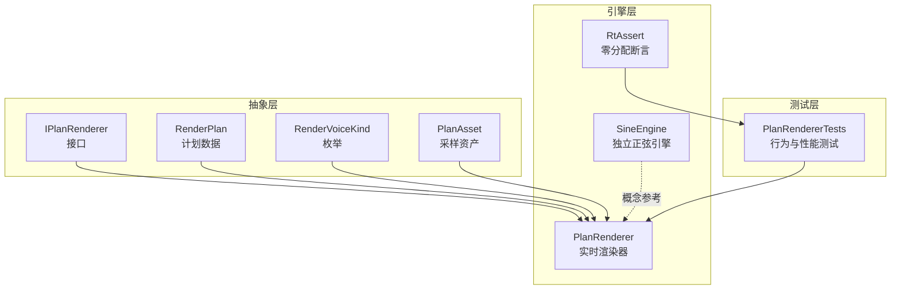
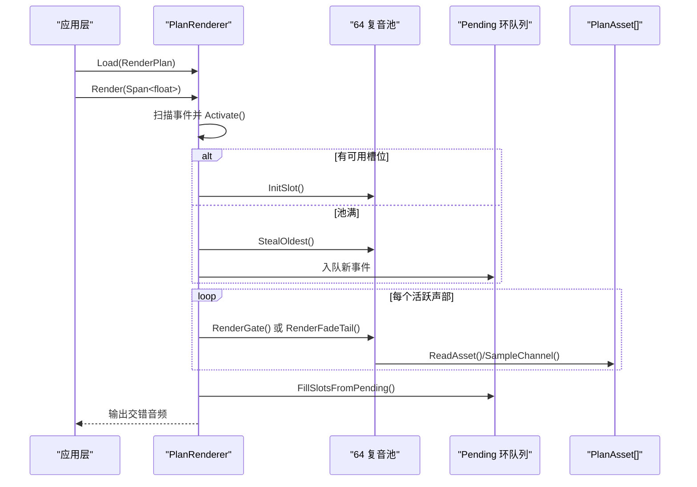
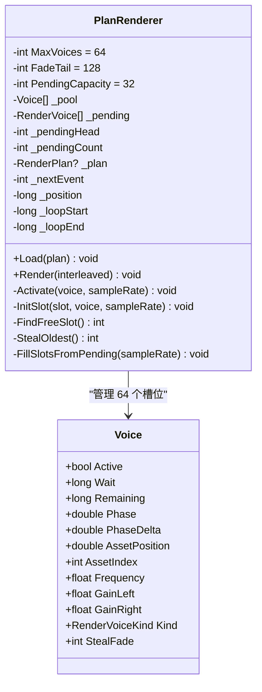
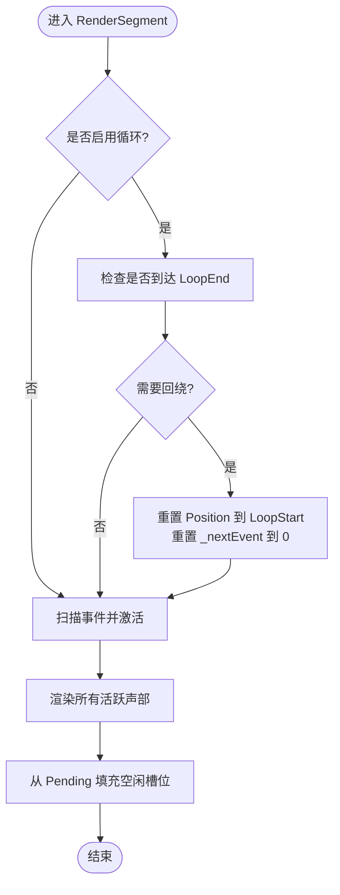
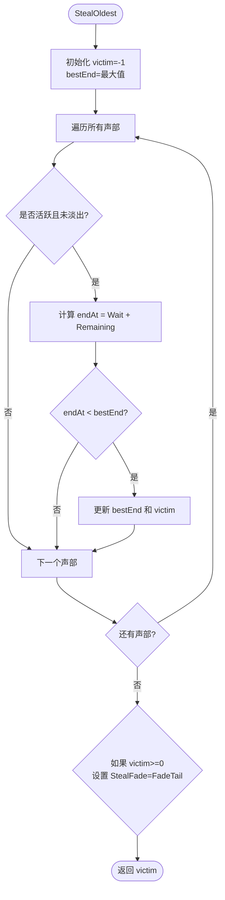
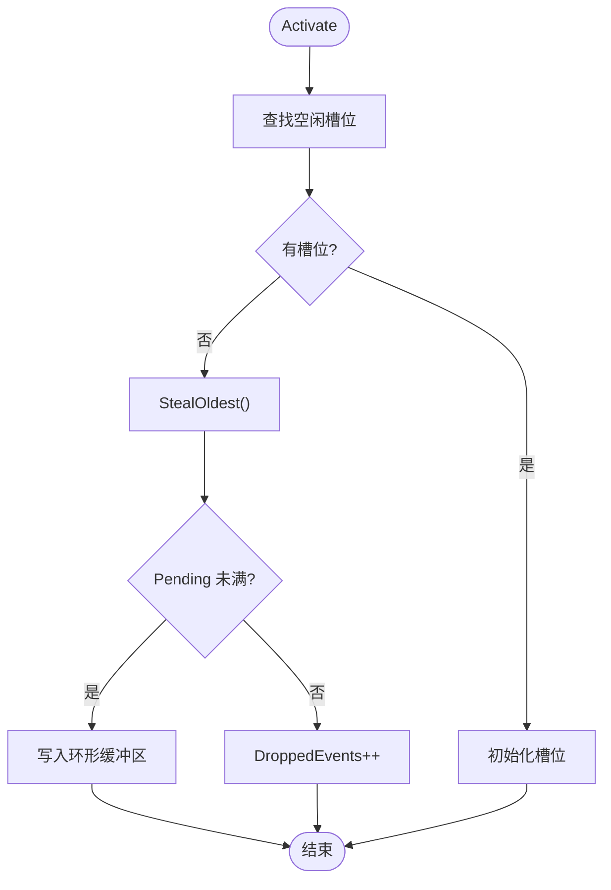
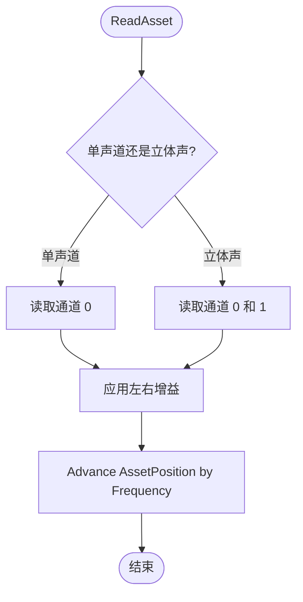
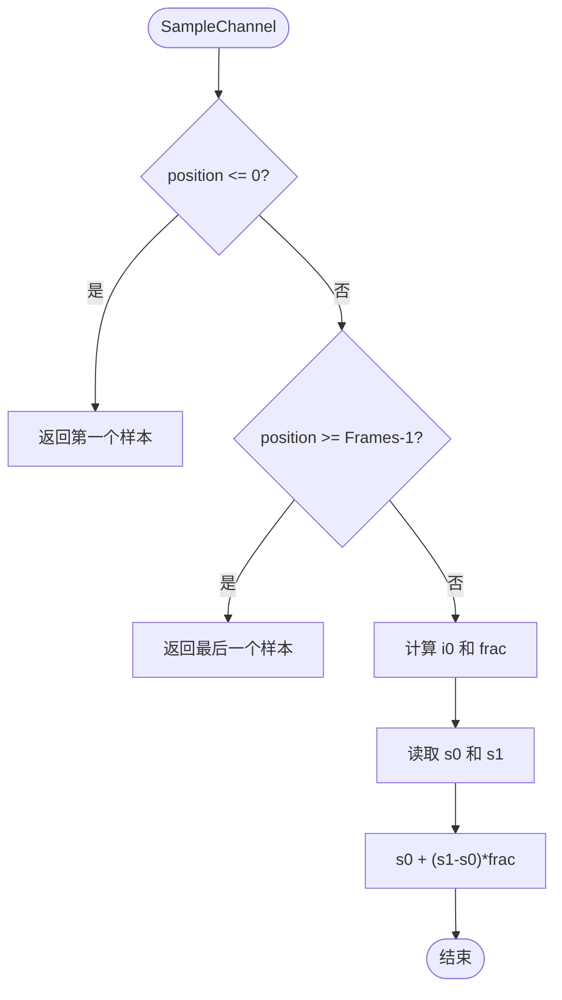
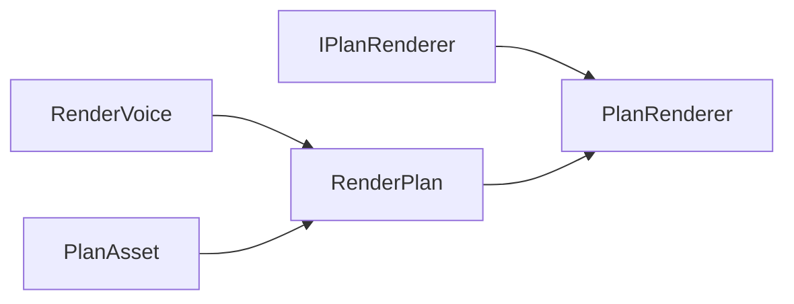
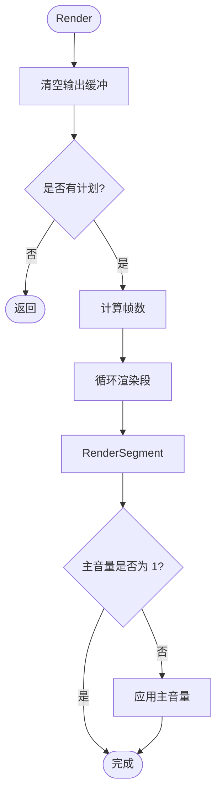

# PlanRenderer 渲染器

<cite>
**本文引用的文件**   
- [PlanRenderer.cs](file://src/Weftone.Engine/PlanRenderer.cs)
- [IPlanRenderer.cs](file://src/Weftone.Abstractions/Rendering/IPlanRenderer.cs)
- [RenderPlan.cs](file://src/Weftone.Abstractions/Rendering/RenderPlan.cs)
- [SineEngine.cs](file://src/Weftone.Engine/SineEngine.cs)
- [RtAssert.cs](file://src/Weftone.Engine/RtAssert.cs)
- [PlanRendererTests.cs](file://tests/Weftone.Engine.Tests/PlanRendererTests.cs)
</cite>

## 目录
1. [简介](#简介)
2. [项目结构](#项目结构)
3. [核心组件](#核心组件)
4. [架构总览](#架构总览)
5. [详细组件分析](#详细组件分析)
6. [依赖关系分析](#依赖关系分析)
7. [性能与零分配保证](#性能与零分配保证)
8. [音频处理流程](#音频处理流程)
9. [内存布局](#内存布局)
10. [调试技巧与常见问题](#调试技巧与常见问题)
11. [结论](#结论)

## 简介
PlanRenderer 是 Weftone 引擎中的高性能实时音频渲染器。它基于“计划式”渲染：所有音符、采样播放和包络参数在离线阶段预计算为扁平的 `RenderPlan`，渲染期只做线性累加、相位推进和线性插值，避免任何运行时对象分配。

关键特性包括：
- 固定 64 复音池，避免堆分配。
- 事件按 `StartSample` 顺序激活，支持循环区间回绕。
- 池满时采用“最早结束优先”的声部偷取策略，配合 128 样本线性淡出尾音，避免点击噪声。
- 使用环形缓冲区 `pending` 队列缓冲突发新事件，保障实时稳定性。
- 正弦波合成使用双精度相位，采样器播放使用线性插值，MIDI60=原速。
- 通过 `RtAssert` 在 RT_ASSERT 构建下检测托管分配违规，确保音频路径零分配。

## 项目结构
与 PlanRenderer 直接相关的代码分布在以下位置：
- 抽象接口与数据模型：`Weftone.Abstractions/Rendering`
- 渲染器实现：`Weftone.Engine/PlanRenderer.cs`
- 辅助正弦引擎（非 PlanRenderer 内部使用，但体现相同零分配思想）：`Weftone.Engine/SineEngine.cs`
- 实时断言工具：`Weftone.Engine/RtAssert.cs`
- 行为验证测试：`tests/Weftone.Engine.Tests/PlanRendererTests.cs`



**图表来源**
- [IPlanRenderer.cs:1-12](file://src/Weftone.Abstractions/Rendering/IPlanRenderer.cs#L1-L12)
- [RenderPlan.cs:1-42](file://src/Weftone.Abstractions/Rendering/RenderPlan.cs#L1-L42)
- [PlanRenderer.cs:1-356](file://src/Weftone.Engine/PlanRenderer.cs#L1-L356)
- [SineEngine.cs:1-40](file://src/Weftone.Engine/SineEngine.cs#L1-L40)
- [RtAssert.cs:1-32](file://src/Weftone.Engine/RtAssert.cs#L1-L32)
- [PlanRendererTests.cs:1-231](file://tests/Weftone.Engine.Tests/PlanRendererTests.cs#L1-L231)

**章节来源**
- [IPlanRenderer.cs:1-12](file://src/Weftone.Abstractions/Rendering/IPlanRenderer.cs#L1-L12)
- [RenderPlan.cs:1-42](file://src/Weftone.Abstractions/Rendering/RenderPlan.cs#L1-L42)
- [PlanRenderer.cs:1-356](file://src/Weftone.Engine/PlanRenderer.cs#L1-L356)

## 核心组件
- `IPlanRenderer`：定义加载计划和渲染交错立体声缓冲的端口。
- `RenderPlan`：扁平计划数据结构，包含采样率、声道数、主音量、循环区间、声音事件数组和采样资产数组。
- `RenderVoice`：单次触发声音事件，包含起始样本、长度、类型、频率、左右增益和资产索引。
- `PlanAsset`：解码并重采样后的交错浮点样本数据，包含声道数和帧数。
- `PlanRenderer`：实现 `IPlanRenderer`，负责复音池管理、事件调度、声部偷取、环形 pending 队列、正弦合成与采样器播放。
- `SineEngine`：独立的正弦波生成器，展示相同的零分配与相位推进模式。
- `RtAssert`：在 RT_ASSERT 构建下统计音频路径上的托管分配次数，用于验证零分配。

**章节来源**
- [IPlanRenderer.cs:1-12](file://src/Weftone.Abstractions/Rendering/IPlanRenderer.cs#L1-L12)
- [RenderPlan.cs:1-42](file://src/Weftone.Abstractions/Rendering/RenderPlan.cs#L1-L42)
- [PlanRenderer.cs:1-356](file://src/Weftone.Engine/PlanRenderer.cs#L1-L356)
- [SineEngine.cs:1-40](file://src/Weftone.Engine/SineEngine.cs#L1-L40)
- [RtAssert.cs:1-32](file://src/Weftone.Engine/RtAssert.cs#L1-L32)

## 架构总览
PlanRenderer 的渲染流程围绕“计划驱动 + 固定资源池”展开：
- 应用层构造 `RenderPlan`，将音符、采样、包络等全部参数离线预乘。
- 渲染器加载计划后，在每段音频块中：
  - 扫描并激活到当前时间的事件。
  - 对每个活跃声部进行门控或淡出尾音渲染。
  - 从 pending 环队列填充空闲槽位。
  - 可选地应用主音量。



**图表来源**
- [PlanRenderer.cs:48-137](file://src/Weftone.Engine/PlanRenderer.cs#L48-L137)
- [PlanRenderer.cs:139-231](file://src/Weftone.Engine/PlanRenderer.cs#L139-L231)
- [PlanRenderer.cs:233-334](file://src/Weftone.Engine/PlanRenderer.cs#L233-L334)

## 详细组件分析

### 复音池与声部生命周期
- 池大小固定为 64，结构体数组 `_pool` 避免堆分配。
- 每个 `Voice` 包含活动标志、等待样本、剩余样本、相位、资产位置、频率、左右增益、类型和偷取淡出计数。
- 生命周期：
  - 激活：`Activate` 查找空闲槽位；若无则执行 `StealOldest`，并将新事件放入 pending。
  - 渲染：`RenderGate` 正常门控，`RenderFadeTail` 淡出尾音。
  - 结束：当剩余样本为零且无需等待时，标记为非活动。



**图表来源**
- [PlanRenderer.cs:11-43](file://src/Weftone.Engine/PlanRenderer.cs#L11-L43)
- [PlanRenderer.cs:18-32](file://src/Weftone.Engine/PlanRenderer.cs#L18-L32)

**章节来源**
- [PlanRenderer.cs:11-43](file://src/Weftone.Engine/PlanRenderer.cs#L11-L43)
- [PlanRenderer.cs:139-177](file://src/Weftone.Engine/PlanRenderer.cs#L139-L177)

### 事件调度与循环回绕
- 事件按 `StartSample` 顺序存储在 `RenderPlan.Voices` 中。
- 渲染段内，`_nextEvent` 游标向前推进，直到事件起始样本超过当前段末尾。
- 若启用循环区间（`LoopEnd > LoopStart`），当 `_position` 到达 `LoopEnd` 时回绕至 `LoopStart`，并重置事件游标以重新触发事件。



**图表来源**
- [PlanRenderer.cs:61-105](file://src/Weftone.Engine/PlanRenderer.cs#L61-L105)
- [PlanRenderer.cs:107-137](file://src/Weftone.Engine/PlanRenderer.cs#L107-L137)

**章节来源**
- [PlanRenderer.cs:61-105](file://src/Weftone.Engine/PlanRenderer.cs#L61-L105)
- [PlanRenderer.cs:107-137](file://src/Weftone.Engine/PlanRenderer.cs#L107-L137)

### 声部偷取算法 StealOldest
- 目标：在池满时选择“最早结束”的声部进行偷取，确保确定性。
- 规则：
  - 仅考虑活跃且未处于淡出状态的声部。
  - 比较 `Wait + Remaining`，最小者被选中。
  - 平局时选择较低索引，保证稳定。
  - 被选中的声部设置 `StealFade = FadeTail`，进入淡出尾音路径。
- 效果：避免突然截断导致的点击噪声，同时为新事件腾出槽位。



**图表来源**
- [PlanRenderer.cs:191-215](file://src/Weftone.Engine/PlanRenderer.cs#L191-L215)

**章节来源**
- [PlanRenderer.cs:191-215](file://src/Weftone.Engine/PlanRenderer.cs#L191-L215)

### 环形缓冲区 Pending 队列
- 目的：缓冲突发的新事件，避免丢事件导致音频中断。
- 容量：固定 32，头指针 `_pendingHead` 和计数 `_pendingCount` 控制入队出队。
- 入队：当池满且发生偷取后，新事件写入 `(head + count) % capacity`。
- 出队：每段渲染结束后尝试从 pending 填充空闲槽位。
- 溢出保护：若 pending 也满，则增加 `DroppedEvents` 计数器。



**图表来源**
- [PlanRenderer.cs:139-156](file://src/Weftone.Engine/PlanRenderer.cs#L139-L156)
- [PlanRenderer.cs:217-231](file://src/Weftone.Engine/PlanRenderer.cs#L217-L231)

**章节来源**
- [PlanRenderer.cs:139-156](file://src/Weftone.Engine/PlanRenderer.cs#L139-L156)
- [PlanRenderer.cs:217-231](file://src/Weftone.Engine/PlanRenderer.cs#L217-L231)

### 正弦波合成与采样器播放
- 正弦波：
  - 使用双精度相位 `Phase`，每样本推进 `TwoPi * Frequency / SampleRate`。
  - 相位超过 `TwoPi` 时减去周期，避免溢出。
  - 输出乘以左右增益，并叠加到交错缓冲。
- 采样器：
  - 根据 `Frequency` 作为播放速率（MIDI60=原速）。
  - 使用线性插值读取单声道或立体声资产。
  - 当资产耗尽时，将 `Remaining` 置为 1，随后自然结束。



**图表来源**
- [PlanRenderer.cs:300-334](file://src/Weftone.Engine/PlanRenderer.cs#L300-L334)

**章节来源**
- [PlanRenderer.cs:233-268](file://src/Weftone.Engine/PlanRenderer.cs#L233-L268)
- [PlanRenderer.cs:270-298](file://src/Weftone.Engine/PlanRenderer.cs#L270-L298)
- [PlanRenderer.cs:300-334](file://src/Weftone.Engine/PlanRenderer.cs#L300-L334)

### 线性插值算法
- 输入：当前位置 `position`、声道 `channel`、资产样本数组。
- 边界处理：
  - 位置小于等于 0：返回第一个样本。
  - 位置大于等于 `Frames - 1`：返回最后一个样本。
- 插值：
  - 计算整数部分 `i0` 和小数部分 `frac`。
  - 读取相邻两个样本 `s0` 和 `s1`。
  - 返回 `s0 + (s1 - s0) * frac`。



**图表来源**
- [PlanRenderer.cs:318-334](file://src/Weftone.Engine/PlanRenderer.cs#L318-L334)

**章节来源**
- [PlanRenderer.cs:318-334](file://src/Weftone.Engine/PlanRenderer.cs#L318-L334)

## 依赖关系分析
PlanRenderer 依赖以下抽象和数据类型：
- `IPlanRenderer`：定义渲染接口。
- `RenderPlan`：提供计划数据，包括声音事件和采样资产。
- `RenderVoice`：描述单个声音事件。
- `PlanAsset`：描述采样资产数据。



**图表来源**
- [IPlanRenderer.cs:1-12](file://src/Weftone.Abstractions/Rendering/IPlanRenderer.cs#L1-L12)
- [RenderPlan.cs:1-42](file://src/Weftone.Abstractions/Rendering/RenderPlan.cs#L1-L42)
- [PlanRenderer.cs:1-356](file://src/Weftone.Engine/PlanRenderer.cs#L1-L356)

**章节来源**
- [IPlanRenderer.cs:1-12](file://src/Weftone.Abstractions/Rendering/IPlanRenderer.cs#L1-L12)
- [RenderPlan.cs:1-42](file://src/Weftone.Abstractions/Rendering/RenderPlan.cs#L1-L42)
- [PlanRenderer.cs:1-356](file://src/Weftone.Engine/PlanRenderer.cs#L1-L356)

## 性能与零分配保证
- 固定大小数组：`_pool` 和 `_pending` 在构造函数中分配，渲染期不再分配。
- 结构体复用：`Voice` 是值类型，避免对象头开销。
- 无 GC 压力：测试通过 `RtAssert.Guard` 验证渲染路径无托管分配。
- 主音量优化：仅在 `MasterGain != 1f` 时遍历缓冲应用增益。

测试覆盖：
- 复音池溢出不会崩溃，pending 队列能消化额外事件。
- 渲染路径零分配断言通过。

**章节来源**
- [PlanRenderer.cs:13-38](file://src/Weftone.Engine/PlanRenderer.cs#L13-L38)
- [PlanRenderer.cs:97-104](file://src/Weftone.Engine/PlanRenderer.cs#L97-L104)
- [RtAssert.cs:1-32](file://src/Weftone.Engine/RtAssert.cs#L1-L32)
- [PlanRendererTests.cs:77-115](file://tests/Weftone.Engine.Tests/PlanRendererTests.cs#L77-L115)

## 音频处理流程
整体渲染流程如下：
1. 清空输出缓冲。
2. 计算当前段长度，考虑循环回绕。
3. 激活到当前时间的事件。
4. 渲染所有活跃声部（门控或淡出）。
5. 从 pending 队列填充空闲槽位。
6. 应用主音量（可选）。



**图表来源**
- [PlanRenderer.cs:61-105](file://src/Weftone.Engine/PlanRenderer.cs#L61-L105)
- [PlanRenderer.cs:107-137](file://src/Weftone.Engine/PlanRenderer.cs#L107-L137)

**章节来源**
- [PlanRenderer.cs:61-105](file://src/Weftone.Engine/PlanRenderer.cs#L61-L105)
- [PlanRenderer.cs:107-137](file://src/Weftone.Engine/PlanRenderer.cs#L107-L137)

## 内存布局
PlanRenderer 的内存布局高度紧凑：
- `_pool`：64 个 `Voice` 结构体，每个约 40 字节，总计约 2.5KB。
- `_pending`：32 个 `RenderVoice` 结构体，每个约 40 字节，总计约 1.2KB。
- 其他字段：计划引用、位置、循环区间等，占用少量栈空间。

```mermaid
erDiagram
PLAN_RENDERER {
Voice[] _pool
RenderVoice[] _pending
int _pendingHead
int _pendingCount
RenderPlan? _plan
int _nextEvent
long _position
long _loopStart
long _loopEnd
}
VOICE {
bool Active
long Wait
long Remaining
double Phase
double PhaseDelta
double AssetPosition
int AssetIndex
float Frequency
float GainLeft
float GainRight
RenderVoiceKind Kind
int StealFade
}
PLAN_RENDERER ||--o{ VOICE : "_pool[64]"
```

**图表来源**
- [PlanRenderer.cs:11-43](file://src/Weftone.Engine/PlanRenderer.cs#L11-L43)
- [PlanRenderer.cs:18-32](file://src/Weftone.Engine/PlanRenderer.cs#L18-L32)

**章节来源**
- [PlanRenderer.cs:11-43](file://src/Weftone.Engine/PlanRenderer.cs#L11-L43)
- [PlanRenderer.cs:18-32](file://src/Weftone.Engine/PlanRenderer.cs#L18-L32)

## 调试技巧与常见问题
- 监听点击噪声：
  - 检查 `FadeTail` 是否正确应用于被偷取的声部。
  - 确认 `RenderFadeTail` 中的包络从 `FadeTail` 递减到 0。
- 事件丢失：
  - 检查 `DroppedEvents` 计数器，确认 pending 队列是否溢出。
  - 调整 `PendingCapacity` 或减少瞬时复音数量。
- 相位溢出：
  - 确认 `AdvancePhase` 在每次推进后减去 `TwoPi`。
- 采样器播放异常：
  - 检查 `Frequency` 是否为正数，避免负速度或零速度。
  - 确认资产帧数与 `LengthSamples` 的关系。

测试用例参考：
- 正弦波延迟启动与正确频率输出。
- 采样器线性插值与立体声映射。
- 资产耗尽后静音。
- 复音池溢出与零分配断言。

**章节来源**
- [PlanRenderer.cs:270-298](file://src/Weftone.Engine/PlanRenderer.cs#L270-L298)
- [PlanRenderer.cs:347-354](file://src/Weftone.Engine/PlanRenderer.cs#L347-L354)
- [PlanRendererTests.cs:32-60](file://tests/Weftone.Engine.Tests/PlanRendererTests.cs#L32-L60)
- [PlanRendererTests.cs:136-229](file://tests/Weftone.Engine.Tests/PlanRendererTests.cs#L136-L229)

## 结论
PlanRenderer 通过计划式渲染、固定复音池、确定性声部偷取和环形 pending 队列，实现了高性能、零分配的实时音频合成。其设计兼顾了可扩展性与稳定性，适合用于音乐制作软件的核心音频引擎。正弦波合成与采样器播放的实现简洁高效，线性插值确保了平滑的采样回放。通过 `RtAssert` 的零分配断言，开发者可以持续验证音频路径的性能特性。