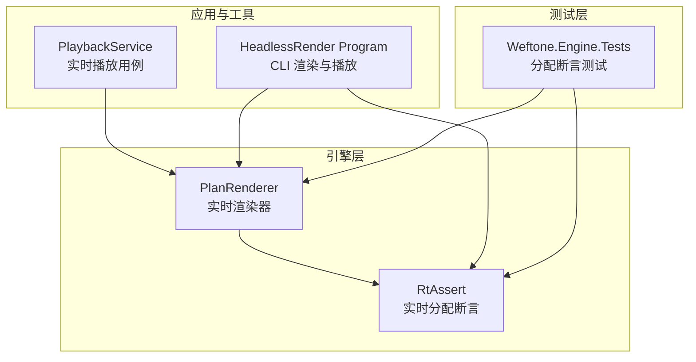
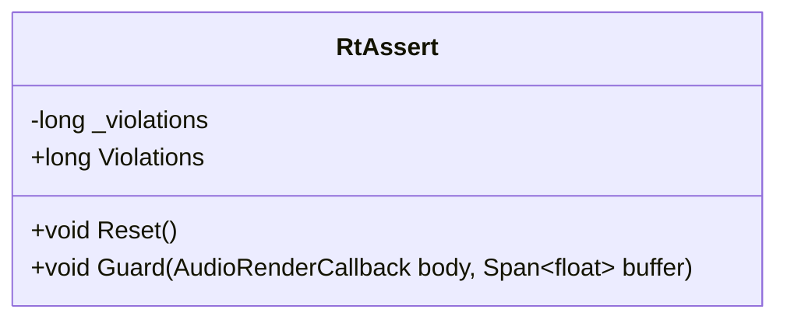
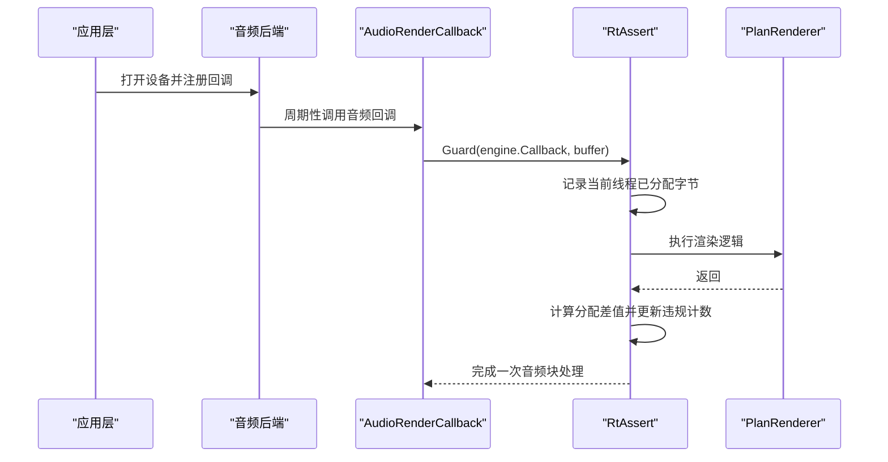
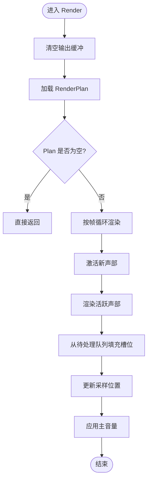
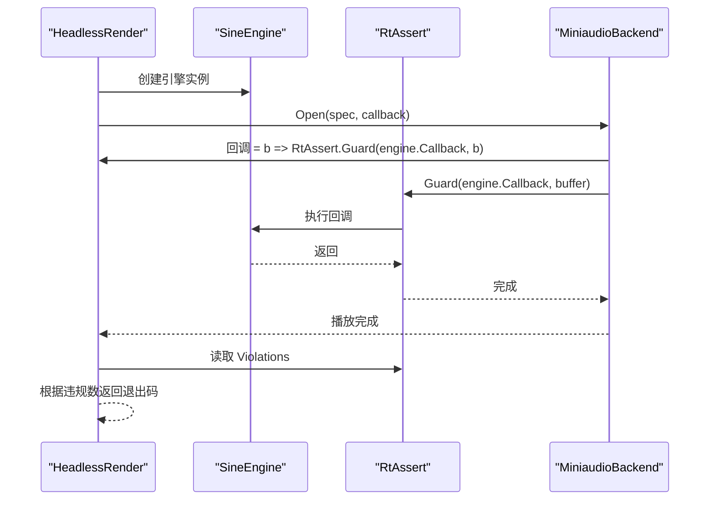
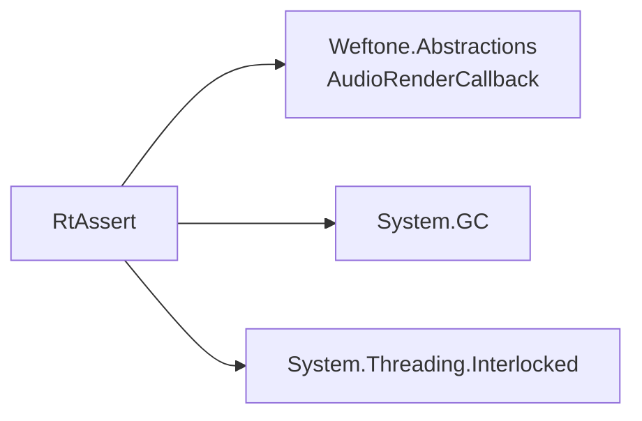

# RtAssert 实时断言

<cite>
**本文引用的文件**   
- [RtAssert.cs](file://src/Weftone.Engine/RtAssert.cs)
- [PlanRenderer.cs](file://src/Weftone.Engine/PlanRenderer.cs)
- [PlaybackService.cs](file://src/Weftone.Application/PlaybackService.cs)
- [Program.cs](file://tools/HeadlessRender/Program.cs)
- [AGENTS.md](file://AGENTS.md)
- [PlanRendererLoopTests.cs](file://tests/Weftone.Engine.Tests/PlanRendererLoopTests.cs)
- [PlanRendererTests.cs](file://tests/Weftone.Engine.Tests/PlanRendererTests.cs)
- [SineEngineTests.cs](file://tests/Weftone.Engine.Tests/SineEngineTests.cs)
</cite>

## 目录
1. [引言](#引言)
2. [项目结构中的实时断言位置](#项目结构中的实时断言位置)
3. [核心组件：RtAssert](#核心组件rtassert)
4. [架构总览：音频回调与零分配边界](#架构总览音频回调与零分配边界)
5. [详细组件分析](#详细组件分析)
6. [依赖关系分析](#依赖关系分析)
7. [性能与实时性特征](#性能与实时性特征)
8. [调试与故障排查](#调试与故障排查)
9. [开发环境与生产环境配置建议](#开发环境与生产环境配置建议)
10. [结论](#结论)

## 引言
RtAssert 是 Weftone 引擎的实时断言子系统，用于在音频回调路径中强制“零分配”约束。它的核心目标是：在实时音频线程上，任何可能触发垃圾回收器分配的行为都会被检测并计数，但不会抛出异常，从而保证音频线程绝对安全、可预测且不被 GC 或异常打断。

该机制直接服务于 AGENTS.md 中定义的实时硬约束：音频线程必须零分配、零锁、零异常、零日志、零 native malloc，并通过 `GC.GetAllocatedBytesForCurrentThread()` 差值进行分配断言。RtAssert 仅在启用 `RT_ASSERT` 编译符号时生效；未启用时，它退化为无开销的直接调用。

## 项目结构中的实时断言位置
RtAssert 位于引擎层，被以下关键位置使用：
- 引擎渲染器：声明全程零分配并由 RtAssert 守护。
- 应用层播放服务：将渲染回调一次性捕获，确保音频路径零分配。
- Headless CLI：离线渲染和实时播放均通过 RtAssert.Guard 包裹回调。
- 引擎测试：验证渲染循环、正弦引擎等路径的分配违规数为 0。

**图表来源**
- [PlaybackService.cs:6-11](file://src/Weftone.Application/PlaybackService.cs#L6-L11)
- [Program.cs:193-247](file://tools/HeadlessRender/Program.cs#L193-L247)
- [PlanRenderer.cs:5-10](file://src/Weftone.Engine/PlanRenderer.cs#L5-L10)
- [RtAssert.cs:5-30](file://src/Weftone.Engine/RtAssert.cs#L5-L30)

**章节来源**
- [PlanRenderer.cs:5-10](file://src/Weftone.Engine/PlanRenderer.cs#L5-L10)
- [PlaybackService.cs:6-11](file://src/Weftone.Application/PlaybackService.cs#L6-L11)
- [Program.cs:193-247](file://tools/HeadlessRender/Program.cs#L193-L247)
- [RtAssert.cs:5-30](file://src/Weftone.Engine/RtAssert.cs#L5-L30)

## 核心组件：RtAssert
RtAssert 是一个静态类，提供三个关键能力：
- 违规计数：通过原子读取当前累计的分配违规次数。
- 重置计数：供测试或批处理流程在阶段结束后清零。
- 音频回调守卫：在 `RT_ASSERT` 构建下，测量回调前后当前线程的已分配字节数差值，若不为 0，则递增违规计数。

**图表来源**
- [RtAssert.cs:9-30](file://src/Weftone.Engine/RtAssert.cs#L9-L30)

### 设计要点
- **仅计数不抛异常**：音频线程不允许抛出异常，因此 RtAssert 只增加 `_violations`，由上层决定如何处理。
- **线程安全计数**：使用 `Interlocked.Read` 和 `Interlocked.Increment`，避免竞争条件。
- **编译期开关**：`#if RT_ASSERT` 控制是否启用分配检测；未启用时直接执行回调，零额外开销。
- **最小侵入性**：外部只需调用 `Guard(body, buffer)`，无需关心内部实现细节。

**章节来源**
- [RtAssert.cs:5-30](file://src/Weftone.Engine/RtAssert.cs#L5-L30)

## 架构总览：音频回调与零分配边界
Weftone 的实时数据流遵循“编辑模型 → 编译器 → 渲染计划 → 实时引擎”的分层结构。RtAssert 位于实时引擎入口，确保进入音频回调前所有对象都已预分配。

**图表来源**
- [Program.cs:217-247](file://tools/HeadlessRender/Program.cs#L217-L247)
- [RtAssert.cs:17-30](file://src/Weftone.Engine/RtAssert.cs#L17-L30)
- [PlanRenderer.cs:61-105](file://src/Weftone.Engine/PlanRenderer.cs#L61-L105)

**章节来源**
- [Program.cs:217-247](file://tools/HeadlessRender/Program.cs#L217-L247)
- [RtAssert.cs:17-30](file://src/Weftone.Engine/RtAssert.cs#L17-L30)
- [PlanRenderer.cs:61-105](file://src/Weftone.Engine/PlanRenderer.cs#L61-L105)

## 详细组件分析

### PlanRenderer 与 RtAssert 的关系
PlanRenderer 是实时渲染的核心，负责声部激活、偷取、淡出、资产读取和相位推进。其注释明确声明“全程零分配（RtAssert 守护）”，说明该类的实现必须满足 RtAssert 的检测要求。

**图表来源**
- [PlanRenderer.cs:61-105](file://src/Weftone.Engine/PlanRenderer.cs#L61-L105)
- [PlanRenderer.cs:107-137](file://src/Weftone.Engine/PlanRenderer.cs#L107-L137)
- [PlanRenderer.cs:139-231](file://src/Weftone.Engine/PlanRenderer.cs#L139-L231)

**章节来源**
- [PlanRenderer.cs:5-10](file://src/Weftone.Engine/PlanRenderer.cs#L5-L10)
- [PlanRenderer.cs:61-105](file://src/Weftone.Engine/PlanRenderer.cs#L61-L105)
- [PlanRenderer.cs:107-137](file://src/Weftone.Engine/PlanRenderer.cs#L107-L137)
- [PlanRenderer.cs:139-231](file://src/Weftone.Engine/PlanRenderer.cs#L139-L231)

### PlaybackService 的实时播放契约
PlaybackService 将 `renderer.Render` 作为音频回调，并在构造时绑定。它强调“回调一次性捕获，音频路径零分配（RtAssert 守护见 Engine 测试）”。这意味着：
- 渲染逻辑本身不能分配。
- 后端回调包装必须通过 RtAssert.Guard。
- 工程加载只能在非音频线程进行，避免并发修改。

**章节来源**
- [PlaybackService.cs:6-11](file://src/Weftone.Application/PlaybackService.cs#L6-L11)
- [PlaybackService.cs:24-31](file://src/Weftone.Application/PlaybackService.cs#L24-L31)
- [PlaybackService.cs:42-52](file://src/Weftone.Application/PlaybackService.cs#L42-L52)

### HeadlessRender 中的 RtAssert 使用
HeadlessRender 提供了两种典型用法：
- 离线渲染 WAV：循环调用 `RtAssert.Guard(engine.Callback, block)`，并在结束时检查违规数。
- 实时播放：通过 miniaudio 后端注册回调，同样用 RtAssert.Guard 包裹。

**图表来源**
- [Program.cs:193-214](file://tools/HeadlessRender/Program.cs#L193-L214)
- [Program.cs:217-247](file://tools/HeadlessRender/Program.cs#L217-L247)
- [RtAssert.cs:17-30](file://src/Weftone.Engine/RtAssert.cs#L17-L30)

**章节来源**
- [Program.cs:193-214](file://tools/HeadlessRender/Program.cs#L193-L214)
- [Program.cs:217-247](file://tools/HeadlessRender/Program.cs#L217-L247)

### 测试中的 RtAssert 行为
引擎测试通过以下方式验证 RtAssert：
- 在测试开始前调用 `RtAssert.Reset()`。
- 多次调用 `RtAssert.Guard(callback, buffer)`。
- 断言 `RtAssert.Violations == 0`，确保渲染路径零分配。

这体现了 RtAssert 不仅是运行时监控，也是回归测试的一部分。

**章节来源**
- [SineEngineTests.cs:38-46](file://tests/Weftone.Engine.Tests/SineEngineTests.cs#L38-L46)
- [PlanRendererTests.cs:108-113](file://tests/Weftone.Engine.Tests/PlanRendererTests.cs#L108-L113)
- [PlanRendererLoopTests.cs:82-87](file://tests/Weftone.Engine.Tests/PlanRendererLoopTests.cs#L82-L87)

## 依赖关系分析
RtAssert 的依赖非常轻量：
- 仅依赖 `Weftone.Abstractions.AudioRenderCallback` 类型，用于回调签名。
- 不依赖 UI、日志、异常、第三方库。
- 通过 `System.Threading.Interlocked` 保证线程安全。
- 通过 `System.GC.GetAllocatedBytesForCurrentThread()` 获取分配信息。

**图表来源**
- [RtAssert.cs:1-3](file://src/Weftone.Engine/RtAssert.cs#L1-L3)
- [RtAssert.cs:13-25](file://src/Weftone.Engine/RtAssert.cs#L13-L25)

**章节来源**
- [RtAssert.cs:1-3](file://src/Weftone.Engine/RtAssert.cs#L1-L3)
- [RtAssert.cs:13-25](file://src/Weftone.Engine/RtAssert.cs#L13-L25)

## 性能与实时性特征
RtAssert 的设计充分考虑了实时音频的性能要求：

| 维度 | 行为 | 实时影响 |
|---|---|---|
| 分配检测 | 仅在 `RT_ASSERT` 构建下启用 | 未启用时无额外开销 |
| 异常处理 | 不抛出异常 | 音频线程安全 |
| 线程同步 | 使用 `Interlocked` | 低竞争原子操作 |
| GC 交互 | 调用 `GetAllocatedBytesForCurrentThread()` | 仅在守卫函数内，频率低 |
| 回调包装 | 单次委托调用 | 最小委托开销 |

AGENTS.md 明确指出：
- 音频回调分配断言基于 `GC.GetAllocatedBytesForCurrentThread()` 差值。
- 仅 DEBUG / RT_ASSERT 构建启用。
- RT 内禁止 native malloc，分配断言不覆盖 native，需人工或工具审计。
- 初始目标为 128 samples @48k、64 轨、8 插件下引擎 CPU < 1.5ms/块。

**章节来源**
- [AGENTS.md:193-224](file://AGENTS.md#L193-L224)
- [RtAssert.cs:17-30](file://src/Weftone.Engine/RtAssert.cs#L17-L30)

## 调试与故障排查

### 常见失败场景
1. **分配违规计数大于 0**
   - 原因：音频回调中触发了 GC 分配，例如 new、装箱、LINQ、字符串、闭包、Dictionary 扩容等。
   - 排查：检查最近引入的实时路径代码，确认是否在 PlanRenderer、SineEngine 或适配器回调中分配。
   - 修复：将分配移到离线预处理阶段，或使用预分配数组、Span、struct。

2. **实时卡顿或 xrun**
   - 原因：虽然 RtAssert 不检测耗时，但分配往往伴随 GC 暂停。
   - 排查：结合 AGENTS.md 的建议，记录回调耗时直方图 p99，并上报 xrun。
   - 修复：优化 DSP 路径，减少分支和内存访问抖动。

3. **Native 分配未被检测**
   - 原因：RtAssert 仅检测托管分配，不覆盖 native malloc。
   - 排查：使用平台工具（如 Windows Performance Recorder、macOS Instruments、Linux perf）审计 native 路径。
   - 修复：避免在音频回调中调用 native 分配函数。

### 调试步骤建议
- 在测试中使用 `RtAssert.Reset()` 和 `Assert.That(RtAssert.Violations, Is.EqualTo(0))` 建立基线。
- 逐步引入可疑代码，观察违规计数变化。
- 在 HeadlessRender 中运行 `play` 命令，观察控制台输出的“RT 分配违规”数量。
- 如果违规出现，优先检查是否使用了 new、LINQ、string、事件订阅、异步调用。

**章节来源**
- [SineEngineTests.cs:38-46](file://tests/Weftone.Engine.Tests/SineEngineTests.cs#L38-L46)
- [Program.cs:213-214](file://tools/HeadlessRender/Program.cs#L213-L214)
- [Program.cs:246-247](file://tools/HeadlessRender/Program.cs#L246-L247)
- [AGENTS.md:193-224](file://AGENTS.md#L193-L224)

## 开发环境与生产环境配置建议

### 开发环境
- 启用 `RT_ASSERT` 编译符号，确保分配断言生效。
- 在单元测试中频繁调用 `RtAssert.Reset()`，并在每个测试断言违规数为 0。
- 使用 HeadlessRender 的 `render` 和 `play` 命令进行冒烟测试。
- 结合 CI 矩阵（Windows/macOS/Linux）验证三平台行为一致。

### 生产环境
- 默认不启用 `RT_ASSERT`，以避免额外开销。
- 如果仍需监控，可通过环境变量或构建配置选择性启用。
- 将 `RtAssert.Violations` 暴露给遥测系统，用于长期趋势分析。
- 对于关键发布版本，建议在预生产环境中启用 `RT_ASSERT` 进行最终验证。

### 配置开关说明
| 构建符号 | RtAssert 行为 | 适用场景 |
|---|---|---|
| 未定义 `RT_ASSERT` | 直接执行回调，不检测分配 | 生产环境 |
| 定义 `RT_ASSERT` | 检测分配并计数，不抛异常 | 开发、测试、预生产 |

**章节来源**
- [RtAssert.cs:17-30](file://src/Weftone.Engine/RtAssert.cs#L17-L30)
- [AGENTS.md:193-224](file://AGENTS.md#L193-L224)

## 结论
RtAssert 是 Weftone 实时音频系统的核心质量护栏。它通过编译期开关和原子计数，在保证音频线程零异常的前提下，严格检测托管分配行为。配合 PlanRenderer 的零分配设计、PlaybackService 的回调封装以及 HeadlessRender 的端到端验证，RtAssert 不仅帮助开发者发现实时路径中的分配陷阱，也为持续集成和发布门禁提供了量化指标。

在实际工程中，应始终遵循 AGENTS.md 的实时纪律：预分配、零异常、零日志、零 native malloc，并将 RtAssert 作为每次变更的必检项。只有当 `RtAssert.Violations` 稳定为 0 时，才能认为实时路径达到了 Weftone 所要求的确定性和稳定性标准。