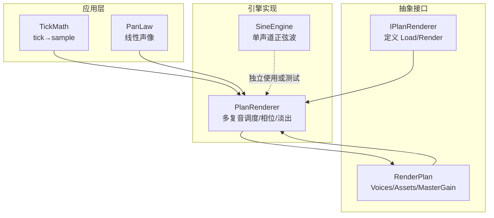
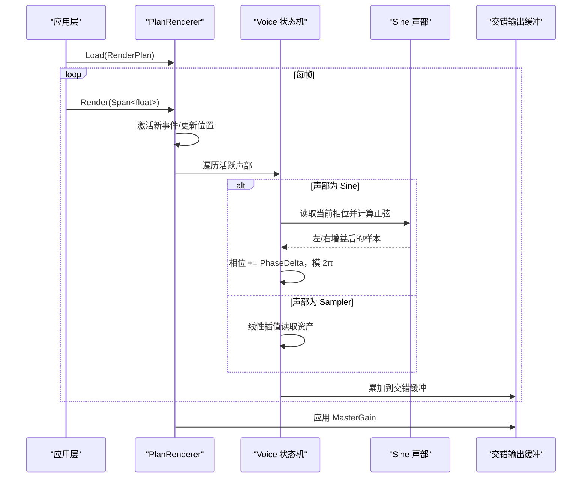
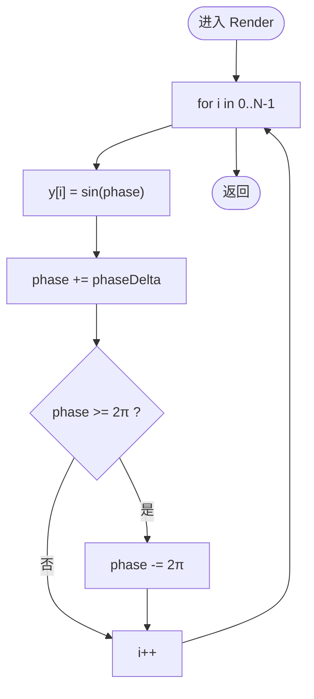
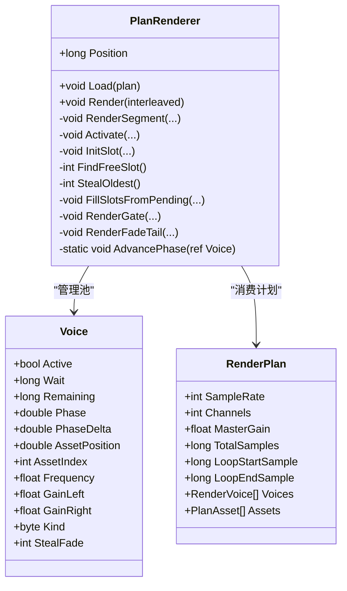
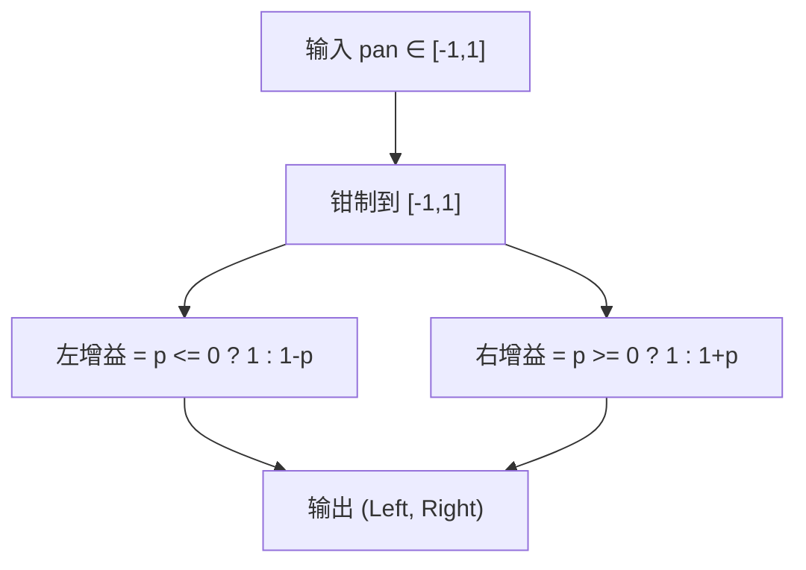
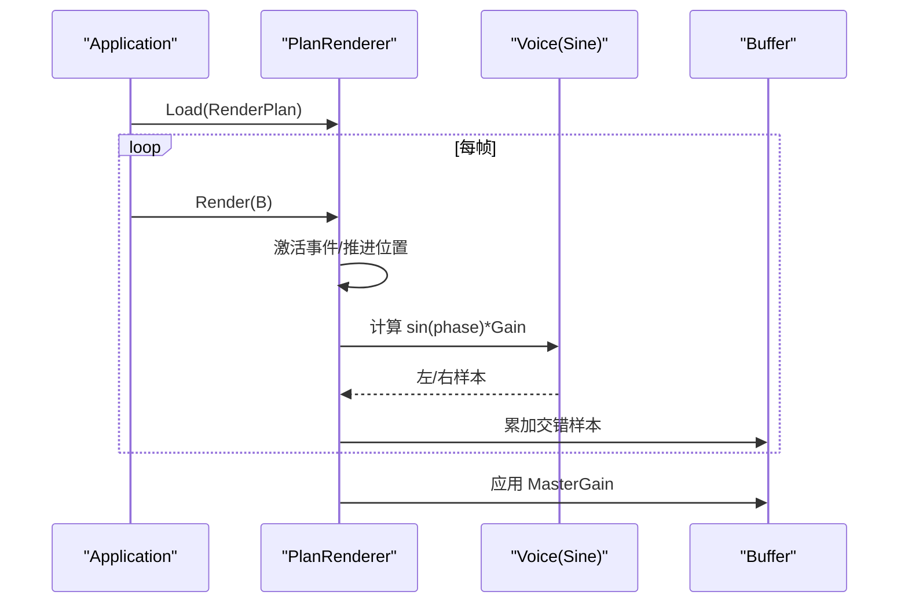
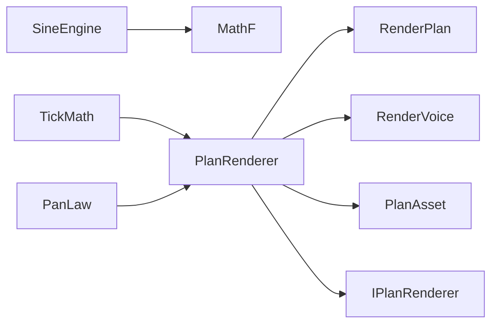

# SineEngine 正弦合成器

<cite>
**本文引用的文件**   
- [SineEngine.cs](file://src/Weftone.Engine/SineEngine.cs)
- [PlanRenderer.cs](file://src/Weftone.Engine/PlanRenderer.cs)
- [RenderPlan.cs](file://src/Weftone.Abstractions/Rendering/RenderPlan.cs)
- [IPlanRenderer.cs](file://src/Weftone.Abstractions/Rendering/IPlanRenderer.cs)
- [TickMath.cs](file://src/Weftone.Application/TickMath.cs)
- [PanLaw.cs](file://src/Weftone.Application/PanLaw.cs)
- [SineEngineTests.cs](file://tests/Weftone.Engine.Tests/SineEngineTests.cs)
</cite>

## 目录
1. [简介](#简介)
2. [项目结构](#项目结构)
3. [核心组件](#核心组件)
4. [架构总览](#架构总览)
5. [详细组件分析](#详细组件分析)
6. [依赖关系分析](#依赖关系分析)
7. [性能与实时性](#性能与实时性)
8. [参数调节与音色调优](#参数调节与音色调优)
9. [可视化示例](#可视化示例)
10. [故障排查指南](#故障排查指南)
11. [结论](#结论)

## 简介
本文件为 Weftone 中的 SineEngine 正弦波合成器提供完整技术文档。内容覆盖：
- 正弦波生成的数学原理与相位计算算法
- 频率到相位的转换公式与精确频率控制
- 包络生成、音量控制与立体声声像定位
- 与 PlanRenderer 的集成方式及实时渲染路径
- 波形可视化建议与参数调节指南
- 音色调优建议与性能优化技巧

SineEngine 是一个面向音频回调的高性能单声道正弦波发生器；PlanRenderer 是支持多复音、循环播放、采样回放与正弦声部的计划渲染器，二者共同构成 Weftone 引擎层的核心声音源。

## 项目结构
围绕 SineEngine 的关键代码位于 Engine 层与 Abstractions.Rendering 层，应用层提供节拍到样本映射与声像法则。

**图表来源**
- [IPlanRenderer.cs:1-11](file://src/Weftone.Abstractions/Rendering/IPlanRenderer.cs#L1-L11)
- [RenderPlan.cs:1-42](file://src/Weftone.Abstractions/Rendering/RenderPlan.cs#L1-L42)
- [PlanRenderer.cs:1-42](file://src/Weftone.Engine/PlanRenderer.cs#L1-L42)
- [SineEngine.cs:1-40](file://src/Weftone.Engine/SineEngine.cs#L1-L40)
- [TickMath.cs:1-14](file://src/Weftone.Application/TickMath.cs#L1-L14)
- [PanLaw.cs:1-15](file://src/Weftone.Application/PanLaw.cs#L1-L15)

**章节来源**
- [IPlanRenderer.cs:1-11](file://src/Weftone.Abstractions/Rendering/IPlanRenderer.cs#L1-L11)
- [RenderPlan.cs:1-42](file://src/Weftone.Abstractions/Rendering/RenderPlan.cs#L1-L42)
- [PlanRenderer.cs:1-42](file://src/Weftone.Engine/PlanRenderer.cs#L1-L42)
- [SineEngine.cs:1-40](file://src/Weftone.Engine/SineEngine.cs#L1-L40)
- [TickMath.cs:1-14](file://src/Weftone.Application/TickMath.cs#L1-L14)
- [PanLaw.cs:1-15](file://src/Weftone.Application/PanLaw.cs#L1-L15)

## 核心组件
- SineEngine：封装正弦波生成，维护双精度相位与每帧相位增量，输出交错立体声缓冲（单声道正弦同时写入左右通道）。
- PlanRenderer：基于 RenderPlan 的多复音调度器，支持 Sine 与 Sampler 两种声部，包含等待、剩余时长、相位推进、淡出尾音、事件池与待处理队列。
- RenderPlan/RenderVoice/PlanAsset：描述一次触发事件的预乘参数、资产数据与工程元信息。
- TickMath：将节拍 tick 转换为样本数，保证确定性整数运算。
- PanLaw：线性声像法则，用于将 pan 值映射为左右增益。

**章节来源**
- [SineEngine.cs:5-39](file://src/Weftone.Engine/SineEngine.cs#L5-L39)
- [PlanRenderer.cs:11-42](file://src/Weftone.Engine/PlanRenderer.cs#L11-L42)
- [RenderPlan.cs:1-42](file://src/Weftone.Abstractions/Rendering/RenderPlan.cs#L1-L42)
- [TickMath.cs:5-13](file://src/Weftone.Application/TickMath.cs#L5-L13)
- [PanLaw.cs:3-13](file://src/Weftone.Application/PanLaw.cs#L3-L13)

## 架构总览
SineEngine 可直接在音频回调中调用，也可通过 PlanRenderer 以“计划事件”的方式参与多复音渲染。PlanRenderer 内部对 Sine 声部采用与 SineEngine 相同的相位推进策略，但由 Voice 状态机驱动，并叠加包络、声像与主音量。

**图表来源**
- [PlanRenderer.cs:61-137](file://src/Weftone.Engine/PlanRenderer.cs#L61-L137)
- [PlanRenderer.cs:233-298](file://src/Weftone.Engine/PlanRenderer.cs#L233-L298)
- [PlanRenderer.cs:347-354](file://src/Weftone.Engine/PlanRenderer.cs#L347-L354)

## 详细组件分析

### SineEngine：正弦波生成与相位算法
- 数学原理
  - 每个样本 n 的正弦值为 sin(2π·f·n/fs)，其中 f 为频率，fs 为采样率。
  - 实现采用增量相位：phase += 2π·f/fs，并在超过 2π 时减去 2π，避免溢出与累积误差放大。
- 关键设计
  - 构造时校验 sampleRate > 0 且频率在 (0, fs/2) 范围内，防止混叠与非法输入。
  - 预计算 phaseDelta = 2π·f/fs，渲染循环仅做加法与比较，减少重复乘法。
  - 暴露预捕获的回调委托 Callback，避免在音频路径上产生方法组分配。
  - 输出为交错缓冲，同一正弦样本同时写入左右通道，形成居中单声道。

**图表来源**
- [SineEngine.cs:27-38](file://src/Weftone.Engine/SineEngine.cs#L27-L38)

**章节来源**
- [SineEngine.cs:5-39](file://src/Weftone.Engine/SineEngine.cs#L5-L39)

### PlanRenderer：多复音调度与 Sine 集成
- 声部模型
  - Voice 结构体保存 Active、Wait、Remaining、Phase、PhaseDelta、AssetPosition、Frequency、GainLeft、GainRight、Kind、StealFade 等状态。
  - 初始化时根据 Kind 设置 PhaseDelta：Sine 使用 2π·f/fs，Sampler 为 0。
- 事件调度
  - 按 StartSample 顺序激活事件；池满时选择最早结束的活跃声部进行“偷取”，并以 FadeTail 线性淡出避免点击噪声。
  - 新事件进入 pending 环缓冲区，待槽位释放后继续初始化。
- 渲染流程
  - RenderSegment 先激活到期事件，再遍历所有活跃声部：若处于 StealFade 则走淡出路径，否则走正常 Gate 路径。
  - Sine 声部在每个样本点计算 sin(phase)，乘以左右增益，然后推进相位。
  - 最后应用 MasterGain。

**图表来源**
- [PlanRenderer.cs:11-42](file://src/Weftone.Engine/PlanRenderer.cs#L11-L42)
- [PlanRenderer.cs:158-177](file://src/Weftone.Engine/PlanRenderer.cs#L158-L177)
- [PlanRenderer.cs:233-298](file://src/Weftone.Engine/PlanRenderer.cs#L233-L298)
- [PlanRenderer.cs:347-354](file://src/Weftone.Engine/PlanRenderer.cs#L347-L354)
- [RenderPlan.cs:29-41](file://src/Weftone.Abstractions/Rendering/RenderPlan.cs#L29-L41)

**章节来源**
- [PlanRenderer.cs:11-42](file://src/Weftone.Engine/PlanRenderer.cs#L11-L42)
- [PlanRenderer.cs:61-137](file://src/Weftone.Engine/PlanRenderer.cs#L61-L137)
- [PlanRenderer.cs:139-177](file://src/Weftone.Engine/PlanRenderer.cs#L139-L177)
- [PlanRenderer.cs:191-231](file://src/Weftone.Engine/PlanRenderer.cs#L191-L231)
- [PlanRenderer.cs:233-298](file://src/Weftone.Engine/PlanRenderer.cs#L233-L298)
- [PlanRenderer.cs:347-354](file://src/Weftone.Engine/PlanRenderer.cs#L347-L354)
- [RenderPlan.cs:29-41](file://src/Weftone.Abstractions/Rendering/RenderPlan.cs#L29-L41)

### 频率到相位的转换与精确频率控制
- 转换公式
  - 相位增量：Δφ = 2π·f/fs
  - 每帧相位：φ[n+1] = φ[n] + Δφ，若 ≥ 2π 则 φ ← φ − 2π
- 精确性保障
  - 使用 double 存储相位，降低长期累积误差。
  - 构造时对频率范围进行严格校验，避免 Nyquist 以上频率导致混叠。
  - 测试用例验证样本序列与直接公式一致，且多次运行结果确定。

**章节来源**
- [SineEngine.cs:13-22](file://src/Weftone.Engine/SineEngine.cs#L13-L22)
- [SineEngine.cs:27-38](file://src/Weftone.Engine/SineEngine.cs#L27-L38)
- [SineEngineTests.cs:10-21](file://tests/Weftone.Engine.Tests/SineEngineTests.cs#L10-L21)

### 包络生成、音量控制与立体声声像定位
- 包络
  - Gate 模式：当 Remaining ≤ FadeTail 时，包络 = Remaining / FadeTail，实现尾部线性衰减，避免点击。
  - 偷取模式：StealFade 从 FadeTail 递减至 0，同样线性衰减，确保被抢占声部平滑退出。
- 音量控制
  - 每个声部预乘 GainLeft/GainRight，渲染期只读。
  - 全局 MasterGain 在整段渲染结束后统一缩放。
- 立体声声像
  - 默认情况下 Sine 声部左右增益相同，居中定位。
  - 可通过 PanLaw.Linear(pan) 计算左右增益，并将结果写入 RenderVoice.GainLeft/GainRight，从而改变声像。

**图表来源**
- [PanLaw.cs:9-13](file://src/Weftone.Application/PanLaw.cs#L9-L13)

**章节来源**
- [PlanRenderer.cs:233-298](file://src/Weftone.Engine/PlanRenderer.cs#L233-L298)
- [PlanRenderer.cs:97-104](file://src/Weftone.Engine/PlanRenderer.cs#L97-L104)
- [PanLaw.cs:3-13](file://src/Weftone.Application/PanLaw.cs#L3-L13)

### 与 PlanRenderer 的集成方式
- 计划驱动
  - Application 层构建 RenderPlan，其中 Voices 数组包含多个 RenderVoice，Kind=Sine 表示正弦声部。
  - PlanRenderer.Load 接收计划，Render 按时间推进激活事件，并为 Sine 声部计算相位增量。
- 实时高效
  - 渲染路径零分配：Voice 池、pending 环、交错缓冲复用，避免 GC 压力。
  - 相位推进与正弦计算在每样本内完成，无分支预测惩罚热点。
  - 主音量与声像均在渲染前预乘，渲染期只做乘加。

**图表来源**
- [PlanRenderer.cs:61-137](file://src/Weftone.Engine/PlanRenderer.cs#L61-L137)
- [PlanRenderer.cs:158-177](file://src/Weftone.Engine/PlanRenderer.cs#L158-L177)
- [PlanRenderer.cs:233-298](file://src/Weftone.Engine/PlanRenderer.cs#L233-L298)

**章节来源**
- [PlanRenderer.cs:61-137](file://src/Weftone.Engine/PlanRenderer.cs#L61-L137)
- [PlanRenderer.cs:158-177](file://src/Weftone.Engine/PlanRenderer.cs#L158-L177)
- [PlanRenderer.cs:233-298](file://src/Weftone.Engine/PlanRenderer.cs#L233-L298)

### 节拍到样本的确定性映射
- TickMath 提供 SamplesPerTick 与 TicksToSamples，使用整数分子分母避免浮点不确定性。
- 该映射常用于将音符起止 tick 转换为 StartSample/LengthSamples，进而构建 RenderVoice。

**章节来源**
- [TickMath.cs:5-13](file://src/Weftone.Application/TickMath.cs#L5-L13)

## 依赖关系分析
- SineEngine 依赖 MathF.Sin 与系统采样率，不依赖其他引擎组件。
- PlanRenderer 依赖 RenderPlan/RenderVoice/PlanAsset 数据结构，以及 IPlanRenderer 接口。
- 应用层 TickMath/PanLaw 为上层编排提供工具函数，不耦合具体渲染实现。

**图表来源**
- [SineEngine.cs:1-40](file://src/Weftone.Engine/SineEngine.cs#L1-L40)
- [PlanRenderer.cs:1-42](file://src/Weftone.Engine/PlanRenderer.cs#L1-L42)
- [RenderPlan.cs:1-42](file://src/Weftone.Abstractions/Rendering/RenderPlan.cs#L1-L42)
- [IPlanRenderer.cs:1-11](file://src/Weftone.Abstractions/Rendering/IPlanRenderer.cs#L1-L11)
- [TickMath.cs:1-14](file://src/Weftone.Application/TickMath.cs#L1-L14)
- [PanLaw.cs:1-15](file://src/Weftone.Application/PanLaw.cs#L1-L15)

**章节来源**
- [SineEngine.cs:1-40](file://src/Weftone.Engine/SineEngine.cs#L1-L40)
- [PlanRenderer.cs:1-42](file://src/Weftone.Engine/PlanRenderer.cs#L1-L42)
- [RenderPlan.cs:1-42](file://src/Weftone.Abstractions/Rendering/RenderPlan.cs#L1-L42)
- [IPlanRenderer.cs:1-11](file://src/Weftone.Abstractions/Rendering/IPlanRenderer.cs#L1-L11)
- [TickMath.cs:1-14](file://src/Weftone.Application/TickMath.cs#L1-L14)
- [PanLaw.cs:1-15](file://src/Weftone.Application/PanLaw.cs#L1-L15)

## 性能与实时性
- 零分配渲染路径
  - SineEngine.Render 仅读写 Span<float>，无托管对象分配。
  - PlanRenderer 使用固定大小 Voice 池与 pending 环，避免运行时分配。
- 确定性
  - 相位推进与样本计算均为确定性操作；测试断言多次运行结果一致。
- 复杂度
  - 单帧复杂度 O(F×V)，F 为帧数，V 为活跃声部数量；Sine 声部每样本一次正弦与一次加法。
- 优化建议
  - 尽量复用 SineEngine 实例，避免频繁构造销毁。
  - 合理设置 MaxVoices 与 PendingCapacity，平衡复音容量与内存占用。
  - 使用 RtAssert 在调试构建下检测音频路径分配违规。

**章节来源**
- [SineEngine.cs:24-38](file://src/Weftone.Engine/SineEngine.cs#L24-L38)
- [PlanRenderer.cs:13-16](file://src/Weftone.Engine/PlanRenderer.cs#L13-L16)
- [PlanRenderer.cs:61-137](file://src/Weftone.Engine/PlanRenderer.cs#L61-L137)
- [SineEngineTests.cs:35-48](file://tests/Weftone.Engine.Tests/SineEngineTests.cs#L35-L48)

## 参数调节与音色调优
- 频率控制
  - 低频（如 60–200 Hz）适合低音线条；中频（200–2k Hz）适合主旋律；高频（>2k Hz）易刺耳，需谨慎。
  - 保持频率 < fs/2，避免混叠。
- 包络与尾音
  - 缩短 FadeTail 可加快淡出，但可能引入轻微点击；适当增大 FadeTail 使过渡更平滑。
- 音量与声像
  - 调整 GainLeft/GainRight 或 PanLaw 输出的左右增益，实现居中或偏左/右定位。
  - MasterGain 控制整体响度，注意不要削波。
- 复音与资源
  - 增加 MaxVoices 可提升复音能力，但会增加每帧计算量。
  - 合理组织 RenderPlan.Voices，按 StartSample 排序以减少扫描开销。

[本节为通用指导，不直接分析具体文件]

## 可视化示例
- 正弦波形
  - 横轴为样本索引 n，纵轴为振幅 y[n] = sin(2π·f·n/fs)。
  - 建议使用不同颜色绘制包络线（Gate/FadeTail），观察尾部衰减。
- 频谱示意
  - 理想正弦仅在基频处有能量；实际数字系统中需关注量化噪声与混叠。
- 声像定位
  - 绘制左右声道电平随 pan 的变化曲线，展示线性声像法则。

[本节为概念性说明，不直接分析具体文件]

## 故障排查指南
- 频率异常
  - 现象：失真、爆音或无声。
  - 检查：频率是否在 (0, fs/2) 范围内；是否传入 NaN 或非正数。
- 点击噪声
  - 现象：切换声部或结束时有明显点击。
  - 检查：FadeTail 是否为 0；是否正确使用线性包络。
- 复音不足
  - 现象：新音符无法发声。
  - 检查：MaxVoices 是否过小；DroppedEvents 是否增长；pending 环是否溢出。
- 相位漂移
  - 现象：长时运行后频率偏差。
  - 检查：是否使用 double 相位；是否正确执行模 2π 归一化。
- 分配违规
  - 现象：GC 抖动或卡顿。
  - 检查：是否在音频路径创建对象；启用 RtAssert 检测分配。

**章节来源**
- [SineEngine.cs:13-22](file://src/Weftone.Engine/SineEngine.cs#L13-L22)
- [PlanRenderer.cs:13-16](file://src/Weftone.Engine/PlanRenderer.cs#L13-L16)
- [PlanRenderer.cs:191-231](file://src/Weftone.Engine/PlanRenderer.cs#L191-L231)
- [PlanRenderer.cs:233-298](file://src/Weftone.Engine/PlanRenderer.cs#L233-L298)
- [SineEngineTests.cs:35-48](file://tests/Weftone.Engine.Tests/SineEngineTests.cs#L35-L48)

## 结论
SineEngine 提供了简洁高效的正弦波生成能力，配合 PlanRenderer 的多复音调度、包络与声像机制，能够在实时环境中稳定输出高质量正弦信号。通过严格的频率校验、双精度相位与线性淡出，系统在准确性与稳定性之间取得良好平衡。结合 TickMath 与 PanLaw，上层可灵活编排时间与空间维度上的声音表现。建议在工程中复用引擎实例、合理配置复音容量与淡出长度，以获得最佳性能与听感。