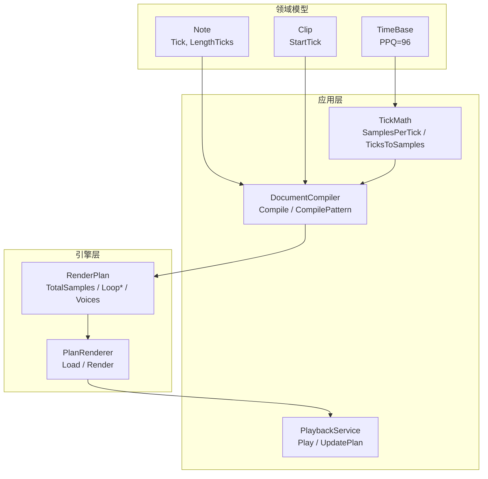
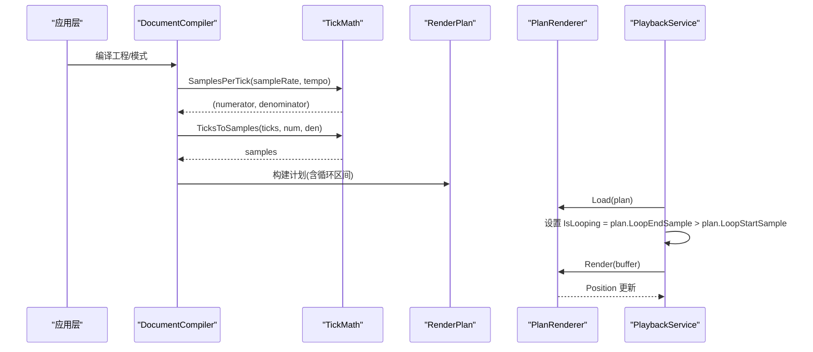
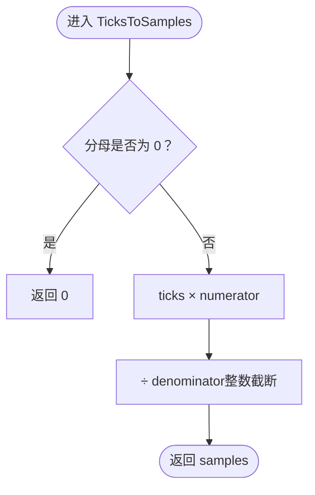
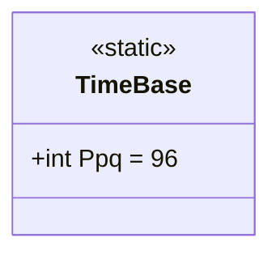
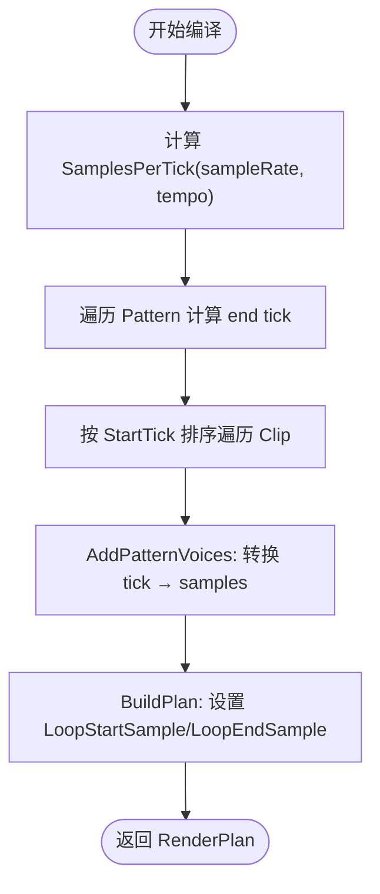
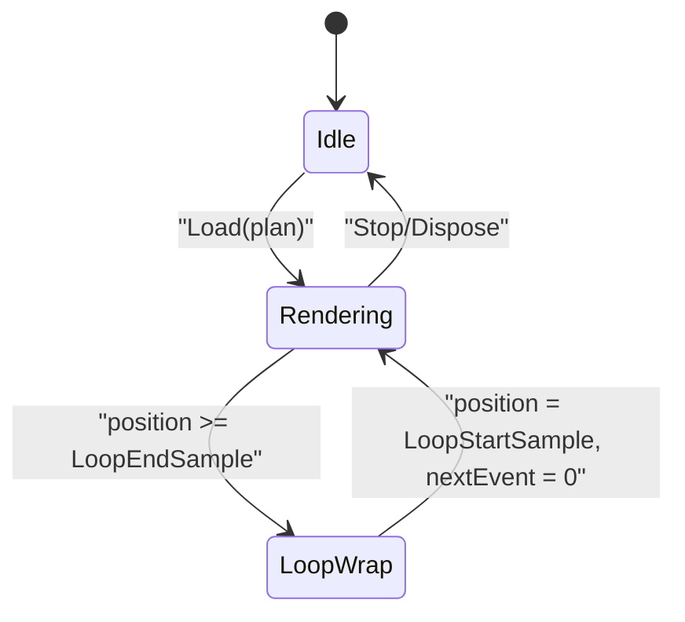
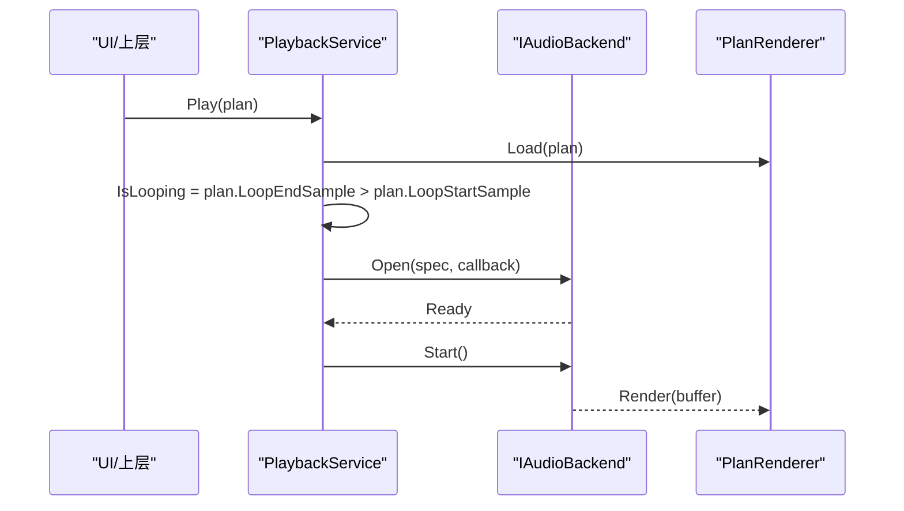
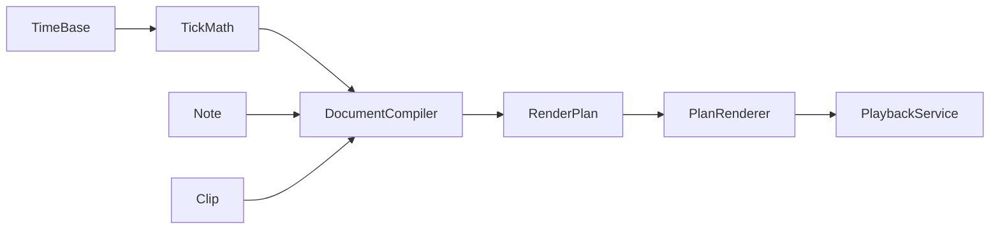

# TickMath 时间计算

<cite>
**本文引用的文件**   
- [TickMath.cs](file://src/Weftone.Application/TickMath.cs)
- [TimeBase.cs](file://src/Weftone.Domain/TimeBase.cs)
- [DocumentCompiler.cs](file://src/Weftone.Application/DocumentCompiler.cs)
- [Note.cs](file://src/Weftone.Domain/Note.cs)
- [Clip.cs](file://src/Weftone.Domain/Clip.cs)
- [PlanRenderer.cs](file://src/Weftone.Engine/PlanRenderer.cs)
- [PlaybackService.cs](file://src/Weftone.Application/PlaybackService.cs)
- [RenderPlan.cs](file://src/Weftone.Abstractions/Rendering/RenderPlan.cs)
- [DocumentCompilerTests.cs](file://tests/Weftone.Application.Tests/DocumentCompilerTests.cs)
</cite>

## 目录
1. [引言](#引言)
2. [项目结构](#项目结构)
3. [核心组件](#核心组件)
4. [架构总览](#架构总览)
5. [详细组件分析](#详细组件分析)
6. [依赖关系分析](#依赖关系分析)
7. [性能与精度特性](#性能与精度特性)
8. [故障排查指南](#故障排查指南)
9. [结论](#结论)
10. [附录：公式与示例路径](#附录公式与示例路径)

## 引言
本文围绕 TickMath 时间计算系统，系统性解释从节拍到采样点的精确转换、BPM（每分钟节拍数）到采样点映射、时间基准 TimeBase 的概念与作用、高精度时间戳生成与管理、时间轴对齐、循环播放的时间处理以及延迟补偿机制。文档面向音频工程与实时渲染场景，帮助读者理解如何在整数 tick 与浮点采样之间建立确定性的时间映射，确保多平台、多采样率下的音频同步准确性。

## 项目结构
TickMath 位于应用层，负责将音乐时间域（tick）转换为音频时间域（sample）。其输入包括采样率和 BPM，输出为每 tick 对应的采样点数分数形式；随后通过 TicksToSamples 完成整数乘法与截断除法，得到确定性结果。

**图表来源**
- [TimeBase.cs:1-8](file://src/Weftone.Domain/TimeBase.cs#L1-L8)
- [TickMath.cs:1-14](file://src/Weftone.Application/TickMath.cs#L1-L14)
- [DocumentCompiler.cs:1-159](file://src/Weftone.Application/DocumentCompiler.cs#L1-L159)
- [PlanRenderer.cs:1-356](file://src/Weftone.Engine/PlanRenderer.cs#L1-L356)
- [PlaybackService.cs:1-98](file://src/Weftone.Application/PlaybackService.cs#L1-L98)
- [RenderPlan.cs](file://src/Weftone.Abstractions/Rendering/RenderPlan.cs)

**章节来源**
- [TickMath.cs:1-14](file://src/Weftone.Application/TickMath.cs#L1-L14)
- [TimeBase.cs:1-8](file://src/Weftone.Domain/TimeBase.cs#L1-L8)
- [DocumentCompiler.cs:1-159](file://src/Weftone.Application/DocumentCompiler.cs#L1-L159)

## 核心组件
- TickMath：提供 BPM 到采样点的数学映射，返回分子分母对，并实现整数截断的 ticks→samples 转换。
- TimeBase：定义 PPQ（每拍 tick 数），当前固定为 96。
- DocumentCompiler：将 ProjectDocument 编译为 RenderPlan，使用 TickMath 将音符和片段偏移转换为样本位置，并设置循环区间。
- PlanRenderer：在实时或离线渲染中按 StartSample 激活声部，支持循环播放与淡出偷取。
- PlaybackService：管理音频后端生命周期，根据 RenderPlan 的循环区间设置 IsLooping，并在采样率变化时重建后端。

**章节来源**
- [TickMath.cs:1-14](file://src/Weftone.Application/TickMath.cs#L1-L14)
- [TimeBase.cs:1-8](file://src/Weftone.Domain/TimeBase.cs#L1-L8)
- [DocumentCompiler.cs:1-159](file://src/Weftone.Application/DocumentCompiler.cs#L1-L159)
- [PlanRenderer.cs:1-356](file://src/Weftone.Engine/PlanRenderer.cs#L1-L356)
- [PlaybackService.cs:1-98](file://src/Weftone.Application/PlaybackService.cs#L1-L98)

## 架构总览
TickMath 是时间域转换的核心，被 DocumentCompiler 调用以构建 RenderPlan。RenderPlan 包含 TotalSamples、LoopStartSample、LoopEndSample 等字段，驱动 PlanRenderer 的循环逻辑。PlaybackService 根据 RenderPlan 的循环区间设置播放状态，并在采样率变化时重建音频后端。

**图表来源**
- [DocumentCompiler.cs:18-65](file://src/Weftone.Application/DocumentCompiler.cs#L18-L65)
- [TickMath.cs:8-12](file://src/Weftone.Application/TickMath.cs#L8-L12)
- [PlanRenderer.cs:48-59](file://src/Weftone.Engine/PlanRenderer.cs#L48-L59)
- [PlaybackService.cs:42-51](file://src/Weftone.Application/PlaybackService.cs#L42-L51)

## 详细组件分析

### TickMath：节拍到采样点的精确映射
- 功能：
  - SamplesPerTick：根据采样率与 BPM 计算每 tick 的采样点数分数（分子/分母）。
  - TicksToSamples：将 tick 数量乘以分子再除以分母，采用整数截断除法，保证确定性。
- 设计要点：
  - 使用 long 避免溢出，分子为 sampleRate * 60，分母为 tempo * PPQ。
  - 当分母为 0 时返回 0，防止除零异常。
- 复杂度：
  - 时间 O(1)，空间 O(1)。

**图表来源**
- [TickMath.cs:8-12](file://src/Weftone.Application/TickMath.cs#L8-L12)

**章节来源**
- [TickMath.cs:1-14](file://src/Weftone.Application/TickMath.cs#L1-L14)

### TimeBase：时间基准 PPQ
- 概念：
  - PPQ（Pulses Per Quarter Note）表示每拍的 tick 数，用于统一音乐时间与事件定位。
  - 当前固定为 96，与 FL Studio 同型，便于工程兼容。
- 使用场景：
  - 所有 tick 相关计算（音符长度、片段偏移、小节对齐）均以 PPQ 为单位。
  - 与 BPM 结合，形成“每分钟多少拍”的时间基准。

**图表来源**
- [TimeBase.cs:1-8](file://src/Weftone.Domain/TimeBase.cs#L1-L8)

**章节来源**
- [TimeBase.cs:1-8](file://src/Weftone.Domain/TimeBase.cs#L1-L8)

### DocumentCompiler：时间轴对齐与循环区间
- 功能：
  - 将 ProjectDocument 中的 Pattern 与 Playlist 展开为 RenderVoice 列表。
  - 使用 TickMath 将 note.Tick、note.LengthTicks、clip.StartTick 转换为 StartSample 与 LengthSamples。
  - 计算 totalTicks，并设置 RenderPlan 的 LoopStartSample 与 LoopEndSample。
- 小节对齐：
  - BarTicks = PPQ * 4，PatternLengthTicks 将最大音符结束 tick 向上取整到小节边界，至少 1 小节。
- 循环播放：
  - 工程模式 loop=false，Pattern 模式 loop=true，LoopEndSample 设为 totalSamples。

**图表来源**
- [DocumentCompiler.cs:18-65](file://src/Weftone.Application/DocumentCompiler.cs#L18-L65)
- [DocumentCompiler.cs:98-157](file://src/Weftone.Application/DocumentCompiler.cs#L98-L157)

**章节来源**
- [DocumentCompiler.cs:1-159](file://src/Weftone.Application/DocumentCompiler.cs#L1-L159)
- [Note.cs:1-12](file://src/Weftone.Domain/Note.cs#L1-L12)
- [Clip.cs:1-9](file://src/Weftone.Domain/Clip.cs#L1-L9)

### PlanRenderer：循环播放与延迟补偿
- 循环播放：
  - 若 LoopEndSample > LoopStartSample，则在到达 LoopEndSample 时将 _position 回绕至 LoopStartSample，并重置事件游标。
  - 活跃声部自然延续尾音，避免硬切。
- 延迟补偿：
  - Voice.Wait 表示等待帧数，SkipWait 跳过等待期，确保 StartSample 对齐。
  - FadeTail 用于偷取时的线性淡出，减少点击噪声。
- 渲染流程：
  - 按段渲染，先激活事件，再生成声音，最后填充 pending 槽位。

**图表来源**
- [PlanRenderer.cs:48-59](file://src/Weftone.Engine/PlanRenderer.cs#L48-L59)
- [PlanRenderer.cs:61-105](file://src/Weftone.Engine/PlanRenderer.cs#L61-L105)
- [PlanRenderer.cs:139-177](file://src/Weftone.Engine/PlanRenderer.cs#L139-L177)

**章节来源**
- [PlanRenderer.cs:1-356](file://src/Weftone.Engine/PlanRenderer.cs#L1-L356)

### PlaybackService：采样率变化与后端管理
- 功能：
  - Play/UpdatePlan：加载 RenderPlan，设置 IsLooping，确保音频后端打开。
  - EnsureOpen：当采样率变化时重建后端，复用通道数。
- 延迟与缓冲：
  - BufferFrames=256，作为音频设备缓冲区大小。
- 热更新：
  - UpdatePlan 在停止后交换新计划，必要时重启后端，保持播放状态。

**图表来源**
- [PlaybackService.cs:42-90](file://src/Weftone.Application/PlaybackService.cs#L42-L90)

**章节来源**
- [PlaybackService.cs:1-98](file://src/Weftone.Application/PlaybackService.cs#L1-L98)

## 依赖关系分析
- TickMath 依赖 TimeBase.Ppq，用于计算分母。
- DocumentCompiler 依赖 TickMath 进行 tick→sample 转换，并依赖 Note/Clip 获取时间信息。
- PlanRenderer 依赖 RenderPlan 的循环区间与声部列表。
- PlaybackService 依赖 IAudioBackend 与 IPlanRenderer，管理生命周期与状态。

**图表来源**
- [TimeBase.cs:1-8](file://src/Weftone.Domain/TimeBase.cs#L1-L8)
- [TickMath.cs:1-14](file://src/Weftone.Application/TickMath.cs#L1-L14)
- [DocumentCompiler.cs:1-159](file://src/Weftone.Application/DocumentCompiler.cs#L1-L159)
- [PlanRenderer.cs:1-356](file://src/Weftone.Engine/PlanRenderer.cs#L1-L356)
- [PlaybackService.cs:1-98](file://src/Weftone.Application/PlaybackService.cs#L1-L98)

**章节来源**
- [TimeBase.cs:1-8](file://src/Weftone.Domain/TimeBase.cs#L1-L8)
- [TickMath.cs:1-14](file://src/Weftone.Application/TickMath.cs#L1-L14)
- [DocumentCompiler.cs:1-159](file://src/Weftone.Application/DocumentCompiler.cs#L1-L159)
- [PlanRenderer.cs:1-356](file://src/Weftone.Engine/PlanRenderer.cs#L1-L356)
- [PlaybackService.cs:1-98](file://src/Weftone.Application/PlaybackService.cs#L1-L98)

## 性能与精度特性
- 确定性：
  - TicksToSamples 使用整数截断除法，保证相同输入产生相同输出，利于回归测试与跨平台一致性。
- 精度：
  - 分子分母均为 long，避免中间计算溢出；最终 samples 为 long，适合大工程。
- 实时性：
  - PlanRenderer 全程零分配，使用预分配池与环形缓冲，降低 GC 压力。
  - PlaybackService 在回调中一次性捕获渲染委托，避免实时路径分配。
- 采样率切换：
  - PlaybackService 在采样率变化时重建后端，确保设备参数匹配。

[本节为通用性能讨论，不直接分析具体文件]

## 故障排查指南
- 除零保护：
  - 当 tempo 为 0 时，分母为 0，TicksToSamples 返回 0，避免崩溃。检查 BPM 设置是否合理。
- 时间对齐问题：
  - 若音符起始位置偏差，检查 Note.Tick 与 clip.StartTick 是否正确，确认 DocumentCompiler 的 AddPatternVoices 转换逻辑。
- 循环播放异常：
  - 若循环区域不正确，检查 RenderPlan 的 LoopStartSample 与 LoopEndSample 设置，确认 Pattern 模式的 loop 标志。
- 采样率不一致：
  - 若播放卡顿或音高异常，检查 PlaybackService 的 EnsureOpen 是否重建后端，确认 AudioDeviceSpec 的采样率与声道数。

**章节来源**
- [TickMath.cs:8-12](file://src/Weftone.Application/TickMath.cs#L8-L12)
- [DocumentCompiler.cs:98-157](file://src/Weftone.Application/DocumentCompiler.cs#L98-L157)
- [PlanRenderer.cs:48-59](file://src/Weftone.Engine/PlanRenderer.cs#L48-L59)
- [PlaybackService.cs:80-90](file://src/Weftone.Application/PlaybackService.cs#L80-L90)

## 结论
TickMath 通过简单的数学映射将音乐时间（tick）与音频时间（sample）解耦，结合 TimeBase 的 PPQ 标准，确保了时间计算的确定性与可移植性。DocumentCompiler 与 PlanRenderer 在此基础上实现了时间轴对齐、循环播放与延迟补偿，PlaybackService 则管理音频后端生命周期与采样率切换。整体架构清晰、职责分离，适合实时音频与离线渲染场景。

[本节为总结性内容，不直接分析具体文件]

## 附录：公式与示例路径
- 数学公式：
  - 每 tick 采样点数分数：numerator = sampleRate × 60，denominator = tempo × PPQ。
  - 样本转换：samples = floor(ticks × numerator ÷ denominator)。
- 代码示例路径：
  - SamplesPerTick 实现：[TickMath.cs:8-9](file://src/Weftone.Application/TickMath.cs#L8-L9)
  - TicksToSamples 实现：[TickMath.cs:11-12](file://src/Weftone.Application/TickMath.cs#L11-L12)
  - PPQ 常量：[TimeBase.cs:6](file://src/Weftone.Domain/TimeBase.cs#L6)
  - 音符 tick 使用：[Note.cs:7-10](file://src/Weftone.Domain/Note.cs#L7-L10)
  - 片段偏移使用：[Clip.cs:6-7](file://src/Weftone.Domain/Clip.cs#L6-L7)
  - 编译中使用 TickMath：[DocumentCompiler.cs:22-23](file://src/Weftone.Application/DocumentCompiler.cs#L22-L23), [DocumentCompiler.cs:118-121](file://src/Weftone.Application/DocumentCompiler.cs#L118-L121)
  - 循环区间设置：[DocumentCompiler.cs:145-154](file://src/Weftone.Application/DocumentCompiler.cs#L145-L154)
  - 播放服务循环判断：[PlaybackService.cs:47-49](file://src/Weftone.Application/PlaybackService.cs#L47-L49)
  - 测试用例验证截断行为：[DocumentCompilerTests.cs:37-45](file://tests/Weftone.Application.Tests/DocumentCompilerTests.cs#L37-L45)

**章节来源**
- [TickMath.cs:1-14](file://src/Weftone.Application/TickMath.cs#L1-L14)
- [TimeBase.cs:1-8](file://src/Weftone.Domain/TimeBase.cs#L1-L8)
- [Note.cs:1-12](file://src/Weftone.Domain/Note.cs#L1-L12)
- [Clip.cs:1-9](file://src/Weftone.Domain/Clip.cs#L1-L9)
- [DocumentCompiler.cs:1-159](file://src/Weftone.Application/DocumentCompiler.cs#L1-L159)
- [PlaybackService.cs:1-98](file://src/Weftone.Application/PlaybackService.cs#L1-L98)
- [DocumentCompilerTests.cs:37-45](file://tests/Weftone.Application.Tests/DocumentCompilerTests.cs#L37-L45)