# 音频引擎

<cite>
**本文引用的文件**   
- [PlanRenderer.cs](file://src/Weftone.Engine/PlanRenderer.cs)
- [SineEngine.cs](file://src/Weftone.Engine/SineEngine.cs)
- [TickMath.cs](file://src/Weftone.Application/TickMath.cs)
- [RtAssert.cs](file://src/Weftone.Engine/RtAssert.cs)
- [IPlanRenderer.cs](file://src/Weftone.Abstractions/Rendering/IPlanRenderer.cs)
- [RenderPlan.cs](file://src/Weftone.Abstractions/Rendering/RenderPlan.cs)
- [MiniaudioBackend.cs](file://src/Weftone.Adapters.Audio.Miniaudio/MiniaudioBackend.cs)
- [PlaybackService.cs](file://src/Weftone.Application/PlaybackService.cs)
- [ADR-0002-threading-realtime.md](file://docs/adr/ADR-0002-threading-realtime.md)
- [README.md](file://README.md)
</cite>

## 目录
1. [引言](#引言)
2. [项目结构](#项目结构)
3. [核心组件](#核心组件)
4. [架构总览](#架构总览)
5. [详细组件分析](#详细组件分析)
6. [依赖关系分析](#依赖关系分析)
7. [性能与实时性](#性能与实时性)
8. [故障排查与调试](#故障排查与调试)
9. [结论](#结论)

## 引言
本文面向 Weftone 的音频引擎，聚焦以下目标：
- 高性能渲染器 PlanRenderer 的实现机制，包括正弦波合成与采样器播放。
- SineEngine 的合成算法与参数控制。
- TickMath 的时间计算系统，节拍到样本的转换与精度保证。
- RtAssert 的实时断言机制，确保音频回调零分配。
- 音频处理流程图、性能优化策略与调试技巧。
- 引擎如何与上层应用服务集成，以及如何处理实时音频的线程安全问题。

Weftone 采用六边形架构与编译器模式：编辑模型在离线线程编译为扁平 RenderPlan，再由实时渲染器消费；音频回调路径严格遵循零分配、零锁、零异常纪律。

**章节来源**
- [README.md:38-57](file://README.md#L38-L57)

## 项目结构
围绕音频引擎的关键代码分布在以下模块：
- Abstractions：定义 IPlanRenderer、RenderPlan、RenderVoice、PlanAsset 等实时数据契约。
- Engine：实现 PlanRenderer、SineEngine、RtAssert 等实时核心。
- Application：提供 PlaybackService、TickMath 等编排与时间换算工具。
- Adapters.Audio.Miniaudio：对接原生音频设备，将回调桥接到托管层。

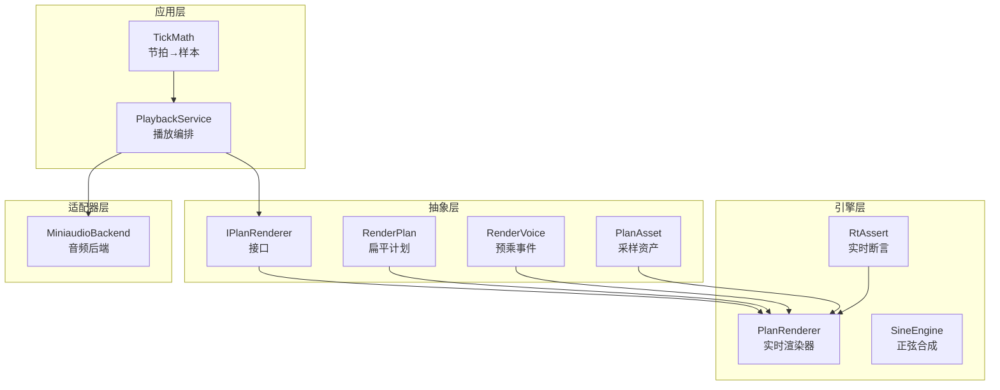

**图表来源**
- [IPlanRenderer.cs:1-12](file://src/Weftone.Abstractions/Rendering/IPlanRenderer.cs#L1-L12)
- [RenderPlan.cs:1-42](file://src/Weftone.Abstractions/Rendering/RenderPlan.cs#L1-L42)
- [PlanRenderer.cs:1-356](file://src/Weftone.Engine/PlanRenderer.cs#L1-L356)
- [SineEngine.cs:1-40](file://src/Weftone.Engine/SineEngine.cs#L1-L40)
- [RtAssert.cs:1-32](file://src/Weftone.Engine/RtAssert.cs#L1-L32)
- [PlaybackService.cs:1-98](file://src/Weftone.Application/PlaybackService.cs#L1-L98)
- [TickMath.cs:1-14](file://src/Weftone.Application/TickMath.cs#L1-L14)
- [MiniaudioBackend.cs:1-85](file://src/Weftone.Adapters.Audio.Miniaudio/MiniaudioBackend.cs#L1-L85)

**章节来源**
- [README.md:70-79](file://README.md#L70-L79)

## 核心组件
- PlanRenderer：基于固定大小 Voice 池的事件驱动渲染器，支持正弦波与采样器两种声部，具备循环区间、主音量、偷声淡出与待激活队列。
- SineEngine：轻量正弦合成器，封装相位步进与回调委托，避免音频路径上的方法组分配。
- TickMath：整数域节拍到样本映射，使用分子分母形式避免浮点误差累积。
- RtAssert：仅在 RT_ASSERT 构建下启用，检测音频回调中的托管内存分配并计数违规。
- PlaybackService：编排播放生命周期，负责停止-交换-恢复、采样率变化时重建后端、捕获回调委托。
- MiniaudioBackend：通过 P/Invoke 调用原生 miniaudio，建立一次性的回调桥接，保持音频路径零分配。

**章节来源**
- [PlanRenderer.cs:5-16](file://src/Weftone.Engine/PlanRenderer.cs#L5-L16)
- [SineEngine.cs:5-25](file://src/Weftone.Engine/SineEngine.cs#L5-L25)
- [TickMath.cs:5-13](file://src/Weftone.Application/TickMath.cs#L5-L13)
- [RtAssert.cs:5-30](file://src/Weftone.Engine/RtAssert.cs#L5-L30)
- [PlaybackService.cs:6-11](file://src/Weftone.Application/PlaybackService.cs#L6-L11)
- [MiniaudioBackend.cs:6-10](file://src/Weftone.Adapters.Audio.Miniaudio/MiniaudioBackend.cs#L6-L10)

## 架构总览
Weftone 的实时音频管线由“编辑器 → 编译器 → 渲染计划 → 实时渲染器 → 音频后端”组成。

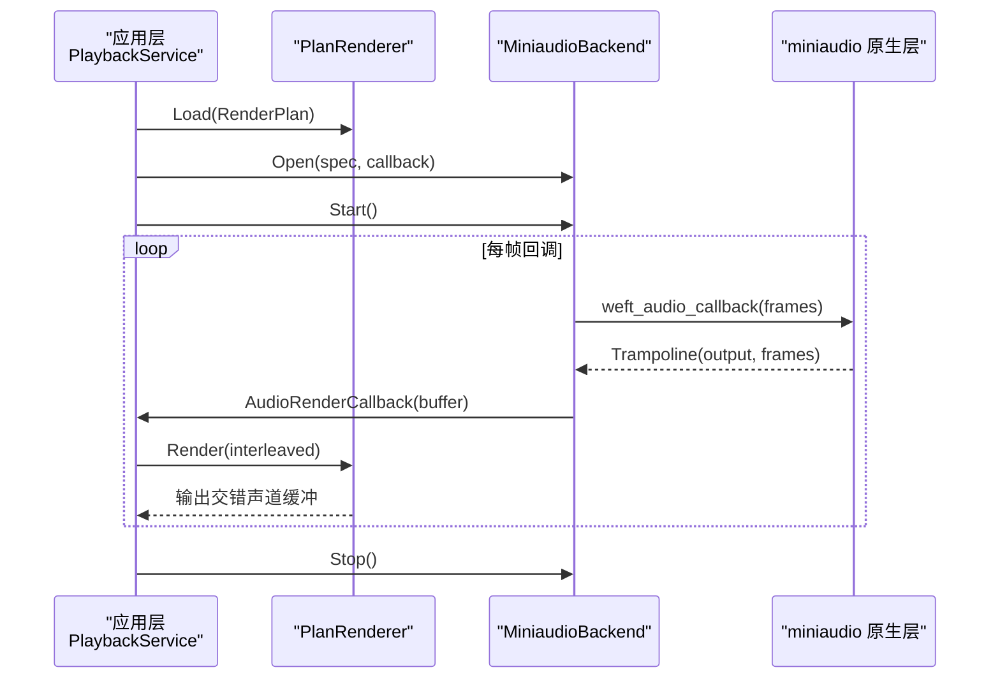

**图表来源**
- [PlaybackService.cs:42-51](file://src/Weftone.Application/PlaybackService.cs#L42-L51)
- [MiniaudioBackend.cs:21-35](file://src/Weftone.Adapters.Audio.Miniaudio/MiniaudioBackend.cs#L21-L35)
- [MiniaudioBackend.cs:78-83](file://src/Weftone.Adapters.Audio.Miniaudio/MiniaudioBackend.cs#L78-L83)
- [PlanRenderer.cs:61-105](file://src/Weftone.Engine/PlanRenderer.cs#L61-L105)

**章节来源**
- [README.md:38-57](file://README.md#L38-L57)
- [ADR-0002-threading-realtime.md:4-15](file://docs/adr/ADR-0002-threading-realtime.md#L4-L15)

## 详细组件分析

### PlanRenderer：高性能事件驱动渲染器
PlanRenderer 是实时渲染的核心，职责包括：
- 维护固定大小的 Voice 池（最多 64 复音），按 StartSample 顺序激活事件。
- 池满时选择“最早结束”的声部进行偷声，并以线性淡出尾音过渡，避免 click。
- 新事件进入 pending 环形队列，等待槽位释放后激活。
- 支持正弦波合成与采样器播放，两者均按左右声道增益混合。
- 支持循环区间：position 到达 LoopEnd 回绕至 LoopStart，事件游标归零重触发。
- 全程零分配，RtAssert 守护。

关键数据结构与复杂度：
- Voice 池数组：O(1) 访问，查找空闲槽 O(N)，N≤64。
- Pending 环：O(1) 入队/出队，容量 32，溢出时丢弃并计数 DroppedEvents。
- 事件激活：按 StartSample 递增顺序扫描 Voices，避免排序开销。
- 渲染段：对每个活跃 Voice 执行门限包络或偷声淡出，逐帧累加到交错缓冲。

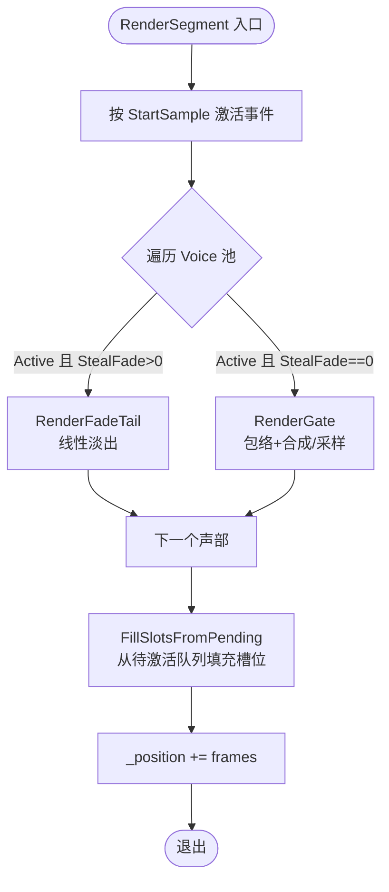

**图表来源**
- [PlanRenderer.cs:107-137](file://src/Weftone.Engine/PlanRenderer.cs#L107-L137)
- [PlanRenderer.cs:139-177](file://src/Weftone.Engine/PlanRenderer.cs#L139-L177)
- [PlanRenderer.cs:217-231](file://src/Weftone.Engine/PlanRenderer.cs#L217-L231)

#### 正弦波合成路径
- 双精度相位存储，每帧以 PhaseDelta 步进，超过 TwoPi 时回绕。
- 正弦值经 MathF.Sin 转换为单精度，再乘以左右声道增益。
- 包络：剩余帧数小于 FadeTail 时按比例衰减，避免突发截断。

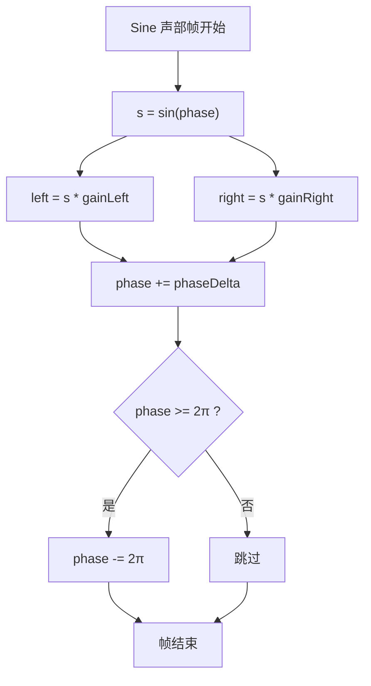

**图表来源**
- [PlanRenderer.cs:233-268](file://src/Weftone.Engine/PlanRenderer.cs#L233-L268)
- [PlanRenderer.cs:347-354](file://src/Weftone.Engine/PlanRenderer.cs#L347-L354)

#### 采样器播放路径
- 根据 AssetIndex 取 PlanAsset，按声道数读取单声道或立体声样本。
- 位置以 double 表示，使用线性插值平滑频率变化。
- 当位置达到 Frames 时标记 Remaining=1，下一帧自然结束。

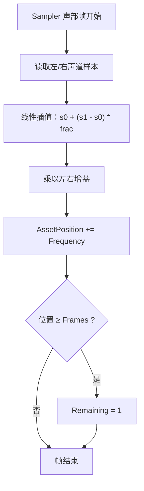

**图表来源**
- [PlanRenderer.cs:300-334](file://src/Weftone.Engine/PlanRenderer.cs#L300-L334)

#### 偷声与淡出
- 选择最早结束的 Active 声部（Wait + Remaining 最小，平局取低索引）。
- 设置 StealFade = FadeTail，随后逐帧递减，输出线性包络。
- 若 StealFade 已大于 0，该声部不可再次被偷。

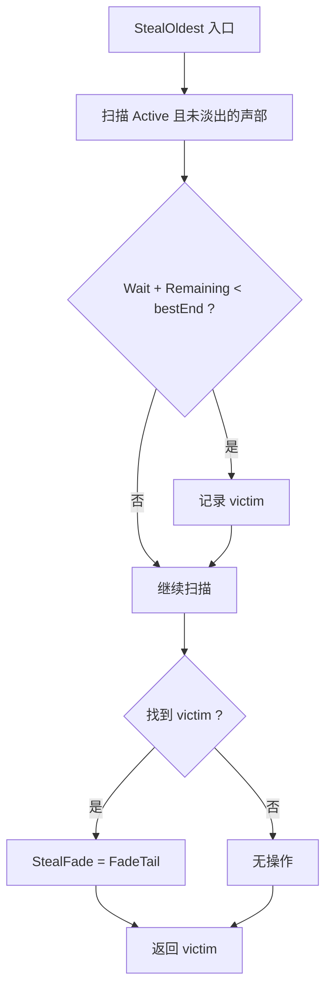

**图表来源**
- [PlanRenderer.cs:191-215](file://src/Weftone.Engine/PlanRenderer.cs#L191-L215)
- [PlanRenderer.cs:270-298](file://src/Weftone.Engine/PlanRenderer.cs#L270-L298)

**章节来源**
- [PlanRenderer.cs:5-16](file://src/Weftone.Engine/PlanRenderer.cs#L5-L16)
- [PlanRenderer.cs:61-105](file://src/Weftone.Engine/PlanRenderer.cs#L61-L105)
- [PlanRenderer.cs:107-137](file://src/Weftone.Engine/PlanRenderer.cs#L107-L137)
- [PlanRenderer.cs:139-177](file://src/Weftone.Engine/PlanRenderer.cs#L139-L177)
- [PlanRenderer.cs:179-231](file://src/Weftone.Engine/PlanRenderer.cs#L179-L231)
- [PlanRenderer.cs:233-354](file://src/Weftone.Engine/PlanRenderer.cs#L233-L354)

### SineEngine：轻量正弦合成器
SineEngine 提供可复用的正弦合成能力，常用于测试或独立合成场景：
- 构造时校验 sampleRate 与 frequency，确保频率在奈奎斯特范围内。
- 预计算 PhaseDelta，避免每帧重复乘法。
- 暴露预捕获的 AudioRenderCallback，避免音频路径上的委托分配。
- Render 方法直接写入 Span<float>，零额外分配。

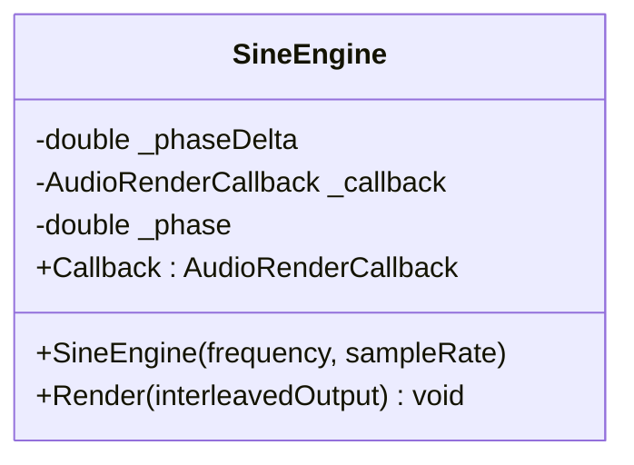

**图表来源**
- [SineEngine.cs:5-39](file://src/Weftone.Engine/SineEngine.cs#L5-L39)

**章节来源**
- [SineEngine.cs:5-39](file://src/Weftone.Engine/SineEngine.cs#L5-L39)

### TickMath：节拍到样本的整数映射
TickMath 提供确定性时间换算：
- SamplesPerTick 返回分子分母对，避免浮点误差累积。
- TicksToSamples 使用整数除法截断，保证确定性。
- 结合 TimeBase.Ppq 将 BPM 转换为 tick 到样本的比例。

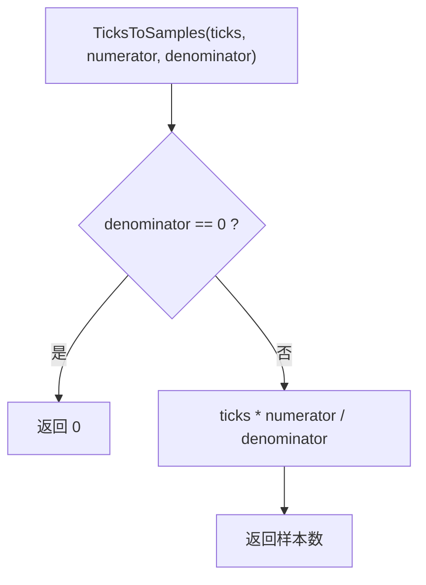

**图表来源**
- [TickMath.cs:8-12](file://src/Weftone.Application/TickMath.cs#L8-L12)

**章节来源**
- [TickMath.cs:5-13](file://src/Weftone.Application/TickMath.cs#L5-L13)

### RtAssert：实时断言与零分配守护
RtAssert 用于在 RT_ASSERT 构建下检测音频回调中的托管内存分配：
- Guard 包裹回调体，前后比较 GC.GetAllocatedBytesForCurrentThread()。
- 若检测到分配，则原子递增 Violations 计数器，不抛异常。
- Reset 允许重置统计，便于分段验证。

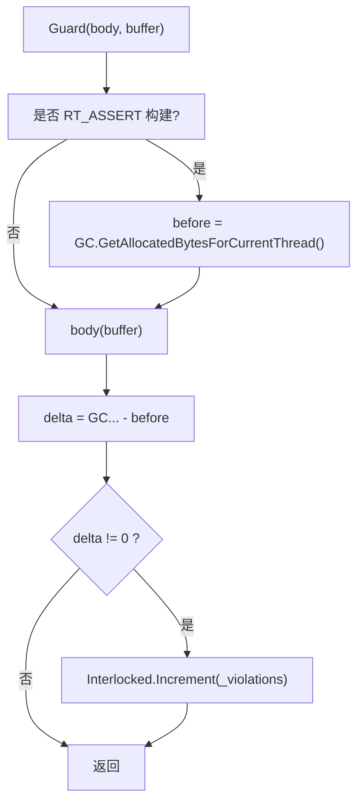

**图表来源**
- [RtAssert.cs:17-30](file://src/Weftone.Engine/RtAssert.cs#L17-L30)

**章节来源**
- [RtAssert.cs:5-30](file://src/Weftone.Engine/RtAssert.cs#L5-L30)

### PlaybackService：播放编排与热更新
PlaybackService 协调 PlanRenderer 与音频后端：
- Play/Stop 管理后端生命周期，确保采样率一致时复用后端。
- UpdatePlan 实现“停止-交换-恢复”，保留播放状态，短暂静音换零并发。
- 捕获 renderer.Render 作为回调委托，避免音频路径上的方法组分配。

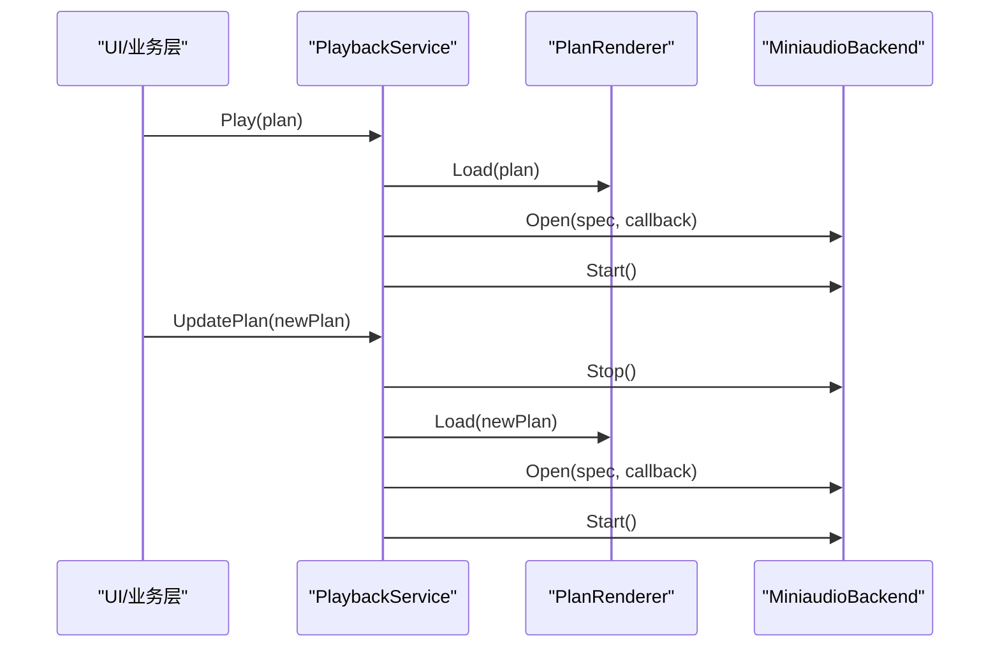

**图表来源**
- [PlaybackService.cs:42-78](file://src/Weftone.Application/PlaybackService.cs#L42-L78)
- [PlaybackService.cs:80-90](file://src/Weftone.Application/PlaybackService.cs#L80-L90)

**章节来源**
- [PlaybackService.cs:6-11](file://src/Weftone.Application/PlaybackService.cs#L6-L11)
- [PlaybackService.cs:42-90](file://src/Weftone.Application/PlaybackService.cs#L42-L90)

### MiniaudioBackend：音频后端桥接
MiniaudioBackend 负责与原生 miniaudio 交互：
- Open 时一次性建立 GCHandle 与 Trampoline，回调路径零分配。
- Start/Stop 调用原生 API，错误码转为 InvalidOperationException。
- Dispose 安全关闭设备并释放句柄。

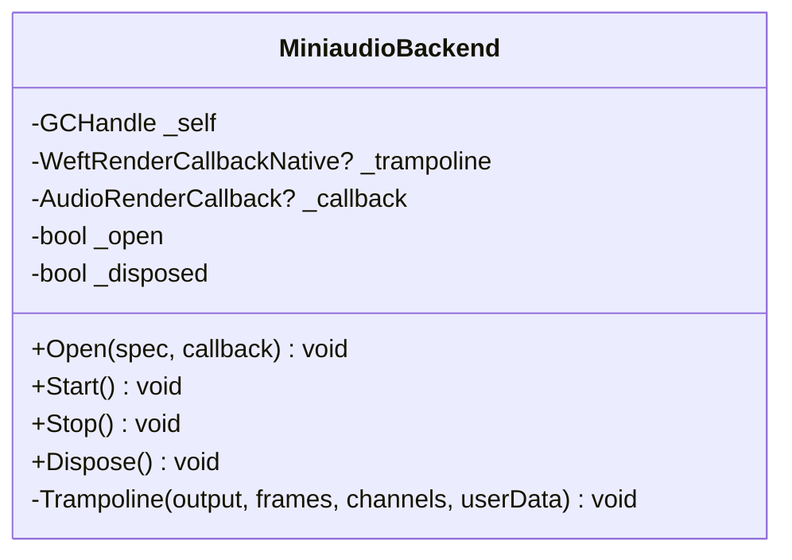

**图表来源**
- [MiniaudioBackend.cs:11-83](file://src/Weftone.Adapters.Audio.Miniaudio/MiniaudioBackend.cs#L11-L83)

**章节来源**
- [MiniaudioBackend.cs:6-10](file://src/Weftone.Adapters.Audio.Miniaudio/MiniaudioBackend.cs#L6-L10)
- [MiniaudioBackend.cs:21-83](file://src/Weftone.Adapters.Audio.Miniaudio/MiniaudioBackend.cs#L21-L83)

## 依赖关系分析
- PlanRenderer 依赖 Abstractions 中的 RenderPlan、RenderVoice、PlanAsset 与 IPlanRenderer 接口。
- PlaybackService 依赖 IPlanRenderer 与 IAudioBackend，解耦具体后端实现。
- MiniaudioBackend 依赖原生 weft_audio_* API，通过 P/Invoke 桥接。
- TickMath 依赖 Domain.TimeBase，提供拍板单位转换。
- RtAssert 依赖 Abstractions.AudioRenderCallback，用于包裹回调。

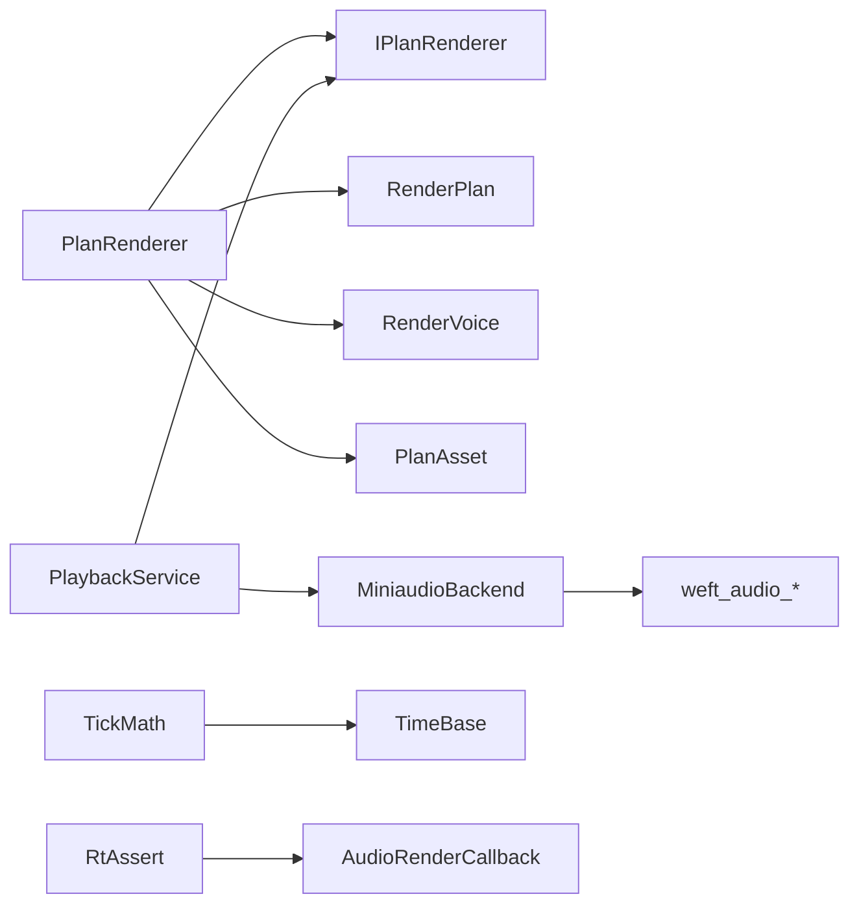

**图表来源**
- [PlanRenderer.cs:1-3](file://src/Weftone.Engine/PlanRenderer.cs#L1-L3)
- [IPlanRenderer.cs:1-12](file://src/Weftone.Abstractions/Rendering/IPlanRenderer.cs#L1-L12)
- [RenderPlan.cs:1-42](file://src/Weftone.Abstractions/Rendering/RenderPlan.cs#L1-L42)
- [PlaybackService.cs:1-3](file://src/Weftone.Application/PlaybackService.cs#L1-L3)
- [MiniaudioBackend.cs:1-3](file://src/Weftone.Adapters.Audio.Miniaudio/MiniaudioBackend.cs#L1-L3)
- [TickMath.cs:1-2](file://src/Weftone.Application/TickMath.cs#L1-L2)
- [RtAssert.cs:1-2](file://src/Weftone.Engine/RtAssert.cs#L1-L2)

**章节来源**
- [PlanRenderer.cs:1-3](file://src/Weftone.Engine/PlanRenderer.cs#L1-L3)
- [PlaybackService.cs:1-3](file://src/Weftone.Application/PlaybackService.cs#L1-L3)
- [MiniaudioBackend.cs:1-3](file://src/Weftone.Adapters.Audio.Miniaudio/MiniaudioBackend.cs#L1-L3)
- [TickMath.cs:1-2](file://src/Weftone.Application/TickMath.cs#L1-L2)
- [RtAssert.cs:1-2](file://src/Weftone.Engine/RtAssert.cs#L1-L2)

## 性能与实时性
- 零分配保证：PlanRenderer 使用固定数组与 struct，避免堆分配；RtAssert 在 RT_ASSERT 构建下检测分配。
- 零锁设计：PlanRenderer 内部无锁，Play/UpdatePlan 通过“停止-交换-恢复”保证并发安全。
- 确定性渲染：TickMath 使用整数运算，PlanRenderer 事件顺序与偷声规则确定。
- 高频优化：SineEngine 预计算 PhaseDelta，PlanRenderer 使用双精度相位与快速正弦。
- 资源复用：PlaybackService 复用 MiniaudioBackend，避免频繁打开/关闭设备。
- 循环渲染：LoopStart/LoopEnd 支持 Pattern 模式，position 回绕与事件游标重置保证无缝循环。

建议优化方向：
- 对大段静音区域跳过渲染（当前已按 Wait 跳过，可进一步批量跳过）。
- 对采样器插值使用查表或 SIMD（视平台特性评估）。
- 监控 DroppedEvents 与 RtAssert.Violations，持续回归。

[本节为通用指导，不直接分析具体文件]

## 故障排查与调试
常见问题与定位方法：
- 爆音或卡顿：检查 RtAssert.Violations 是否非零，确认音频路径存在分配。
- 丢事件：观察 PlanRenderer.DroppedEvents，增大 PendingCapacity 或减少复音数量。
- 循环跳变：确认 LoopEnd > LoopStart，且 position 回绕逻辑正常。
- 无声或噪声：检查 RenderPlan.MasterGain 与声部 GainLeft/GainRight。
- 后端错误：查看 MiniaudioBackend 抛出的 InvalidOperationException 与错误码。

调试技巧：
- 使用 HeadlessRender 离线渲染 WAV，对比黄金音频基线。
- 在 RT_ASSERT 构建下运行单元测试，强制分配断言。
- 逐步禁用声部类型（仅 Sine 或仅 Sampler）隔离问题。
- 打印 Position、DroppedEvents、Violations 辅助定位。

**章节来源**
- [RtAssert.cs:5-30](file://src/Weftone.Engine/RtAssert.cs#L5-L30)
- [PlanRenderer.cs:44-46](file://src/Weftone.Engine/PlanRenderer.cs#L44-L46)
- [MiniaudioBackend.cs:28-35](file://src/Weftone.Adapters.Audio.Miniaudio/MiniaudioBackend.cs#L28-L35)

## 结论
Weftone 的音频引擎以 PlanRenderer 为核心，结合 SineEngine、TickMath 与 RtAssert，构建了高性能、确定性、零分配的实时渲染体系。通过 Abstractions 与 Adapters 的清晰边界，上层应用服务 PlaybackService 能够安全地编排播放与热更新，MiniaudioBackend 则提供稳定的音频设备接入。整体架构遵循实时纪律与六边形设计，适合跨平台 DAW 的高要求场景。

[本节为总结性内容，不直接分析具体文件]