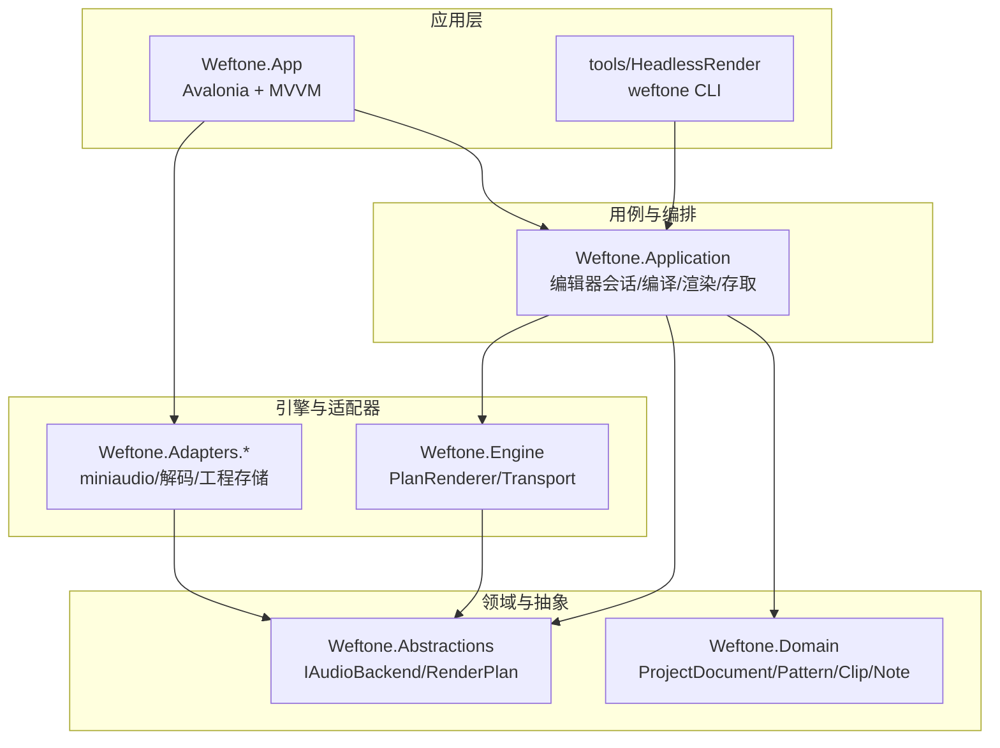
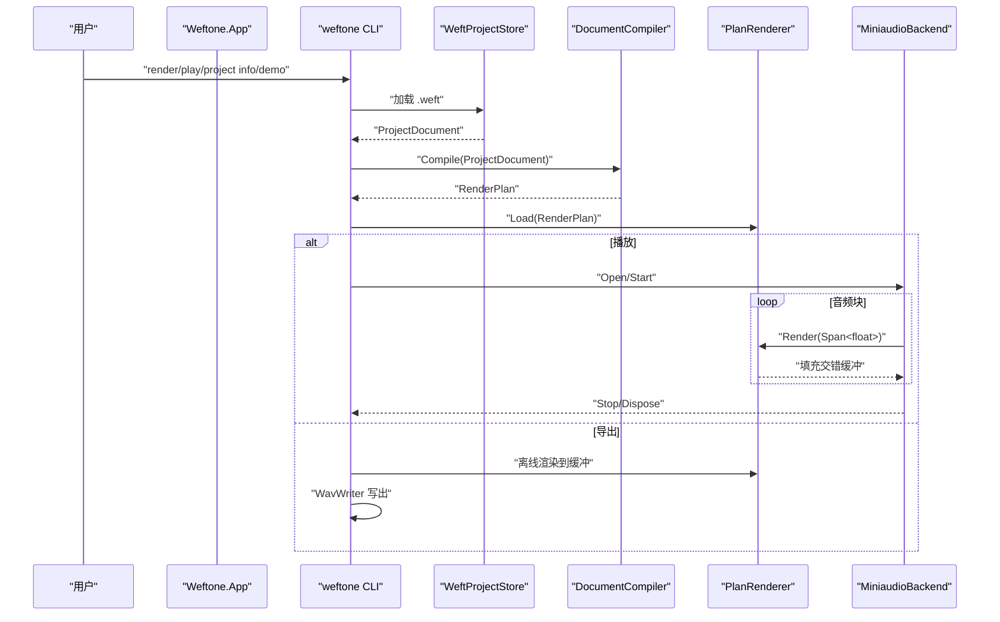
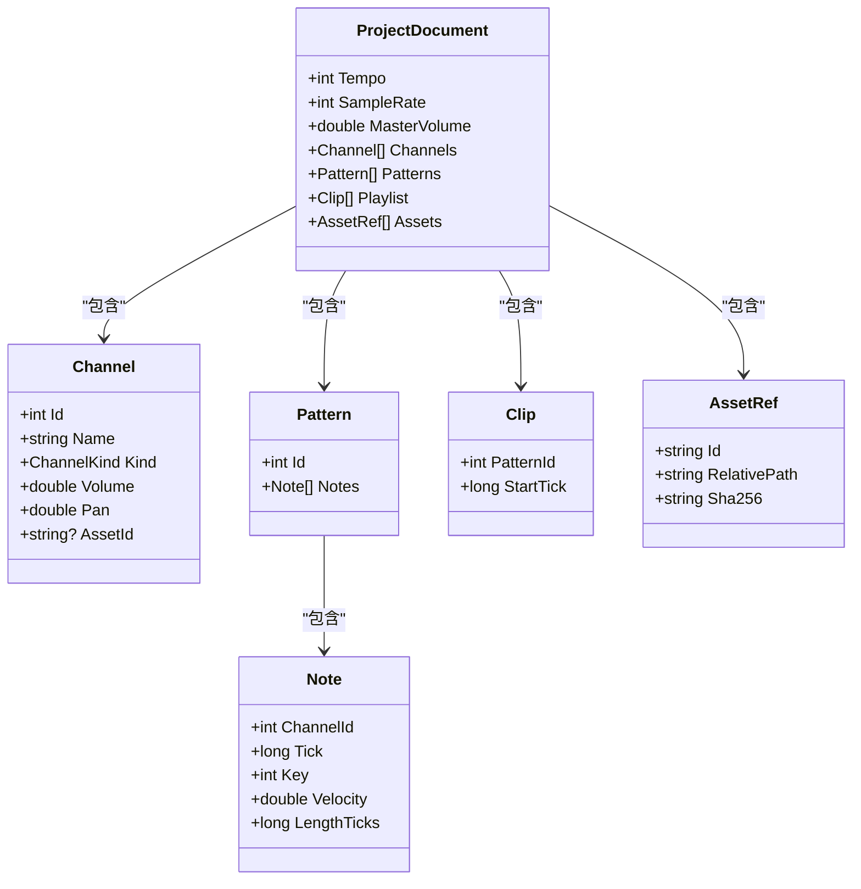
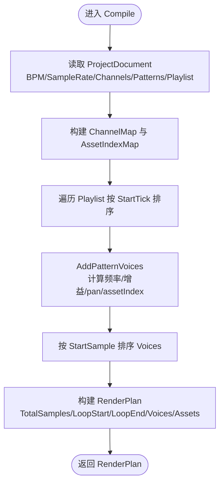
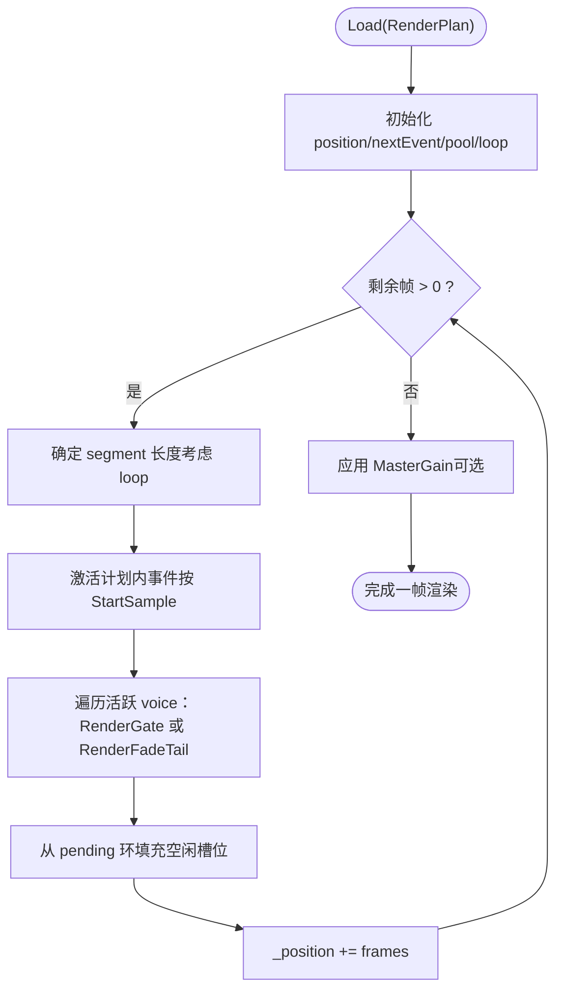
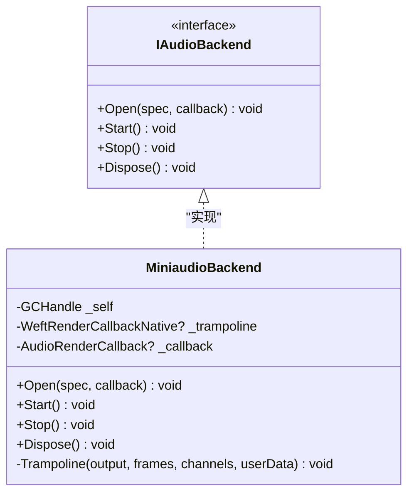
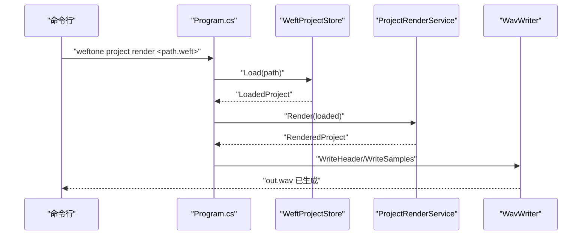
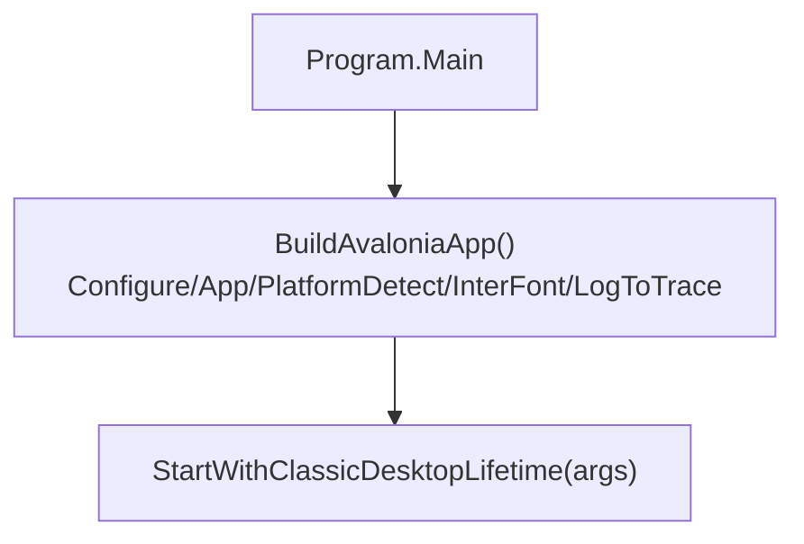
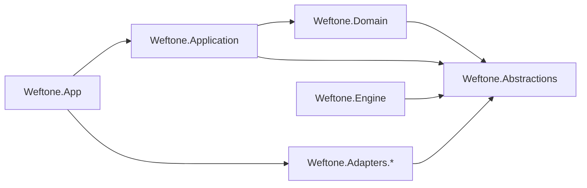

# 项目概述

<cite>
**本文引用的文件**   
- [README.md](file://README.md)
- [AGENTS.md](file://AGENTS.md)
- [M0_FOUNDATION.md](file://specs/M0_FOUNDATION.md)
- [M1a_HEADLESS.md](file://specs/M1a_HEADLESS.md)
- [M1b_UI.md](file://specs/M1b_UI.md)
- [ADR-0001-methodology.md](file://docs/adr/ADR-0001-methodology.md)
- [ADR-0002-threading-realtime.md](file://docs/adr/ADR-0002-threading-realtime.md)
- [ADR-0003-document-engine-compiler.md](file://docs/adr/ADR-0003-document-engine-compiler.md)
- [ADR-0004-ports-adapters-wheel-first.md](file://docs/adr/ADR-0004-ports-adapters-wheel-first.md)
- [ProjectDocument.cs](file://src/Weftone.Domain/ProjectDocument.cs)
- [DocumentCompiler.cs](file://src/Weftone.Application/DocumentCompiler.cs)
- [PlanRenderer.cs](file://src/Weftone.Engine/PlanRenderer.cs)
- [IAudioBackend.cs](file://src/Weftone.Abstractions/IAudioBackend.cs)
- [MiniaudioBackend.cs](file://src/Weftone.Adapters.Audio.Miniaudio/MiniaudioBackend.cs)
- [Program.cs（HeadlessRender）](file://tools/HeadlessRender/Program.cs)
- [Program.cs（App）](file://src/Weftone.App/Program.cs)
</cite>

## 目录
1. [引言](#引言)
2. [项目结构](#项目结构)
3. [核心组件](#核心组件)
4. [架构总览](#架构总览)
5. [详细组件分析](#详细组件分析)
6. [依赖关系分析](#依赖关系分析)
7. [性能与实时性](#性能与实时性)
8. [快速开始](#快速开始)
9. [故障排查](#故障排查)
10. [结论](#结论)

## 引言
Weftone（纬音）是一个用 C# / .NET 从零构建的开源、跨平台数字音频工作站，目标平台为 Windows、macOS 与 Linux。其工作流致敬 FL Studio 的 Pattern → Playlist → Mixer 范式，但代码、UI、DSP 与工程格式全部自研，采用正向规格驱动开发，不做二进制逆向，不复制任何专有资产或命名视觉元素。

当前状态为 M1b（最小 UI 阶段），已完成：
- M0（地基）：仓库治理、CI、miniaudio shim、正弦出声、RT 分配断言、离线渲染 CLI。
- M1a（headless 竖切）：`.weft` 工程可确定性渲染出 WAV，含文档模型、命令撤销、编译器、transport、Sampler 声部、Mixer 与黄金音频回归。

未来路线图包括自动化曲线、CLAP 宿主、拉伸/切片、进程隔离与性能打磨等后续里程碑。

**章节来源**
- [README.md:12-36](file://README.md#L12-L36)
- [README.md:81-112](file://README.md#L81-L112)
- [AGENTS.md:249-272](file://AGENTS.md#L249-L272)

## 项目结构
仓库按领域分层组织，核心源码位于 `/src`，原生代码在 `/native`，功能规格在 `/specs`，架构决策记录在 `/docs/adr`，测试在 `/tests`，CLI 工具在 `/tools`。

**图表来源**
- [AGENTS.md:61-80](file://AGENTS.md#L61-L80)
- [README.md:70-79](file://README.md#L70-L79)

**章节来源**
- [README.md:70-79](file://README.md#L70-L79)
- [AGENTS.md:124-152](file://AGENTS.md#L124-L152)

## 核心组件
- 文档模型（Domain）：`ProjectDocument` 是可编辑、可撤销、可序列化的富对象，包含 tempo、sampleRate、主控音量、Channel、Pattern、Playlist、AssetRef 等。
- 编译器（Application）：`DocumentCompiler` 将 `ProjectDocument` 编译为 `RenderPlan`，支持 Song 模式与 Pattern 循环模式，输出扁平事件数组，保证幂等与确定性。
- 渲染器（Engine）：`PlanRenderer` 是离线/实时两用渲染器，维护预分配 voice 池、事件激活、voice stealing 淡出、loop 回绕、主增益，全程零分配。
- 音频后端（Abstractions + Adapter）：`IAudioBackend` 定义音频回调契约；`MiniaudioBackend` 通过 P/Invoke 调用 vendored miniaudio，回调路径零分配。
- CLI（HeadlessRender）：`Program.cs` 提供 render/play/project demo/info 子命令，串联 ProjectStore、Decoder、Resampler、PlanRenderer 与 WavWriter。

**章节来源**
- [ProjectDocument.cs:1-21](file://src/Weftone.Domain/ProjectDocument.cs#L1-L21)
- [DocumentCompiler.cs:1-159](file://src/Weftone.Application/DocumentCompiler.cs#L1-L159)
- [PlanRenderer.cs:1-356](file://src/Weftone.Engine/PlanRenderer.cs#L1-L356)
- [IAudioBackend.cs:1-15](file://src/Weftone.Abstractions/IAudioBackend.cs#L1-L15)
- [MiniaudioBackend.cs:1-85](file://src/Weftone.Adapters.Audio.Miniaudio/MiniaudioBackend.cs#L1-L85)
- [Program.cs（HeadlessRender）:1-266](file://tools/HeadlessRender/Program.cs#L1-L266)

## 架构总览
Weftone 采用六边形架构（端口与适配器）+ 编译器模式 + 数据导向实时层。编辑模型与实时模型彻底分离：音频线程永远看不到 Note/Clip/Document，只读不可变 RenderPlan。

**图表来源**
- [Program.cs（HeadlessRender）:119-136](file://tools/HeadlessRender/Program.cs#L119-L136)
- [Program.cs（HeadlessRender）:217-248](file://tools/HeadlessRender/Program.cs#L217-L248)
- [DocumentCompiler.cs:15-49](file://src/Weftone.Application/DocumentCompiler.cs#L15-L49)
- [PlanRenderer.cs:48-105](file://src/Weftone.Engine/PlanRenderer.cs#L48-L105)
- [MiniaudioBackend.cs:21-56](file://src/Weftone.Adapters.Audio.Miniaudio/MiniaudioBackend.cs#L21-L56)

## 详细组件分析

### 文档模型与命令撤销（Domain）
`ProjectDocument` 作为单写者持有的富对象，承载工程元数据与编辑实体。配合命令日志与事务机制，实现撤销/重做与拖拽合并（M1b）。

**图表来源**
- [ProjectDocument.cs:1-21](file://src/Weftone.Domain/ProjectDocument.cs#L1-L21)
- [M1a_HEADLESS.md:13-29](file://specs/M1a_HEADLESS.md#L13-L29)

**章节来源**
- [ProjectDocument.cs:1-21](file://src/Weftone.Domain/ProjectDocument.cs#L1-L21)
- [M1a_HEADLESS.md:13-29](file://specs/M1a_HEADLESS.md#L13-L29)
- [M1b_UI.md:75-93](file://specs/M1b_UI.md#L75-L93)

### 编译器（Application）
`DocumentCompiler.Compile` 展开 Playlist 线性时间轴，`CompilePattern` 支持 Pattern 循环模式。输出 `RenderPlan` 为扁平数组，按 StartSample 排序，无对象图与第三方类型泄漏。

**图表来源**
- [DocumentCompiler.cs:15-49](file://src/Weftone.Application/DocumentCompiler.cs#L15-L49)
- [DocumentCompiler.cs:98-157](file://src/Weftone.Application/DocumentCompiler.cs#L98-L157)

**章节来源**
- [DocumentCompiler.cs:1-159](file://src/Weftone.Application/DocumentCompiler.cs#L1-L159)
- [M1a_HEADLESS.md:36-49](file://specs/M1a_HEADLESS.md#L36-L49)

### 渲染器（Engine）
`PlanRenderer` 维护固定大小 voice 池、pending 环与事件游标，支持 loop 回绕、voice stealing 淡出、sine 与 sampler 两种声源，以及主增益。

**图表来源**
- [PlanRenderer.cs:48-105](file://src/Weftone.Engine/PlanRenderer.cs#L48-L105)
- [PlanRenderer.cs:107-137](file://src/Weftone.Engine/PlanRenderer.cs#L107-L137)
- [PlanRenderer.cs:139-231](file://src/Weftone.Engine/PlanRenderer.cs#L139-L231)

**章节来源**
- [PlanRenderer.cs:1-356](file://src/Weftone.Engine/PlanRenderer.cs#L1-L356)
- [M1b_UI.md:49-64](file://specs/M1b_UI.md#L49-L64)

### 音频后端（Abstractions + Adapter）
`IAudioBackend` 定义 Open/Start/Stop 与 AudioRenderCallback 契约；`MiniaudioBackend` 通过反向 P/Invoke 建立委托与 GCHandle，回调路径零分配。

**图表来源**
- [IAudioBackend.cs:1-15](file://src/Weftone.Abstractions/IAudioBackend.cs#L1-L15)
- [MiniaudioBackend.cs:1-85](file://src/Weftone.Adapters.Audio.Miniaudio/MiniaudioBackend.cs#L1-L85)

**章节来源**
- [IAudioBackend.cs:1-15](file://src/Weftone.Abstractions/IAudioBackend.cs#L1-L15)
- [MiniaudioBackend.cs:1-85](file://src/Weftone.Adapters.Audio.Miniaudio/MiniaudioBackend.cs#L1-L85)

### CLI 入口（HeadlessRender）
`Program.cs` 解析参数并分发至 render/play/project demo/info 子命令，串联 WeftProjectStore、DrWavDecoder、LinearResampler、PlanRenderer 与 WavWriter。

**图表来源**
- [Program.cs（HeadlessRender）:122-136](file://tools/HeadlessRender/Program.cs#L122-L136)
- [Program.cs（HeadlessRender）:138-169](file://tools/HeadlessRender/Program.cs#L138-L169)

**章节来源**
- [Program.cs（HeadlessRender）:1-266](file://tools/HeadlessRender/Program.cs#L1-L266)

### 图形界面入口（App）
`Program.cs` 启动 Avalonia 桌面生命周期，组合根装配 Application、Adapters 与 Engine。

**图表来源**
- [Program.cs（App）:1-16](file://src/Weftone.App/Program.cs#L1-L16)

**章节来源**
- [Program.cs（App）:1-16](file://src/Weftone.App/Program.cs#L1-L16)

## 依赖关系分析
- 依赖方向严格遵循六边形架构：Domain 无依赖；Abstractions 无依赖；Application 依赖 Domain + Abstractions；Engine 仅依赖 Abstractions；Adapters 依赖 Abstractions；App 依赖 Application + Adapters。
- 实时纪律要求 Engine 不得引用 UI 或第三方类型，所有轮子经 adapter 接口隔离。

**图表来源**
- [AGENTS.md:61-80](file://AGENTS.md#L61-L80)
- [ADR-0004-ports-adapters-wheel-first.md:1-26](file://docs/adr/ADR-0004-ports-adapters-wheel-first.md#L1-L26)

**章节来源**
- [AGENTS.md:61-80](file://AGENTS.md#L61-L80)
- [ADR-0004-ports-adapters-wheel-first.md:1-26](file://docs/adr/ADR-0004-ports-adapters-wheel-first.md#L1-L26)

## 性能与实时性
- 实时约束：音频回调零分配、零锁、零异常、零 native malloc；CI 以分配断言守护（DEBUG/RT_ASSERT）。
- 渲染确定性：同配置下输出位一致，支持黄金音频回归（跨平台容差 ≤ 1e-4）。
- 性能预算：初始目标 128 samples @48k、64 轨、8 插件引擎 CPU < 1.5ms/块；UI 60fps，Piano Roll 1 万音符视口裁剪后流畅。
- 交换策略：M1b 采用“停止-交换-恢复”，避免并发风险；RCU 双缓冲留 M2。

**章节来源**
- [AGENTS.md:193-224](file://AGENTS.md#L193-L224)
- [M1b_UI.md:59-64](file://specs/M1b_UI.md#L59-L64)
- [README.md:38-57](file://README.md#L38-L57)

## 快速开始
环境搭建与构建步骤：
- 安装 .NET 10 LTS 与 CMake。
- 构建托管项目：`dotnet build -c Release`、`dotnet test -c Release`。
- 构建原生 shim：`cmake -S native -B native/build`，`cmake --build native/build --config Release`。

基本使用方法：
- 离线渲染正弦 WAV：`dotnet run --project tools/HeadlessRender -c Release -- render --seconds 5 --out out.wav`。
- 实时播放（需 native shim）：`dotnet run --project tools/HeadlessRender -c Release -- play --seconds 5`。
- 图形界面（M1b，需 native shim）：`dotnet run --project src/Weftone.App -c Release`。

**章节来源**
- [README.md:90-112](file://README.md#L90-L112)

## 故障排查
常见问题与处理建议：
- 未找到 native 库 weftone_miniaudio：请先构建 native shim，或设置 WEFTONE_NATIVE_DIR。
- 音频设备打开/启动失败：检查系统音频权限与设备可用性；查看异常消息定位具体错误码。
- 工程包非法或数据非法：确认 `.weft` 完整性、SHA256 校验与 schemaVersion 合法；拒绝 zip slip 与畸形包。
- 实时分配违规：启用 DEBUG/RT_ASSERT 构建，检查回调路径是否出现 new/LINQ/lock/异常/native malloc。

**章节来源**
- [Program.cs（HeadlessRender）:217-248](file://tools/HeadlessRender/Program.cs#L217-L248)
- [M0_FOUNDATION.md:20-28](file://specs/M0_FOUNDATION.md#L20-L28)
- [M1a_HEADLESS.md:71-79](file://specs/M1a_HEADLESS.md#L71-L79)

## 结论
Weftone 以六边形架构、编译器模式与数据导向实时层为核心，坚持 headless 优先与 wheel-first 策略，确保实时安全、可测与可替换。当前 M1b 最小 UI 阶段已打通 Pattern → Playlist → Mixer 的工作流闭环，并通过 CI 与黄金音频基线守护质量。后续里程碑将逐步引入自动化、插件宿主、进程隔离与性能优化，持续向 L1 目标迈进。