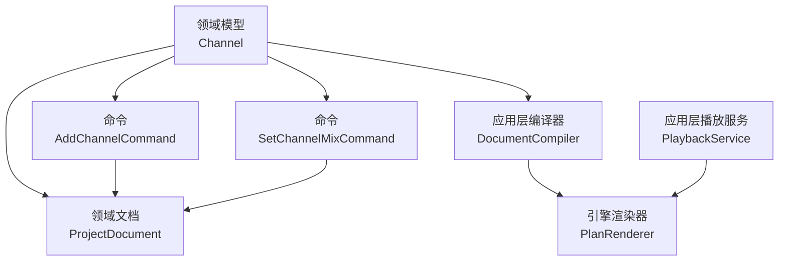
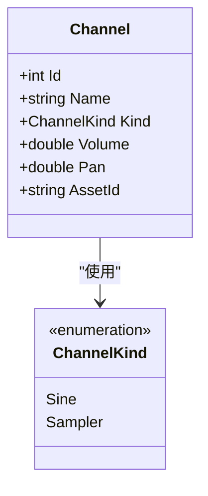
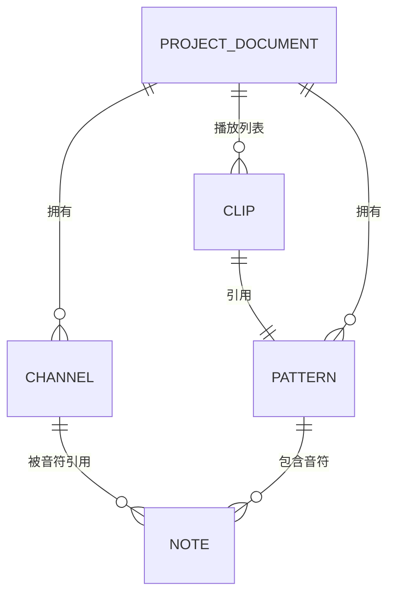
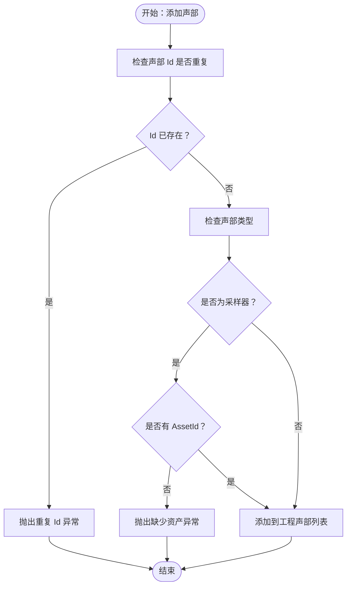
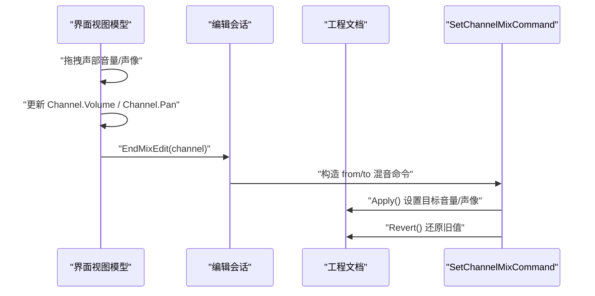
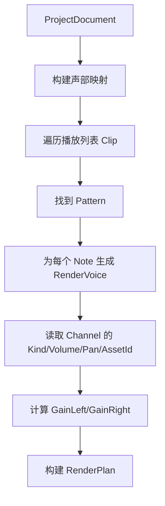
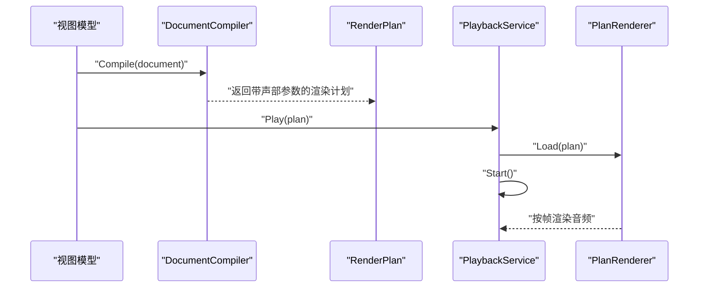
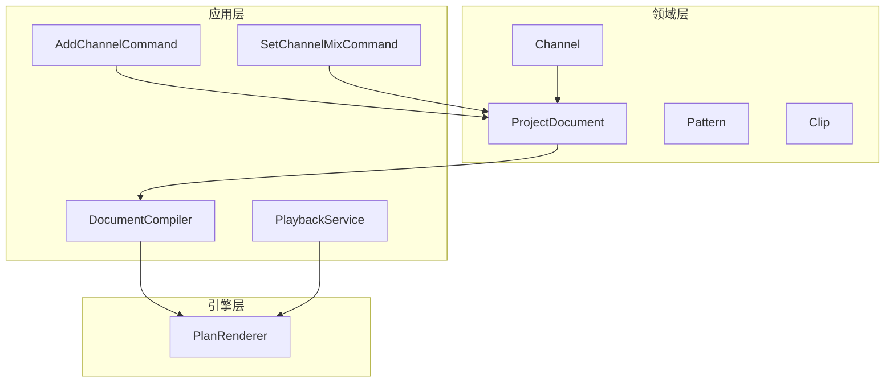
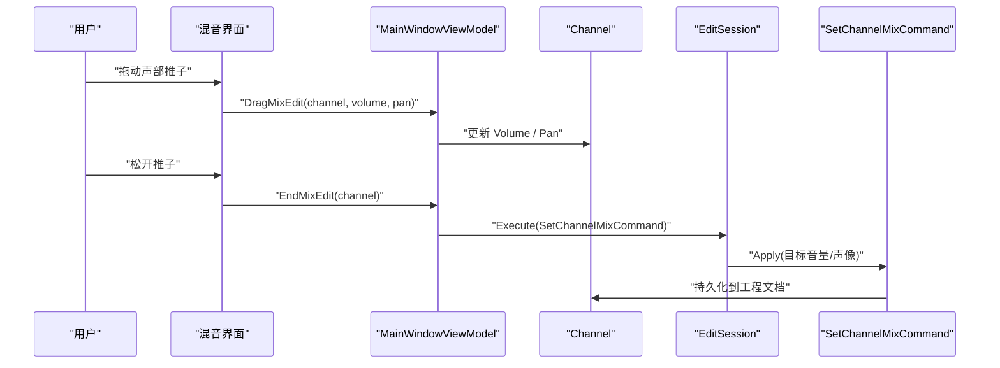
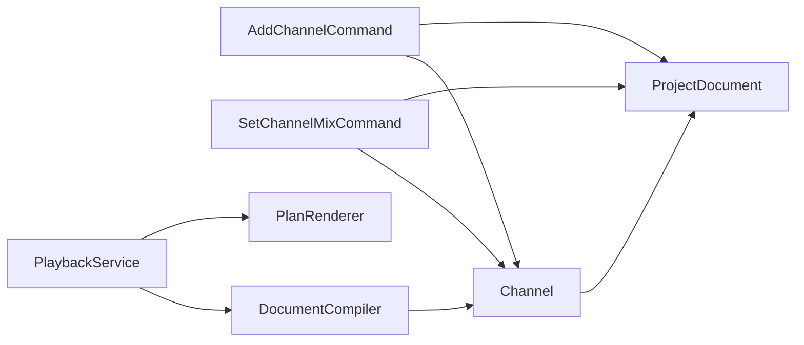

# Channel 声部模型

<cite>
**本文引用的文件**   
- [Channel.cs](file://src/Weftone.Domain/Channel.cs)
- [ProjectDocument.cs](file://src/Weftone.Domain/ProjectDocument.cs)
- [Pattern.cs](file://src/Weftone.Domain/Pattern.cs)
- [Clip.cs](file://src/Weftone.Domain/Clip.cs)
- [AddChannelCommand.cs](file://src/Weftone.Domain/Commands/AddChannelCommand.cs)
- [SetChannelMixCommand.cs](file://src/Weftone.Domain/Commands/SetChannelMixCommand.cs)
- [DocumentCompiler.cs](file://src/Weftone.Application/DocumentCompiler.cs)
- [PlaybackService.cs](file://src/Weftone.Application/PlaybackService.cs)
- [PlanRenderer.cs](file://src/Weftone.Engine/PlanRenderer.cs)
- [MainWindowViewModel.cs](file://src/Weftone.App/ViewModels/MainWindowViewModel.cs)
</cite>

## 目录
1. [引言](#引言)
2. [项目结构定位](#项目结构定位)
3. [核心概念：什么是 Channel 声部](#核心概念什么是-channel-声部)
4. [Channel 数据模型定义](#channel-数据模型定义)
5. [与 Pattern、Clip 和播放列表的关系](#与-patternclip-和播放列表的关系)
6. [创建、配置与管理 Channel 的业务流程](#创建配置与管理-channel-的业务流程)
7. [混音与音频处理中的角色](#混音与音频处理中的角色)
8. [业务规则与约束条件](#业务规则与约束条件)
9. [架构总览与关键流程图](#架构总览与关键流程图)
10. [依赖关系分析](#依赖关系分析)
11. [性能与实时性特征](#性能与实时性特征)
12. [常见问题与排错指南](#常见问题与排错指南)
13. [结论](#结论)

## 引言
本文围绕 Weftone 工程中的 `Channel` 类，建立一份面向音乐制作场景的数据模型文档。重点说明：
- 声部的概念、属性含义和业务语义；
- 声部名称管理、音量控制、声像定位；
- 声部与 `Pattern`、`Clip` 的协作方式；
- 如何在播放列表中引用声部；
- 声部的创建、配置和管理命令；
- 声部在编译、渲染和实时播放链路中的作用；
- 业务规则、约束条件和常见错误。

## 项目结构定位
`Channel` 属于领域层（Domain）的核心实体，位于 `Weftone.Domain` 命名空间。它被应用层的编译器、命令系统以及 UI 视图模型使用，并最终参与音频引擎的渲染管线。

**图表来源**
- [Channel.cs:1-19](file://src/Weftone.Domain/Channel.cs#L1-L19)
- [ProjectDocument.cs:1-21](file://src/Weftone.Domain/ProjectDocument.cs#L1-L21)
- [AddChannelCommand.cs:1-27](file://src/Weftone.Domain/Commands/AddChannelCommand.cs#L1-L27)
- [SetChannelMixCommand.cs:1-46](file://src/Weftone.Domain/Commands/SetChannelMixCommand.cs#L1-L46)
- [DocumentCompiler.cs:1-159](file://src/Weftone.Application/DocumentCompiler.cs#L1-L159)
- [PlaybackService.cs:1-98](file://src/Weftone.Application/PlaybackService.cs#L1-L98)
- [PlanRenderer.cs:1-356](file://src/Weftone.Engine/PlanRenderer.cs#L1-L356)

**章节来源**
- [Channel.cs:1-19](file://src/Weftone.Domain/Channel.cs#L1-L19)
- [ProjectDocument.cs:1-21](file://src/Weftone.Domain/ProjectDocument.cs#L1-L21)

## 核心概念：什么是 Channel 声部
在 Weftone 中，`Channel` 表示一个“声部通道”，用于描述一段声音的来源及其在混音中的位置与强度。它不是音符本身，而是音符所归属的“发声主体”。

- 声部决定声音类型：正弦波合成或采样回放。
- 声部提供混音参数：音量、声像。
- 声部可绑定外部资产：例如采样器的音频资源标识。
- 声部通过 `Id` 唯一标识，供命令、编译器和播放器查找。

从音乐制作角度看，声部类似于传统 DAW 中的一个轨道或乐器轨：你可以为鼓组、贝斯、键盘、人声等分别设置不同的声部，并在播放时独立调节它们的音量和左右声道分布。

**章节来源**
- [Channel.cs:9-18](file://src/Weftone.Domain/Channel.cs#L9-L18)

## Channel 数据模型定义
`Channel` 是一个密封类，包含以下字段：

| 字段 | 类型 | 默认值 | 含义 | 业务约束 |
|---|---|---:|---|---|
| `Id` | `int` | 未显式默认 | 声部唯一标识 | 工程中应唯一；添加命令会拒绝重复 Id |
| `Name` | `string` | 空字符串 | 声部显示名称 | 由用户或导入逻辑设置；UI 常用于混音面板展示 |
| `Kind` | `ChannelKind` | 枚举值 | 声部类型：正弦波或采样器 | 影响编译时的频率计算和资产需求 |
| `Volume` | `double` | `1.0` | 声部音量 | 业务层通常限制在 `[0, 2]`；`1.0` 表示不衰减 |
| `Pan` | `double` | 未显式默认 | 线性声像 | 业务层通常限制在 `[-1, 1]`；负值偏左，正值偏右 |
| `AssetId` | `string?` | 空引用 | 采样器声部绑定的资产标识 | 若 `Kind` 为采样器，则必须存在有效资产 |

`ChannelKind` 是声部类型的枚举，当前支持：
- `Sine`：正弦波合成声部。
- `Sampler`：采样回放声部。

**图表来源**
- [Channel.cs:3-18](file://src/Weftone.Domain/Channel.cs#L3-L18)

**章节来源**
- [Channel.cs:3-18](file://src/Weftone.Domain/Channel.cs#L3-L18)

## 与 Pattern、Clip 和播放列表的关系
`Channel` 并不直接持有音符，也不直接出现在播放列表中。它的关系如下：

- `Pattern` 包含一组 `Note`。
- `Note` 通过 `ChannelId` 引用某个 `Channel`。
- `Clip` 将某个 `Pattern` 放置在时间轴上，以 `StartTick` 表示起始位置。
- `ProjectDocument.Playlist` 是所有 `Clip` 的集合，构成播放列表。

因此，声部在播放列表中的引用是间接的：  
播放列表 → Clip → Pattern → Note → ChannelId → Channel。

**图表来源**
- [Channel.cs:10-18](file://src/Weftone.Domain/Channel.cs#L10-L18)
- [Pattern.cs:3-8](file://src/Weftone.Domain/Pattern.cs#L3-L8)
- [Clip.cs:3-8](file://src/Weftone.Domain/Clip.cs#L3-L8)
- [ProjectDocument.cs:16-18](file://src/Weftone.Domain/ProjectDocument.cs#L16-L18)

**章节来源**
- [Pattern.cs:3-8](file://src/Weftone.Domain/Pattern.cs#L3-L8)
- [Clip.cs:3-8](file://src/Weftone.Domain/Clip.cs#L3-L8)
- [ProjectDocument.cs:16-18](file://src/Weftone.Domain/ProjectDocument.cs#L16-L18)

## 创建、配置与管理 Channel 的业务流程
### 创建声部
创建声部主要通过命令系统完成。`AddChannelCommand` 负责把新声部加入工程文档，并执行基本校验：

1. 检查 `Id` 是否已存在。
2. 如果声部类型是采样器，则必须提供 `AssetId`。
3. 将声部添加到 `ProjectDocument.Channels`。

**图表来源**
- [AddChannelCommand.cs:9-20](file://src/Weftone.Domain/Commands/AddChannelCommand.cs#L9-L20)

**章节来源**
- [AddChannelCommand.cs:1-27](file://src/Weftone.Domain/Commands/AddChannelCommand.cs#L1-L27)

### 配置声部混音
混音参数包括音量和声像。UI 拖拽混音推子时，视图模型会直接修改 `Channel.Volume` 和 `Channel.Pan`，并在编辑结束时生成 `SetChannelMixCommand`，以便撤销恢复。

**图表来源**
- [MainWindowViewModel.cs:446-474](file://src/Weftone.App/ViewModels/MainWindowViewModel.cs#L446-L474)
- [SetChannelMixCommand.cs:19-38](file://src/Weftone.Domain/Commands/SetChannelMixCommand.cs#L19-L38)

**章节来源**
- [MainWindowViewModel.cs:446-474](file://src/Weftone.App/ViewModels/MainWindowViewModel.cs#L446-L474)
- [SetChannelMixCommand.cs:1-46](file://src/Weftone.Domain/Commands/SetChannelMixCommand.cs#L1-L46)

### 导入采样并自动创建采样器声部
当用户导入 WAV 文件时，系统会：
1. 解码音频文件。
2. 生成资产标识和路径。
3. 分配下一个可用 `Channel.Id`。
4. 创建 `ChannelKind.Sampler` 的声部。
5. 执行导入命令并准备资产。

**章节来源**
- [PlaybackService.cs:1-98](file://src/Weftone.Application/PlaybackService.cs#L1-L98)

## 混音与音频处理中的角色
### 编译阶段：声部如何影响声音事件
`DocumentCompiler` 将 `ProjectDocument` 编译为 `RenderPlan`。在这个过程中，声部的作用非常关键：

- 根据 `Channel.Kind` 决定渲染声音类型。
- 根据 `Channel.Volume` 和音符力度计算增益。
- 根据 `Channel.Pan` 计算左右声道增益。
- 对于采样器声部，要求 `AssetId` 对应已准备的音频资产。

**图表来源**
- [DocumentCompiler.cs:19-49](file://src/Weftone.Application/DocumentCompiler.cs#L19-L49)
- [DocumentCompiler.cs:98-129](file://src/Weftone.Application/DocumentCompiler.cs#L98-L129)

**章节来源**
- [DocumentCompiler.cs:1-159](file://src/Weftone.Application/DocumentCompiler.cs#L1-L159)

### 播放阶段：声部参数如何进入音频流
`PlaybackService` 负责加载渲染计划并启动后端设备。它不直接操作 `Channel`，但接收由编译器生成的 `RenderPlan`，其中已经包含了基于声部参数计算好的声音事件。

**图表来源**
- [PlaybackService.cs:42-52](file://src/Weftone.Application/PlaybackService.cs#L42-L52)
- [PlanRenderer.cs:48-59](file://src/Weftone.Engine/PlanRenderer.cs#L48-L59)

**章节来源**
- [PlaybackService.cs:1-98](file://src/Weftone.Application/PlaybackService.cs#L1-L98)
- [PlanRenderer.cs:1-356](file://src/Weftone.Engine/PlanRenderer.cs#L1-L356)

## 业务规则与约束条件
### 声部 Id 唯一性
- 工程中不能有两个相同 `Id` 的声部。
- 添加声部时若发现重复 Id，会抛出异常。

### 采样器声部必须绑定资产
- 如果 `Channel.Kind` 是 `Sampler`，则 `AssetId` 不能为空。
- 编译时若采样器声部缺少已准备的资产，会抛出异常。

### 音量范围
- 业务层期望音量为 `[0, 2]`。
- `SetChannelMixCommand.Apply` 会对目标音量进行范围校验。
- `ProjectDocument.MasterVolume` 也受 `[0, 2]` 约束。

### 声像范围
- 业务层期望声像为 `[-1, 1]`。
- `SetChannelMixCommand.Apply` 会对目标声像进行范围校验。

### 名称管理
- `Name` 主要用于 UI 展示和用户识别。
- 导入采样时，系统可能使用文件名作为声部名称。
- 名称没有强唯一性约束，但建议保持可读性和区分度。

**章节来源**
- [AddChannelCommand.cs:11-18](file://src/Weftone.Domain/Commands/AddChannelCommand.cs#L11-L18)
- [SetChannelMixCommand.cs:21-28](file://src/Weftone.Domain/Commands/SetChannelMixCommand.cs#L21-L28)
- [ProjectDocument.cs:14-15](file://src/Weftone.Domain/ProjectDocument.cs#L14-L15)
- [DocumentCompiler.cs:109-117](file://src/Weftone.Application/DocumentCompiler.cs#L109-L117)

## 架构总览与关键流程图
### 声部在整体系统中的位置

**图表来源**
- [Channel.cs:10-18](file://src/Weftone.Domain/Channel.cs#L10-L18)
- [ProjectDocument.cs:16-18](file://src/Weftone.Domain/ProjectDocument.cs#L16-L18)
- [AddChannelCommand.cs:9-20](file://src/Weftone.Domain/Commands/AddChannelCommand.cs#L9-L20)
- [SetChannelMixCommand.cs:19-38](file://src/Weftone.Domain/Commands/SetChannelMixCommand.cs#L19-L38)
- [DocumentCompiler.cs:19-49](file://src/Weftone.Application/DocumentCompiler.cs#L19-L49)
- [PlaybackService.cs:42-52](file://src/Weftone.Application/PlaybackService.cs#L42-L52)
- [PlanRenderer.cs:48-59](file://src/Weftone.Engine/PlanRenderer.cs#L48-L59)

### 声部混音编辑序列

**图表来源**
- [MainWindowViewModel.cs:446-474](file://src/Weftone.App/ViewModels/MainWindowViewModel.cs#L446-L474)
- [SetChannelMixCommand.cs:19-38](file://src/Weftone.Domain/Commands/SetChannelMixCommand.cs#L19-L38)

## 依赖关系分析
- `Channel` 被 `ProjectDocument` 持有，作为工程的一部分。
- `AddChannelCommand` 依赖 `Channel` 和 `ProjectDocument`，负责添加声部。
- `SetChannelMixCommand` 依赖 `Channel` 和 `ProjectDocument`，负责修改混音参数。
- `DocumentCompiler` 依赖 `Channel` 的 `Kind`、`Volume`、`Pan`、`AssetId`，将其转换为渲染事件。
- `PlaybackService` 不直接依赖 `Channel`，但依赖由 `Channel` 参与生成的 `RenderPlan`。
- `PlanRenderer` 消费 `RenderPlan`，最终输出音频流。

**图表来源**
- [Channel.cs:10-18](file://src/Weftone.Domain/Channel.cs#L10-L18)
- [ProjectDocument.cs:16-18](file://src/Weftone.Domain/ProjectDocument.cs#L16-L18)
- [AddChannelCommand.cs:9-20](file://src/Weftone.Domain/Commands/AddChannelCommand.cs#L9-L20)
- [SetChannelMixCommand.cs:19-38](file://src/Weftone.Domain/Commands/SetChannelMixCommand.cs#L19-L38)
- [DocumentCompiler.cs:19-49](file://src/Weftone.Application/DocumentCompiler.cs#L19-L49)
- [PlaybackService.cs:42-52](file://src/Weftone.Application/PlaybackService.cs#L42-L52)

**章节来源**
- [Channel.cs:10-18](file://src/Weftone.Domain/Channel.cs#L10-L18)
- [ProjectDocument.cs:16-18](file://src/Weftone.Domain/ProjectDocument.cs#L16-L18)
- [AddChannelCommand.cs:9-20](file://src/Weftone.Domain/Commands/AddChannelCommand.cs#L9-L20)
- [SetChannelMixCommand.cs:19-38](file://src/Weftone.Domain/Commands/SetChannelMixCommand.cs#L19-L38)
- [DocumentCompiler.cs:19-49](file://src/Weftone.Application/DocumentCompiler.cs#L19-L49)
- [PlaybackService.cs:42-52](file://src/Weftone.Application/PlaybackService.cs#L42-L52)

## 性能与实时性特征
- `Channel` 本身是轻量数据对象，不参与实时音频循环。
- 声部参数在编译阶段被转换为 `RenderVoice` 的增益和频率信息。
- 实时渲染由 `PlanRenderer` 负责，强调零分配和确定性行为。
- 声部混音编辑会触发重新编译和播放计划更新，因此在播放中调整混音需要谨慎，避免频繁重编译造成卡顿。

**章节来源**
- [DocumentCompiler.cs:131-156](file://src/Weftone.Application/DocumentCompiler.cs#L131-L156)
- [PlanRenderer.cs:1-10](file://src/Weftone.Engine/PlanRenderer.cs#L1-L10)
- [PlaybackService.cs:63-78](file://src/Weftone.Application/PlaybackService.cs#L63-L78)

## 常见问题与排错指南
### 添加声部时报 Id 重复
- 原因：工程中已有相同 `Id` 的声部。
- 解决：确保新增声部使用新的 `Id`，或在生成 Id 前查询现有声部最大值。

**章节来源**
- [AddChannelCommand.cs:11-14](file://src/Weftone.Domain/Commands/AddChannelCommand.cs#L11-L14)

### 添加采样器声部时报缺少资产
- 原因：`Kind` 为 `Sampler` 但未设置 `AssetId`。
- 解决：先导入音频资产，再创建采样器声部，并确保 `AssetId` 指向已准备资产。

**章节来源**
- [AddChannelCommand.cs:15-18](file://src/Weftone.Domain/Commands/AddChannelCommand.cs#L15-L18)
- [DocumentCompiler.cs:109-117](file://src/Weftone.Application/DocumentCompiler.cs#L109-L117)

### 设置混音时报音量或声像越界
- 原因：目标音量不在 `[0, 2]`，或声像不在 `[-1, 1]`。
- 解决：在 UI 层对推子值做钳制，或在命令执行前校验范围。

**章节来源**
- [SetChannelMixCommand.cs:21-28](file://src/Weftone.Domain/Commands/SetChannelMixCommand.cs#L21-L28)

### 播放无声或声音异常
- 可能原因：
  - 声部音量过低或为零。
  - 声像极端导致单声道静音。
  - 采样器声部缺少资产。
  - 播放列表未正确引用 Pattern。
- 排查步骤：
  1. 检查 `Channel.Volume` 是否在合理范围。
  2. 检查 `Channel.Pan` 是否导致单声道静音。
  3. 检查采样器声部是否绑定有效 `AssetId`。
  4. 检查 `Playlist` 中 `Clip.PatternId` 是否存在于 `Patterns`。

**章节来源**
- [DocumentCompiler.cs:38-47](file://src/Weftone.Application/DocumentCompiler.cs#L38-L47)
- [DocumentCompiler.cs:109-127](file://src/Weftone.Application/DocumentCompiler.cs#L109-L127)

## 结论
`Channel` 是 Weftone 音乐工程中的核心声部模型。它定义了声音来源类型、音量、声像和资产绑定，并通过命令系统进行创建和配置。在编译阶段，声部参数被转换为渲染事件，最终由引擎渲染为音频流。理解 `Channel` 与 `Pattern`、`Clip` 的间接关系，有助于正确使用播放列表、调试混音问题，并设计更稳定的音乐制作工作流。