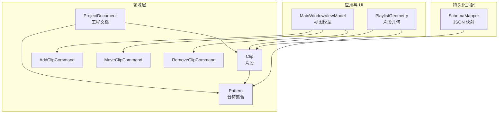
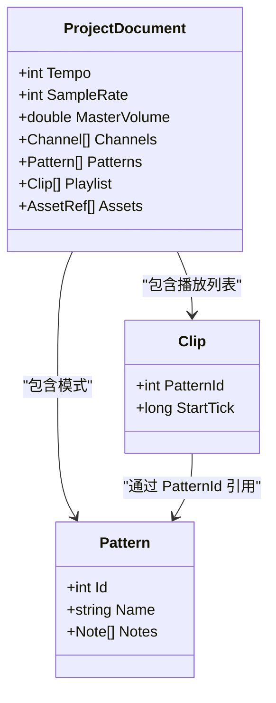
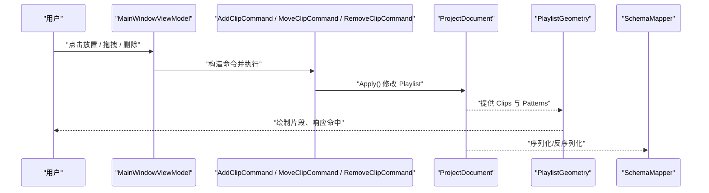
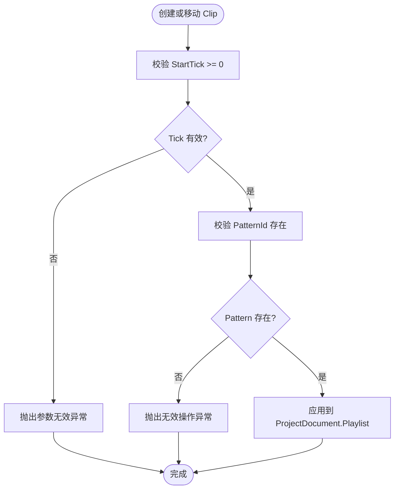
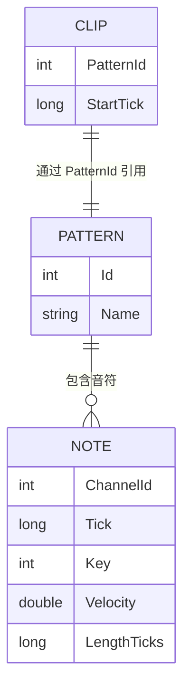
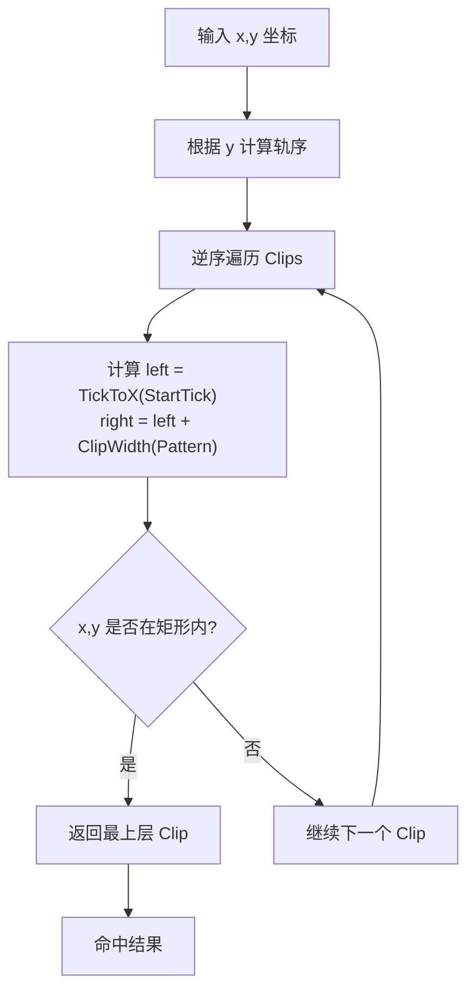
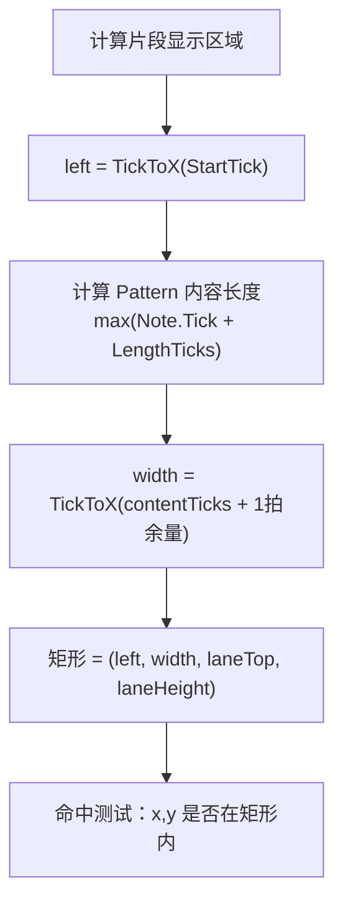
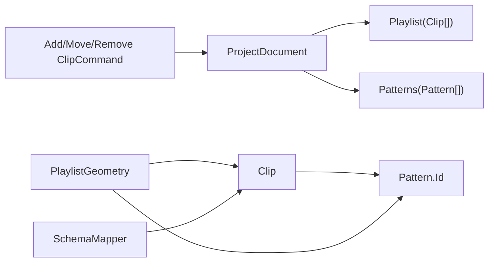

# Clip 播放列表片段

<cite>
**本文引用的文件**   
- [Clip.cs](file://src/Weftone.Domain/Clip.cs)
- [Pattern.cs](file://src/Weftone.Domain/Pattern.cs)
- [ProjectDocument.cs](file://src/Weftone.Domain/ProjectDocument.cs)
- [AddClipCommand.cs](file://src/Weftone.Domain/Commands/AddClipCommand.cs)
- [MoveClipCommand.cs](file://src/Weftone.Domain/Commands/MoveClipCommand.cs)
- [RemoveClipCommand.cs](file://src/Weftone.Domain/Commands/RemoveClipCommand.cs)
- [PlaylistGeometry.cs](file://src/Weftone.App/Controls/PlaylistGeometry.cs)
- [MainWindowViewModel.cs](file://src/Weftone.App/ViewModels/MainWindowViewModel.cs)
- [SchemaMapper.cs](file://src/Weftone.Adapters.ProjectStore/SchemaMapper.cs)
- [PlaylistGeometryTests.cs](file://tests/Weftone.App.Tests/PlaylistGeometryTests.cs)
- [ClipCommandTests.cs](file://tests/Weftone.Domain.Tests/ClipCommandTests.cs)
</cite>

## 目录
1. [引言](#引言)
2. [项目结构定位](#项目结构定位)
3. [核心数据模型](#核心数据模型)
4. [架构总览](#架构总览)
5. [详细组件分析](#详细组件分析)
6. [依赖关系分析](#依赖关系分析)
7. [性能与时间计算特性](#性能与时间计算特性)
8. [故障排查指南](#故障排查指南)
9. [结论](#结论)

## 引言
本文围绕 `Clip`（播放列表片段）建立完整的数据模型文档。`Clip` 表示一个 Pattern 在时间轴上的摆放位置，是工程文档中“播放列表”的基本单元。它通过引用 Pattern 的标识和起始 Tick 来参与多轨编排、用户交互、持久化以及后续渲染流程。本文重点说明：
- `Clip` 的属性含义、业务规则与约束条件。
- `Clip` 与 `Pattern` 的关联方式。
- 在播放列表中如何创建、移动、删除多个片段。
- 片段的时间计算、显示宽度、命中测试逻辑。
- 片段在编辑命令、视图几何、项目存储映射中的作用。

## 项目结构定位
`Clip` 属于领域层的核心实体，位于 `Weftone.Domain`；其编辑行为由领域命令封装；UI 侧通过几何工具进行显示与命中测试；项目持久化通过适配器将 `Clip` 映射为 JSON 字段。

**图表来源**
- [ProjectDocument.cs:7-19](file://src/Weftone.Domain/ProjectDocument.cs#L7-L19)
- [Clip.cs:3-8](file://src/Weftone.Domain/Clip.cs#L3-L8)
- [Pattern.cs:3-8](file://src/Weftone.Domain/Pattern.cs#L3-L8)
- [AddClipCommand.cs:3-31](file://src/Weftone.Domain/Commands/AddClipCommand.cs#L3-L31)
- [MoveClipCommand.cs:7-46](file://src/Weftone.Domain/Commands/MoveClipCommand.cs#L7-L46)
- [RemoveClipCommand.cs:3-21](file://src/Weftone.Domain/Commands/RemoveClipCommand.cs#L3-L21)
- [PlaylistGeometry.cs:17-90](file://src/Weftone.App/Controls/PlaylistGeometry.cs#L17-L90)
- [MainWindowViewModel.cs:354-396](file://src/Weftone.App/ViewModels/MainWindowViewModel.cs#L354-L396)
- [SchemaMapper.cs:52-56](file://src/Weftone.Adapters.ProjectStore/SchemaMapper.cs#L52-L56)

**章节来源**
- [ProjectDocument.cs:7-19](file://src/Weftone.Domain/ProjectDocument.cs#L7-L19)
- [Clip.cs:3-8](file://src/Weftone.Domain/Clip.cs#L3-L8)
- [Pattern.cs:3-8](file://src/Weftone.Domain/Pattern.cs#L3-L8)

## 核心数据模型
`Clip` 是一个不可变语义的轻量实体，用于描述“哪个 Pattern 从哪个 Tick 开始”。

| 属性 | 类型 | 含义 | 约束与规则 |
| --- | --- | --- | --- |
| `PatternId` | `int` | 被引用的 Pattern 标识 | 必须存在于工程文档的 Patterns 列表中；否则添加或移动操作会失败。 |
| `StartTick` | `long` | 片段在时间轴上的起始位置（Tick） | 不得为负数；在 UI 拖拽时会被钳制为非负值。 |

`Clip` 本身不包含持续时间；片段的视觉长度由其引用的 `Pattern` 的内容长度决定。Pattern 内容长度基于其中所有 Note 的结束位置计算，并至少保留一拍余量，从而形成 FL Studio 风格的“片段包住内容”的视觉效果。

**图表来源**
- [Clip.cs:3-8](file://src/Weftone.Domain/Clip.cs#L3-L8)
- [Pattern.cs:3-8](file://src/Weftone.Domain/Pattern.cs#L3-L8)
- [ProjectDocument.cs:7-19](file://src/Weftone.Domain/ProjectDocument.cs#L7-L19)

**章节来源**
- [Clip.cs:3-8](file://src/Weftone.Domain/Clip.cs#L3-L8)
- [Pattern.cs:3-8](file://src/Weftone.Domain/Pattern.cs#L3-L8)
- [ProjectDocument.cs:7-19](file://src/Weftone.Domain/ProjectDocument.cs#L7-L19)

## 架构总览
`Clip` 的生命周期贯穿以下阶段：
1. **创建**：用户在视图模型中放置片段，生成 `Clip` 并通过 `AddClipCommand` 加入工程文档。
2. **显示与交互**：`PlaylistGeometry` 根据 `StartTick` 和 Pattern 内容计算片段左边界与宽度，并进行命中测试。
3. **移动与调整**：通过 `MoveClipCommand` 同时修改 `StartTick` 与 `PatternId`，支持跨轨拖拽。
4. **删除**：通过 `RemoveClipCommand` 从播放列表中移除。
5. **持久化**：`SchemaMapper` 将 `Clip` 序列化为 JSON，并在反序列化时校验 Pattern 引用与 Tick 范围。

**图表来源**
- [MainWindowViewModel.cs:354-396](file://src/Weftone.App/ViewModels/MainWindowViewModel.cs#L354-L396)
- [AddClipCommand.cs:9-30](file://src/Weftone.Domain/Commands/AddClipCommand.cs#L9-L30)
- [MoveClipCommand.cs:17-45](file://src/Weftone.Domain/Commands/MoveClipCommand.cs#L17-L45)
- [RemoveClipCommand.cs:9-20](file://src/Weftone.Domain/Commands/RemoveClipCommand.cs#L9-L20)
- [PlaylistGeometry.cs:21-50](file://src/Weftone.App/Controls/PlaylistGeometry.cs#L21-L50)
- [SchemaMapper.cs:91-94](file://src/Weftone.Adapters.ProjectStore/SchemaMapper.cs#L91-L94)

## 详细组件分析

### Clip 数据模型与业务规则
- `Clip` 仅持有 `PatternId` 与 `StartTick`，不直接持有 Pattern 对象，避免循环依赖并保持数据简洁。
- 业务规则：
  - `StartTick` 必须非负。
  - `PatternId` 必须存在于 `ProjectDocument.Patterns` 中。
  - 同一 `Clip` 实例不能重复添加到播放列表。
  - 移动操作需保证目标 Pattern 存在且目标 Tick 非负。

这些规则由命令层与持久化层共同保障：
- `AddClipCommand` 在 Apply 前验证 Pattern 是否存在，并检查 Clip 是否已存在。
- `MoveClipCommand` 在 Apply 前验证目标 Tick 与目标 Pattern。
- `SchemaMapper` 在反序列化时校验 Pattern 引用与 Tick 范围。

**图表来源**
- [AddClipCommand.cs:9-30](file://src/Weftone.Domain/Commands/AddClipCommand.cs#L9-L30)
- [MoveClipCommand.cs:17-29](file://src/Weftone.Domain/Commands/MoveClipCommand.cs#L17-L29)
- [SchemaMapper.cs:166-170](file://src/Weftone.Adapters.ProjectStore/SchemaMapper.cs#L166-L170)

**章节来源**
- [AddClipCommand.cs:9-30](file://src/Weftone.Domain/Commands/AddClipCommand.cs#L9-L30)
- [MoveClipCommand.cs:17-29](file://src/Weftone.Domain/Commands/MoveClipCommand.cs#L17-L29)
- [SchemaMapper.cs:166-170](file://src/Weftone.Adapters.ProjectStore/SchemaMapper.cs#L166-L170)

### Clip 与 Pattern 的关联关系
- `Clip` 通过 `PatternId` 间接引用 `Pattern`。
- `Pattern` 拥有 `Notes` 列表，用于计算片段内容长度。
- 播放列表中的每个轨道对应一个 Pattern，轨序等于 `Patterns` 列表顺序。
- 当 `PatternId` 不存在时，几何层会跳过该片段，命令层会拒绝操作。

**图表来源**
- [Clip.cs:3-8](file://src/Weftone.Domain/Clip.cs#L3-L8)
- [Pattern.cs:3-8](file://src/Weftone.Domain/Pattern.cs#L3-L8)

**章节来源**
- [Clip.cs:3-8](file://src/Weftone.Domain/Clip.cs#L3-L8)
- [Pattern.cs:3-8](file://src/Weftone.Domain/Pattern.cs#L3-L8)

### 播放列表中的片段编排
- 播放列表是 `ProjectDocument.Playlist`，按插入顺序维护片段。
- 几何层使用“后画在上层”的策略：命中测试逆序遍历 clips，优先返回最上层片段。
- 每个片段占据一轨（Lane），轨高固定，纵坐标决定所在轨。
- 横坐标由 `StartTick` 映射到像素，宽度由 Pattern 内容长度决定。

**图表来源**
- [PlaylistGeometry.cs:29-50](file://src/Weftone.App/Controls/PlaylistGeometry.cs#L29-L50)

**章节来源**
- [PlaylistGeometry.cs:29-50](file://src/Weftone.App/Controls/PlaylistGeometry.cs#L29-L50)

### 片段的创建、定位与管理代码示例路径
以下为常见操作的参考路径（不展示具体代码内容）：
- 在视图中放置片段：[MainWindowViewModel.AddClipAt:354-361](file://src/Weftone.App/ViewModels/MainWindowViewModel.cs#L354-L361)
- 删除片段：[MainWindowViewModel.RemoveClip:363-367](file://src/Weftone.App/ViewModels/MainWindowViewModel.cs#L363-L367)
- 开始拖拽片段：[MainWindowViewModel.BeginMoveClip:369-375](file://src/Weftone.App/ViewModels/MainWindowViewModel.cs#L369-L375)
- 拖拽过程中更新片段位置：[MainWindowViewModel.DragClip:377-385](file://src/Weftone.App/ViewModels/MainWindowViewModel.cs#L377-L385)
- 结束拖拽事务：[MainWindowViewModel.EndClipGesture:387-396](file://src/Weftone.App/ViewModels/MainWindowViewModel.cs#L387-L396)
- 添加片段命令：[AddClipCommand.Apply:9-17](file://src/Weftone.Domain/Commands/AddClipCommand.cs#L9-L17)
- 移动片段命令：[MoveClipCommand.Apply:17-29](file://src/Weftone.Domain/Commands/MoveClipCommand.cs#L17-L29)
- 删除片段命令：[RemoveClipCommand.Apply:9-15](file://src/Weftone.Domain/Commands/RemoveClipCommand.cs#L9-L15)
- 片段几何宽度与命中测试：[PlaylistGeometry.ClipWidth / HitTest:21-50](file://src/Weftone.App/Controls/PlaylistGeometry.cs#L21-L50)
- 项目存储映射：[SchemaMapper.ToDomain 对 playlist 的处理:166-170](file://src/Weftone.Adapters.ProjectStore/SchemaMapper.cs#L166-L170)

**章节来源**
- [MainWindowViewModel.cs:354-396](file://src/Weftone.App/ViewModels/MainWindowViewModel.cs#L354-L396)
- [AddClipCommand.cs:9-17](file://src/Weftone.Domain/Commands/AddClipCommand.cs#L9-L17)
- [MoveClipCommand.cs:17-29](file://src/Weftone.Domain/Commands/MoveClipCommand.cs#L17-L29)
- [RemoveClipCommand.cs:9-15](file://src/Weftone.Domain/Commands/RemoveClipCommand.cs#L9-L15)
- [PlaylistGeometry.cs:21-50](file://src/Weftone.App/Controls/PlaylistGeometry.cs#L21-L50)
- [SchemaMapper.cs:166-170](file://src/Weftone.Adapters.ProjectStore/SchemaMapper.cs#L166-L170)

### 片段的时间计算与显示宽度
- 片段左边界：`ClipLeft(clip)` 将 `StartTick` 转换为像素横坐标。
- 片段宽度：`ClipWidth(pattern)` 基于 Pattern 内容长度计算，内容为所有 Note 的最大结束 Tick，并至少保留一拍余量。
- 轨顶坐标：`LaneTop(laneIndex)` 根据轨索引计算纵坐标。
- 命中测试：判断鼠标坐标是否落在某个片段的矩形区域内，并返回最上层片段。

**图表来源**
- [PlaylistGeometry.cs:21-27](file://src/Weftone.App/Controls/PlaylistGeometry.cs#L21-L27)
- [PlaylistGeometry.cs:81-89](file://src/Weftone.App/Controls/PlaylistGeometry.cs#L81-L89)

**章节来源**
- [PlaylistGeometry.cs:21-27](file://src/Weftone.App/Controls/PlaylistGeometry.cs#L21-L27)
- [PlaylistGeometry.cs:81-89](file://src/Weftone.App/Controls/PlaylistGeometry.cs#L81-L89)

## 依赖关系分析
- `Clip` 依赖 `Pattern.Id` 作为外键式引用，但不直接持有 Pattern 对象。
- `ProjectDocument` 聚合 `Playlist`、`Patterns`、`Channels`、`Assets`，是编辑与持久化的根对象。
- 命令层对 `Clip` 的增删改都通过 `ProjectDocument` 暴露的集合进行操作。
- UI 几何层依赖 `PianoRollGeometry` 的 Tick 到像素映射，确保横轴一致。
- 持久化层通过 `SchemaMapper` 将 `Clip` 映射为 JSON 字段，并在加载时校验引用完整性。

**图表来源**
- [ProjectDocument.cs:7-19](file://src/Weftone.Domain/ProjectDocument.cs#L7-L19)
- [AddClipCommand.cs:9-30](file://src/Weftone.Domain/Commands/AddClipCommand.cs#L9-L30)
- [MoveClipCommand.cs:17-45](file://src/Weftone.Domain/Commands/MoveClipCommand.cs#L17-L45)
- [RemoveClipCommand.cs:9-20](file://src/Weftone.Domain/Commands/RemoveClipCommand.cs#L9-L20)
- [PlaylistGeometry.cs:21-50](file://src/Weftone.App/Controls/PlaylistGeometry.cs#L21-L50)
- [SchemaMapper.cs:91-94](file://src/Weftone.Adapters.ProjectStore/SchemaMapper.cs#L91-L94)

**章节来源**
- [ProjectDocument.cs:7-19](file://src/Weftone.Domain/ProjectDocument.cs#L7-L19)
- [PlaylistGeometry.cs:21-50](file://src/Weftone.App/Controls/PlaylistGeometry.cs#L21-L50)
- [SchemaMapper.cs:91-94](file://src/Weftone.Adapters.ProjectStore/SchemaMapper.cs#L91-L94)

## 性能与时间计算特性
- `Clip` 结构简单，无复杂算法，时间复杂度主要取决于播放列表与 Pattern 列表的线性查找。
- 命中测试逆序遍历 clips，适合少量片段场景；若未来片段数量增长，可考虑空间索引或区间树优化。
- Pattern 内容长度计算需要遍历 Notes，复杂度为 O(n)，n 为音符数量；对于大型 Pattern，可在 Pattern 上缓存内容长度以减少重复计算。
- Tick 到像素转换复用 `PianoRollGeometry`，保证 UI 一致性，避免重复实现。

[本节为通用性能讨论，不直接分析具体文件]

## 故障排查指南
常见问题与定位建议：
- **添加片段时报“pattern 不存在”**：检查 `PatternId` 是否在 `ProjectDocument.Patterns` 中。参考：[AddClipCommand.ValidatePattern:24-30](file://src/Weftone.Domain/Commands/AddClipCommand.cs#L24-L30)。
- **移动片段时报“pattern 不存在”或“tick 越界”**：检查目标 `toTick` 是否非负，目标 `toPatternId` 是否存在。参考：[MoveClipCommand.Apply:17-29](file://src/Weftone.Domain/Commands/MoveClipCommand.cs#L17-L29)。
- **删除片段时报“clip 不存在”**：确认 clip 实例仍在 `ProjectDocument.Playlist` 中。参考：[RemoveClipCommand.Apply:9-15](file://src/Weftone.Domain/Commands/RemoveClipCommand.cs#L9-L15)。
- **片段无法被点击命中**：检查命中测试的矩形计算是否正确，尤其是 `ClipWidth` 与 `LaneTop`。参考：[PlaylistGeometry.HitTest:29-50](file://src/Weftone.App/Controls/PlaylistGeometry.cs#L29-L50)。
- **项目加载失败**：检查 JSON 中 `playlist` 的 `patternId` 与 `startTick` 是否符合约束。参考：[SchemaMapper.ToDomain:166-170](file://src/Weftone.Adapters.ProjectStore/SchemaMapper.cs#L166-L170)。

**章节来源**
- [AddClipCommand.cs:24-30](file://src/Weftone.Domain/Commands/AddClipCommand.cs#L24-L30)
- [MoveClipCommand.cs:17-29](file://src/Weftone.Domain/Commands/MoveClipCommand.cs#L17-L29)
- [RemoveClipCommand.cs:9-15](file://src/Weftone.Domain/Commands/RemoveClipCommand.cs#L9-L15)
- [PlaylistGeometry.cs:29-50](file://src/Weftone.App/Controls/PlaylistGeometry.cs#L29-L50)
- [SchemaMapper.cs:166-170](file://src/Weftone.Adapters.ProjectStore/SchemaMapper.cs#L166-L170)

## 结论
`Clip` 是播放列表的最小编排单元，通过 `PatternId` 与 `StartTick` 将 Pattern 放置在时间轴上。其设计保持简洁，职责明确：
- 数据模型简单，便于编辑、持久化与测试。
- 业务规则由命令层与持久化层共同保障，确保引用完整性与时间有效性。
- UI 几何层负责将 Tick 与像素映射，并处理片段显示与命中。
- 在多轨编排中，每个轨道对应一个 Pattern，片段按插入顺序排列，命中测试优先返回最上层片段。

在实际使用中，应始终遵循以下最佳实践：
- 创建或移动片段前，确保 Pattern 存在且 Tick 非负。
- 使用命令层进行状态变更，避免直接绕过校验。
- 在 UI 层使用 `PlaylistGeometry` 进行显示与命中测试，保持一致性。
- 在项目加载时依赖 `SchemaMapper` 的校验机制，及时发现非法数据。

[本节为总结性内容，不直接分析具体文件]