# Note 音符模型

<cite>
**本文引用的文件**   
- [Note.cs](file://src/Weftone.Domain/Note.cs)
- [Pattern.cs](file://src/Weftone.Domain/Pattern.cs)
- [TimeBase.cs](file://src/Weftone.Domain/TimeBase.cs)
- [AddNoteCommand.cs](file://src/Weftone.Domain/Commands/AddNoteCommand.cs)
- [RemoveNoteCommand.cs](file://src/Weftone.Domain/Commands/RemoveNoteCommand.cs)
- [MoveNoteCommand.cs](file://src/Weftone.Domain/Commands/MoveNoteCommand.cs)
- [ResizeNoteCommand.cs](file://src/Weftone.Domain/Commands/ResizeNoteCommand.cs)
- [PianoRollControl.cs](file://src/Weftone.App/Controls/PianoRollControl.cs)
- [PianoRollGeometry.cs](file://src/Weftone.App/Controls/PianoRollGeometry.cs)
- [DocumentCompiler.cs](file://src/Weftone.Application/DocumentCompiler.cs)
- [SineEngine.cs](file://src/Weftone.Engine/SineEngine.cs)
- [PlanRenderer.cs](file://src/Weftone.Engine/PlanRenderer.cs)
</cite>

## 目录
1. [引言](#引言)
2. [项目结构中的音符位置](#项目结构中的音符位置)
3. [核心数据模型：Note](#核心数据模型note)
4. [音符与频率、节拍和音频合成的关系](#音符与频率节拍和音频合成的关系)
5. [音符的创建、编辑和删除流程](#音符的创建编辑和删除流程)
6. [钢琴卷帘与 MIDI 映射中的作用](#钢琴卷帘与-midi-映射中的作用)
7. [业务规则与约束条件](#业务规则与约束条件)
8. [架构总览](#架构总览)
9. [依赖关系分析](#依赖关系分析)
10. [性能与实时性考虑](#性能与实时性考虑)
11. [故障排查指南](#故障排查指南)
12. [结论](#结论)

## 引言
Note 是 Weftone 音乐工程中的最小可播放单位。它描述一个音在时间轴上的位置、音高、力度和持续时间，并作为从用户界面到音频合成引擎的桥梁。通过 Note，用户可以像操作钢琴键一样在钢琴卷帘中绘制音符；系统随后将音符转换为频率、增益、采样时长等音频参数，最终由渲染器或回放服务驱动声音输出。

## 项目结构中的音符位置
Note 属于领域层实体，被模式 Pattern 持有，并通过命令对象进行增删改，再由应用层的文档编译器转换为音频渲染计划，最终进入引擎层的声部渲染管线。

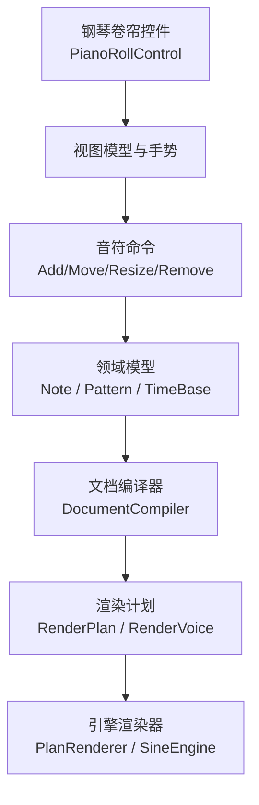

**图表来源**
- [PianoRollControl.cs:10-14](file://src/Weftone.App/Controls/PianoRollControl.cs#L10-L14)
- [AddNoteCommand.cs:3-18](file://src/Weftone.Domain/Commands/AddNoteCommand.cs#L3-L18)
- [Note.cs:3-11](file://src/Weftone.Domain/Note.cs#L3-L11)
- [DocumentCompiler.cs:98-129](file://src/Weftone.Application/DocumentCompiler.cs#L98-L129)
- [PlanRenderer.cs:139-176](file://src/Weftone.Engine/PlanRenderer.cs#L139-L176)

**章节来源**
- [Note.cs:3-11](file://src/Weftone.Domain/Note.cs#L3-L11)
- [Pattern.cs:3-8](file://src/Weftone.Domain/Pattern.cs#L3-L8)
- [TimeBase.cs:3-7](file://src/Weftone.Domain/TimeBase.cs#L3-L7)

## 核心数据模型：Note
Note 是一个不可变语义较强的领域实体，用于表达一个音符的基本属性：

| 字段 | 类型 | 默认值 | 含义 | 约束与说明 |
|---|---:|---:|---|---|
| ChannelId | int | 无默认值 | 所属通道编号 | 必须对应工程中已存在的 Channel；编译时根据 ChannelId 查找通道 |
| Tick | long | 无默认值 | 音符起始拍位 | 以 PPQ=96 的整数 tick 表示；与钢琴卷帘横轴线性映射 |
| Key | int | 60 | 音符键号 | 注释约定为 0..127；MIDI 标准中 60 通常对应 C4 |
| Velocity | double | 1.0 | 力度 | 注释约定为 0..1；影响音量增益，也影响钢琴卷帘颜色 |
| LengthTicks | long | TimeBase.Ppq | 音符持续长度（tick） | 至少为 1 tick；调整长度命令强制校验 |

Note 本身不直接保存频率或采样数，而是由编译器根据 Key、Velocity、Channel、Tick、LengthTicks 以及工程 Tempo、SampleRate 计算音频参数。

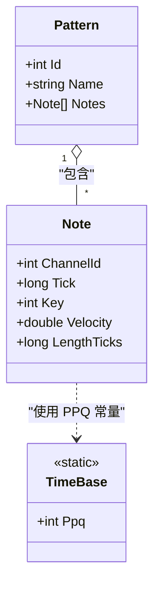

**图表来源**
- [Note.cs:3-11](file://src/Weftone.Domain/Note.cs#L3-L11)
- [Pattern.cs:3-8](file://src/Weftone.Domain/Pattern.cs#L3-L8)
- [TimeBase.cs:3-7](file://src/Weftone.Domain/TimeBase.cs#L3-L7)

**章节来源**
- [Note.cs:3-11](file://src/Weftone.Domain/Note.cs#L3-L11)
- [Pattern.cs:3-8](file://src/Weftone.Domain/Pattern.cs#L3-L8)
- [TimeBase.cs:3-7](file://src/Weftone.Domain/TimeBase.cs#L3-L7)

## 音符与频率、节拍和音频合成的关系
### 节拍与时间单位
- 系统使用整数 tick 表示时间，PPQ=96，即每拍 96 tick。
- 小节长度为 4 拍，因此一个小节等于 4 × 96 = 384 tick。
- 钢琴卷帘的横轴按 TickToX 线性映射到像素坐标，纵轴按 KeyToY 映射到 MIDI 键号。

### 音高与频率
- 对于正弦波声部，Key 通过 A4=440Hz 的半音偏移公式换算为频率。
- 对于采样声部，Key 相对于基准键 60 决定播放速率，从而改变音高。

### 力度与音量
- Velocity 与通道 Volume 相乘得到增益，再结合 PanLaw 分配到左右声道。
- 在钢琴卷帘中，Velocity 还用于可视化：低力度偏蓝，高力度偏橙。

### 长度与采样数
- LengthTicks 通过 TickMath 转换为 SamplesPerTick，再乘以 LengthTicks 得到 LengthSamples。
- 渲染器根据 StartSample、LengthSamples 控制音符何时开始、持续多久。

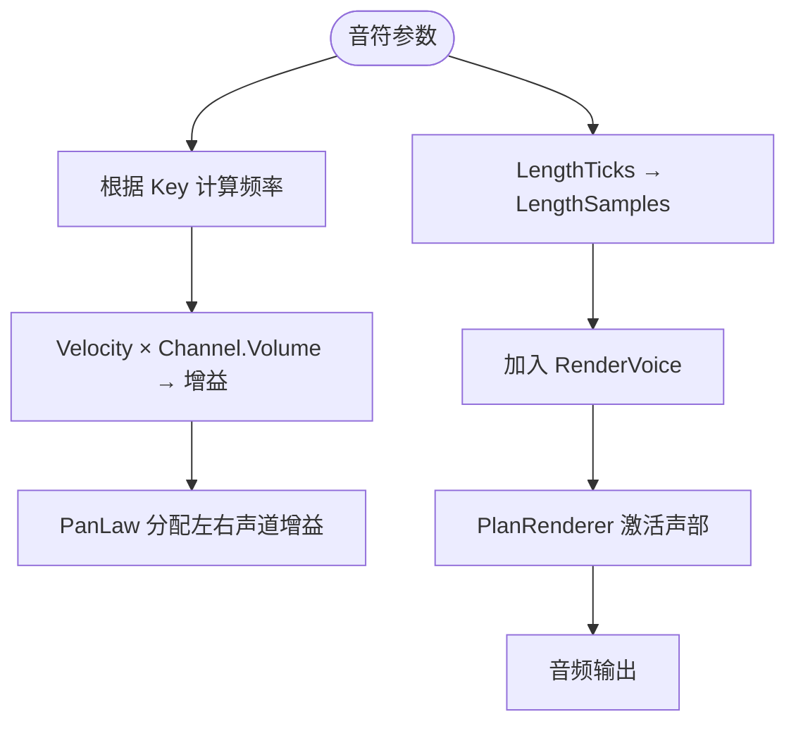

**图表来源**
- [DocumentCompiler.cs:102-127](file://src/Weftone.Application/DocumentCompiler.cs#L102-L127)
- [PlanRenderer.cs:158-176](file://src/Weftone.Engine/PlanRenderer.cs#L158-L176)
- [PianoRollControl.cs:141-151](file://src/Weftone.App/Controls/PianoRollControl.cs#L141-L151)

**章节来源**
- [TimeBase.cs:3-7](file://src/Weftone.Domain/TimeBase.cs#L3-L7)
- [DocumentCompiler.cs:102-127](file://src/Weftone.Application/DocumentCompiler.cs#L102-L127)
- [PianoRollControl.cs:141-164](file://src/Weftone.App/Controls/PianoRollControl.cs#L141-L164)

## 音符的创建、编辑和删除流程
### 创建音符
用户在钢琴卷帘空白区域按下左键，系统记录目标 Tick 和 Key，调用视图模型开始添加音符。若当前工程存在可用通道，则生成一个 Note 并加入 Pattern.Notes。

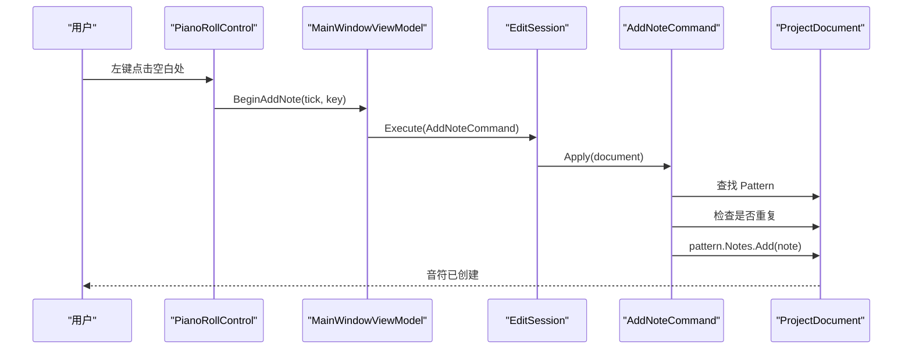

**图表来源**
- [PianoRollControl.cs:213-237](file://src/Weftone.App/Controls/PianoRollControl.cs#L213-L237)
- [AddNoteCommand.cs:10-18](file://src/Weftone.Domain/Commands/AddNoteCommand.cs#L10-L18)

### 移动音符
拖拽音符主体时，系统记录起点 Tick 和 Key，并在拖动过程中更新目标 Tick 和 Key。最终通过 MoveNoteCommand 提交撤销事务。

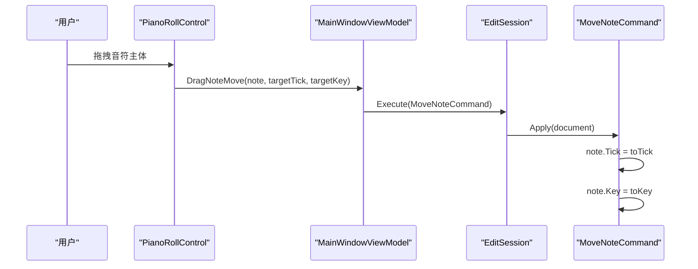

**图表来源**
- [PianoRollControl.cs:224-229](file://src/Weftone.App/Controls/PianoRollControl.cs#L224-L229)
- [MoveNoteCommand.cs:18-22](file://src/Weftone.Domain/Commands/MoveNoteCommand.cs#L18-L22)

### 调整音符长度
拖拽音符右边缘时，系统计算新的结束 Tick，并转换为 LengthTicks。ResizeNoteCommand 会校验长度至少为 1 tick。

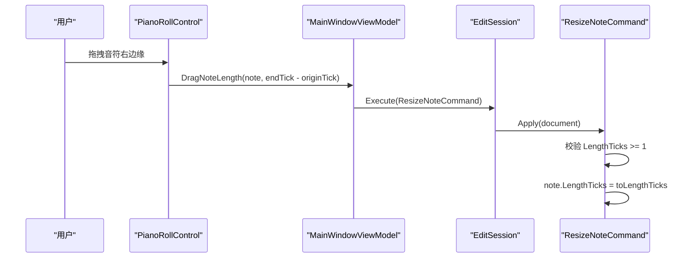

**图表来源**
- [PianoRollControl.cs:265-269](file://src/Weftone.App/Controls/PianoRollControl.cs#L265-L269)
- [ResizeNoteCommand.cs:16-23](file://src/Weftone.Domain/Commands/ResizeNoteCommand.cs#L16-L23)

### 删除音符
右键点击音符时，系统调用 RemoveNoteCommand 从 Pattern.Notes 移除该音符。

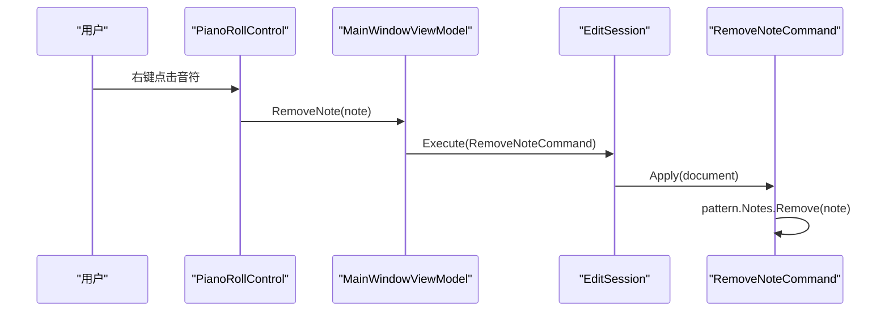

**图表来源**
- [PianoRollControl.cs:198-206](file://src/Weftone.App/Controls/PianoRollControl.cs#L198-L206)
- [RemoveNoteCommand.cs:10-16](file://src/Weftone.Domain/Commands/RemoveNoteCommand.cs#L10-L16)

**章节来源**
- [PianoRollControl.cs:185-291](file://src/Weftone.App/Controls/PianoRollControl.cs#L185-L291)
- [AddNoteCommand.cs:3-30](file://src/Weftone.Domain/Commands/AddNoteCommand.cs#L3-L30)
- [MoveNoteCommand.cs:3-40](file://src/Weftone.Domain/Commands/MoveNoteCommand.cs#L3-L40)
- [ResizeNoteCommand.cs:3-41](file://src/Weftone.Domain/Commands/ResizeNoteCommand.cs#L3-L41)
- [RemoveNoteCommand.cs:3-29](file://src/Weftone.Domain/Commands/RemoveNoteCommand.cs#L3-L29)

## 钢琴卷帘与 MIDI 映射中的作用
钢琴卷帘是 Note 的主要交互界面。它将用户的鼠标事件映射为音符的 Tick 和 Key，并通过几何工具类完成像素与音乐单位的转换。

- 横轴：Tick ↔ Pixel，使用 PixelsPerBeat 和 TimeBase.Ppq 进行线性映射。
- 纵轴：Key ↔ Pixel，Key 范围 0..127，127 在顶部。
- 吸附：默认吸附步长为 1/4 拍，即 SnapTicks = TimeBase.Ppq / 4。
- 命中检测：区分音符主体、右边缘和空白区域，分别触发添加、调整长度、移动或删除。

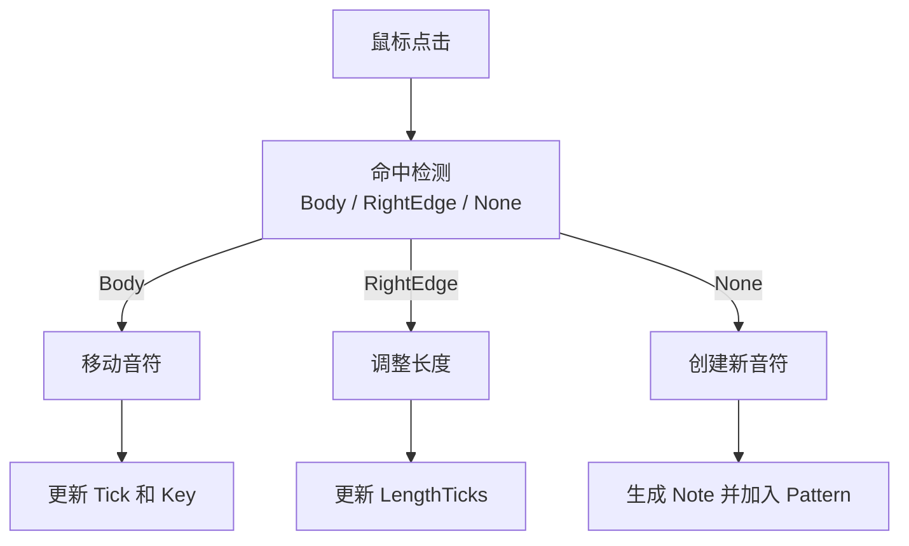

**图表来源**
- [PianoRollGeometry.cs:5-12](file://src/Weftone.App/Controls/PianoRollGeometry.cs#L5-L12)
- [PianoRollGeometry.cs:18-42](file://src/Weftone.App/Controls/PianoRollGeometry.cs#L18-L42)
- [PianoRollControl.cs:196-237](file://src/Weftone.App/Controls/PianoRollControl.cs#L196-L237)

**章节来源**
- [PianoRollGeometry.cs:5-42](file://src/Weftone.App/Controls/PianoRollGeometry.cs#L5-L42)
- [PianoRollControl.cs:104-157](file://src/Weftone.App/Controls/PianoRollControl.cs#L104-L157)
- [PianoRollControl.cs:185-291](file://src/Weftone.App/Controls/PianoRollControl.cs#L185-L291)

## 业务规则与约束条件
### 基本约束
- Tick 使用整数拍位，单位为 PPQ=96。
- Key 注释约定为 0..127，默认值为 60。
- Velocity 注释约定为 0..1，默认值为 1.0。
- LengthTicks 默认为一个拍，且调整时必须大于等于 1。

### 唯一性与存在性
- 添加音符前需检查 Pattern 中是否已存在相同 Note 实例；若存在则抛出异常。
- 删除音符前需确认音符存在于 Pattern；不存在则抛出异常。
- 所有命令都通过 Pattern.Id 查找 Pattern；若 Pattern 不存在则抛出异常。

### 通道与资产
- Note.ChannelId 必须对应工程中的 Channel；否则编译时会找不到通道。
- Sampler 通道需要已准备的 Asset；缺少资产会导致编译异常。

### 时间与循环
- Pattern 循环长度按最大音符结束 Tick 向上取整到小节，至少 1 小节。
- 播放服务根据 RenderPlan 的 LoopStartSample 和 LoopEndSample 判断是否循环。

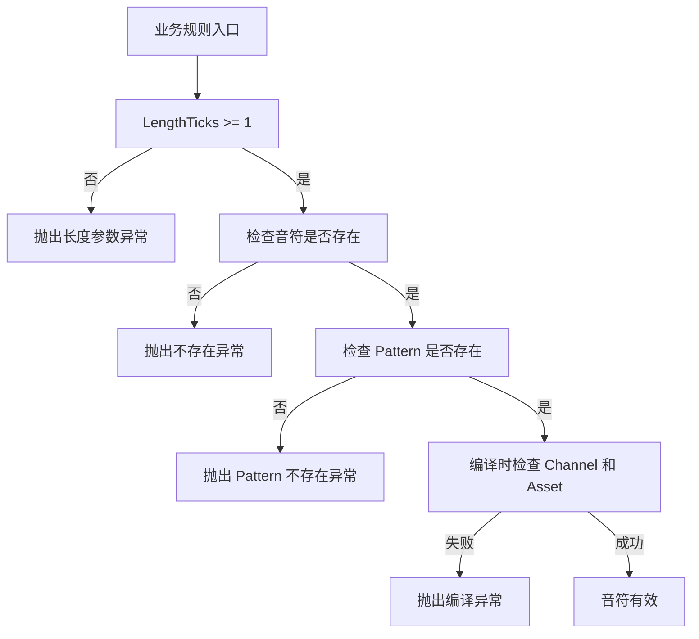

**图表来源**
- [ResizeNoteCommand.cs:16-23](file://src/Weftone.Domain/Commands/ResizeNoteCommand.cs#L16-L23)
- [AddNoteCommand.cs:10-18](file://src/Weftone.Domain/Commands/AddNoteCommand.cs#L10-L18)
- [RemoveNoteCommand.cs:10-16](file://src/Weftone.Domain/Commands/RemoveNoteCommand.cs#L10-L16)
- [DocumentCompiler.cs:102-127](file://src/Weftone.Application/DocumentCompiler.cs#L102-L127)

**章节来源**
- [Note.cs:3-11](file://src/Weftone.Domain/Note.cs#L3-L11)
- [AddNoteCommand.cs:10-29](file://src/Weftone.Domain/Commands/AddNoteCommand.cs#L10-L29)
- [RemoveNoteCommand.cs:10-27](file://src/Weftone.Domain/Commands/RemoveNoteCommand.cs#L10-L27)
- [MoveNoteCommand.cs:18-39](file://src/Weftone.Domain/Commands/MoveNoteCommand.cs#L18-L39)
- [ResizeNoteCommand.cs:16-39](file://src/Weftone.Domain/Commands/ResizeNoteCommand.cs#L16-L39)
- [DocumentCompiler.cs:51-76](file://src/Weftone.Application/DocumentCompiler.cs#L51-L76)

## 架构总览
Note 的生命周期贯穿 UI、领域、应用和引擎四层：

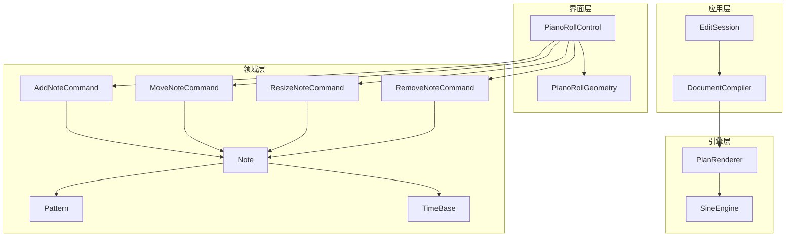

**图表来源**
- [PianoRollControl.cs:10-14](file://src/Weftone.App/Controls/PianoRollControl.cs#L10-L14)
- [PianoRollGeometry.cs:18-42](file://src/Weftone.App/Controls/PianoRollGeometry.cs#L18-L42)
- [Note.cs:3-11](file://src/Weftone.Domain/Note.cs#L3-L11)
- [Pattern.cs:3-8](file://src/Weftone.Domain/Pattern.cs#L3-L8)
- [TimeBase.cs:3-7](file://src/Weftone.Domain/TimeBase.cs#L3-L7)
- [AddNoteCommand.cs:3-30](file://src/Weftone.Domain/Commands/AddNoteCommand.cs#L3-L30)
- [MoveNoteCommand.cs:3-40](file://src/Weftone.Domain/Commands/MoveNoteCommand.cs#L3-L40)
- [ResizeNoteCommand.cs:3-41](file://src/Weftone.Domain/Commands/ResizeNoteCommand.cs#L3-L41)
- [RemoveNoteCommand.cs:3-29](file://src/Weftone.Domain/Commands/RemoveNoteCommand.cs#L3-L29)
- [DocumentCompiler.cs:11-159](file://src/Weftone.Application/DocumentCompiler.cs#L11-L159)
- [PlanRenderer.cs:139-176](file://src/Weftone.Engine/PlanRenderer.cs#L139-L176)
- [SineEngine.cs:5-39](file://src/Weftone.Engine/SineEngine.cs#L5-L39)

## 依赖关系分析
- PianoRollControl 依赖 PianoRollGeometry 进行命中检测和坐标转换。
- 命令类依赖 Pattern 和 ProjectDocument 进行状态变更。
- DocumentCompiler 依赖 Note、Pattern、Channel、TimeBase 和 TickMath 生成 RenderPlan。
- PlanRenderer 依赖 RenderVoice 和 SineEngine 进行实时渲染。

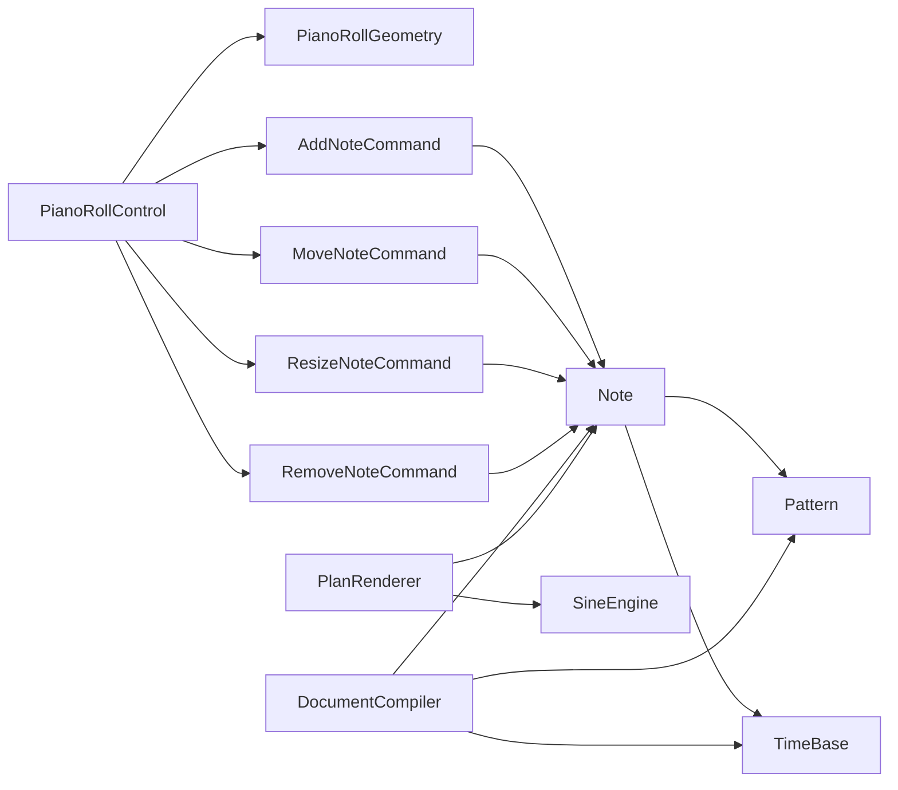

**图表来源**
- [PianoRollControl.cs:185-291](file://src/Weftone.App/Controls/PianoRollControl.cs#L185-L291)
- [PianoRollGeometry.cs:18-42](file://src/Weftone.App/Controls/PianoRollGeometry.cs#L18-L42)
- [AddNoteCommand.cs:3-30](file://src/Weftone.Domain/Commands/AddNoteCommand.cs#L3-L30)
- [MoveNoteCommand.cs:3-40](file://src/Weftone.Domain/Commands/MoveNoteCommand.cs#L3-L40)
- [ResizeNoteCommand.cs:3-41](file://src/Weftone.Domain/Commands/ResizeNoteCommand.cs#L3-L41)
- [RemoveNoteCommand.cs:3-29](file://src/Weftone.Domain/Commands/RemoveNoteCommand.cs#L3-L29)
- [DocumentCompiler.cs:98-129](file://src/Weftone.Application/DocumentCompiler.cs#L98-L129)
- [PlanRenderer.cs:139-176](file://src/Weftone.Engine/PlanRenderer.cs#L139-L176)
- [SineEngine.cs:5-39](file://src/Weftone.Engine/SineEngine.cs#L5-L39)

**章节来源**
- [PianoRollControl.cs:185-291](file://src/Weftone.App/Controls/PianoRollControl.cs#L185-L291)
- [DocumentCompiler.cs:98-159](file://src/Weftone.Application/DocumentCompiler.cs#L98-L159)
- [PlanRenderer.cs:139-176](file://src/Weftone.Engine/PlanRenderer.cs#L139-L176)

## 性能与实时性考虑
- 钢琴卷帘只渲染可见范围内的音符，避免大规模重绘。
- 音符长度和位置变化通过命令合并为撤销事务，减少撤销栈膨胀。
- 文档编译器在非实时线程执行，全量生成 RenderPlan；回放服务负责实时渲染。
- PlanRenderer 对声部池满时使用淡出偷取策略，避免丢帧。

[本节为通用性能讨论，不直接分析具体文件]

## 故障排查指南
### 常见异常及原因
- “音符已存在于 pattern”：尝试添加重复 Note 实例。
- “pattern 不存在”：命令使用的 PatternId 无效。
- “音符不存在”：删除或移动时目标 Note 不在 Pattern 中。
- “长度至少 1 tick”：调整长度小于 1。
- “sampler channel 缺少已准备的资产”：采样通道未正确准备资源。

### 排查步骤
1. 确认 PatternId 是否正确。
2. 确认 Note 是否已被添加到 Pattern.Notes。
3. 确认 LengthTicks 是否大于等于 1。
4. 确认 ChannelId 对应的 Channel 是否存在。
5. 确认 Sampler 通道的 Asset 是否已准备。

**章节来源**
- [AddNoteCommand.cs:10-29](file://src/Weftone.Domain/Commands/AddNoteCommand.cs#L10-L29)
- [RemoveNoteCommand.cs:10-27](file://src/Weftone.Domain/Commands/RemoveNoteCommand.cs#L10-L27)
- [MoveNoteCommand.cs:18-39](file://src/Weftone.Domain/Commands/MoveNoteCommand.cs#L18-L39)
- [ResizeNoteCommand.cs:16-39](file://src/Weftone.Domain/Commands/ResizeNoteCommand.cs#L16-L39)
- [DocumentCompiler.cs:108-117](file://src/Weftone.Application/DocumentCompiler.cs#L108-L117)

## 结论
Note 是 Weftone 音乐工程的核心数据单元，承载音高、时间、力度和长度等关键信息。它在钢琴卷帘中与用户交互，在领域层中被命令修改，在应用层中被编译器转换为音频渲染计划，在引擎层中被渲染器驱动为真实声音。理解 Note 的属性、约束以及与频率、节拍、合成参数的关系，有助于正确使用、扩展和调试整个音频工作流。