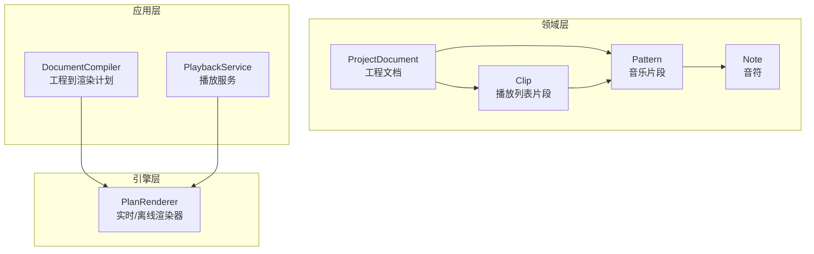
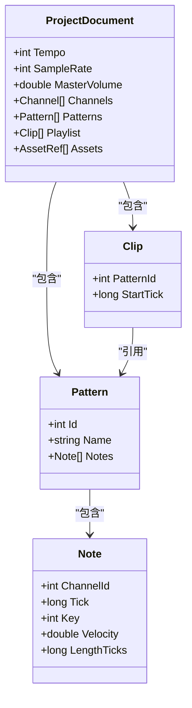
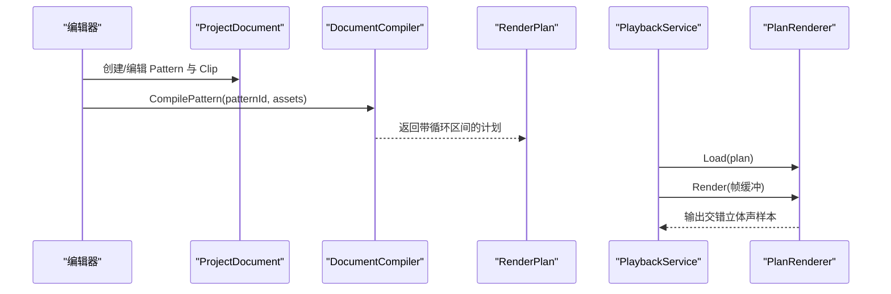
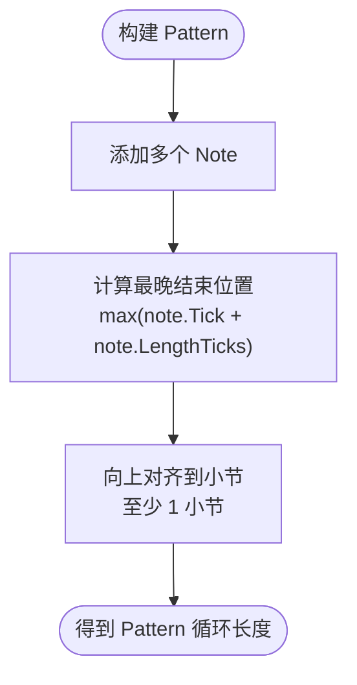
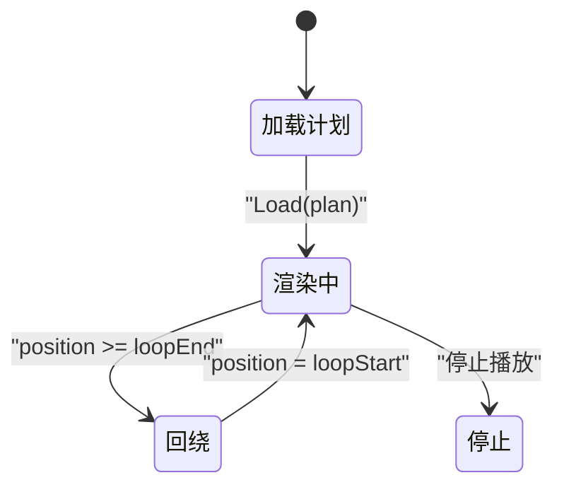
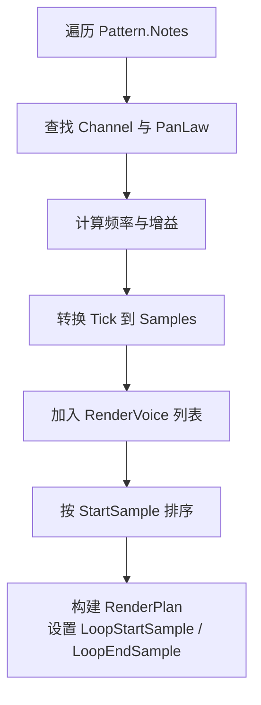
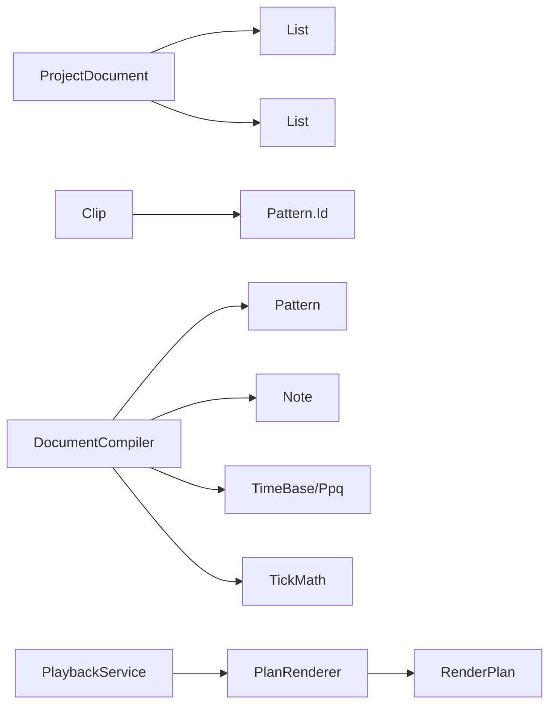
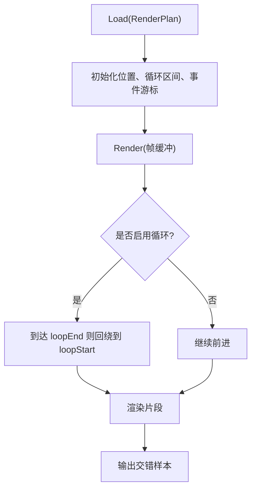
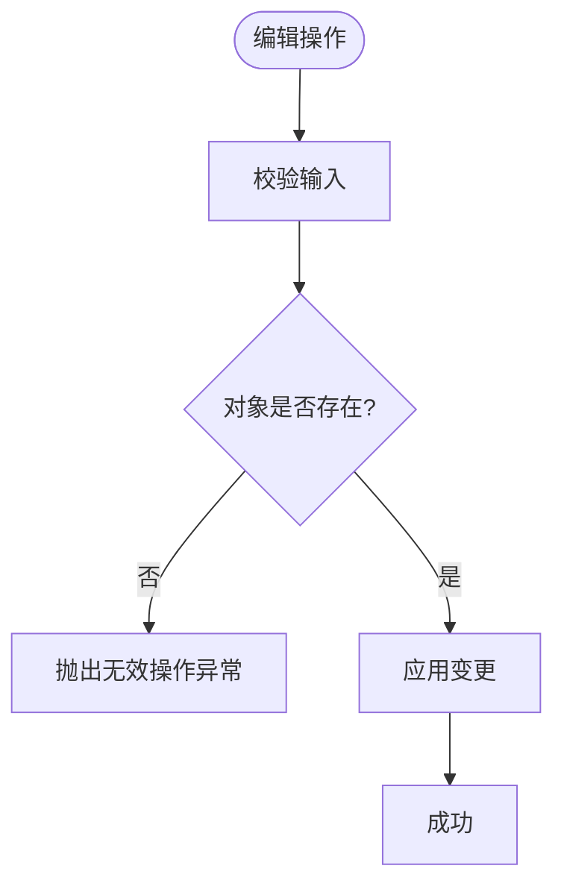

# Pattern 音乐片段

<cite>
**本文引用的文件**   
- [Pattern.cs](file://src/Weftone.Domain/Pattern.cs)
- [Note.cs](file://src/Weftone.Domain/Note.cs)
- [Clip.cs](file://src/Weftone.Domain/Clip.cs)
- [ProjectDocument.cs](file://src/Weftone.Domain/ProjectDocument.cs)
- [AddNoteCommand.cs](file://src/Weftone.Domain/Commands/AddNoteCommand.cs)
- [RemoveNoteCommand.cs](file://src/Weftone.Domain/Commands/RemoveNoteCommand.cs)
- [MoveNoteCommand.cs](file://src/Weftone.Domain/Commands/MoveNoteCommand.cs)
- [ResizeNoteCommand.cs](file://src/Weftone.Domain/Commands/ResizeNoteCommand.cs)
- [AddClipCommand.cs](file://src/Weftone.Domain/Commands/AddClipCommand.cs)
- [RemoveClipCommand.cs](file://src/Weftone.Domain/Commands/RemoveClipCommand.cs)
- [DocumentCompiler.cs](file://src/Weftone.Application/DocumentCompiler.cs)
- [IPlanRenderer.cs](file://src/Weftone.Abstractions/Rendering/IPlanRenderer.cs)
- [PlanRenderer.cs](file://src/Weftone.Engine/PlanRenderer.cs)
- [PlaybackService.cs](file://src/Weftone.Application/PlaybackService.cs)
</cite>

## 目录
1. [引言](#引言)
2. [项目结构定位](#项目结构定位)
3. [核心数据模型](#核心数据模型)
4. [架构总览](#架构总览)
5. [详细组件分析](#详细组件分析)
6. [依赖关系分析](#依赖关系分析)
7. [性能与实时渲染特性](#性能与实时渲染特性)
8. [业务规则与约束](#业务规则与约束)
9. [创建、编辑与管理示例](#创建编辑与管理示例)
10. [故障排查](#故障排查)
11. [结论](#结论)

## 引言
本文围绕 `Pattern`（音乐片段）建立完整的数据模型文档。`Pattern` 是 Weftone 工程中的可复用音乐单元，承载一组音符；它通过 `Clip` 被放置在播放列表的时间轴上，既可用于整曲编译，也可单独进入“Pattern 模式”进行循环播放。本文说明：
- `Pattern` 与 `Note` 的关系及长度、时间单位等关键属性。
- `Pattern` 如何参与离线编译和实时渲染。
- 片段的创建、编辑、删除以及播放列表编排的业务规则。
- 在实时音频路径中，`Pattern` 如何转化为带循环区间的渲染计划。

## 项目结构定位
`Pattern` 属于领域层核心实体，位于 `Weftone.Domain`；其编辑操作由命令对象表达；编译过程由 `Weftone.Application.DocumentCompiler` 完成；最终由 `Weftone.Engine.PlanRenderer` 在实时或离线路径中渲染。

**图表来源**
- [ProjectDocument.cs:7-20](file://src/Weftone.Domain/ProjectDocument.cs#L7-L20)
- [Pattern.cs:3-8](file://src/Weftone.Domain/Pattern.cs#L3-L8)
- [Note.cs:4-11](file://src/Weftone.Domain/Note.cs#L4-L11)
- [Clip.cs:4-8](file://src/Weftone.Domain/Clip.cs#L4-L8)
- [DocumentCompiler.cs:11-158](file://src/Weftone.Application/DocumentCompiler.cs#L11-L158)
- [PlanRenderer.cs:11-59](file://src/Weftone.Engine/PlanRenderer.cs#L11-L59)
- [PlaybackService.cs:12-38](file://src/Weftone.Application/PlaybackService.cs#L12-L38)

**章节来源**
- [ProjectDocument.cs:7-20](file://src/Weftone.Domain/ProjectDocument.cs#L7-L20)
- [Pattern.cs:3-8](file://src/Weftone.Domain/Pattern.cs#L3-L8)
- [Note.cs:4-11](file://src/Weftone.Domain/Note.cs#L4-L11)
- [Clip.cs:4-8](file://src/Weftone.Domain/Clip.cs#L4-L8)
- [DocumentCompiler.cs:11-158](file://src/Weftone.Application/DocumentCompiler.cs#L11-L158)
- [PlanRenderer.cs:11-59](file://src/Weftone.Engine/PlanRenderer.cs#L11-L59)
- [PlaybackService.cs:12-38](file://src/Weftone.Application/PlaybackService.cs#L12-L38)

## 核心数据模型
`Pattern` 是一个不可变外观的领域实体，包含标识、名称和音符集合。音符使用 tick 作为时间单位，并以 MIDI Key 和 Velocity 描述音高与力度。

**图表来源**
- [Pattern.cs:3-8](file://src/Weftone.Domain/Pattern.cs#L3-L8)
- [Note.cs:4-11](file://src/Weftone.Domain/Note.cs#L4-L11)
- [Clip.cs:4-8](file://src/Weftone.Domain/Clip.cs#L4-L8)
- [ProjectDocument.cs:7-20](file://src/Weftone.Domain/ProjectDocument.cs#L7-L20)

### 关键属性说明
- `Pattern.Id`：片段唯一标识，用于在播放列表中引用。
- `Pattern.Name`：人类可读的名称，便于编辑器展示。
- `Pattern.Notes`：片段内的音符集合；每个音符决定一个声音事件。
- `Note.Tick`：音符起始位置，单位为 tick（PPQ=96）。
- `Note.LengthTicks`：音符持续时间，单位为 tick；默认值为一个拍。
- `Note.Key`：MIDI 音高，范围 0..127；默认 60。
- `Note.Velocity`：力度，范围 0..1；默认 1.0。
- `Clip.PatternId`：指向某个 `Pattern.Id`。
- `Clip.StartTick`：该片段在播放列表上的起始 tick。

**章节来源**
- [Pattern.cs:3-8](file://src/Weftone.Domain/Pattern.cs#L3-L8)
- [Note.cs:4-11](file://src/Weftone.Domain/Note.cs#L4-L11)
- [Clip.cs:4-8](file://src/Weftone.Domain/Clip.cs#L4-L8)
- [ProjectDocument.cs:7-20](file://src/Weftone.Domain/ProjectDocument.cs#L7-L20)

## 架构总览
`Pattern` 本身不直接产生音频；它先被编译器展开为 `RenderPlan`，再由渲染器按样本流驱动。

**图表来源**
- [DocumentCompiler.cs:51-76](file://src/Weftone.Application/DocumentCompiler.cs#L51-L76)
- [DocumentCompiler.cs:131-157](file://src/Weftone.Application/DocumentCompiler.cs#L131-L157)
- [IPlanRenderer.cs:4-10](file://src/Weftone.Abstractions/Rendering/IPlanRenderer.cs#L4-L10)
- [PlanRenderer.cs:48-105](file://src/Weftone.Engine/PlanRenderer.cs#L48-L105)
- [PlaybackService.cs:24-38](file://src/Weftone.Application/PlaybackService.cs#L24-L38)

## 详细组件分析

### Pattern 与 Note 的关系
- `Pattern` 是容器，`Note` 是事件。
- 每个 `Note` 指定目标通道、起始 tick、音高、力度和时长。
- 多个 `Note` 共同构成一段可重复使用的音乐内容。
- `Pattern` 的长度不是固定字段，而是根据其中所有音符的最晚结束位置计算得出。

**图表来源**
- [DocumentCompiler.cs:67-76](file://src/Weftone.Application/DocumentCompiler.cs#L67-L76)

**章节来源**
- [Pattern.cs:3-8](file://src/Weftone.Domain/Pattern.cs#L3-L8)
- [Note.cs:4-11](file://src/Weftone.Domain/Note.cs#L4-L11)
- [DocumentCompiler.cs:67-76](file://src/Weftone.Application/DocumentCompiler.cs#L67-L76)

### Pattern 在循环播放中的作用
- 当使用 `CompilePattern` 时，系统只展开单个 `Pattern`，并设置循环区间 `[0, length)`。
- `PlaybackService.IsLooping` 会根据计划是否带有循环区间来反映当前是否为 Pattern 模式。
- 渲染器在到达循环终点时回绕到起点，重新触发事件，但活跃声部会自然延续尾音。

**图表来源**
- [DocumentCompiler.cs:51-65](file://src/Weftone.Application/DocumentCompiler.cs#L51-L65)
- [PlanRenderer.cs:78-93](file://src/Weftone.Engine/PlanRenderer.cs#L78-L93)
- [PlaybackService.cs:35-38](file://src/Weftone.Application/PlaybackService.cs#L35-L38)

**章节来源**
- [DocumentCompiler.cs:51-65](file://src/Weftone.Application/DocumentCompiler.cs#L51-L65)
- [PlanRenderer.cs:78-93](file://src/Weftone.Engine/PlanRenderer.cs#L78-L93)
- [PlaybackService.cs:35-38](file://src/Weftone.Application/PlaybackService.cs#L35-L38)

### 从 Pattern 到音频数据的处理流程
编译器将 `Pattern.Notes` 转换为 `RenderVoice`，再排序生成 `RenderPlan`；渲染器按样本推进，激活声部并输出波形。

**图表来源**
- [DocumentCompiler.cs:98-129](file://src/Weftone.Application/DocumentCompiler.cs#L98-L129)
- [DocumentCompiler.cs:131-157](file://src/Weftone.Application/DocumentCompiler.cs#L131-L157)

**章节来源**
- [DocumentCompiler.cs:98-157](file://src/Weftone.Application/DocumentCompiler.cs#L98-L157)

## 依赖关系分析
- `ProjectDocument` 持有 `Patterns` 与 `Playlist`。
- `Clip` 引用 `Pattern.Id`，表示片段在时间轴上的摆放。
- `DocumentCompiler` 依赖 `Pattern`、`Note`、`Channel`、`TimeBase`、`TickMath`。
- `PlanRenderer` 依赖 `RenderPlan`、`RenderVoice`、`PlanAsset`。
- `PlaybackService` 依赖 `IPlanRenderer` 与音频后端。

**图表来源**
- [ProjectDocument.cs:7-20](file://src/Weftone.Domain/ProjectDocument.cs#L7-L20)
- [Clip.cs:4-8](file://src/Weftone.Domain/Clip.cs#L4-L8)
- [DocumentCompiler.cs:11-158](file://src/Weftone.Application/DocumentCompiler.cs#L11-L158)
- [PlanRenderer.cs:11-59](file://src/Weftone.Engine/PlanRenderer.cs#L11-L59)
- [PlaybackService.cs:12-38](file://src/Weftone.Application/PlaybackService.cs#L12-L38)

**章节来源**
- [ProjectDocument.cs:7-20](file://src/Weftone.Domain/ProjectDocument.cs#L7-L20)
- [Clip.cs:4-8](file://src/Weftone.Domain/Clip.cs#L4-L8)
- [DocumentCompiler.cs:11-158](file://src/Weftone.Application/DocumentCompiler.cs#L11-L158)
- [PlanRenderer.cs:11-59](file://src/Weftone.Engine/PlanRenderer.cs#L11-L59)
- [PlaybackService.cs:12-38](file://src/Weftone.Application/PlaybackService.cs#L12-L38)

## 性能与实时渲染特性
- 编译器在非实时线程执行，全量编译工程或单个 Pattern。
- 渲染器使用固定大小声部池，避免实时路径分配。
- 循环播放时，渲染器在到达循环终点后重置位置和事件游标，同时保持活跃声部的尾音淡出。
- 主音量在渲染阶段统一缩放，保证实时路径稳定。

**图表来源**
- [PlanRenderer.cs:48-105](file://src/Weftone.Engine/PlanRenderer.cs#L48-L105)

**章节来源**
- [PlanRenderer.cs:48-105](file://src/Weftone.Engine/PlanRenderer.cs#L48-L105)
- [DocumentCompiler.cs:131-157](file://src/Weftone.Application/DocumentCompiler.cs#L131-L157)

## 业务规则与约束
- 片段必须存在于工程中才能添加到播放列表；否则添加 clip 会失败。
- 音符不能重复添加到同一个 pattern；添加已存在音符会抛出异常。
- 删除音符时若不存在也会失败。
- 调整音符长度时，最小长度为 1 tick。
- Pattern 的循环长度至少为一个小节，并按最大音符结束位置向上对齐。
- 播放器根据计划是否设置 `LoopEndSample > LoopStartSample` 判断是否为 Pattern 循环模式。

**图表来源**
- [AddClipCommand.cs:24-30](file://src/Weftone.Domain/Commands/AddClipCommand.cs#L24-L30)
- [AddNoteCommand.cs:10-18](file://src/Weftone.Domain/Commands/AddNoteCommand.cs#L10-L18)
- [RemoveNoteCommand.cs:10-16](file://src/Weftone.Domain/Commands/RemoveNoteCommand.cs#L10-L16)
- [ResizeNoteCommand.cs:16-23](file://src/Weftone.Domain/Commands/ResizeNoteCommand.cs#L16-L23)
- [DocumentCompiler.cs:67-76](file://src/Weftone.Application/DocumentCompiler.cs#L67-L76)
- [PlaybackService.cs:35-38](file://src/Weftone.Application/PlaybackService.cs#L35-L38)

**章节来源**
- [AddClipCommand.cs:24-30](file://src/Weftone.Domain/Commands/AddClipCommand.cs#L24-L30)
- [AddNoteCommand.cs:10-18](file://src/Weftone.Domain/Commands/AddNoteCommand.cs#L10-L18)
- [RemoveNoteCommand.cs:10-16](file://src/Weftone.Domain/Commands/RemoveNoteCommand.cs#L10-L16)
- [ResizeNoteCommand.cs:16-23](file://src/Weftone.Domain/Commands/ResizeNoteCommand.cs#L16-L23)
- [DocumentCompiler.cs:67-76](file://src/Weftone.Application/DocumentCompiler.cs#L67-L76)
- [PlaybackService.cs:35-38](file://src/Weftone.Application/PlaybackService.cs#L35-L38)

## 创建、编辑与管理示例
以下示例以“代码片段路径”形式给出，避免直接粘贴实现代码。

- 创建一个 Pattern 并添加音符：
  - 参考：[Pattern.cs:3-8](file://src/Weftone.Domain/Pattern.cs#L3-L8)、[Note.cs:4-11](file://src/Weftone.Domain/Note.cs#L4-L11)
  - 使用命令：[AddNoteCommand.cs:10-18](file://src/Weftone.Domain/Commands/AddNoteCommand.cs#L10-L18)

- 移动音符：
  - 参考：[MoveNoteCommand.cs:30-39](file://src/Weftone.Domain/Commands/MoveNoteCommand.cs#L30-L39)

- 调整音符长度：
  - 参考：[ResizeNoteCommand.cs:16-23](file://src/Weftone.Domain/Commands/ResizeNoteCommand.cs#L16-L23)

- 删除音符：
  - 参考：[RemoveNoteCommand.cs:10-16](file://src/Weftone.Domain/Commands/RemoveNoteCommand.cs#L10-L16)

- 将 Pattern 放入播放列表：
  - 参考：[AddClipCommand.cs:9-17](file://src/Weftone.Domain/Commands/AddClipCommand.cs#L9-L17)

- 删除播放列表中的 Clip：
  - 参考：[RemoveClipCommand.cs:9-15](file://src/Weftone.Domain/Commands/RemoveClipCommand.cs#L9-L15)

- 编译单个 Pattern 并进入循环模式：
  - 参考：[DocumentCompiler.cs:51-65](file://src/Weftone.Application/DocumentCompiler.cs#L51-L65)

- 播放服务读取循环标志：
  - 参考：[PlaybackService.cs:35-38](file://src/Weftone.Application/PlaybackService.cs#L35-L38)

**章节来源**
- [Pattern.cs:3-8](file://src/Weftone.Domain/Pattern.cs#L3-L8)
- [Note.cs:4-11](file://src/Weftone.Domain/Note.cs#L4-L11)
- [AddNoteCommand.cs:10-18](file://src/Weftone.Domain/Commands/AddNoteCommand.cs#L10-L18)
- [MoveNoteCommand.cs:30-39](file://src/Weftone.Domain/Commands/MoveNoteCommand.cs#L30-L39)
- [ResizeNoteCommand.cs:16-23](file://src/Weftone.Domain/Commands/ResizeNoteCommand.cs#L16-L23)
- [RemoveNoteCommand.cs:10-16](file://src/Weftone.Domain/Commands/RemoveNoteCommand.cs#L10-L16)
- [AddClipCommand.cs:9-17](file://src/Weftone.Domain/Commands/AddClipCommand.cs#L9-L17)
- [RemoveClipCommand.cs:9-15](file://src/Weftone.Domain/Commands/RemoveClipCommand.cs#L9-L15)
- [DocumentCompiler.cs:51-65](file://src/Weftone.Application/DocumentCompiler.cs#L51-L65)
- [PlaybackService.cs:35-38](file://src/Weftone.Application/PlaybackService.cs#L35-L38)

## 故障排查
- “pattern 不存在”：添加 clip 或编辑音符时，若 patternId 不在工程中，命令会抛出异常。
  - 参考：[AddClipCommand.cs:24-30](file://src/Weftone.Domain/Commands/AddClipCommand.cs#L24-L30)、[AddNoteCommand.cs:25-29](file://src/Weftone.Domain/Commands/AddNoteCommand.cs#L25-L29)
- “clip 已存在”：重复添加相同 clip 会失败。
  - 参考：[AddClipCommand.cs:9-17](file://src/Weftone.Domain/Commands/AddClipCommand.cs#L9-L17)
- “音符已存在于 pattern”：重复添加同一音符会失败。
  - 参考：[AddNoteCommand.cs:10-18](file://src/Weftone.Domain/Commands/AddNoteCommand.cs#L10-L18)
- “音符不存在”：删除或移动不存在的音符会失败。
  - 参考：[RemoveNoteCommand.cs:10-16](file://src/Weftone.Domain/Commands/RemoveNoteCommand.cs#L10-L16)、[MoveNoteCommand.cs:30-39](file://src/Weftone.Domain/Commands/MoveNoteCommand.cs#L30-L39)
- “长度至少 1 tick”：调整长度小于 1 会抛出参数异常。
  - 参考：[ResizeNoteCommand.cs:16-23](file://src/Weftone.Domain/Commands/ResizeNoteCommand.cs#L16-L23)
- “sampler channel 缺少已准备的资产”：采样器通道未准备资产时编译失败。
  - 参考：[DocumentCompiler.cs:109-117](file://src/Weftone.Application/DocumentCompiler.cs#L109-L117)

**章节来源**
- [AddClipCommand.cs:9-30](file://src/Weftone.Domain/Commands/AddClipCommand.cs#L9-L30)
- [AddNoteCommand.cs:10-29](file://src/Weftone.Domain/Commands/AddNoteCommand.cs#L10-L29)
- [RemoveNoteCommand.cs:10-28](file://src/Weftone.Domain/Commands/RemoveNoteCommand.cs#L10-L28)
- [MoveNoteCommand.cs:30-39](file://src/Weftone.Domain/Commands/MoveNoteCommand.cs#L30-L39)
- [ResizeNoteCommand.cs:16-39](file://src/Weftone.Domain/Commands/ResizeNoteCommand.cs#L16-L39)
- [DocumentCompiler.cs:109-117](file://src/Weftone.Application/DocumentCompiler.cs#L109-L117)

## 结论
`Pattern` 是 Weftone 音乐内容的核心抽象：它以音符集合定义可复用的音乐单元，并通过 `Clip` 在时间轴上编排。编译器将 `Pattern` 展开为带循环区间的渲染计划，使 Pattern 模式能够稳定地循环播放。领域层通过命令对象提供一致的编辑语义，引擎层则在实时路径中以零分配方式渲染音频。理解 `Pattern`、`Note`、`Clip` 与编译、渲染之间的关系，有助于正确构建、编辑和管理音乐内容，并在实时场景中获得稳定的播放体验。