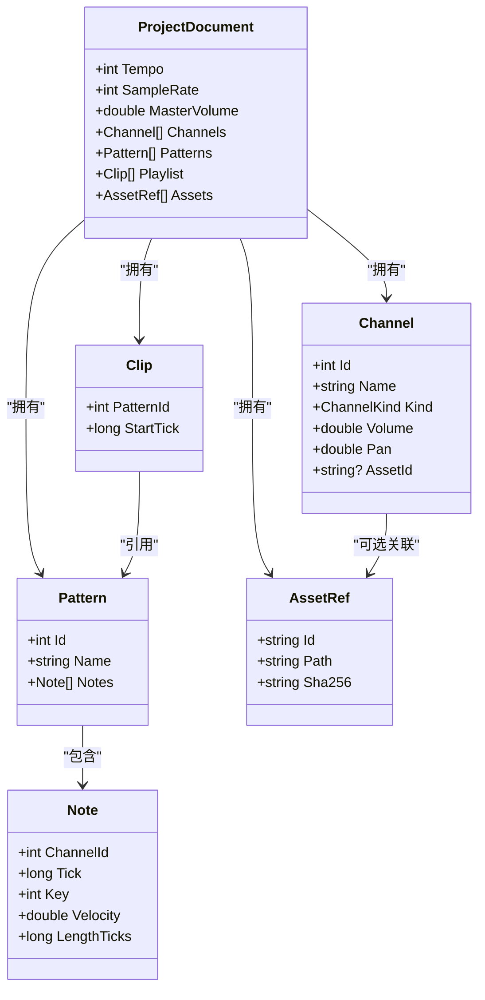
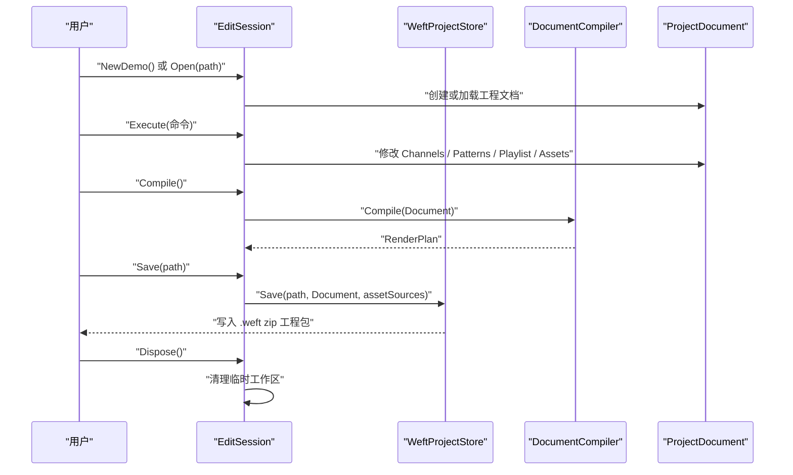
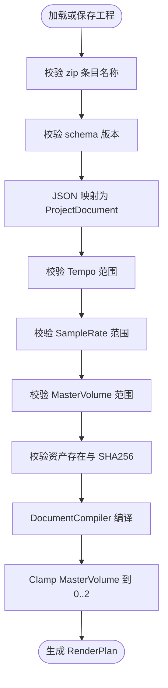
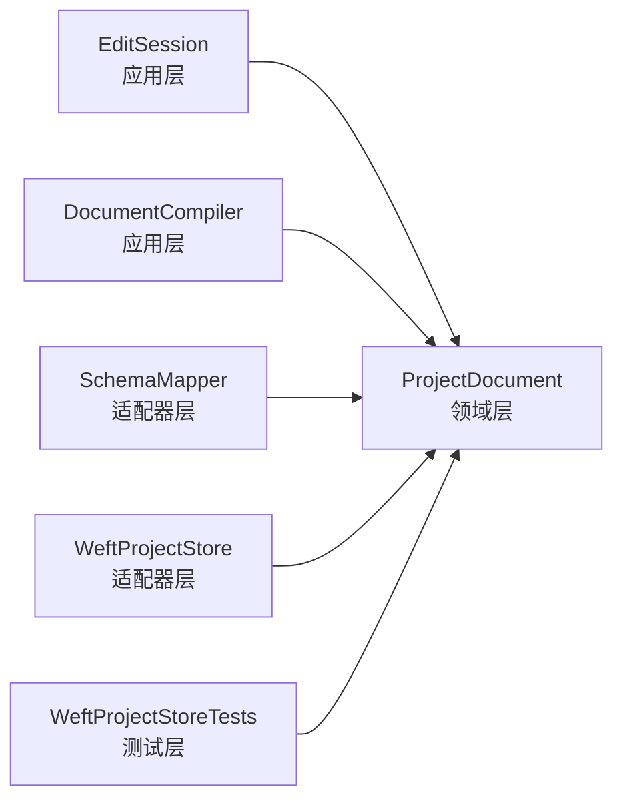

# ProjectDocument 工程文档

<cite>
**本文引用的文件**   
- [ProjectDocument.cs](file://src/Weftone.Domain/ProjectDocument.cs)
- [Channel.cs](file://src/Weftone.Domain/Channel.cs)
- [Pattern.cs](file://src/Weftone.Domain/Pattern.cs)
- [Clip.cs](file://src/Weftone.Domain/Clip.cs)
- [Note.cs](file://src/Weftone.Domain/Note.cs)
- [AssetRef.cs](file://src/Weftone.Domain/AssetRef.cs)
- [TimeBase.cs](file://src/Weftone.Domain/TimeBase.cs)
- [EditSession.cs](file://src/Weftone.Application/EditSession.cs)
- [DocumentCompiler.cs](file://src/Weftone.Application/DocumentCompiler.cs)
- [SchemaMapper.cs](file://src/Weftone.Adapters.ProjectStore/SchemaMapper.cs)
- [WeftProjectStore.cs](file://src/Weftone.Adapters.ProjectStore/WeftProjectStore.cs)
- [ADR-0003-document-engine-compiler.md](file://docs/adr/ADR-0003-document-engine-compiler.md)
- [ADR-0006-project-format.md](file://docs/adr/ADR-0006-project-format.md)
- [WeftProjectStoreTests.cs](file://tests/Weftone.Domain.Tests/WeftProjectStoreTests.cs)
</cite>

## 目录
1. [引言](#引言)
2. [项目结构定位](#项目结构定位)
3. [核心数据模型](#核心数据模型)
4. [集合关系与业务语义](#集合关系与业务语义)
5. [工程文档生命周期](#工程文档生命周期)
6. [数据验证规则](#数据验证规则)
7. [创建与配置示例](#创建与配置示例)
8. [架构与依赖关系](#架构与依赖关系)
9. [性能与实时性约束](#性能与实时性约束)
10. [故障排查](#故障排查)
11. [结论](#结论)

## 引言
ProjectDocument 是 Weftone 领域层中的顶层工程容器，用于承载一个可编辑、可撤销、可序列化的音乐工程。它集中管理 Tempo（BPM）、SampleRate（采样率）、MasterVolume（主控音量）等全局音频参数，并通过 Channels、Patterns、Playlist、Assets 四个集合描述声部、音符模式、时间轴片段和外部资产引用。

根据设计决策，ProjectDocument 由 UI 线程的单写者持有；引擎侧只消费编译后的 RenderPlan，不直接访问可变工程对象图。这样既保证撤销、保存、序列化的一致性，也避免音频线程出现并发问题。

**章节来源**
- [ProjectDocument.cs:3-19](file://src/Weftone.Domain/ProjectDocument.cs#L3-L19)
- [ADR-0003-document-engine-compiler.md:4-11](file://docs/adr/ADR-0003-document-engine-compiler.md#L4-L11)

## 项目结构定位
ProjectDocument 位于 `Weftone.Domain` 领域层，属于富对象模型的核心类型。它不依赖应用层、适配器层或 UI 层，仅通过自身字段和同域类型表达工程语义。

```mermaid
graph TB
Domain["领域层<br/>Weftone.Domain"]
Application["应用层<br/>Weftone.Application"]
Adapters["适配器层<br/>Weftone.Adapters.*"]
Engine["引擎层<br/>Weftone.Engine"]
ProjectDocumentNode["ProjectDocument"]
ChannelNode["Channel"]
PatternNode["Pattern"]
ClipNode["Clip"]
NoteNode["Note"]
AssetRefNode["AssetRef"]
TimeBaseNode["TimeBase"]
Domain --> ProjectDocumentNode
Domain --> ChannelNode
Domain --> PatternNode
Domain --> ClipNode
Domain --> NoteNode
Domain --> AssetRefNode
Domain --> TimeBaseNode
Application --> Domain
Adapters --> Domain
Engine -.-> "消费 RenderPlan"
```

**图表来源**
- [ProjectDocument.cs:1-20](file://src/Weftone.Domain/ProjectDocument.cs#L1-L20)
- [Channel.cs:1-19](file://src/Weftone.Domain/Channel.cs#L1-L19)
- [Pattern.cs:1-9](file://src/Weftone.Domain/Pattern.cs#L1-L9)
- [Clip.cs:1-9](file://src/Weftone.Domain/Clip.cs#L1-L9)
- [Note.cs:1-12](file://src/Weftone.Domain/Note.cs#L1-L12)
- [AssetRef.cs:1-10](file://src/Weftone.Domain/AssetRef.cs#L1-L10)
- [TimeBase.cs:1-8](file://src/Weftone.Domain/TimeBase.cs#L1-L8)

**章节来源**
- [ProjectDocument.cs:1-20](file://src/Weftone.Domain/ProjectDocument.cs#L1-L20)
- [ADR-0003-document-engine-compiler.md:19-23](file://docs/adr/ADR-0003-document-engine-compiler.md#L19-L23)

## 核心数据模型
ProjectDocument 作为工程根节点，提供以下核心属性：

| 字段 | 数据类型 | 默认值 | 取值范围或业务含义 | 说明 |
|---|---:|---:|---|---|
| `Tempo` | `int` | `140` | `MinTempo` 到 `MaxTempo`，即 `20` 到 `999` | BPM，表示每分钟节拍数。该范围由领域常量约束，加载和保存时会被校验。 |
| `SampleRate` | `int` | `48_000` | `8000` 到 `192_000` | 音频采样率，单位 Hz。常见值为 44100、48000，但领域允许更宽范围。 |
| `MasterVolume` | `double` | `1.0` | `0` 到 `2` | 主控音量。`1.0` 表示不衰减；`0` 为静音；`2` 为最大允许增益。 |
| `Channels` | `List<Channel>` | 空列表 | 非负数量 | 工程内所有声部通道集合。 |
| `Patterns` | `List<Pattern>` | 空列表 | 非负数量 | 音符模式集合，每个 Pattern 包含若干 Note。 |
| `Playlist` | `List<Clip>` | 空列表 | 非负数量 | 播放列表，将 Pattern 放置在时间轴的起始 tick 位置。 |
| `Assets` | `List<AssetRef>` | 空列表 | 非负数量 | 工程资产引用，指向 zip 包内的 assets 目录资源。 |

### Tempo、MinTempo 与 MaxTempo
- `MinTempo = 20`：防止工程设置过低 BPM，导致 tick 到样本转换异常或渲染周期过长。
- `MaxTempo = 999`：防止极端高 BPM 造成数值溢出或渲染计划过大。
- 这两个常量既是业务边界，也是持久化加载时的强制校验条件。

### SampleRate
- 默认 `48_000` 符合现代数字音频工作站的常用采样率。
- 加载时要求 `8000` 到 `192_000`，覆盖语音级到专业录音级范围。

### MasterVolume
- 注释明确标注范围为 `[0, 2]`，其中 `1.0` 对应 Mixer 主输出推子的“不衰减”状态。
- 编译器在生成 RenderPlan 时会再次使用 `Math.Clamp` 限制到 `0` 到 `2`，形成双重保护。

**章节来源**
- [ProjectDocument.cs:9-19](file://src/Weftone.Domain/ProjectDocument.cs#L9-L19)
- [SchemaMapper.cs:173-179](file://src/Weftone.Adapters.ProjectStore/SchemaMapper.cs#L173-L179)
- [DocumentCompiler.cs:145-156](file://src/Weftone.Application/DocumentCompiler.cs#L145-L156)

## 集合关系与业务语义
ProjectDocument 的四个集合共同构成“工程 → 声部 → 模式 → 音符 → 时间轴 → 资产”的数据链。



**图表来源**
- [ProjectDocument.cs:7-19](file://src/Weftone.Domain/ProjectDocument.cs#L7-L19)
- [Channel.cs:9-18](file://src/Weftone.Domain/Channel.cs#L9-L18)
- [Pattern.cs:3-8](file://src/Weftone.Domain/Pattern.cs#L3-L8)
- [Clip.cs:3-8](file://src/Weftone.Domain/Clip.cs#L3-L8)
- [Note.cs:3-11](file://src/Weftone.Domain/Note.cs#L3-L11)
- [AssetRef.cs:3-9](file://src/Weftone.Domain/AssetRef.cs#L3-L9)

### Channels：声部通道
- 每个 Channel 代表一个可发声的声部，例如正弦波合成器或采样器。
- `Kind` 决定音源类型：`Sine` 或 `Sampler`。
- `Volume` 控制声部音量，`Pan` 控制线性声像。
- `AssetId` 仅在 Sampler 类型中有效，用于关联外部采样资产。

### Patterns：音符模式
- Pattern 是音符的模板，包含一组 Note。
- Note 使用 `Tick` 表示时间位置，`Key` 表示 MIDI 音高，`Velocity` 表示力度，`LengthTicks` 表示音符时长。
- `TimeBase.Ppq = 96` 表示每拍 96 个 tick，与 FL Studio 等 DAW 的整数 tick 模型一致。

### Playlist：播放列表
- Playlist 是时间轴上的片段排列。
- 每个 Clip 指定一个 `PatternId` 和 `StartTick`，表示从哪个 tick 开始播放对应 Pattern。
- 编译器按 `StartTick` 排序展开 Playlist，并计算总长度。

### Assets：资产引用
- AssetRef 表示工程包内的外部资源，如 wav 采样。
- `Path` 是相对路径，通常以 `assets/` 开头。
- `Sha256` 是小写十六进制哈希，用于完整性校验。
- 保存时由项目存储适配器计算 SHA256；加载时重新计算并比对。

**章节来源**
- [Channel.cs:3-18](file://src/Weftone.Domain/Channel.cs#L3-L18)
- [Pattern.cs:3-8](file://src/Weftone.Domain/Pattern.cs#L3-L8)
- [Clip.cs:3-8](file://src/Weftone.Domain/Clip.cs#L3-L8)
- [Note.cs:3-11](file://src/Weftone.Domain/Note.cs#L3-L11)
- [AssetRef.cs:3-9](file://src/Weftone.Domain/AssetRef.cs#L3-L9)
- [TimeBase.cs:3-7](file://src/Weftone.Domain/TimeBase.cs#L3-L7)
- [DocumentCompiler.cs:28-48](file://src/Weftone.Application/DocumentCompiler.cs#L28-L48)
- [WeftProjectStore.cs:55-68](file://src/Weftone.Adapters.ProjectStore/WeftProjectStore.cs#L55-L68)

## 工程文档生命周期
ProjectDocument 的生命周期由 `EditSession` 管理，典型流程包括新建、打开、编辑、编译、保存和销毁。



**图表来源**
- [EditSession.cs:27-41](file://src/Weftone.Application/EditSession.cs#L27-L41)
- [EditSession.cs:51-92](file://src/Weftone.Application/EditSession.cs#L51-L92)
- [EditSession.cs:100-130](file://src/Weftone.Application/EditSession.cs#L100-L130)
- [EditSession.cs:190-221](file://src/Weftone.Application/EditSession.cs#L190-L221)
- [WeftProjectStore.cs:73-110](file://src/Weftone.Adapters.ProjectStore/WeftProjectStore.cs#L73-L110)

### 新建工程
- `EditSession.NewDemo()` 会创建新的 ProjectDocument，并填充演示内容。
- 同时准备临时工作区和演示资产，标记工程为已修改。

### 打开工程
- `Open(path)` 通过 `IProjectStore.Load` 读取 zip 工程包。
- 加载后复制资产到工作区，建立 `asset.Path → 本地路径` 映射。
- 清空命令历史，并将 `IsDirty` 设为 false。

### 编辑工程
- 所有编辑通过命令执行，命令由 `CommandHistory` 记录。
- 每次执行命令后标记 `IsDirty = true`。
- 支持事务合并，便于拖拽操作等批量编辑。

### 编译工程
- `Compile()` 调用 `DocumentCompiler.Compile`，将 ProjectDocument 转换为 RenderPlan。
- 编译过程不在音频线程执行，而是由 UI 线程或后台任务触发。

### 保存工程
- `Save(path)` 调用项目存储适配器，将 Document 和资产写入 zip。
- 保存成功后清除脏标记。

### 销毁会话
- `Dispose()` 删除临时工作区中的文件。
- 若文件被占用，捕获 IO 异常并继续退出，避免阻塞程序关闭。

**章节来源**
- [EditSession.cs:8-41](file://src/Weftone.Application/EditSession.cs#L8-L41)
- [EditSession.cs:51-92](file://src/Weftone.Application/EditSession.cs#L51-L92)
- [EditSession.cs:100-130](file://src/Weftone.Application/EditSession.cs#L100-L130)
- [EditSession.cs:190-221](file://src/Weftone.Application/EditSession.cs#L190-L221)

## 数据验证规则
ProjectDocument 的合法性由领域常量、适配器映射器和项目存储层共同保障。

### 领域常量约束
- `Tempo` 必须在 `MinTempo` 到 `MaxTempo` 之间。
- `SampleRate` 必须在 `8000` 到 `192_000` 之间。
- `MasterVolume` 必须在 `0` 到 `2` 之间。

### 持久化加载校验
- 加载 zip 时检查条目白名单，防止 zip slip 攻击。
- 校验 `metadata.json` 和 `project.json` 的 schema 版本。
- 将 JSON 映射为领域对象后，对 Tempo、SampleRate、MasterVolume 进行范围校验。
- 对每个 AssetRef 检查资产是否存在，并重新计算 SHA256 与预期值比较。

### 渲染阶段约束
- 编译器在构建 RenderPlan 时对 `MasterVolume` 再次 clamp 到 `0` 到 `2`。
- 如果 sampler 通道缺少已准备的资产，编译会抛出无效操作异常。



**图表来源**
- [WeftProjectStore.cs:23-70](file://src/Weftone.Adapters.ProjectStore/WeftProjectStore.cs#L23-L70)
- [SchemaMapper.cs:173-179](file://src/Weftone.Adapters.ProjectStore/SchemaMapper.cs#L173-L179)
- [DocumentCompiler.cs:145-156](file://src/Weftone.Application/DocumentCompiler.cs#L145-L156)

**章节来源**
- [SchemaMapper.cs:173-179](file://src/Weftone.Adapters.ProjectStore/SchemaMapper.cs#L173-L179)
- [WeftProjectStore.cs:23-70](file://src/Weftone.Adapters.ProjectStore/WeftProjectStore.cs#L23-L70)
- [WeftProjectStore.cs:131-152](file://src/Weftone.Adapters.ProjectStore/WeftProjectStore.cs#L131-L152)
- [DocumentCompiler.cs:108-127](file://src/Weftone.Application/DocumentCompiler.cs#L108-L127)
- [DocumentCompiler.cs:145-156](file://src/Weftone.Application/DocumentCompiler.cs#L145-L156)

## 创建与配置示例
以下示例展示如何创建一个最小可用的 ProjectDocument，并添加声部、Pattern、Clip 和 AssetRef。为避免泄露实现细节，这里仅给出步骤说明和对应源码路径。

### 步骤一：创建工程文档
- 实例化 `ProjectDocument`。
- 设置 `Tempo` 为合法 BPM，例如 `128`。
- 设置 `SampleRate` 为 `48_000`。

参考路径：
- [WeftProjectStoreTests.cs:23-25](file://tests/Weftone.Domain.Tests/WeftProjectStoreTests.cs#L23-L25)

### 步骤二：添加声部通道
- 向 `Channels` 添加 `Channel`。
- 设置 `Id`、`Name`、`Kind`。
- 如果是 Sampler 类型，设置 `AssetId`、`Volume`、`Pan`。

参考路径：
- [WeftProjectStoreTests.cs:26-31](file://tests/Weftone.Domain.Tests/WeftProjectStoreTests.cs#L26-L31)
- [Channel.cs:9-18](file://src/Weftone.Domain/Channel.cs#L9-L18)

### 步骤三：创建 Pattern 和 Note
- 创建 `Pattern`，设置 `Id` 和 `Name`。
- 向 `Notes` 添加 `Note`，指定 `ChannelId`、`Tick`、`Key`、`Velocity`、`LengthTicks`。
- 将 Pattern 加入 `document.Patterns`。

参考路径：
- [WeftProjectStoreTests.cs:31-34](file://tests/Weftone.Domain.Tests/WeftProjectStoreTests.cs#L31-L34)
- [Pattern.cs:3-8](file://src/Weftone.Domain/Pattern.cs#L3-L8)
- [Note.cs:3-11](file://src/Weftone.Domain/Note.cs#L3-L11)

### 步骤四：添加到 Playlist
- 创建 `Clip`，设置 `PatternId` 和 `StartTick`。
- 将 Clip 加入 `document.Playlist`。

参考路径：
- [WeftProjectStoreTests.cs:35](file://tests/Weftone.Domain.Tests/WeftProjectStoreTests.cs#L35)
- [Clip.cs:3-8](file://src/Weftone.Domain/Clip.cs#L3-L8)

### 步骤五：注册资产引用
- 创建 `AssetRef`，设置 `Id`、`Path`。
- 将 AssetRef 加入 `document.Assets`。

参考路径：
- [WeftProjectStoreTests.cs:36](file://tests/Weftone.Domain.Tests/WeftProjectStoreTests.cs#L36)
- [AssetRef.cs:3-9](file://src/Weftone.Domain/AssetRef.cs#L3-L9)

### 完整流程参考
测试用例展示了从零构建工程文档的最小集合，适合用作 API 使用参考。

**章节来源**
- [WeftProjectStoreTests.cs:23-37](file://tests/Weftone.Domain.Tests/WeftProjectStoreTests.cs#L23-L37)
- [ProjectDocument.cs:7-19](file://src/Weftone.Domain/ProjectDocument.cs#L7-L19)
- [Channel.cs:9-18](file://src/Weftone.Domain/Channel.cs#L9-L18)
- [Pattern.cs:3-8](file://src/Weftone.Domain/Pattern.cs#L3-L8)
- [Clip.cs:3-8](file://src/Weftone.Domain/Clip.cs#L3-L8)
- [AssetRef.cs:3-9](file://src/Weftone.Domain/AssetRef.cs#L3-L9)

## 架构与依赖关系
ProjectDocument 处于领域层中心，被应用层和适配器层共同消费，但不反向依赖它们。



**图表来源**
- [EditSession.cs:40-43](file://src/Weftone.Application/EditSession.cs#L40-L43)
- [DocumentCompiler.cs:16-19](file://src/Weftone.Application/DocumentCompiler.cs#L16-L19)
- [SchemaMapper.cs:173-179](file://src/Weftone.Adapters.ProjectStore/SchemaMapper.cs#L173-L179)
- [WeftProjectStore.cs:53-70](file://src/Weftone.Adapters.ProjectStore/WeftProjectStore.cs#L53-L70)
- [WeftProjectStoreTests.cs:23-37](file://tests/Weftone.Domain.Tests/WeftProjectStoreTests.cs#L23-L37)

**章节来源**
- [EditSession.cs:8-43](file://src/Weftone.Application/EditSession.cs#L8-L43)
- [DocumentCompiler.cs:6-19](file://src/Weftone.Application/DocumentCompiler.cs#L6-L19)
- [WeftProjectStore.cs:9-13](file://src/Weftone.Adapters.ProjectStore/WeftProjectStore.cs#L9-L13)

## 性能与实时性约束
- ProjectDocument 是可变对象图，不适合直接交给音频线程。
- 渲染通过 `DocumentCompiler` 将工程转换为扁平的 `RenderPlan`，避免运行时 GC 和锁竞争。
- M1a 阶段采用单线程同步编辑，M1b 阶段仍保持 UI 线程单写者模型。
- 导出 WAV 时使用独立离线渲染器，与实时播放互不干扰。

**章节来源**
- [ADR-0003-document-engine-compiler.md:4-11](file://docs/adr/ADR-0003-document-engine-compiler.md#L4-L11)
- [EditSession.cs:167-188](file://src/Weftone.Application/EditSession.cs#L167-L188)

## 故障排查
### Tempo 越界
- 现象：加载工程时报错 BPM 越界。
- 原因：`Tempo` 不在 `20` 到 `999` 范围内。
- 处理：修正工程中的 BPM，或使用合理默认值。

参考路径：
- [SchemaMapper.cs:173-174](file://src/Weftone.Adapters.ProjectStore/SchemaMapper.cs#L173-L174)

### SampleRate 越界
- 现象：加载工程时报错采样率越界。
- 原因：`SampleRate` 不在 `8000` 到 `192_000` 范围内。
- 处理：调整为标准采样率，如 `44100` 或 `48000`。

参考路径：
- [SchemaMapper.cs:175-176](file://src/Weftone.Adapters.ProjectStore/SchemaMapper.cs#L175-L176)

### MasterVolume 越界
- 现象：加载工程时报错主控音量越界。
- 原因：`MasterVolume` 不在 `0` 到 `2` 范围内。
- 处理：将音量限制到合法区间。

参考路径：
- [SchemaMapper.cs:177-178](file://src/Weftone.Adapters.ProjectStore/SchemaMapper.cs#L177-L178)

### 资产缺失或 SHA256 不匹配
- 现象：加载工程时报资产缺失或哈希不匹配。
- 原因：zip 包内缺少 assets 条目，或资产内容被篡改。
- 处理：重新打包工程，确保 `AssetRef.Path` 和 `Sha256` 正确。

参考路径：
- [WeftProjectStore.cs:55-68](file://src/Weftone.Adapters.ProjectStore/WeftProjectStore.cs#L55-L68)

### Zip 条目非法
- 现象：加载工程时报非法 zip 条目或非白名单条目。
- 原因：zip 中包含不允许的路径、绝对路径、父目录跳转或非 assets 文件。
- 处理：清理 zip 结构，仅保留 `metadata.json`、`project.json` 和 `assets/*`。

参考路径：
- [WeftProjectStore.cs:131-152](file://src/Weftone.Adapters.ProjectStore/WeftProjectStore.cs#L131-L152)

### Sampler 通道缺少已准备资产
- 现象：编译时报 sampler channel 缺少已准备的资产。
- 原因：Channel 类型为 Sampler，但未通过 `EditSession.ImportSample` 或资产准备流程注册。
- 处理：先导入采样，再编译 Pattern 或 Song。

参考路径：
- [DocumentCompiler.cs:108-117](file://src/Weftone.Application/DocumentCompiler.cs#L108-L117)

**章节来源**
- [SchemaMapper.cs:173-179](file://src/Weftone.Adapters.ProjectStore/SchemaMapper.cs#L173-L179)
- [WeftProjectStore.cs:55-68](file://src/Weftone.Adapters.ProjectStore/WeftProjectStore.cs#L55-L68)
- [WeftProjectStore.cs:131-152](file://src/Weftone.Adapters.ProjectStore/WeftProjectStore.cs#L131-L152)
- [DocumentCompiler.cs:108-117](file://src/Weftone.Application/DocumentCompiler.cs#L108-L117)

## 结论
ProjectDocument 是 Weftone 工程模型的根对象，负责聚合 Tempo、SampleRate、MasterVolume 以及 Channels、Patterns、Playlist、Assets 四大集合。它的设计强调：
- 明确的业务边界：Tempo、采样率、主控音量都有清晰取值范围。
- 清晰的实体关系：Pattern 包含 Note，Playlist 引用 Pattern，Channel 可选关联 AssetRef。
- 安全的生命周期：由 EditSession 管理，编辑器单写，引擎只消费 RenderPlan。
- 严格的验证：加载、保存、编译三个阶段分别承担不同职责的校验。

在实际使用中，建议始终通过 `EditSession` 创建、打开、编辑和保存工程，而不是直接操作 ProjectDocument 的底层集合。这样可以获得撤销、事务、资产准备和持久化校验等完整能力。