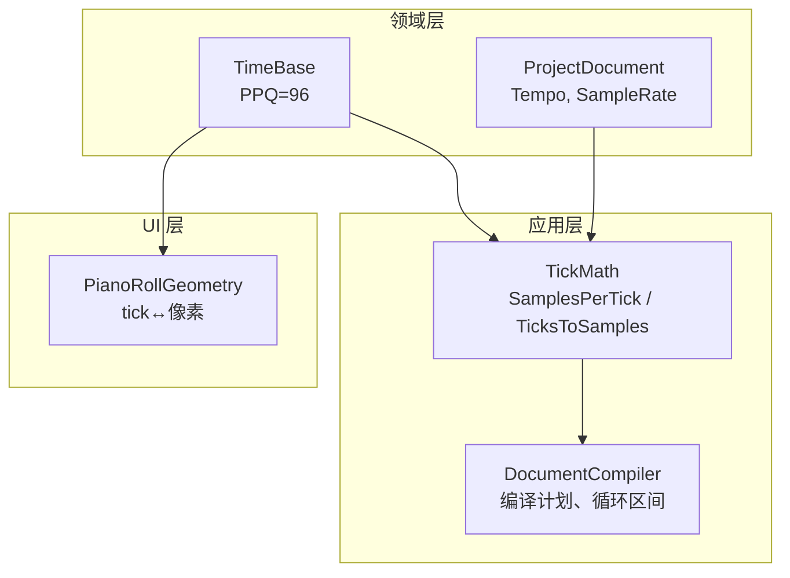
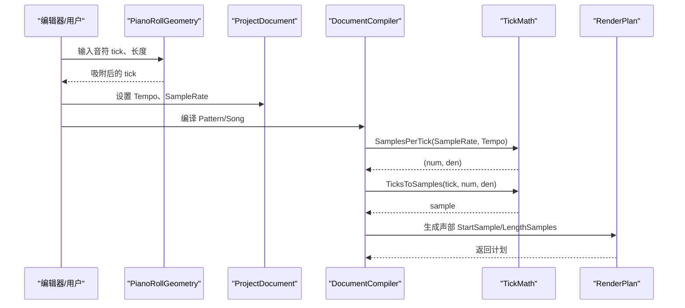
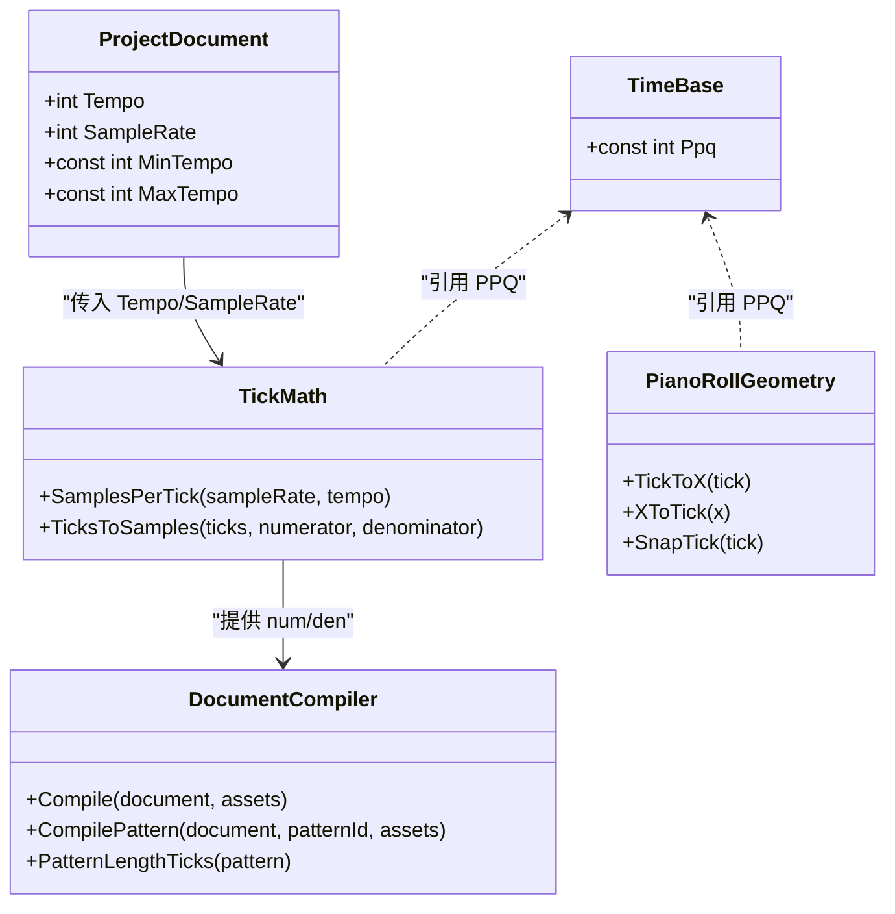

# 时间系统

<cite>
**本文引用的文件**   
- [TimeBase.cs](file://src/Weftone.Domain/TimeBase.cs)
- [TickMath.cs](file://src/Weftone.Application/TickMath.cs)
- [ProjectDocument.cs](file://src/Weftone.Domain/ProjectDocument.cs)
- [DocumentCompiler.cs](file://src/Weftone.Application/DocumentCompiler.cs)
- [PianoRollGeometry.cs](file://src/Weftone.App/Controls/PianoRollGeometry.cs)
- [CompilePatternTests.cs](file://tests/Weftone.Application.Tests/CompilePatternTests.cs)
</cite>

## 目录
1. [引言](#引言)
2. [项目结构中的时间相关位置](#项目结构中的时间相关位置)
3. [核心组件](#核心组件)
4. [架构总览](#架构总览)
5. [详细组件分析](#详细组件分析)
6. [依赖关系分析](#依赖关系分析)
7. [性能与实时性考虑](#性能与实时性考虑)
8. [故障排查指南](#故障排查指南)
9. [结论](#结论)
10. [附录：单位换算与公式](#附录单位换算与公式)

## 引言
本文件面向“时间系统”的技术文档，聚焦以下目标：
- 解释 TimeBase 的时间基准概念。
- 说明 TickMath 的 tick 到采样点（sample）的整数映射方法。
- 阐述 BPM（每分钟节拍数）与采样时间的转换关系，以及 tick、beat（拍）、bar（小节）等单位的换算。
- 给出时间计算的数学公式与代码示例路径。
- 说明时间系统在实时音频处理中的重要性、精度要求与性能考量。
- 提供时间相关工具函数的使用说明。

该时间系统以“整数 tick”为内部时间单位，通过固定 PPQ（每拍 tick 数）将音乐时间轴与音频采样时间轴解耦，从而在编辑、编译、渲染各阶段保持一致且可预测的时间语义。

## 项目结构中的时间相关位置
时间系统的关键实现分布在领域层与应用层：
- 领域层定义时间基准与工程参数。
- 应用层负责将音乐时间（tick）转换为音频时间（sample），并参与渲染计划构建。
- UI 层使用 tick 进行钢琴卷帘几何计算与交互。

图示来源
- [TimeBase.cs:1-8](file://src/Weftone.Domain/TimeBase.cs#L1-L8)
- [ProjectDocument.cs:1-21](file://src/Weftone.Domain/ProjectDocument.cs#L1-L21)
- [TickMath.cs:1-14](file://src/Weftone.Application/TickMath.cs#L1-L14)
- [DocumentCompiler.cs:1-159](file://src/Weftone.Application/DocumentCompiler.cs#L1-L159)
- [PianoRollGeometry.cs:1-82](file://src/Weftone.App/Controls/PianoRollGeometry.cs#L1-L82)

章节来源
- [TimeBase.cs:1-8](file://src/Weftone.Domain/TimeBase.cs#L1-L8)
- [ProjectDocument.cs:1-21](file://src/Weftone.Domain/ProjectDocument.cs#L1-L21)
- [TickMath.cs:1-14](file://src/Weftone.Application/TickMath.cs#L1-L14)
- [DocumentCompiler.cs:1-159](file://src/Weftone.Application/DocumentCompiler.cs#L1-L159)
- [PianoRollGeometry.cs:1-82](file://src/Weftone.App/Controls/PianoRollGeometry.cs#L1-L82)

## 核心组件
- TimeBase：定义每拍 tick 数（PPQ）。
- ProjectDocument：保存 Tempo（BPM）与 SampleRate（采样率），并提供 BPM 合法范围。
- TickMath：提供 SamplesPerTick 与 TicksToSamples，完成 tick 与 sample 的整数映射。
- DocumentCompiler：在编译时计算每个音符的 StartSample 与 LengthSamples，并确定循环长度（按 bar 向上取整）。
- PianoRollGeometry：在 UI 中将 tick 与像素坐标线性映射，支持吸附步长（基于 PPQ）。

章节来源
- [TimeBase.cs:1-8](file://src/Weftone.Domain/TimeBase.cs#L1-L8)
- [ProjectDocument.cs:1-21](file://src/Weftone.Domain/ProjectDocument.cs#L1-L21)
- [TickMath.cs:1-14](file://src/Weftone.Application/TickMath.cs#L1-L14)
- [DocumentCompiler.cs:1-159](file://src/Weftone.Application/DocumentCompiler.cs#L1-L159)
- [PianoRollGeometry.cs:1-82](file://src/Weftone.App/Controls/PianoRollGeometry.cs#L1-L82)

## 架构总览
时间系统的核心流程如下：
- 编辑期：用户输入以 tick 为单位（PPQ=96），UI 层进行 snap 吸附与可视化。
- 编译期：根据 ProjectDocument.Tempo 与 SampleRate，计算 num/den，将 tick 映射为 sample。
- 渲染期：RenderPlan 中每个声部（voice）具有 StartSample 与 LengthSamples，供引擎播放。

图示来源
- [PianoRollGeometry.cs:1-82](file://src/Weftone.App/Controls/PianoRollGeometry.cs#L1-L82)
- [ProjectDocument.cs:1-21](file://src/Weftone.Domain/ProjectDocument.cs#L1-L21)
- [DocumentCompiler.cs:1-159](file://src/Weftone.Application/DocumentCompiler.cs#L1-L159)
- [TickMath.cs:1-14](file://src/Weftone.Application/TickMath.cs#L1-L14)

## 详细组件分析

### TimeBase：时间基准
- 职责：定义每拍 tick 数（PPQ），作为所有音乐时间的基础单位。
- 关键常量：PPQ = 96。
- 影响范围：UI 吸附步长、小节长度（BarTicks = PPQ × 4）、tick→像素映射。

章节来源
- [TimeBase.cs:1-8](file://src/Weftone.Domain/TimeBase.cs#L1-L8)

### ProjectDocument：工程时间与速度
- 职责：保存 Tempo（BPM）与 SampleRate（采样率），并提供 BPM 合法范围。
- 关键常量：MinTempo、MaxTempo。
- 典型默认值：Tempo=140，SampleRate=48000。

章节来源
- [ProjectDocument.cs:1-21](file://src/Weftone.Domain/ProjectDocument.cs#L1-L21)

### TickMath：tick 与 sample 的整数映射
- 职责：
  - SamplesPerTick(sampleRate, tempo)：返回分子分母对 (num, den)，用于后续整数除法。
  - TicksToSamples(ticks, num, den)：将 tick 转换为 sample，采用截断除法保证确定性。
- 设计要点：
  - 使用 long 避免溢出。
  - 当 denominator 为 0 时返回 0，避免除零异常。
  - 截断除法确保相同输入得到相同输出，利于回放一致性。

章节来源
- [TickMath.cs:1-14](file://src/Weftone.Application/TickMath.cs#L1-L14)

### DocumentCompiler：时间到样本的编译过程
- 职责：
  - 从 ProjectDocument 读取 Tempo 与 SampleRate，调用 TickMath.SamplesPerTick 获取 (num, den)。
  - 将每个 Note 的 Tick 与 LengthTicks 转换为 StartSample 与 LengthSamples。
  - 计算 Pattern 循环长度：按 bar 向上取整，至少 1 小节（4 拍）。
- 关键逻辑：
  - BarTicks = PPQ × 4。
  - PatternLengthTicks(pattern)：最大音符结束 tick 向上取整到 bar，最小值为 1 bar。
  - BuildPlan：汇总 TotalSamples、LoopStartSample、LoopEndSample。

章节来源
- [DocumentCompiler.cs:1-159](file://src/Weftone.Application/DocumentCompiler.cs#L1-L159)

### PianoRollGeometry：UI 时间几何
- 职责：
  - 将 tick 与像素坐标线性映射。
  - 提供 SnapTick 吸附（默认 1/4 拍，即 PPQ/4）。
  - 提供可见 tick/key 范围计算。
- 关键点：
  - PixelsPerBeat 控制视觉密度。
  - SnapTicks = PPQ / 4，确保编辑对齐到十六分音符。

章节来源
- [PianoRollGeometry.cs:1-82](file://src/Weftone.App/Controls/PianoRollGeometry.cs#L1-L82)

### 测试用例：时间换算验证
- 场景：
  - 120 BPM @48k：num=48000×60，den=120×96 ⇒ 恰好 250 samples/tick。
  - CompilePattern 将循环区间向上取整到 bar。
  - Song 模式无循环，TotalSamples 等于最后一个音符结束 sample。
- 价值：
  - 验证 BPM、PPQ、SampleRate 三者组合下的 time-to-sample 换算正确性。
  - 验证 bar 对齐规则与空 pattern 的最小循环行为。

章节来源
- [CompilePatternTests.cs:1-82](file://tests/Weftone.Application.Tests/CompilePatternTests.cs#L1-L82)

## 依赖关系分析
- TimeBase 被 TickMath、DocumentCompiler、PianoRollGeometry 引用。
- ProjectDocument 提供 Tempo 与 SampleRate，驱动 TickMath 的计算。
- TickMath 被 DocumentCompiler 用于将 tick 转为 sample。
- DocumentCompiler 输出 RenderPlan，包含基于 sample 的时间信息。
- PianoRollGeometry 独立于音频线程，仅用于 UI 显示与交互。

图示来源
- [TimeBase.cs:1-8](file://src/Weftone.Domain/TimeBase.cs#L1-L8)
- [ProjectDocument.cs:1-21](file://src/Weftone.Domain/ProjectDocument.cs#L1-L21)
- [TickMath.cs:1-14](file://src/Weftone.Application/TickMath.cs#L1-L14)
- [DocumentCompiler.cs:1-159](file://src/Weftone.Application/DocumentCompiler.cs#L1-L159)
- [PianoRollGeometry.cs:1-82](file://src/Weftone.App/Controls/PianoRollGeometry.cs#L1-L82)

## 性能与实时性考虑
- 整数运算优先：TickMath.TicksToSamples 使用整数乘法与截断除法，避免浮点误差，保证确定性回放。
- 预计算 num/den：在编译阶段一次性计算 SamplesPerTick，避免在实时路径重复计算。
- 非实时编译：DocumentCompiler 在非实时线程执行，全量编译生成 RenderPlan，音频线程只消费已确定的 sample 时间。
- 内存与排序：编译时对 voices 按 StartSample 排序，便于渲染器顺序访问。
- 边界保护：TicksToSamples 在 denominator 为 0 时返回 0，防止运行时异常。

章节来源
- [TickMath.cs:1-14](file://src/Weftone.Application/TickMath.cs#L1-L14)
- [DocumentCompiler.cs:1-159](file://src/Weftone.Application/DocumentCompiler.cs#L1-L159)

## 故障排查指南
- 现象：播放时出现跳变或错位。
  - 检查 Tempo 是否在合法范围内（MinTempo~MaxTempo）。
  - 确认 SampleRate 设置正确（通常 48000）。
  - 核对 PPQ 是否一致（当前为 96）。
- 现象：循环播放长度不符合预期。
  - 检查 PatternLengthTicks 是否按 bar 向上取整。
  - 确认空 pattern 至少循环 1 小节。
- 现象：UI 吸附不精确。
  - 检查 SnapTicks 是否为 PPQ/4（十六分音符）。
  - 确认 TickToX/XToTick 的线性映射系数 PixelsPerBeat 设置合理。

章节来源
- [ProjectDocument.cs:1-21](file://src/Weftone.Domain/ProjectDocument.cs#L1-L21)
- [DocumentCompiler.cs:1-159](file://src/Weftone.Application/DocumentCompiler.cs#L1-L159)
- [PianoRollGeometry.cs:1-82](file://src/Weftone.App/Controls/PianoRollGeometry.cs#L1-L82)

## 结论
时间系统通过 TimeBase 固定 PPQ，结合 ProjectDocument 的 Tempo 与 SampleRate，由 TickMath 提供确定性整数映射，最终在 DocumentCompiler 中生成基于 sample 的渲染计划。该设计将音乐时间与音频时间解耦，既满足编辑期的直观性，又保证回放期的稳定性与性能。UI 层通过 PianoRollGeometry 将 tick 映射到像素，提供直观的编辑体验。整体架构清晰、可测试性强，适合实时音频处理场景。

## 附录：单位换算与公式

### 基本单位
- PPQ（每拍 tick 数）：TimeBase.Ppq = 96。
- Beat（拍）：1 beat = PPQ ticks。
- Bar（小节）：1 bar = 4 beats = 4 × PPQ ticks。

### BPM 与采样时间
- 给定 SampleRate（采样率）与 Tempo（BPM）：
  - num = SampleRate × 60
  - den = Tempo × PPQ
  - 1 tick = num / den samples（整数截断除法）
- 示例（来自测试注释）：
  - 120 BPM @48k：num=48000×60，den=120×96 ⇒ 1 tick = 250 samples。

### 常用换算
- tick → sample：samples = ticks × num / den（截断除法）
- sample → tick：ticks = samples × den / num（截断除法）
- beat → tick：ticks = beats × PPQ
- bar → tick：ticks = bars × 4 × PPQ

### 代码示例路径
- 计算 num/den：[TickMath.cs:8-9](file://src/Weftone.Application/TickMath.cs#L8-L9)
- tick → sample：[TickMath.cs:11-12](file://src/Weftone.Application/TickMath.cs#L11-L12)
- 编译中使用 num/den：[DocumentCompiler.cs:22-23](file://src/Weftone.Application/DocumentCompiler.cs#L22-L23)
- 音符 start/length 转 sample：[DocumentCompiler.cs:118-127](file://src/Weftone.Application/DocumentCompiler.cs#L118-L127)
- 循环长度按 bar 向上取整：[DocumentCompiler.cs:67-76](file://src/Weftone.Application/DocumentCompiler.cs#L67-L76)
- UI 吸附步长：[PianoRollGeometry.cs:24-25](file://src/Weftone.App/Controls/PianoRollGeometry.cs#L24-L25)

章节来源
- [TickMath.cs:1-14](file://src/Weftone.Application/TickMath.cs#L1-L14)
- [DocumentCompiler.cs:1-159](file://src/Weftone.Application/DocumentCompiler.cs#L1-L159)
- [PianoRollGeometry.cs:1-82](file://src/Weftone.App/Controls/PianoRollGeometry.cs#L1-L82)
- [CompilePatternTests.cs:1-82](file://tests/Weftone.Application.Tests/CompilePatternTests.cs#L1-L82)