# 领域模型

<cite>
**本文引用的文件**   
- [ProjectDocument.cs](file://src/Weftone.Domain/ProjectDocument.cs)
- [Channel.cs](file://src/Weftone.Domain/Channel.cs)
- [Pattern.cs](file://src/Weftone.Domain/Pattern.cs)
- [Clip.cs](file://src/Weftone.Domain/Clip.cs)
- [Note.cs](file://src/Weftone.Domain/Note.cs)
- [TimeBase.cs](file://src/Weftone.Domain/TimeBase.cs)
- [AssetRef.cs](file://src/Weftone.Domain/AssetRef.cs)
- [ICommand.cs](file://src/Weftone.Domain/Commands/ICommand.cs)
- [CommandHistory.cs](file://src/Weftone.Domain/Commands/CommandHistory.cs)
- [TickMath.cs](file://src/Weftone.Application/TickMath.cs)
- [SchemaMapper.cs](file://src/Weftone.Adapters.ProjectStore/SchemaMapper.cs)
- [ADR-0006-project-format.md](file://docs/adr/ADR-0006-project-format.md)
- [M0_FOUNDATION.md](file://specs/M0_FOUNDATION.md)
</cite>

## 目录
1. [引言](#引言)
2. [项目结构](#项目结构)
3. [核心实体与职责](#核心实体与职责)
4. [架构总览](#架构总览)
5. [详细组件分析](#详细组件分析)
6. [依赖关系分析](#依赖关系分析)
7. [性能与时间系统](#性能与时间系统)
8. [数据生命周期、验证与约束](#数据生命周期验证与约束)
9. [撤销重做与可编辑性](#撤销重做与可编辑性)
10. [示例数据与可视化](#示例数据与可视化)
11. [故障排查](#故障排查)
12. [结论](#结论)

## 引言
本文面向 Weftone 的领域模型，聚焦顶层工程容器 ProjectDocument 及其内部实体 Channel（声部）、Pattern（音乐片段）、Clip（播放列表片段）、Note（音符定义）之间的关系。文档同时说明时间系统与 BPM 计算机制、字段定义与业务规则、数据生命周期与校验约束，以及撤销/重做能力如何支撑可编辑性。该模型遵循“富对象 + 可撤销 + 可序列化”的设计决策，并在 M1a 阶段采用单线程同步编辑。

## 项目结构
领域模型位于 `Weftone.Domain`，其中：
- 顶层工程容器：`ProjectDocument`
- 核心实体：`Channel`、`Pattern`、`Clip`、`Note`、`AssetRef`
- 时间基准：`TimeBase`
- 撤销/重做命令接口与历史栈：`ICommand`、`CommandHistory`

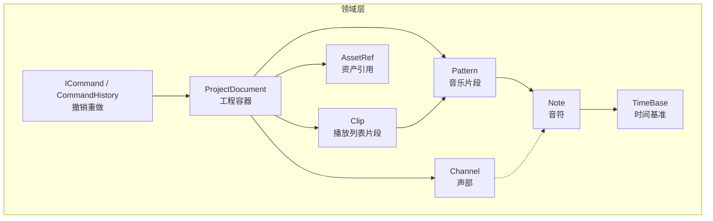

**图表来源**
- [ProjectDocument.cs:1-21](file://src/Weftone.Domain/ProjectDocument.cs#L1-L21)
- [Channel.cs:1-19](file://src/Weftone.Domain/Channel.cs#L1-L19)
- [Pattern.cs:1-9](file://src/Weftone.Domain/Pattern.cs#L1-L9)
- [Clip.cs:1-9](file://src/Weftone.Domain/Clip.cs#L1-L9)
- [Note.cs:1-12](file://src/Weftone.Domain/Note.cs#L1-L12)
- [TimeBase.cs:1-8](file://src/Weftone.Domain/TimeBase.cs#L1-L8)
- [AssetRef.cs:1-10](file://src/Weftone.Domain/AssetRef.cs#L1-L10)
- [ICommand.cs:1-12](file://src/Weftone.Domain/Commands/ICommand.cs#L1-L12)
- [CommandHistory.cs:1-99](file://src/Weftone.Domain/Commands/CommandHistory.cs#L1-L99)

**章节来源**
- [ProjectDocument.cs:1-21](file://src/Weftone.Domain/ProjectDocument.cs#L1-L21)
- [ADR-0006-project-format.md:1-23](file://docs/adr/ADR-0006-project-format.md#L1-L23)
- [M0_FOUNDATION.md:1-33](file://specs/M0_FOUNDATION.md#L1-L33)

## 核心实体与职责
- ProjectDocument：工程根容器，持有 Tempo、SampleRate、MasterVolume、Channels、Patterns、Playlist、Assets。
- Channel：声部通道，包含 Id、Name、Kind（Sine/Sampler）、Volume、Pan、可选 AssetId（用于 Sampler）。
- Pattern：音乐片段，包含 Id、Name、Notes。
- Clip：播放列表片段，包含 PatternId、StartTick，表示某 Pattern 在时间轴上的起始位置。
- Note：音符，包含 ChannelId、Tick、Key、Velocity、LengthTicks。
- AssetRef：资产引用，包含 Id、Path、Sha256，指向工程包 assets 下的内容。
- TimeBase：时间基准常量 PPQ=96，即每拍 tick 数。

这些实体共同构成“工程 → 声部/片段/播放列表/素材”的层次化数据结构，并通过 Tick 时间轴组织播放顺序。

**章节来源**
- [ProjectDocument.cs:1-21](file://src/Weftone.Domain/ProjectDocument.cs#L1-L21)
- [Channel.cs:1-19](file://src/Weftone.Domain/Channel.cs#L1-L19)
- [Pattern.cs:1-9](file://src/Weftone.Domain/Pattern.cs#L1-L9)
- [Clip.cs:1-9](file://src/Weftone.Domain/Clip.cs#L1-L9)
- [Note.cs:1-12](file://src/Weftone.Domain/Note.cs#L1-L12)
- [TimeBase.cs:1-8](file://src/Weftone.Domain/TimeBase.cs#L1-L8)
- [AssetRef.cs:1-10](file://src/Weftone.Domain/AssetRef.cs#L1-L10)

## 架构总览
领域模型通过“工程容器 + 实体集合”的方式组织数据；应用层负责编译为渲染计划，适配器层负责持久化到 zip+JSON 的工程格式。

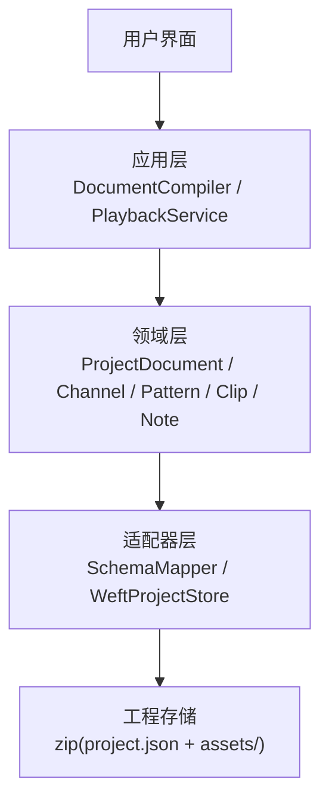

**图表来源**
- [ProjectDocument.cs:1-21](file://src/Weftone.Domain/ProjectDocument.cs#L1-L21)
- [SchemaMapper.cs:17-174](file://src/Weftone.Adapters.ProjectStore/SchemaMapper.cs#L17-L174)
- [ADR-0006-project-format.md:1-23](file://docs/adr/ADR-0006-project-format.md#L1-L23)

## 详细组件分析

### ProjectDocument：顶层工程容器
- 职责：承载工程级参数（Tempo、SampleRate、MasterVolume）和集合（Channels、Patterns、Playlist、Assets）。
- 关键约束：
  - Tempo 范围由 MinTempo 与 MaxTempo 限定。
  - MasterVolume 语义为 [0,2]，1.0 不衰减。
- 设计要点：作为富对象，直接暴露集合供命令修改，配合 CommandHistory 实现撤销/重做。

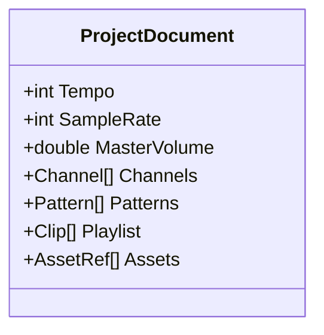

**图表来源**
- [ProjectDocument.cs:1-21](file://src/Weftone.Domain/ProjectDocument.cs#L1-L21)

**章节来源**
- [ProjectDocument.cs:1-21](file://src/Weftone.Domain/ProjectDocument.cs#L1-L21)

### Channel：声部通道
- 字段：
  - Id：唯一标识。
  - Name：显示名称。
  - Kind：音源类型（Sine、Sampler）。
  - Volume：音量 [0,2]。
  - Pan：线性声像 [-1,1]。
  - AssetId：当 Kind=Sampler 时，关联 AssetRef.Id。
- 业务规则：
  - Sampler 声部需绑定有效资产引用。
  - 混音参数影响最终输出响度与立体声定位。

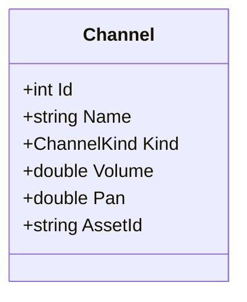

**图表来源**
- [Channel.cs:1-19](file://src/Weftone.Domain/Channel.cs#L1-L19)

**章节来源**
- [Channel.cs:1-19](file://src/Weftone.Domain/Channel.cs#L1-L19)

### Pattern：音乐片段
- 字段：
  - Id：唯一标识。
  - Name：片段名称。
  - Notes：音符集合。
- 业务规则：
  - Notes 中的每个 Note 引用一个 ChannelId，决定由哪个声部演奏。
  - 音符的时间以 Tick 为单位，长度以 LengthTicks 表达。

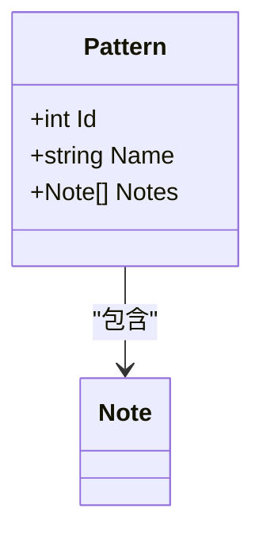

**图表来源**
- [Pattern.cs:1-9](file://src/Weftone.Domain/Pattern.cs#L1-L9)
- [Note.cs:1-12](file://src/Weftone.Domain/Note.cs#L1-L12)

**章节来源**
- [Pattern.cs:1-9](file://src/Weftone.Domain/Pattern.cs#L1-L9)
- [Note.cs:1-12](file://src/Weftone.Domain/Note.cs#L1-L12)

### Clip：播放列表片段
- 字段：
  - PatternId：引用的 Pattern。
  - StartTick：在时间轴上的起始位置（整 tick）。
- 业务规则：
  - Clip 本身不包含音符，仅声明 Pattern 的摆放位置。
  - 播放序列由 Playlist 中多个 Clip 的顺序决定。

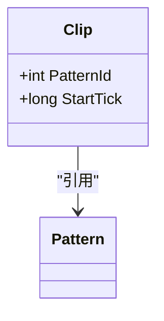

**图表来源**
- [Clip.cs:1-9](file://src/Weftone.Domain/Clip.cs#L1-L9)
- [Pattern.cs:1-9](file://src/Weftone.Domain/Pattern.cs#L1-L9)

**章节来源**
- [Clip.cs:1-9](file://src/Weftone.Domain/Clip.cs#L1-L9)

### Note：音符定义
- 字段：
  - ChannelId：目标声部。
  - Tick：起始拍位（PPQ 整数）。
  - Key：音高 0..127。
  - Velocity：力度 0..1。
  - LengthTicks：时长（默认一拍的 PPQ tick）。
- 业务规则：
  - Tick 与 LengthTicks 均以 TimeBase.Ppq 为基准单位。
  - Velocity 控制相对强度，结合 Channel.Volume 与 MasterVolume 参与最终混音。

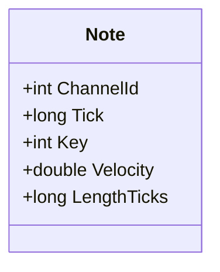

**图表来源**
- [Note.cs:1-12](file://src/Weftone.Domain/Note.cs#L1-L12)
- [TimeBase.cs:1-8](file://src/Weftone.Domain/TimeBase.cs#L1-L8)

**章节来源**
- [Note.cs:1-12](file://src/Weftone.Domain/Note.cs#L1-L12)

### AssetRef：资产引用
- 字段：
  - Id：资产标识。
  - Path：工程包内相对路径（assets/ 下）。
  - Sha256：内容哈希（小写十六进制）。
- 业务规则：
  - 与 Channel.AssetId 关联，确保 Sampler 声部能定位到具体音频资源。
  - 工程格式使用 SHA256 命名，保证内容完整性与可迁移性。

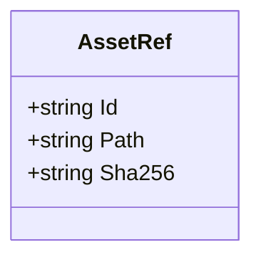

**图表来源**
- [AssetRef.cs:1-10](file://src/Weftone.Domain/AssetRef.cs#L1-L10)

**章节来源**
- [AssetRef.cs:1-10](file://src/Weftone.Domain/AssetRef.cs#L1-L10)

## 依赖关系分析
- ProjectDocument 聚合 Channel、Pattern、Clip、AssetRef。
- Pattern 聚合 Note。
- Clip 通过 PatternId 间接引用 Pattern。
- Note 通过 ChannelId 间接引用 Channel。
- TimeBase 被 Note 与应用层 TickMath 使用，提供 PPQ 常量。
- CommandHistory 对 ProjectDocument 执行 Apply/Revert，形成可编辑性与撤销/重做能力。

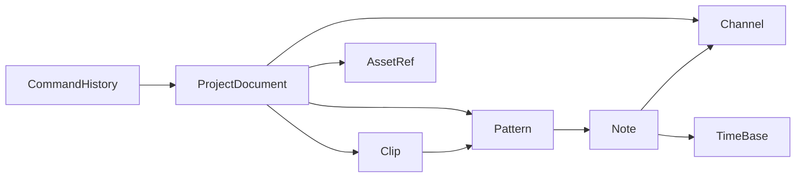

**图表来源**
- [ProjectDocument.cs:1-21](file://src/Weftone.Domain/ProjectDocument.cs#L1-L21)
- [Channel.cs:1-19](file://src/Weftone.Domain/Channel.cs#L1-L19)
- [Pattern.cs:1-9](file://src/Weftone.Domain/Pattern.cs#L1-L9)
- [Clip.cs:1-9](file://src/Weftone.Domain/Clip.cs#L1-L9)
- [Note.cs:1-12](file://src/Weftone.Domain/Note.cs#L1-L12)
- [TimeBase.cs:1-8](file://src/Weftone.Domain/TimeBase.cs#L1-L8)
- [CommandHistory.cs:1-99](file://src/Weftone.Domain/Commands/CommandHistory.cs#L1-L99)

**章节来源**
- [ProjectDocument.cs:1-21](file://src/Weftone.Domain/ProjectDocument.cs#L1-L21)
- [CommandHistory.cs:1-99](file://src/Weftone.Domain/Commands/CommandHistory.cs#L1-L99)

## 性能与时间系统
- 时间基准：TimeBase.Ppq=96，所有 Tick 均为整数拍位，便于确定性计算。
- BPM 与采样映射：
  - 应用层 TickMath.SamplesPerTick(sampleRate, tempo) 返回 (sampleRate*60, tempo*Ppq)。
  - TicksToSamples(ticks, numerator, denominator) 使用截断除法，保证确定性。
- 性能特性：
  - 整数运算避免浮点误差，适合实时与离线渲染。
  - 时间转换 O(1)，整体复杂度取决于音符数量与播放列表长度。

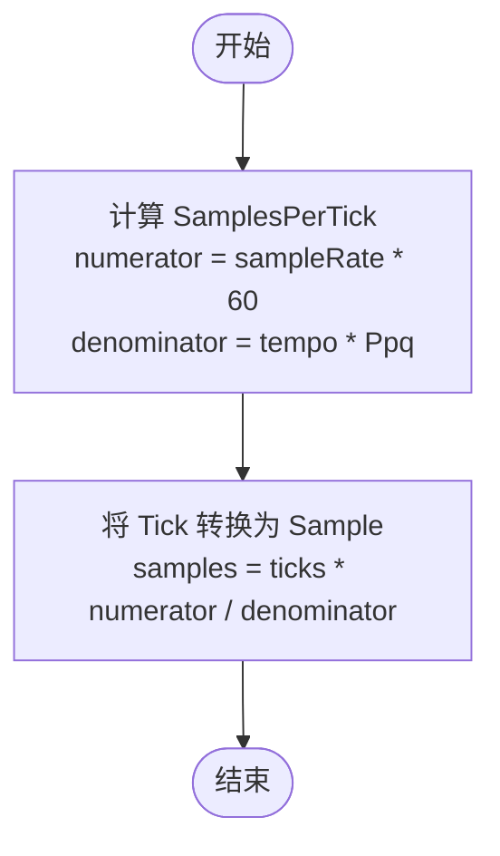

**图表来源**
- [TickMath.cs:1-13](file://src/Weftone.Application/TickMath.cs#L1-L13)
- [TimeBase.cs:1-8](file://src/Weftone.Domain/TimeBase.cs#L1-L8)

**章节来源**
- [TickMath.cs:1-13](file://src/Weftone.Application/TickMath.cs#L1-L13)
- [TimeBase.cs:1-8](file://src/Weftone.Domain/TimeBase.cs#L1-L8)

## 数据生命周期、验证与约束
- 生命周期：
  - 创建：通过命令（如 AddChannel/AddPattern/AddClip/AddNote）构建工程。
  - 编辑：命令 Apply 修改 ProjectDocument 状态。
  - 撤销/重做：CommandHistory 管理 Undo/Redo 栈。
  - 持久化：SchemaMapper 将 ProjectDocument 映射为 JSON，并写入 zip 工程包。
- 验证与约束：
  - Tempo 必须在 MinTempo 与 MaxTempo 之间，否则 SchemaMapper 抛出错误。
  - MasterVolume 语义为 [0,2]，UI 与命令应遵守该范围。
  - Note.Key 应在 0..127，Velocity 在 0..1，LengthTicks 至少为 PPQ。
  - Channel.Kind=Sine/Sampler，Sampler 需绑定有效 AssetId。
  - Clip.StartTick 为非负整数 tick。
  - AssetRef.Path 为工程内相对路径，Sha256 为小写十六进制。

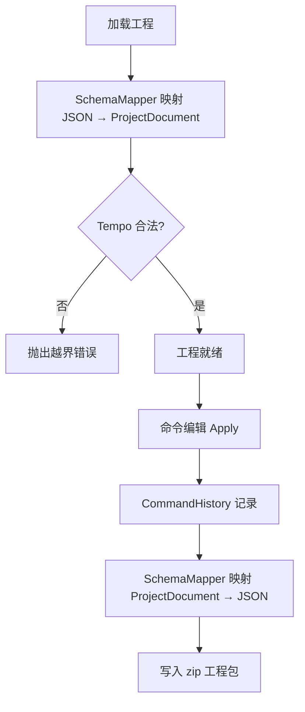

**图表来源**
- [SchemaMapper.cs:17-174](file://src/Weftone.Adapters.ProjectStore/SchemaMapper.cs#L17-L174)
- [CommandHistory.cs:1-99](file://src/Weftone.Domain/Commands/CommandHistory.cs#L1-L99)
- [ADR-0006-project-format.md:1-23](file://docs/adr/ADR-0006-project-format.md#L1-L23)

**章节来源**
- [SchemaMapper.cs:17-174](file://src/Weftone.Adapters.ProjectStore/SchemaMapper.cs#L17-L174)
- [ADR-0006-project-format.md:1-23](file://docs/adr/ADR-0006-project-format.md#L1-L23)

## 撤销重做与可编辑性
- 命令接口 ICommand 要求 Apply/Revert 精确互逆。
- CommandHistory 维护撤销栈与重做栈：
  - Execute：Apply 后入撤销栈，清空重做栈。
  - BeginTransaction/EndTransaction：合并多次操作为一次撤销记录。
  - Undo/Redo：分别调用 Revert/Apply，并交换栈。
  - Clear：载入新工程时清空栈。
- 事务支持拖拽等复杂手势的多步合并，提升用户体验。

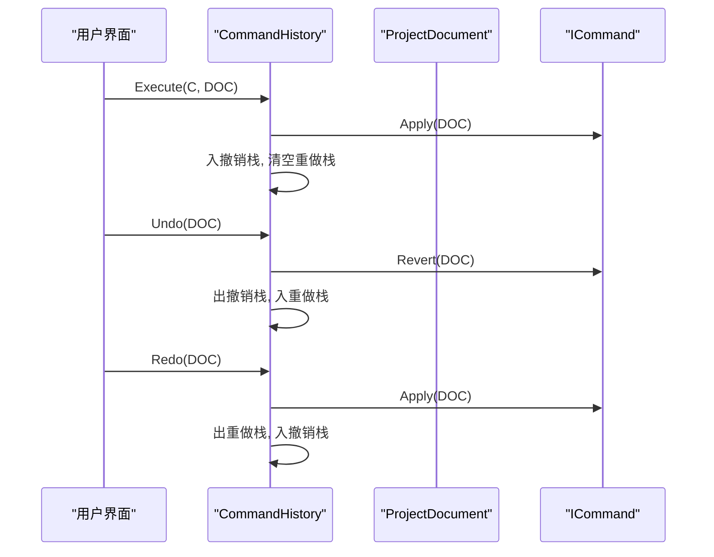

**图表来源**
- [CommandHistory.cs:1-99](file://src/Weftone.Domain/Commands/CommandHistory.cs#L1-L99)
- [ICommand.cs:1-12](file://src/Weftone.Domain/Commands/ICommand.cs#L1-L12)

**章节来源**
- [CommandHistory.cs:1-99](file://src/Weftone.Domain/Commands/CommandHistory.cs#L1-L99)
- [ICommand.cs:1-12](file://src/Weftone.Domain/Commands/ICommand.cs#L1-L12)

## 示例数据与可视化
以下示例展示一个最小可用工程的结构关系（概念性示例，非代码片段）：
- 工程：Tempo=120，SampleRate=48000，MasterVolume=1.0
- 声部：
  - Ch1：Kind=Sine，Volume=1.0，Pan=0
  - Ch2：Kind=Sampler，Volume=0.8，Pan=-0.3，AssetId="kick.wav"
- 片段：
  - Pt1：Notes=[N1(ChannelId=Ch1, Tick=0, Key=60, Velocity=1.0, LengthTicks=96), N2(ChannelId=Ch2, Tick=96, Key=36, Velocity=0.9, LengthTicks=96)]
- 播放列表：
  - Cl1：PatternId=Pt1, StartTick=0
  - Cl2：PatternId=Pt1, StartTick=96*4

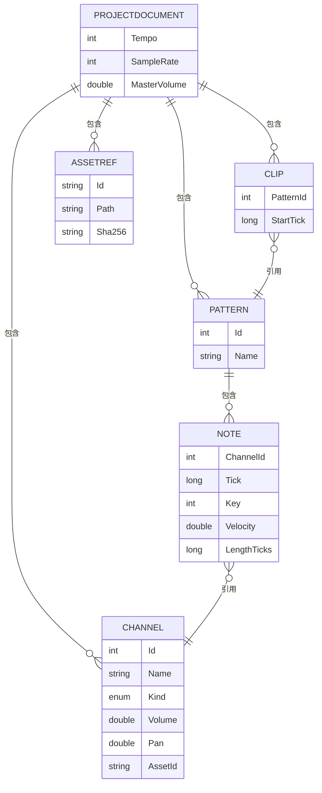

[本图为概念性实体关系图，不直接对应具体源码文件，故不提供图表来源]

## 故障排查
- Tempo 越界：
  - 现象：保存或加载工程时报错。
  - 原因：Tempo 不在 MinTempo..MaxTempo 范围内。
  - 处理：调整 Tempo 至合法区间。
- 空撤销/重做栈：
  - 现象：调用 Undo/Redo 抛异常。
  - 原因：无历史记录或事务进行中。
  - 处理：先执行编辑命令，或在非事务状态下调用。
- 资产缺失：
  - 现象：Sampler 声部无声或报错。
  - 原因：Channel.AssetId 未指向有效 AssetRef。
  - 处理：确保 AssetRef.Path 与 Sha256 正确，且工程包中包含该资产。

**章节来源**
- [SchemaMapper.cs:173-174](file://src/Weftone.Adapters.ProjectStore/SchemaMapper.cs#L173-L174)
- [CommandHistory.cs:61-89](file://src/Weftone.Domain/Commands/CommandHistory.cs#L61-L89)

## 结论
Weftone 的领域模型以 ProjectDocument 为核心，围绕 Channel、Pattern、Clip、Note、AssetRef 构建清晰的层次结构，并通过 TimeBase 与 TickMath 提供确定性的时间系统。命令模式与 CommandHistory 赋予模型完整的可编辑性与撤销/重做能力，适配层则负责将领域对象持久化为开放、可迁移的工程格式。该设计兼顾了易用性、可测试性与可扩展性，为后续功能演进奠定了坚实基础。